# School Management System — System Design & PostgreSQL Data Model

| Item | Value |
|---|---|
| Source spec | `School_Management_Software_Feature_List_and_Technical_Specification.pdf` (EMSL/LIS/SMS/2026-10 v1.0) |
| Reference customer | Lighthouse International School (Dhanmondi, Gulshan, Lalmatia; 1,100+ students → 3,000+ headroom) |
| Back-end | Node.js 24 LTS · Express 5 · TypeScript (strict) · class-based controllers / use cases |
| Architecture | Clean Architecture inside a **Modular Monolith** (one deployable, 21 bounded modules) |
| Database | PostgreSQL 18 (min 16) · Redis 7 / Valkey · S3-compatible object storage |
| UI | Next.js (App Router) + React + TypeScript — staff web app, parent/student portal, public website |
| Status | Design baseline v1.0 — 23 Oct 2026 |

> **Stack note.** The PDF (§5.3) recommends ASP.NET Core + React; it explicitly allows alternative stacks provided the
> functional scope, security controls and NFRs stay unchanged. This document keeps every requirement and re-targets
> the implementation to Node.js/Express + PostgreSQL + Next.js. "nest js" for the UI is interpreted as **Next.js**
> (the spec already uses Next.js for the public website). If NestJS was intended for the back end, every layer below
> maps 1:1 (NestJS modules ≈ our modules, providers ≈ our use-case/repository classes).

---

## Table of Contents

1. [Requirement analysis](#1-requirement-analysis)
2. [Architecture overview](#2-architecture-overview)
3. [Technology stack](#3-technology-stack)
4. [Modular monolith & clean architecture](#4-modular-monolith--clean-architecture)
5. [Multi-campus tenancy & security model](#5-multi-campus-tenancy--security-model)
6. [PostgreSQL data modeling](#6-postgresql-data-modeling)
7. [Back-end implementation design (class-based)](#7-back-end-implementation-design-class-based)
8. [API design & endpoint catalogue](#8-api-design--endpoint-catalogue)
9. [Key end-to-end flows](#9-key-end-to-end-flows)
10. [Background jobs, events & integrations](#10-background-jobs-events--integrations)
11. [Front-end design (Next.js)](#11-front-end-design-nextjs)
12. [Non-functional requirements → design](#12-non-functional-requirements--design)
13. [Security & privacy](#13-security--privacy)
14. [DevOps, environments & observability](#14-devops-environments--observability)
15. [Testing & quality gates](#15-testing--quality-gates)
16. [Delivery roadmap](#16-delivery-roadmap)
17. [Architecture decision records](#17-architecture-decision-records)
18. [Open questions & risks](#18-open-questions--risks)

---

## 1. Requirement analysis

### 1.1 What the system is

One platform replacing registers, spreadsheets, separate fee software and WhatsApp groups for a **single organisation
with several campuses**. Every campus has its own head, office and accounts desk, but policies, fee rules, grading and
reporting are shared. The organisation is future-proofed for sister schools (`organisation_id`).

### 1.2 Module inventory (21 modules, 172 features)

| Code | Module | P1 | P2 | P3 | Schema | Core aggregates |
|---|---|---|---|---|---|---|
| CORE | Platform, Administration & Security | 11 | 2 | 0 | `core`, `iam`, `audit`, `wf`, `sys` | Organisation, Campus, AcademicYear, User, Role, ApprovalRequest, AuditEvent |
| ADM | Enquiry, Admission & Enrolment | 8 | 2 | 0 | `adm` | Enquiry, Application, TestSession, MeritList, Offer |
| SIS | Student Information System | 7 | 2 | 1 | `sis` | Student, Guardian, Family, Enrolment, Withdrawal |
| ACA | Academic Structure, Timetable & Calendar | 7 | 2 | 0 | `aca` | Programme, ClassSection, TeachingGroup, Timetable, Substitution |
| ATT | Attendance & Leave | 6 | 2 | 0 | `att` | DailyAttendance, PeriodAttendance, LeaveRequest, StaffAttendance |
| LRN | Teaching, Learning & e-Classroom | 4 | 4 | 1 | `lrn` | Homework, Submission, ClassDiary, GradebookItem |
| EXM | Examination, Assessment & Reports | 7 | 3 | 2 | `exm` | Exam, ExamPaper, MarkEntry, GradingScheme, ReportCard, ExternalEntry |
| FEE | Fees, Billing & Payments | 8 | 3 | 0 | `fee` | FeeStructure, Invoice, Payment, GatewayTransaction, Refund |
| ACC | Accounts, Budget & Procurement | 0 | 3 | 3 | `acc` | Journal, Account, Budget, PurchaseOrder |
| HRM | Staff, HR & Payroll | 3 | 4 | 1 | `hrm` | Staff, Contract, PayrollRun, Payslip |
| COM | Communication & Engagement | 5 | 5 | 0 | `com` | Notice, MessageTemplate, OutboundMessage, Conversation |
| PRT | Portals & Mobile Apps | 9 | 1 | 0 | (no own data — composes APIs) + `prt` consents | FormConsent |
| TRN | Transport | 0 | 3 | 3 | `trn` | Route, Vehicle, TransportAssignment |
| LIB | Library | 0 | 4 | 2 | `lib` | BookTitle, BookCopy, Circulation |
| INV | Inventory, Store, Uniform & Assets | 0 | 3 | 3 | `inv` | Item, Store, StockMovement, Asset, Ticket |
| HLT | Health, Welfare & Pastoral Care | 2 | 5 | 0 | `hlt` | HealthProfile, SickbayVisit, BehaviourIncident, SafeguardingConcern |
| CCA | Co-curricular, Houses, Events, Islamic Values | 1 | 5 | 2 | `cca` | House, Club, Event, QuranProgress |
| SEC | Security, Visitors & Safe Pick-up | 0 | 3 | 2 | `sec` | Visit, PickupAuthorisation, GateEvent |
| DOC | Certificates, Letters & Documents | 4 | 1 | 0 | `doc` | DocumentTemplate, IssuedDocument |
| WEB | Public Website & CMS Integration | 4 | 2 | 0 | `web` | NewsPost, GalleryAlbum, ApiClient |
| BI | Dashboards, MIS & Reports | 3 | 3 | 1 | `bi` | KPI snapshots, SavedReport, ScheduledReport |
| | **Total** | **89** | **62** | **21** | | |

### 1.3 User groups and channels

| User group | Main needs | Channel | Default data scope |
|---|---|---|---|
| Principal, campus heads, governing body | Dashboards, approvals, campus comparison | Web, mobile summary | Org / own campus |
| Heads of section / department | Timetable, cover, moderation, discipline | Web | Section / department |
| Teachers | Attendance, homework, marks, lesson plans, leave | Teacher app, web | Own classes / own subjects |
| Admission & front office | Enquiries, tests, certificates, visitors | Web | Campus |
| Accounts & cashiers | Invoices, collection, reconciliation | Web | Campus |
| HR | Staff records, leave, payroll | Web | Org / campus |
| Exam office | Schedules, seating, marks, report cards, Edexcel entries | Web | Campus / org |
| Librarian, store, transport, nurse, counsellor | Module operations | Web, scanner app | Campus |
| Parents / guardians | Attendance, homework, fees, results, notices | Parent app / PWA, SMS | Own children (all campuses) |
| Students (senior years) | Timetable, homework, resources, results | Student portal | Self |
| IT administrator | Users, roles, settings, integrations | Web admin | Org |

### 1.4 Critical business invariants (derived from the spec)

These drive the data model more than anything else.

| # | Invariant | Source | Enforced by |
|---|---|---|---|
| I-1 | Every transactional record carries `org_id` + `campus_id`; users only see allowed campuses | CORE-01, §5.4, §5.5 | Service-layer scope **and** PostgreSQL RLS |
| I-2 | Money exact to the paisa; never floating point | §5.4, §5.10 | `bigint` paisa columns, `Money` value object |
| I-3 | Fee postings and marks are **append-only**; corrections are reversing entries | §5.4 | Insert-only tables, `REVOKE UPDATE/DELETE`, reversal rows |
| I-4 | An invoice is marked paid only after webhook signature **and** server-to-server validation; callbacks idempotent | FEE-04, §5.5 | `gateway_transaction` state machine, unique `merchant_tran_id`, idempotency keys |
| I-5 | No duplicate payment; payment allocations never exceed invoice-line net | §5.10 | `CHECK (paid ≤ net)` maintained by trigger, row locks |
| I-6 | Marks locked after approval; re-open is controlled and audited | EXM-03 | Paper status machine + approval workflow + audit |
| I-7 | Results hidden until embargo date / publication | EXM-05 | `exam.published_at`, `result_embargo_until`, portal queries filter |
| I-8 | Receipt / invoice / admission / certificate numbers auto-generated, unique, gap-free per campus+year | CORE-07, FEE-06, DOC-03 | `core.number_sequence` row-locked counter |
| I-9 | No negative stock | §5.10, INV | Stock ledger + `CHECK (qty_on_hand >= 0)` on balance |
| I-10 | Audit trail: who/what/when/where with before/after values; tamper-evident | CORE-04 | Generic audit trigger + hash-chained seals |
| I-11 | One student → many guardians; siblings across campuses share one family login and combined fee view | SIS-02, PRT-08 | `sis.family`, `sis.student_guardian` |
| I-12 | Student history retained across section/campus transfers and year rollover | SIS-04, CORE-02 | `sis.enrolment` (one row per student per year/placement) |
| I-13 | Configuration over customisation: grading, fees, workflows, templates are data | §5.1 | Config tables, JSONB rules, versioned templates |
| I-14 | Bangla + English everywhere (UI, SMS, PDFs, search, sorting) | CORE-05, §5.1 | `_en`/`_bn` columns, ICU collation, trigram search, Bangla PDF fonts |
| I-15 | Confidential records (SEN, safeguarding, counselling) need break-glass logging | §5.5, SIS-08, HLT | Separate tables, restricted permissions, `iam.break_glass_access` |

### 1.5 Data volume & load estimate (design for 3,000 students, 400 staff; scale to 10,000)

| Data | Formula (3k students) | Rows / year | At 10k students |
|---|---|---|---|
| Daily attendance | 3,000 × 220 days | ~660 K | 2.2 M |
| Period attendance (senior) | 1,500 × 7 periods × 220 | ~2.3 M | 7.7 M |
| Device events (gate) | 3,400 people × 2 × 220 | ~1.5 M | 5 M |
| Mark entries | 3,000 × 9 subjects × 3 components × 6 exams × ~1.3 versions | ~630 K | 2.1 M |
| Invoices / lines | 3,000 × 12 / × 5 lines | 36 K / 180 K | 120 K / 600 K |
| Payments | ~40 K | 40 K | 130 K |
| Outbound messages | 3,000 families × ~40 msgs/month × 12 | ~1.5 M | 5 M |
| Audit events | all sensitive writes | 5–10 M | 20–30 M |

Conclusion: PostgreSQL on a single primary is ample. Only **attendance, device events, outbound messages, audit events**
need partitioning (by time) for retention and vacuum efficiency, not for raw size.

Peak load targets (§5.10): 500 concurrent users, 300 online payments/hour on due date, **1,500 simultaneous parent
logins at result publication**, 10,000 SMS/push per hour, 1,000 report-card PDFs in 10 minutes, API p95 < 500 ms.

### 1.6 Key end-to-end workflows

1. **Admission → enrolment**: enquiry → follow-up → online application + fee → test/interview → merit/waitlist → offer →
   acceptance + admission fee → student, enrolment, portal account, fee plan auto-created.
2. **Monthly fee cycle**: fee plan + concessions → bulk invoices → SMS/app with pay link → bKash/Nagad/card → webhook +
   validation → receipt → reminders → settlement reconciliation → ledger → dashboards.
3. **Examination cycle**: calendar → seating & admit cards → mark entry → moderation → lock → grading → bilingual PDF
   report cards → embargoed publication → notification → analysis.
4. **Daily attendance**: teacher/device marks → absent/late alerts within minutes → leave auto-reconciles → thresholds
   flag exam eligibility.

### 1.7 Gaps & ambiguities found in the spec (resolved here)

| Gap | Resolution in this design |
|---|---|
| Elective/IAL subjects mean a period's students can span several sections | Introduce **TeachingGroup** (subject class that may span sections); timetable and period attendance hang off it |
| "Append-only" marks vs. teacher editing before lock | Versioned `mark_entry` rows (`is_current`); edits create new versions; after lock only via approved re-open |
| Overpayment / advance payment (FEE-05) | Family **credit account** ledger (`fee.family_ledger`) instead of overpaying invoice lines |
| Global search across modules but "no module reads another's tables" | Event-fed read model `search.document` owned by a Search component of CORE |
| Tamper-evident audit with concurrent writers | Insert-only audit + periodic **hash-chained seal** batches |
| RLS + connection pooling | GUCs set with `set_config(..., true)` (transaction-local) — safe with PgBouncer transaction mode |
| Hijri dates with moon-sighting adjustment | `Intl` `islamic-umalqura` calendar + `core.hijri_adjustment` offsets per month |
| Permission matrix (§5.6) mixes action and data scope | Permission = `module.resource.action`; role-permission carries a `data_scope` |

---

## 2. Architecture overview

### 2.1 Context

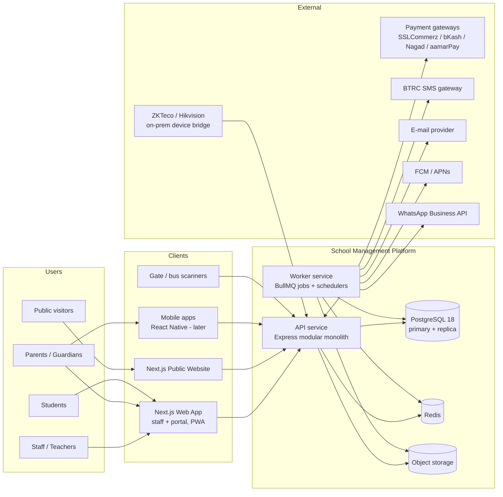

### 2.2 Deployment containers

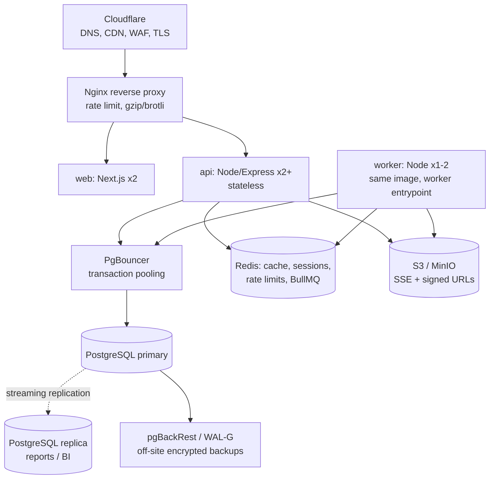

### 2.3 Architecture principles (spec §5.1 → implementation)

| Principle | How it is realised |
|---|---|
| One platform, many campuses | Single deployment; `campus_id` on every transactional row; RLS defence in depth |
| Modular monolith first | 21 modules = 21 folders + 21 PostgreSQL schemas; enforced import boundaries; extractable later |
| API-first | Web, mobile, public site, devices all use the same REST API documented with OpenAPI 3.1 generated from Zod |
| Mobile-first, low bandwidth | Small JSON payloads, field selection, ETags, gzip/brotli, cursor pagination, PWA offline queue |
| Secure by default, audited | Least privilege RBAC + data scopes; append-only audit; encryption in transit/at rest/column-level |
| Configuration over customisation | Grading, fee rules, workflows, templates, calendars, number formats are tables |
| Bangla and English everywhere | UTF-8, ICU collations, `_en`/`_bn` columns, next-intl, Noto Sans Bengali in PDFs |

---

## 3. Technology stack

| Area | Choice | Why |
|---|---|---|
| Runtime | **Node.js 24 LTS**, TypeScript 5.x `strict` | LTS until 2028; one language front to back |
| HTTP | **Express 5** (native async error handling) | Mature, minimal; we add structure via classes |
| DI container | **awilix** (CLASSIC injection, request scopes) | Constructor injection for class-based design without decorators/reflect-metadata |
| Validation & contracts | **Zod 4** + `@asteasolutions/zod-to-openapi` | One schema → runtime validation, TS types, OpenAPI, front-end forms |
| DB access | **Drizzle ORM** (type-safe query builder) + `pg` | Full SQL power (RLS, CTEs, partitions, `FOR UPDATE SKIP LOCKED`), no ORM magic; fits repository pattern |
| Migrations | **SQL-first migrations** (`db/tools/migrate.sh`, checksummed, ordered `.sql`) | DDL is reviewed as SQL; RLS, triggers, partitions are first-class |
| Type generation | `backend/scripts/gen-db-schema.ts` (Drizzle tables from the live schema) | DB types never drift from migrations |
| Cache / locks / rate limit | Redis 7 (or Valkey) via `ioredis`, `rate-limiter-flexible` | Sessions, throttling, idempotency fast-path |
| Queue / scheduler | **BullMQ 5** (job schedulers, rate limiter, retries, DLQ) + PostgreSQL **transactional outbox** | Guaranteed delivery of domain events and notifications |
| Auth | Built-in IAM module: argon2id, JWT (EdDSA) access 15 min + rotating refresh tokens, OTP, TOTP (`otplib`); OIDC SSO via `openid-client` (P2) | Standards-based; can be swapped for Keycloak later |
| PDFs | **Playwright (headless Chromium)** + HTML templates (Handlebars) + Noto Sans Bengali | Correct Bangla shaping (HarfBuzz) and pixel-perfect report cards |
| Excel / CSV | `exceljs`, `csv-parse` / `csv-stringify` (streaming) | Import/export with validation preview |
| QR / barcode | `qrcode`, `bwip-js` | Admit cards, receipts, certificate verification |
| Object storage | S3 API (`@aws-sdk/client-s3`) → AWS S3 / MinIO | Presigned uploads/downloads; never from web root |
| Antivirus | ClamAV (`clamd` sidecar) via job | Upload scanning (SIS-03) |
| Logging / tracing | `pino` (JSON) + OpenTelemetry → Prometheus, Grafana, Loki, Tempo; Sentry | §5.2 observability |
| UI | **Next.js (App Router)**, React 19, TypeScript, Tailwind CSS, shadcn/ui (Radix), TanStack Query + Table, React Hook Form + Zod, next-intl | Dense data entry, keyboard-first, i18n, SSR for portal |
| Mobile (later) | React Native (Expo) sharing `packages/contracts` | Spec §5.8 |
| Monorepo | pnpm workspaces + Turborepo | Shared contracts/UI, cached builds |
| Testing | Vitest, Supertest, Testcontainers (PostgreSQL/Redis), Playwright E2E, k6, OWASP ZAP, axe | Spec §5.3/§5.13 |
| CI/CD | GitHub Actions → Docker images → registry → rolling deploy | Spec §5.11 |

---

## 4. Modular monolith & clean architecture

### 4.1 Repository layout (pnpm + Turborepo)

```
school-platform/
├─ apps/
│  ├─ server/                 # ONE codebase, TWO entrypoints (api + worker), same Docker image
│  │  ├─ src/
│  │  │  ├─ main.http.ts      # starts Express API
│  │  │  ├─ main.worker.ts    # starts BullMQ workers, schedulers, outbox relay
│  │  │  ├─ bootstrap/        # container, module registry, express app factory, config
│  │  │  ├─ shared/           # shared kernel (NO business rules of any module)
│  │  │  └─ modules/          # 21 bounded modules
│  │  └─ test/
│  ├─ web/                    # Next.js: staff app + parent/student portal (+ PWA)
│  ├─ site/                   # Next.js public website (reads public API only)
│  └─ device-bridge/          # on-campus Node service for ZKTeco/Hikvision (P2), store-and-forward
├─ packages/
│  ├─ contracts/              # Zod schemas, DTO types, permission codes, event names, error codes
│  ├─ api-client/             # typed fetch client generated from OpenAPI (used by web, site, mobile)
│  ├─ ui/                     # design system (shadcn/ui based), Bangla-ready typography
│  ├─ i18n/                   # en / bn message catalogues
│  └─ config/                 # eslint, tsconfig, prettier presets
├─ db/
│  ├─ migrations/             # 0001_extensions.sql, 0002_core.sql, ... (SQL-first)
│  ├─ seeds/                  # roles, permissions, grading schemes, fee heads, templates
│  └─ policies/               # RLS policy SQL, grants
├─ infra/                     # docker-compose (dev), Dockerfiles, nginx, IaC, Grafana dashboards
└─ docs/                      # ADRs, runbooks, data dictionary, OpenAPI output
```

### 4.2 Module internal structure (Clean Architecture)

Every module follows the same 4 layers. Dependencies point **inwards only**.

```
modules/fee/
├─ domain/                         # pure TS: no Express, no Drizzle, no Redis
│  ├─ entities/        Invoice.ts, InvoiceLine.ts, Payment.ts, GatewayTransaction.ts
│  ├─ value-objects/   InvoiceStatus.ts, PaymentChannel.ts, BillingPeriod.ts
│  ├─ services/        ConcessionCalculator.ts, LateFeeCalculator.ts, AllocationPolicy.ts
│  ├─ events/          PaymentReceived.ts, InvoiceIssued.ts
│  ├─ errors/          InvoiceAlreadyPaidError.ts, OverAllocationError.ts
│  └─ repositories/    InvoiceRepository.ts (interface), PaymentRepository.ts (interface)
├─ application/                    # use cases = one class per business action
│  ├─ use-cases/       RecordCounterPayment.ts, StartOnlinePayment.ts, HandleGatewayCallback.ts,
│  │                   GenerateBillingRun.ts, PostBillingRun.ts, ApproveConcession.ts, ...
│  ├─ queries/         GetFamilyStatement.ts, ListDueInvoices.ts (read side, may use SQL directly)
│  ├─ ports/           PaymentGateway.ts (interface), ReceiptRenderer.ts
│  └─ dto/             (re-exports Zod contracts from packages/contracts)
├─ infrastructure/
│  ├─ persistence/     DrizzleInvoiceRepository.ts, DrizzlePaymentRepository.ts, mappers/
│  ├─ gateways/        SslCommerzGateway.ts, BkashGateway.ts, NagadGateway.ts (implement PaymentGateway)
│  └─ pdf/             PlaywrightReceiptRenderer.ts
├─ presentation/
│  ├─ http/            InvoiceController.ts, PaymentController.ts, GatewayWebhookController.ts
│  └─ jobs/            BillingRunJob.ts, FeeReminderJob.ts, SettlementImportJob.ts
├─ public-api/
│  └─ FeeModuleApi.ts  # the ONLY thing other modules may import (interface + DTOs)
└─ fee.module.ts       # ModuleDefinition: DI registrations, controllers, jobs, event subscriptions
```

| Layer | May depend on | Must NOT depend on |
|---|---|---|
| `domain` | `shared/domain` only | Express, Drizzle, Redis, other modules |
| `application` | own `domain`, `shared/application`, other modules' **`public-api`** | Express, Drizzle concrete classes |
| `infrastructure` | own `domain` + `application` ports, `shared/infrastructure` | `presentation` |
| `presentation` | own `application` (use cases / queries), `shared/http` | `infrastructure`, domain repositories |

Enforced in CI with **dependency-cruiser** (or `eslint-plugin-boundaries`):

```js
// .dependency-cruiser.cjs (excerpt)
forbidden: [
  { name: 'no-cross-module-internals',
    from: { path: '^src/modules/([^/]+)/' },
    to:   { path: '^src/modules/([^/]+)/(?!public-api)', pathNot: '^src/modules/$1/' } },
  { name: 'domain-is-pure',
    from: { path: '/domain/' },
    to:   { path: '(express|drizzle-orm|ioredis|bullmq|/infrastructure/|/presentation/)' } },
]
```

### 4.3 Module communication

| Style | When | Mechanism |
|---|---|---|
| **Synchronous call** | Caller needs an answer now (FEE asks SIS for a student's current enrolment) | Inject `SisModuleApi` (interface in `sis/public-api`); in-process call, same DB transaction |
| **Domain event (async)** | Side effects in other modules (absence → SMS, payment → ledger, enrolment → fee plan) | Event written to `sys.outbox_event` in the **same transaction**; relay publishes to BullMQ; subscribers idempotent |
| **Read model** | Cross-module search / dashboards | Event-fed tables (`search.document`, `bi.*`) owned by CORE / BI |

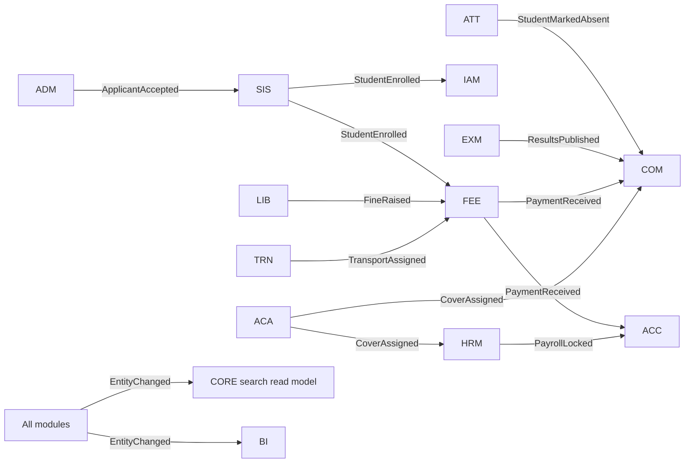

Cross-module **foreign keys** are allowed only towards *kernel* tables (`core.organisation`, `core.campus`,
`core.academic_year`, `iam.user_account`, `sis.student`, `sis.enrolment`, `hrm.staff`, `sys.stored_file`) for
referential integrity. Code never *queries* another module's schema — it calls the module's public API (ADR-008).

### 4.4 Module definition contract

```ts
// shared/application/ModuleDefinition.ts
export interface ModuleDefinition {
  readonly name: string;                                    // 'fee'
  register(container: AwilixContainer): void;               // DI registrations
  controllers?(): Array<Constructor<BaseController>>;       // HTTP
  jobs?(): Array<Constructor<JobHandler>>;                  // BullMQ processors
  subscriptions?(): Array<EventSubscription>;               // domain-event handlers
  schedules?(): Array<ScheduleDefinition>;                  // repeatable jobs
}
```

```ts
// bootstrap/module-registry.ts
export const MODULES: ModuleDefinition[] = [
  new CoreModule(), new IamModule(), new WorkflowModule(), new AuditModule(),
  new SisModule(), new AdmModule(), new AcaModule(), new AttModule(), new LrnModule(),
  new ExmModule(), new FeeModule(), new HrmModule(), new ComModule(), new DocModule(),
  new WebModule(), new BiModule(),
  // P2/P3 – feature-flagged per organisation (core.org_module)
  new TrnModule(), new LibModule(), new InvModule(), new HltModule(), new CcaModule(),
  new SecModule(), new AccModule(),
];
```

---

## 5. Multi-campus tenancy & security model

### 5.1 Scoping keys

| Key | Meaning | On which tables |
|---|---|---|
| `org_id` | Organisation (Lighthouse group; future sister schools) | Every business table |
| `campus_id` | Dhanmondi / Gulshan / Lalmatia / future | Every transactional table (nullable only for org-wide rows, e.g. a notice to all campuses) |
| `academic_year_id` | School year | Enrolment, sections, timetables, exams, fee structures, invoices |

### 5.2 Authorisation = permission × data scope × campus

* **Permission code**: `<module>.<resource>.<action>` e.g. `fee.invoice.create`, `exm.mark.approve`, `sis.student.export`.
  Actions: `view | create | edit | approve | export | delete`.
* **Data scope** (on the role↔permission link): `org | campus | section | own_classes | own_subjects | own_children | self`.
* **Role assignment** scoped to the `org` or one `campus` (a user may hold different roles on different campuses).

Resolved at login, cached in Redis (`authz:{userId}:{authzVersion}`), attached to the request:

```ts
export interface RequestContext {
  requestId: string;
  user: { id: string; type: 'staff' | 'guardian' | 'student' | 'system'; orgId: string; locale: 'en' | 'bn' };
  campusIds: string[] | '*';                     // union of campus scopes
  activeCampusId?: string;                       // from X-Campus-Id header (validated against campusIds)
  grants: Map<PermissionCode, DataScope[]>;      // 'att.daily.edit' -> ['own_classes']
  staffId?: string; guardianId?: string; studentId?: string;
  ip: string; userAgent: string;
}
```

### 5.3 Defence in depth

1. **Route guard** — `permission: 'exm.mark.edit'` on the route → 403 if not granted.
2. **Use-case guard** — `ScopePolicy` checks data scope (teacher allocated to that teaching group; guardian linked to
   that student) → prevents IDOR.
3. **Repository filter** — list/get queries are built through a `ScopedQuery` helper adding campus/section predicates.
4. **PostgreSQL RLS** — even if 1–3 have a bug, other campuses' rows are invisible to the application DB role.

```sql
-- Set by the API at the start of every transaction (transaction-local => safe with PgBouncer transaction mode)
SELECT set_config('app.org_id',     $1, true),
       set_config('app.user_id',    $2, true),
       set_config('app.campus_ids', $3, true),   -- '*' or comma-separated uuids
       set_config('app.request_id', $4, true);
```

```sql
CREATE FUNCTION core.campus_visible(p_org uuid, p_campus uuid) RETURNS boolean
LANGUAGE sql STABLE PARALLEL SAFE AS $$
  SELECT p_org = current_setting('app.org_id')::uuid
     AND CASE                                                    -- CASE guarantees order; OR does not short-circuit
           WHEN current_setting('app.campus_ids', true) = '*' THEN true
           WHEN p_campus IS NULL THEN true                       -- org-wide rows
           ELSE p_campus = ANY (string_to_array(current_setting('app.campus_ids', true), ',')::uuid[])
         END;
$$;

-- Applied to every campus-scoped table by a migration helper: SELECT core.enable_campus_rls('fee.invoice');
ALTER TABLE fee.invoice ENABLE ROW LEVEL SECURITY;
ALTER TABLE fee.invoice FORCE  ROW LEVEL SECURITY;
CREATE POLICY p_campus ON fee.invoice
  USING      (core.campus_visible(org_id, campus_id))
  WITH CHECK (core.campus_visible(org_id, campus_id));
```

Database roles:

| Role | Rights |
|---|---|
| `sms_owner` | Owns schemas; used only by migrations |
| `sms_app` | DML on module tables, **INSERT-only** on append-only tables; `NOBYPASSRLS` |
| `sms_worker` | Like `sms_app`; system jobs run with `app.campus_ids='*'` and the system user id |
| `sms_readonly` | Replica reporting role (BI, ad-hoc report builder); RLS still applies |
| `sms_audit_sealer` | `SELECT` on audit + `INSERT` on seals only |

Guardian/student "own children / self" scope is enforced in layers 2–3 (RLS is campus-level only, because one family
spans campuses).

---

## 6. PostgreSQL data modeling

> **Implementation:** the runnable schema lives in [`db/`](db/README.md) (migrations, seeds, invariant tests) and is
> documented in [`docs/database/README.md`](docs/database/README.md) with a generated data dictionary. This section
> explains the design; where details differ (helper procedures, Phase 2/3 tables), `db/migrations` is authoritative.

### 6.1 Modeling conventions

| Topic | Rule | Reason |
|---|---|---|
| Schemas | One schema per module (`core`, `iam`, `audit`, `wf`, `sys`, `search`, `sis`, `adm`, `aca`, `att`, `lrn`, `exm`, `fee`, `acc`, `hrm`, `com`, `prt`, `doc`, `web`, `bi`, `trn`, `lib`, `inv`, `hlt`, `cca`, `sec`) | Ownership, grants, future extraction (§5.1) |
| Primary keys | `uuid DEFAULT uuidv7()` (PG 18 built-in; app-generated v7 on PG 16/17). High-volume append tables use `bigint GENERATED ALWAYS AS IDENTITY` | Time-ordered UUIDs → B-tree friendly, safe to expose, mergeable across sister schools |
| Names | `snake_case`, singular table names, FK = `<entity>_id` | Consistency |
| Bilingual text | `name_en` / `name_bn` (and `title_*`, `body_*`) | Simple, indexable, sortable with the right collation |
| Money | `bigint` **paisa** (`core.paisa` domain); amounts never `numeric` floats | Exact to the paisa (I-2) |
| Percent / marks | `numeric(5,2)` / `numeric(6,2)` | Exact decimal |
| Time | `timestamptz` stored in UTC; `date` for school days; display Asia/Dhaka | §5.4 |
| Status fields | `text` + `CHECK (... IN ...)` for code-owned state machines; **lookup tables** for school-configurable lists | Enum changes need no `ALTER TYPE`; config stays data (I-13) |
| Standard columns | `LIKE core.std_cols INCLUDING DEFAULTS` → `created_at, created_by, updated_at, updated_by, row_version` | Audit + optimistic concurrency (`If-Match`) |
| Soft delete | `deleted_at timestamptz` only on master data with legal retention (students, guardians, staff, documents) + partial unique indexes `WHERE deleted_at IS NULL` | Keep history, allow re-use of codes |
| Append-only | Marks, payments, allocations, ledgers, stock movements, audit: no `UPDATE/DELETE` grants; corrections = reversal rows | I-3 |
| Flexible data | `jsonb` only for genuinely variable shape (form answers, rule config, provider payloads) — never for queried relational data | Avoid hidden schemas |
| Partitioning | Range by date for attendance, device events, outbound messages, audit, GPS pings (`pg_partman` maintains) | Retention, vacuum, archive (CORE-13) |
| Sensitive fields | NID / birth-cert / health / bank: `bytea` AES-256-GCM ciphertext (app-level, KMS key) + `*_bidx` HMAC blind index for exact search | §5.5 column-level encryption |
| Search | `pg_trgm` GIN on normalised search text (English + Bangla + IDs + phones) | CORE-08 global search |
| Sorting | ICU collations `core.bn_bd` and `core.en_natural` | Bangla sorting; "Year 2" < "Year 10" |

### 6.2 Foundation: extensions, domains, helpers

```sql
-- 0001_foundation.sql
CREATE SCHEMA core; CREATE SCHEMA iam; CREATE SCHEMA audit; CREATE SCHEMA wf; CREATE SCHEMA sys;
CREATE SCHEMA search; CREATE SCHEMA sis; CREATE SCHEMA adm; CREATE SCHEMA aca; CREATE SCHEMA att;
CREATE SCHEMA lrn; CREATE SCHEMA exm; CREATE SCHEMA fee; CREATE SCHEMA acc; CREATE SCHEMA hrm;
CREATE SCHEMA com; CREATE SCHEMA prt; CREATE SCHEMA doc; CREATE SCHEMA web; CREATE SCHEMA bi;
CREATE SCHEMA trn; CREATE SCHEMA lib; CREATE SCHEMA inv; CREATE SCHEMA hlt; CREATE SCHEMA cca; CREATE SCHEMA sec;

CREATE EXTENSION IF NOT EXISTS citext;
CREATE EXTENSION IF NOT EXISTS pg_trgm;
CREATE EXTENSION IF NOT EXISTS btree_gist;          -- exclusion constraints on (uuid, range)
CREATE EXTENSION IF NOT EXISTS pgcrypto;            -- digest() for audit seals, gen_random_bytes()
CREATE EXTENSION IF NOT EXISTS pg_partman;          -- partition maintenance
CREATE EXTENSION IF NOT EXISTS pg_stat_statements;

CREATE COLLATION core.bn_bd      (provider = icu, locale = 'bn-BD');
CREATE COLLATION core.en_natural (provider = icu, locale = 'en-u-kn-true');   -- numeric-aware

CREATE DOMAIN core.paisa       AS bigint;                                     -- signed (adjustments)
CREATE DOMAIN core.paisa_nn    AS bigint        CHECK (VALUE >= 0);
CREATE DOMAIN core.percent     AS numeric(5,2)  CHECK (VALUE BETWEEN 0 AND 100);
CREATE DOMAIN core.locale      AS text          CHECK (VALUE IN ('en','bn'));
CREATE DOMAIN core.phone_e164  AS text          CHECK (VALUE ~ '^\+[1-9][0-9]{7,14}$');

CREATE FUNCTION core.current_user_id() RETURNS uuid LANGUAGE sql STABLE AS
$$ SELECT nullif(current_setting('app.user_id', true), '')::uuid $$;

-- Template for standard columns: CREATE TABLE x (..., LIKE core.std_cols INCLUDING DEFAULTS)
CREATE TABLE core.std_cols (
  created_at  timestamptz NOT NULL DEFAULT now(),
  created_by  uuid                 DEFAULT core.current_user_id(),
  updated_at  timestamptz NOT NULL DEFAULT now(),
  updated_by  uuid,
  row_version integer     NOT NULL DEFAULT 1
);
REVOKE ALL ON core.std_cols FROM PUBLIC;

CREATE FUNCTION core.tg_touch() RETURNS trigger LANGUAGE plpgsql AS $$
BEGIN
  NEW.updated_at  := now();
  NEW.updated_by  := core.current_user_id();
  NEW.row_version := OLD.row_version + 1;
  RETURN NEW;
END $$;

-- Helper used by every migration: touch trigger + optional audit trigger + campus RLS
CREATE PROCEDURE core.standardize(p_table regclass, p_audit boolean, p_campus_rls boolean,
                                  p_redact text[] DEFAULT '{}')
LANGUAGE plpgsql AS $$
BEGIN
  EXECUTE format('CREATE TRIGGER trg_touch BEFORE UPDATE ON %s FOR EACH ROW EXECUTE FUNCTION core.tg_touch()', p_table);
  IF p_audit THEN
    EXECUTE format('CREATE TRIGGER trg_audit AFTER INSERT OR UPDATE OR DELETE ON %s
                    FOR EACH ROW EXECUTE FUNCTION audit.tg_row_audit(%s)',
                   p_table, array_to_string(array(SELECT quote_literal(x) FROM unnest(p_redact) x), ','));
  END IF;
  IF p_campus_rls THEN
    EXECUTE format('ALTER TABLE %s ENABLE ROW LEVEL SECURITY', p_table);
    EXECUTE format('ALTER TABLE %s FORCE ROW LEVEL SECURITY', p_table);
    EXECUTE format('CREATE POLICY p_campus ON %s USING (core.campus_visible(org_id, campus_id))
                    WITH CHECK (core.campus_visible(org_id, campus_id))', p_table);
  END IF;
END $$;
```

> In the module DDL below, `-- std(audit, rls)` after a table means
> `CALL core.standardize('<table>', true, true);` is executed in the same migration.

### 6.3 CORE — organisation, campuses, calendar, settings, numbering

```sql
CREATE TABLE core.organisation (
  id        uuid PRIMARY KEY DEFAULT uuidv7(),
  code      text NOT NULL UNIQUE,
  name_en   text NOT NULL,
  name_bn   text,
  timezone  text NOT NULL DEFAULT 'Asia/Dhaka',
  currency  char(3) NOT NULL DEFAULT 'BDT',
  settings  jsonb NOT NULL DEFAULT '{}',          -- default locale, Hijri display, branding
  LIKE core.std_cols INCLUDING DEFAULTS
);

CREATE TABLE core.campus (
  id                 uuid PRIMARY KEY DEFAULT uuidv7(),
  org_id             uuid NOT NULL REFERENCES core.organisation(id),
  code               text NOT NULL,              -- DHN, GUL, LAL
  name_en            text NOT NULL,
  name_bn            text,
  address_en         text,
  address_bn         text,
  phone              core.phone_e164,
  email              citext,
  letterhead_file_id uuid,
  signature_file_id  uuid,
  is_active          boolean NOT NULL DEFAULT true,
  LIKE core.std_cols INCLUDING DEFAULTS,
  UNIQUE (org_id, code)
);

CREATE TABLE core.org_module (                     -- feature switches per phase
  org_id      uuid NOT NULL REFERENCES core.organisation(id),
  module_code text NOT NULL,                       -- 'trn','lib','inv',...
  enabled     boolean NOT NULL DEFAULT false,
  enabled_at  timestamptz,
  PRIMARY KEY (org_id, module_code)
);

CREATE TABLE core.academic_year (
  id         uuid PRIMARY KEY DEFAULT uuidv7(),
  org_id     uuid NOT NULL REFERENCES core.organisation(id),
  code       text NOT NULL,                        -- '2026-27'
  starts_on  date NOT NULL,
  ends_on    date NOT NULL,
  status     text NOT NULL DEFAULT 'planned'
             CHECK (status IN ('planned','open','closing','locked','archived')),
  is_current boolean NOT NULL DEFAULT false,
  LIKE core.std_cols INCLUDING DEFAULTS,
  UNIQUE (org_id, code),
  CHECK (ends_on > starts_on),
  EXCLUDE USING gist (org_id WITH =, daterange(starts_on, ends_on, '[]') WITH &&)
);
CREATE UNIQUE INDEX ux_academic_year_current ON core.academic_year (org_id) WHERE is_current;

CREATE TABLE core.term (
  id               uuid PRIMARY KEY DEFAULT uuidv7(),
  academic_year_id uuid NOT NULL REFERENCES core.academic_year(id) ON DELETE CASCADE,
  seq              smallint NOT NULL,
  code             text NOT NULL,                  -- T1, T2, T3
  name_en          text NOT NULL,
  name_bn          text,
  starts_on        date NOT NULL,
  ends_on          date NOT NULL,
  LIKE core.std_cols INCLUDING DEFAULTS,
  UNIQUE (academic_year_id, seq),
  EXCLUDE USING gist (academic_year_id WITH =, daterange(starts_on, ends_on, '[]') WITH &&)
);

CREATE TABLE core.shift (
  id        uuid PRIMARY KEY DEFAULT uuidv7(),
  org_id    uuid NOT NULL,
  campus_id uuid NOT NULL REFERENCES core.campus(id),
  code      text NOT NULL,                         -- MORNING, DAY
  name_en   text NOT NULL,
  name_bn   text,
  starts_at time NOT NULL,
  ends_at   time NOT NULL,
  LIKE core.std_cols INCLUDING DEFAULTS,
  UNIQUE (campus_id, code)
);  -- std(rls)

CREATE TABLE core.room (
  id        uuid PRIMARY KEY DEFAULT uuidv7(),
  org_id    uuid NOT NULL,
  campus_id uuid NOT NULL REFERENCES core.campus(id),
  code      text NOT NULL,
  name      text NOT NULL,
  room_type text NOT NULL CHECK (room_type IN ('classroom','lab','ict_lab','hall','library','playground','office','other')),
  capacity  smallint,
  exam_capacity smallint,
  is_bookable boolean NOT NULL DEFAULT false,
  LIKE core.std_cols INCLUDING DEFAULTS,
  UNIQUE (campus_id, code)
);  -- std(rls)

CREATE TABLE core.calendar_event (                 -- ACA-06 academic calendar + holidays
  id               uuid PRIMARY KEY DEFAULT uuidv7(),
  org_id           uuid NOT NULL,
  campus_id        uuid REFERENCES core.campus(id), -- NULL = all campuses
  academic_year_id uuid NOT NULL REFERENCES core.academic_year(id),
  kind             text NOT NULL CHECK (kind IN ('holiday_national','holiday_islamic','holiday_school',
                                                 'exam_window','ptm','event','term_break','ramadan_routine')),
  title_en         text NOT NULL,
  title_bn         text,
  starts_on        date NOT NULL,
  ends_on          date NOT NULL,
  is_instructional boolean NOT NULL DEFAULT false, -- false => no attendance expected
  audience         text NOT NULL DEFAULT 'all' CHECK (audience IN ('all','staff','students')),
  is_tentative     boolean NOT NULL DEFAULT false, -- moon-sighting dependent
  publish_to_web   boolean NOT NULL DEFAULT false,
  LIKE core.std_cols INCLUDING DEFAULTS,
  CHECK (ends_on >= starts_on)
);  -- std(audit, rls)
CREATE INDEX ix_calendar_event_range ON core.calendar_event USING gist (org_id, daterange(starts_on, ends_on, '[]'));

CREATE TABLE core.hijri_adjustment (               -- CCA-07 moon-sighting offsets
  org_id         uuid NOT NULL,
  hijri_year     smallint NOT NULL,
  hijri_month    smallint NOT NULL CHECK (hijri_month BETWEEN 1 AND 12),
  offset_days    smallint NOT NULL CHECK (offset_days BETWEEN -2 AND 2),
  PRIMARY KEY (org_id, hijri_year, hijri_month)
);

CREATE TABLE core.lookup_value (                   -- configurable dropdowns (occupations, doc types, lost reasons...)
  id        uuid PRIMARY KEY DEFAULT uuidv7(),
  org_id    uuid NOT NULL,
  list_code text NOT NULL,
  code      text NOT NULL,
  label_en  text NOT NULL,
  label_bn  text,
  seq       smallint NOT NULL DEFAULT 0,
  is_active boolean NOT NULL DEFAULT true,
  meta      jsonb NOT NULL DEFAULT '{}',
  UNIQUE (org_id, list_code, code)
);

CREATE TABLE core.setting (                        -- CORE-06 master settings (typed via JSON schema in app)
  org_id    uuid NOT NULL,
  campus_id uuid,                                  -- NULL = org default, campus row overrides
  key       text NOT NULL,                         -- 'attendance.late_cutoff', 'sms.sender_id', ...
  value     jsonb NOT NULL,
  LIKE core.std_cols INCLUDING DEFAULTS,
  UNIQUE NULLS NOT DISTINCT (org_id, campus_id, key)
);

CREATE TABLE core.number_sequence (                -- I-8 gap-free numbering
  id         uuid PRIMARY KEY DEFAULT uuidv7(),
  org_id     uuid NOT NULL,
  campus_id  uuid,                                 -- NULL = org-wide
  seq_key    text NOT NULL,                        -- 'admission_no','invoice','receipt','tc','application'
  period_key text NOT NULL DEFAULT '',             -- '2026-27' | '2026' | '' (never resets)
  format     text NOT NULL,                        -- '{CAMPUS}-RCP-{PERIOD}-{SEQ:6}'
  next_value bigint NOT NULL DEFAULT 1,
  UNIQUE NULLS NOT DISTINCT (org_id, campus_id, seq_key, period_key)
);
-- Allocation inside the business transaction (row lock => gap-free; rolled back with the tx):
-- UPDATE core.number_sequence SET next_value = next_value + 1
--  WHERE org_id = $1 AND campus_id IS NOT DISTINCT FROM $2 AND seq_key = $3 AND period_key = $4
-- RETURNING next_value - 1 AS value, format;
```

### 6.4 IAM — users, roles, permissions, sessions

```sql
CREATE TABLE iam.user_account (
  id                 uuid PRIMARY KEY DEFAULT uuidv7(),
  org_id             uuid NOT NULL REFERENCES core.organisation(id),
  user_type          text NOT NULL CHECK (user_type IN ('staff','guardian','student','system')),
  username           citext,                       -- staff/student login id
  email              citext,
  phone              core.phone_e164,              -- guardian OTP login
  password_hash      text,                         -- argon2id; NULL for OTP-only guardians
  status             text NOT NULL DEFAULT 'invited'
                     CHECK (status IN ('invited','active','locked','disabled')),
  mfa_type           text CHECK (mfa_type IN ('totp','sms_otp')),
  mfa_secret_enc     bytea,
  must_change_password boolean NOT NULL DEFAULT false,
  preferred_locale   core.locale NOT NULL DEFAULT 'en',
  failed_login_count smallint NOT NULL DEFAULT 0,
  locked_until       timestamptz,
  last_login_at      timestamptz,
  password_changed_at timestamptz,
  authz_version      integer NOT NULL DEFAULT 1,   -- bump => cached permissions invalidated
  deleted_at         timestamptz,
  LIKE core.std_cols INCLUDING DEFAULTS
);
CREATE UNIQUE INDEX ux_user_username ON iam.user_account (org_id, username) WHERE username IS NOT NULL AND deleted_at IS NULL;
CREATE UNIQUE INDEX ux_user_email    ON iam.user_account (org_id, email)    WHERE email    IS NOT NULL AND deleted_at IS NULL;
CREATE UNIQUE INDEX ux_user_phone    ON iam.user_account (org_id, phone)    WHERE phone    IS NOT NULL AND deleted_at IS NULL
                                                                              AND user_type = 'guardian';

CREATE TABLE iam.external_identity (               -- Google / Microsoft SSO (CORE-10)
  user_id    uuid NOT NULL REFERENCES iam.user_account(id),
  provider   text NOT NULL CHECK (provider IN ('google','microsoft')),
  subject    text NOT NULL,
  linked_at  timestamptz NOT NULL DEFAULT now(),
  PRIMARY KEY (provider, subject)
);

CREATE TABLE iam.role (
  id          uuid PRIMARY KEY DEFAULT uuidv7(),
  org_id      uuid NOT NULL,
  code        text NOT NULL,                       -- PRINCIPAL, CAMPUS_HEAD, HOS, CLASS_TEACHER, SUBJECT_TEACHER,
                                                   -- ACCOUNTANT, CASHIER, ADMISSION_OFFICER, HR, EXAM_OFFICER,
                                                   -- LIBRARIAN, TRANSPORT, NURSE, COUNSELLOR, IT_ADMIN, PARENT, STUDENT
  name_en     text NOT NULL,
  name_bn     text,
  is_system   boolean NOT NULL DEFAULT false,      -- seeded, cannot be deleted
  requires_mfa boolean NOT NULL DEFAULT false,     -- §5.5 accounts/HR/IT/principal
  LIKE core.std_cols INCLUDING DEFAULTS,
  UNIQUE (org_id, code)
);

CREATE TABLE iam.permission (                      -- seeded from packages/contracts/permissions.ts
  code        text PRIMARY KEY,                    -- 'fee.invoice.create'
  module      text NOT NULL,
  resource    text NOT NULL,
  action      text NOT NULL CHECK (action IN ('view','create','edit','approve','export','delete')),
  is_sensitive boolean NOT NULL DEFAULT false,     -- break-glass logging
  description text
);

CREATE TABLE iam.role_permission (
  role_id         uuid NOT NULL REFERENCES iam.role(id) ON DELETE CASCADE,
  permission_code text NOT NULL REFERENCES iam.permission(code),
  data_scope      text NOT NULL DEFAULT 'campus'
                  CHECK (data_scope IN ('org','campus','section','own_classes','own_subjects','own_children','self')),
  PRIMARY KEY (role_id, permission_code)
);

CREATE TABLE iam.role_assignment (
  id         uuid PRIMARY KEY DEFAULT uuidv7(),
  org_id     uuid NOT NULL,
  user_id    uuid NOT NULL REFERENCES iam.user_account(id),
  role_id    uuid NOT NULL REFERENCES iam.role(id),
  scope_type text NOT NULL CHECK (scope_type IN ('org','campus')),
  campus_id  uuid REFERENCES core.campus(id),
  valid_from date NOT NULL DEFAULT current_date,
  valid_to   date,
  granted_by uuid,
  LIKE core.std_cols INCLUDING DEFAULTS,
  CHECK ((scope_type = 'org' AND campus_id IS NULL) OR (scope_type = 'campus' AND campus_id IS NOT NULL)),
  UNIQUE NULLS NOT DISTINCT (user_id, role_id, campus_id)
);  -- std(audit)  -- permission changes are audited (§5.5)

CREATE TABLE iam.refresh_token (                   -- rotating refresh tokens with reuse detection
  id          uuid PRIMARY KEY DEFAULT uuidv7(),
  user_id     uuid NOT NULL REFERENCES iam.user_account(id),
  family_id   uuid NOT NULL,                       -- all rotations of one login
  token_hash  bytea NOT NULL UNIQUE,               -- sha256(token)
  client      text NOT NULL CHECK (client IN ('web','parent_app','staff_app','scanner')),
  issued_at   timestamptz NOT NULL DEFAULT now(),
  expires_at  timestamptz NOT NULL,
  rotated_at  timestamptz,
  revoked_at  timestamptz,
  revoke_reason text,
  ip          inet,
  user_agent  text
);
CREATE INDEX ix_refresh_token_family ON iam.refresh_token (family_id);
CREATE INDEX ix_refresh_token_user_active ON iam.refresh_token (user_id) WHERE revoked_at IS NULL;

CREATE TABLE iam.otp_challenge (
  id          uuid PRIMARY KEY DEFAULT uuidv7(),
  phone       core.phone_e164,
  email       citext,
  user_id     uuid REFERENCES iam.user_account(id),
  purpose     text NOT NULL CHECK (purpose IN ('login','mfa','reset_password','verify_phone','result_lookup','pickup')),
  code_hash   bytea NOT NULL,
  attempts    smallint NOT NULL DEFAULT 0,
  expires_at  timestamptz NOT NULL,
  consumed_at timestamptz,
  created_at  timestamptz NOT NULL DEFAULT now()
);

CREATE TABLE iam.consent_record (                  -- CORE-11 data privacy, PRT-07 consents
  id           uuid PRIMARY KEY DEFAULT uuidv7(),
  org_id       uuid NOT NULL,
  guardian_id  uuid NOT NULL,
  student_id   uuid,
  consent_type text NOT NULL,                      -- 'photo_media','data_processing','medical_treatment','trip:<id>'
  granted      boolean NOT NULL,
  version      text NOT NULL,                      -- policy version
  signed_name  text,
  evidence_file_id uuid,
  granted_at   timestamptz NOT NULL DEFAULT now(),
  revoked_at   timestamptz
);
CREATE INDEX ix_consent_student ON iam.consent_record (student_id, consent_type);

CREATE TABLE iam.break_glass_access (              -- confidential record access log (SEN, safeguarding, counselling)
  id            uuid PRIMARY KEY DEFAULT uuidv7(),
  org_id        uuid NOT NULL,
  user_id       uuid NOT NULL,
  resource_type text NOT NULL,
  resource_id   uuid NOT NULL,
  reason        text NOT NULL,
  accessed_at   timestamptz NOT NULL DEFAULT now(),
  reviewed_by   uuid,
  reviewed_at   timestamptz,
  review_note   text
);
```

### 6.5 AUDIT — append-only, tamper-evident

```sql
CREATE TABLE audit.audit_event (
  id            bigint GENERATED ALWAYS AS IDENTITY,
  occurred_at   timestamptz NOT NULL DEFAULT clock_timestamp(),
  org_id        uuid,
  campus_id     uuid,
  actor_user_id uuid,
  request_id    text,
  ip            inet,
  source        text NOT NULL CHECK (source IN ('trigger','app')),
  action        text NOT NULL,                     -- INSERT/UPDATE/DELETE | LOGIN, LOGIN_FAILED, EXPORT, BREAK_GLASS, ...
  schema_name   text,
  table_name    text,
  entity_id     text,
  before        jsonb,
  after         jsonb,
  changed_cols  text[],
  PRIMARY KEY (id, occurred_at)
) PARTITION BY RANGE (occurred_at);                -- monthly partitions via pg_partman, retention >= 7 years
CREATE INDEX ix_audit_entity ON audit.audit_event (table_name, entity_id, occurred_at DESC);
CREATE INDEX ix_audit_actor  ON audit.audit_event (actor_user_id, occurred_at DESC);

CREATE FUNCTION audit.tg_row_audit() RETURNS trigger
LANGUAGE plpgsql SECURITY DEFINER SET search_path = pg_catalog, audit AS $$
DECLARE
  v_old jsonb := CASE WHEN TG_OP <> 'INSERT' THEN to_jsonb(OLD) END;
  v_new jsonb := CASE WHEN TG_OP <> 'DELETE' THEN to_jsonb(NEW) END;
  v_changed text[];
BEGIN
  IF TG_OP = 'UPDATE' THEN
    SELECT array_agg(n.key) INTO v_changed
      FROM jsonb_each(v_new) n
     WHERE n.value IS DISTINCT FROM v_old -> n.key
       AND n.key NOT IN ('updated_at','updated_by','row_version');
    IF v_changed IS NULL THEN RETURN NULL; END IF;
  END IF;
  v_old := v_old - TG_ARGV;   -- redact encrypted columns passed as trigger args
  v_new := v_new - TG_ARGV;
  INSERT INTO audit.audit_event (org_id, campus_id, actor_user_id, request_id, ip, source, action,
                                 schema_name, table_name, entity_id, before, after, changed_cols)
  VALUES (coalesce(v_new->>'org_id',    v_old->>'org_id')::uuid,
          coalesce(v_new->>'campus_id', v_old->>'campus_id')::uuid,
          nullif(current_setting('app.user_id', true), '')::uuid,
          current_setting('app.request_id', true),
          nullif(current_setting('app.client_ip', true), '')::inet,
          'trigger', TG_OP, TG_TABLE_SCHEMA, TG_TABLE_NAME,
          coalesce(v_new->>'id', v_old->>'id'),
          v_old, v_new, v_changed);
  RETURN NULL;
END $$;

CREATE TABLE audit.audit_seal (                    -- hash chain over batches => tamper evidence
  seq            bigint GENERATED ALWAYS AS IDENTITY PRIMARY KEY,
  from_event_id  bigint NOT NULL,
  to_event_id    bigint NOT NULL,
  event_count    integer NOT NULL,
  batch_hash     bytea NOT NULL,                   -- sha256(prev_hash || sha256(canonical rows ordered by id))
  prev_hash      bytea,
  sealed_at      timestamptz NOT NULL DEFAULT now()
);
-- Sealer job (every minute) seals events with occurred_at < now() - interval '2 minutes' (covers in-flight tx).
-- A verifier job recomputes the chain nightly and alerts on mismatch.

REVOKE UPDATE, DELETE, TRUNCATE ON audit.audit_event, audit.audit_seal FROM sms_app, sms_worker;
```

Audit triggers are attached to: `sis.student`, `sis.guardian`, `sis.enrolment`, `att.*attendance*` (UPDATE/DELETE only,
to keep volume sane), `exm.mark_entry`, `exm.exam_paper`, `fee.*` (all), `hrm.staff`, `hrm.payroll_run`,
`iam.role_assignment`, `doc.issued_document`, `hlt.*`. Application-level events (`source='app'`) record logins, exports,
break-glass and certificate issue.

### 6.6 WF — configurable approval workflows (CORE-03)

```sql
CREATE TABLE wf.workflow_definition (
  id          uuid PRIMARY KEY DEFAULT uuidv7(),
  org_id      uuid NOT NULL,
  code        text NOT NULL,                       -- 'student_leave','staff_leave','fee_concession','fee_waiver',
                                                   -- 'refund','certificate_issue','marks_reopen','payroll','purchase'
  name_en     text NOT NULL,
  version     integer NOT NULL DEFAULT 1,
  is_active   boolean NOT NULL DEFAULT true,
  LIKE core.std_cols INCLUDING DEFAULTS,
  UNIQUE (org_id, code, version)
);

CREATE TABLE wf.workflow_step (
  id              uuid PRIMARY KEY DEFAULT uuidv7(),
  definition_id   uuid NOT NULL REFERENCES wf.workflow_definition(id) ON DELETE CASCADE,
  step_no         smallint NOT NULL,
  name_en         text NOT NULL,
  approver_type   text NOT NULL CHECK (approver_type IN ('role','user','class_teacher','head_of_section',
                                                         'reporting_manager','campus_head')),
  approver_role_id uuid REFERENCES iam.role(id),
  approver_user_id uuid REFERENCES iam.user_account(id),
  condition       jsonb,                           -- e.g. {"amount_paisa": {"gt": 500000}} => step applies
  min_approvals   smallint NOT NULL DEFAULT 1,
  escalate_after  interval,                        -- e.g. '48 hours'
  escalate_to_role_id uuid REFERENCES iam.role(id),
  UNIQUE (definition_id, step_no)
);

CREATE TABLE wf.approval_request (
  id             uuid PRIMARY KEY DEFAULT uuidv7(),
  org_id         uuid NOT NULL,
  campus_id      uuid,
  definition_id  uuid NOT NULL REFERENCES wf.workflow_definition(id),
  subject_module text NOT NULL,                    -- 'fee'
  subject_type   text NOT NULL,                    -- 'student_concession'
  subject_id     uuid NOT NULL,
  summary        text NOT NULL,                    -- shown in approver inbox
  payload        jsonb NOT NULL DEFAULT '{}',      -- snapshot used for conditions (amount etc.)
  requested_by   uuid NOT NULL,
  status         text NOT NULL DEFAULT 'pending'
                 CHECK (status IN ('pending','approved','rejected','returned','cancelled')),
  current_step   smallint NOT NULL DEFAULT 1,
  due_at         timestamptz,                      -- escalation timer
  decided_at     timestamptz,
  LIKE core.std_cols INCLUDING DEFAULTS
);  -- std(audit, rls)
CREATE INDEX ix_approval_subject ON wf.approval_request (subject_type, subject_id);
CREATE INDEX ix_approval_pending ON wf.approval_request (org_id, status, due_at) WHERE status = 'pending';

CREATE TABLE wf.approval_task (                    -- materialised inbox per approver for the current step
  id           uuid PRIMARY KEY DEFAULT uuidv7(),
  request_id   uuid NOT NULL REFERENCES wf.approval_request(id) ON DELETE CASCADE,
  step_no      smallint NOT NULL,
  assignee_user_id uuid NOT NULL,
  status       text NOT NULL DEFAULT 'open' CHECK (status IN ('open','done','skipped','escalated')),
  created_at   timestamptz NOT NULL DEFAULT now()
);
CREATE INDEX ix_approval_task_inbox ON wf.approval_task (assignee_user_id) WHERE status = 'open';

CREATE TABLE wf.approval_action (                  -- append-only history
  id            bigint GENERATED ALWAYS AS IDENTITY PRIMARY KEY,
  request_id    uuid NOT NULL REFERENCES wf.approval_request(id),
  step_no       smallint NOT NULL,
  actor_user_id uuid NOT NULL,
  on_behalf_of  uuid,                              -- delegation
  action        text NOT NULL CHECK (action IN ('submit','approve','reject','return','delegate','escalate','comment','cancel')),
  comment       text,
  acted_at      timestamptz NOT NULL DEFAULT now()
);

CREATE TABLE wf.delegation (
  id            uuid PRIMARY KEY DEFAULT uuidv7(),
  from_user_id  uuid NOT NULL,
  to_user_id    uuid NOT NULL,
  definition_id uuid REFERENCES wf.workflow_definition(id),   -- NULL = all workflows
  starts_on     date NOT NULL,
  ends_on       date NOT NULL,
  CHECK (ends_on >= starts_on)
);
```

### 6.7 SYS — outbox, idempotency, files, imports, jobs; SEARCH read model

```sql
CREATE TABLE sys.outbox_event (                    -- transactional outbox
  id             bigint GENERATED ALWAYS AS IDENTITY PRIMARY KEY,
  event_id       uuid NOT NULL UNIQUE DEFAULT uuidv7(),
  org_id         uuid NOT NULL,
  module         text NOT NULL,
  event_type     text NOT NULL,                    -- 'att.student_marked_absent.v1'
  aggregate_type text NOT NULL,
  aggregate_id   text NOT NULL,
  payload        jsonb NOT NULL,
  occurred_at    timestamptz NOT NULL DEFAULT now(),
  published_at   timestamptz,
  attempts       smallint NOT NULL DEFAULT 0,
  last_error     text
);
CREATE INDEX ix_outbox_unpublished ON sys.outbox_event (id) WHERE published_at IS NULL;
-- Relay: SELECT ... WHERE published_at IS NULL ORDER BY id LIMIT 500 FOR UPDATE SKIP LOCKED; (+ LISTEN/NOTIFY wake-up)

CREATE TABLE sys.processed_event (                 -- inbox de-duplication for idempotent subscribers
  consumer     text NOT NULL,                      -- 'com.on_student_absent'
  event_id     uuid NOT NULL,
  processed_at timestamptz NOT NULL DEFAULT now(),
  PRIMARY KEY (consumer, event_id)
);

CREATE TABLE sys.idempotency_key (                 -- Idempotency-Key header for POSTs (payments, attendance sync)
  user_id       uuid NOT NULL,
  key           text NOT NULL,
  method_path   text NOT NULL,
  request_hash  bytea NOT NULL,
  status        text NOT NULL CHECK (status IN ('in_progress','completed')),
  response_code smallint,
  response_body jsonb,
  created_at    timestamptz NOT NULL DEFAULT now(),
  expires_at    timestamptz NOT NULL DEFAULT now() + interval '48 hours',
  PRIMARY KEY (user_id, key)
);

CREATE TABLE sys.stored_file (                     -- every uploaded/generated file (documents, photos, PDFs)
  id            uuid PRIMARY KEY DEFAULT uuidv7(),
  org_id        uuid NOT NULL,
  campus_id     uuid,
  bucket        text NOT NULL,
  object_key    text NOT NULL,                     -- '{org}/{module}/{yyyy}/{mm}/{uuid}' (no PII in keys)
  original_name text,
  mime_type     text NOT NULL,
  size_bytes    bigint NOT NULL CHECK (size_bytes >= 0),
  sha256        bytea,
  purpose       text NOT NULL,                     -- 'student_photo','student_document','report_card','receipt',...
  classification text NOT NULL DEFAULT 'internal'
                CHECK (classification IN ('public','internal','confidential','restricted')),
  scan_status   text NOT NULL DEFAULT 'pending' CHECK (scan_status IN ('pending','clean','infected','failed','skipped')),
  uploaded_by   uuid,
  created_at    timestamptz NOT NULL DEFAULT now(),
  deleted_at    timestamptz,
  UNIQUE (bucket, object_key)
);  -- std(rls)

CREATE TABLE sys.import_batch (                    -- CORE-09 import with validation preview
  id           uuid PRIMARY KEY DEFAULT uuidv7(),
  org_id       uuid NOT NULL,
  campus_id    uuid,
  kind         text NOT NULL,                      -- 'students','guardians','staff','fee_plans','opening_balances','marks'
  file_id      uuid NOT NULL REFERENCES sys.stored_file(id),
  status       text NOT NULL DEFAULT 'uploaded'
               CHECK (status IN ('uploaded','validating','validated','invalid','committing','committed','failed')),
  row_count    integer,
  error_count  integer,
  report       jsonb,                              -- per-row errors/warnings (dry-run report)
  committed_at timestamptz,
  LIKE core.std_cols INCLUDING DEFAULTS
);  -- std(rls)

CREATE TABLE sys.job_run (                         -- user-visible async jobs (exports, PDF batches, billing runs)
  id           uuid PRIMARY KEY DEFAULT uuidv7(),
  org_id       uuid NOT NULL,
  campus_id    uuid,
  kind         text NOT NULL,
  requested_by uuid,
  status       text NOT NULL DEFAULT 'queued' CHECK (status IN ('queued','running','succeeded','failed','cancelled')),
  progress     smallint NOT NULL DEFAULT 0 CHECK (progress BETWEEN 0 AND 100),
  params       jsonb NOT NULL DEFAULT '{}',
  result_file_id uuid REFERENCES sys.stored_file(id),
  error        text,
  created_at   timestamptz NOT NULL DEFAULT now(),
  finished_at  timestamptz
);

CREATE TABLE search.document (                     -- CORE-08 global search read model (fed by events)
  entity_type  text NOT NULL,                      -- 'student','guardian','staff','invoice','receipt','application'
  entity_id    uuid NOT NULL,
  org_id       uuid NOT NULL,
  campus_id    uuid,
  title        text NOT NULL,                      -- 'Ayaan Rahman (DHN-2026-0142)'
  subtitle     text,                               -- 'Year 7 - B · Dhanmondi'
  search_text  text NOT NULL,                      -- lower(name_en) || name_bn || ids || phones || barcode
  route        text NOT NULL,                      -- '/students/{id}'
  required_permission text NOT NULL,               -- filtered per user
  updated_at   timestamptz NOT NULL DEFAULT now(),
  PRIMARY KEY (entity_type, entity_id)
);  -- std(rls)
CREATE INDEX ix_search_trgm ON search.document USING gin (search_text gin_trgm_ops);
```

### 6.8 ACA — programmes, classes, subjects, teaching groups, timetable (ACA-01…09)

Design choice: **ClassSection** is the pastoral/registration unit (Year 7-B, has a class teacher and roll numbers).
**TeachingGroup** is the instructional unit (Year 10 Physics Set 1) — may equal a whole section or span several sections
(IGCSE/IAL electives). Timetable, homework, gradebook and period attendance hang off teaching groups.

```sql
CREATE TABLE aca.programme (                       -- EY, PRIMARY, LOWER_SEC, IGCSE, IAL
  id                 uuid PRIMARY KEY DEFAULT uuidv7(),
  org_id             uuid NOT NULL,
  code               text NOT NULL,
  name_en            text NOT NULL,
  name_bn            text,
  awarding_body      text,                         -- 'PEARSON_EDEXCEL' | NULL (internal)
  default_grading_scheme_id uuid,                  -- FK added after exm.grading_scheme
  seq                smallint NOT NULL,
  LIKE core.std_cols INCLUDING DEFAULTS,
  UNIQUE (org_id, code)
);

CREATE TABLE aca.year_group (                      -- Nursery..Y13 / AS / A2
  id              uuid PRIMARY KEY DEFAULT uuidv7(),
  programme_id    uuid NOT NULL REFERENCES aca.programme(id),
  code            text NOT NULL,                   -- 'Y7'
  name_en         text NOT NULL,
  name_bn         text,
  seq             smallint NOT NULL,               -- global ordering for promotion (Y7 -> Y8)
  next_year_group_id uuid REFERENCES aca.year_group(id),
  min_age_months  smallint,                        -- admission age cut-off
  max_age_months  smallint,
  LIKE core.std_cols INCLUDING DEFAULTS,
  UNIQUE (programme_id, code)
);

CREATE TABLE aca.class_section (
  id                  uuid PRIMARY KEY DEFAULT uuidv7(),
  org_id              uuid NOT NULL,
  campus_id           uuid NOT NULL REFERENCES core.campus(id),
  academic_year_id    uuid NOT NULL REFERENCES core.academic_year(id),
  year_group_id       uuid NOT NULL REFERENCES aca.year_group(id),
  shift_id            uuid REFERENCES core.shift(id),
  name                text NOT NULL,               -- 'A', 'Rose', 'Boys-1'
  display_name        text NOT NULL,               -- 'Year 7 - A'
  class_teacher_staff_id uuid,                     -- FK hrm.staff
  head_of_section_staff_id uuid,
  home_room_id        uuid REFERENCES core.room(id),
  capacity            smallint NOT NULL CHECK (capacity > 0),
  gender_policy       text NOT NULL DEFAULT 'mixed' CHECK (gender_policy IN ('mixed','boys','girls')),
  LIKE core.std_cols INCLUDING DEFAULTS,
  UNIQUE (campus_id, academic_year_id, year_group_id, name)
);  -- std(audit, rls)

CREATE TABLE aca.subject (
  id               uuid PRIMARY KEY DEFAULT uuidv7(),
  org_id           uuid NOT NULL,
  code             text NOT NULL,                  -- 'PHY', 'BAN', 'ISL'
  name_en          text NOT NULL,
  name_bn          text,
  kind             text NOT NULL CHECK (kind IN ('core','optional','elective','co_curricular','religious','language')),
  external_code    text,                           -- Edexcel spec code e.g. '4PH1'
  is_graded        boolean NOT NULL DEFAULT true,
  LIKE core.std_cols INCLUDING DEFAULTS,
  UNIQUE (org_id, code)
);

CREATE TABLE aca.subject_group (                   -- ACA-02 choice groups (pick 1 of Physics/Business...)
  id            uuid PRIMARY KEY DEFAULT uuidv7(),
  programme_id  uuid NOT NULL REFERENCES aca.programme(id),
  code          text NOT NULL,
  name_en       text NOT NULL,
  min_choose    smallint NOT NULL DEFAULT 1,
  max_choose    smallint NOT NULL DEFAULT 1,
  rules         jsonb NOT NULL DEFAULT '{}',       -- incompatibilities, prerequisites (validated in domain)
  UNIQUE (programme_id, code),
  CHECK (max_choose >= min_choose)
);

CREATE TABLE aca.curriculum_subject (              -- what a year group studies in a given year
  id                 uuid PRIMARY KEY DEFAULT uuidv7(),
  academic_year_id   uuid NOT NULL REFERENCES core.academic_year(id),
  year_group_id      uuid NOT NULL REFERENCES aca.year_group(id),
  subject_id         uuid NOT NULL REFERENCES aca.subject(id),
  subject_group_id   uuid REFERENCES aca.subject_group(id),   -- NULL = compulsory
  periods_per_week   smallint NOT NULL DEFAULT 0,
  grading_scheme_id  uuid,                                    -- override of programme default
  report_order       smallint NOT NULL DEFAULT 0,
  UNIQUE (academic_year_id, year_group_id, subject_id)
);

CREATE TABLE aca.teaching_group (
  id               uuid PRIMARY KEY DEFAULT uuidv7(),
  org_id           uuid NOT NULL,
  campus_id        uuid NOT NULL,
  academic_year_id uuid NOT NULL REFERENCES core.academic_year(id),
  subject_id       uuid NOT NULL REFERENCES aca.subject(id),
  year_group_id    uuid NOT NULL REFERENCES aca.year_group(id),
  name             text NOT NULL,                  -- 'Y10 Physics Set 1'
  membership       text NOT NULL CHECK (membership IN ('whole_section','explicit')),
  class_section_id uuid REFERENCES aca.class_section(id),   -- when whole_section
  LIKE core.std_cols INCLUDING DEFAULTS,
  CHECK ((membership = 'whole_section') = (class_section_id IS NOT NULL))
);  -- std(audit, rls)

CREATE TABLE aca.teaching_group_teacher (          -- ACA-03 teacher-subject-class allocation
  teaching_group_id uuid NOT NULL REFERENCES aca.teaching_group(id) ON DELETE CASCADE,
  staff_id          uuid NOT NULL,
  role              text NOT NULL DEFAULT 'main' CHECK (role IN ('main','assistant')),
  periods_per_week  smallint NOT NULL DEFAULT 0,
  valid_from        date NOT NULL,
  valid_to          date,
  PRIMARY KEY (teaching_group_id, staff_id, valid_from)
);

CREATE TABLE aca.teaching_group_member (           -- explicit membership (electives)
  teaching_group_id uuid NOT NULL REFERENCES aca.teaching_group(id) ON DELETE CASCADE,
  enrolment_id      uuid NOT NULL,                 -- FK sis.enrolment
  joined_on         date NOT NULL,
  left_on           date,
  PRIMARY KEY (teaching_group_id, enrolment_id)
);

CREATE TABLE aca.period_definition (               -- bell schedule per campus/shift
  id         uuid PRIMARY KEY DEFAULT uuidv7(),
  org_id     uuid NOT NULL,
  campus_id  uuid NOT NULL,
  shift_id   uuid NOT NULL REFERENCES core.shift(id),
  schedule_code text NOT NULL DEFAULT 'regular',   -- 'regular' | 'ramadan' (CCA-07)
  period_no  smallint NOT NULL,
  label      text NOT NULL,                        -- 'P1', 'Break', 'Zuhr'
  kind       text NOT NULL CHECK (kind IN ('teaching','break','prayer','assembly','registration')),
  starts_at  time NOT NULL,
  ends_at    time NOT NULL,
  UNIQUE (shift_id, schedule_code, period_no),
  CHECK (ends_at > starts_at)
);  -- std(rls)

CREATE TABLE aca.timetable (
  id               uuid PRIMARY KEY DEFAULT uuidv7(),
  org_id           uuid NOT NULL,
  campus_id        uuid NOT NULL,
  academic_year_id uuid NOT NULL,
  name             text NOT NULL,
  status           text NOT NULL DEFAULT 'draft' CHECK (status IN ('draft','published','archived')),
  effective_from   date NOT NULL,
  effective_to     date,
  LIKE core.std_cols INCLUDING DEFAULTS
);  -- std(audit, rls)
CREATE UNIQUE INDEX ux_timetable_published ON aca.timetable (campus_id, academic_year_id, effective_from)
  WHERE status = 'published';

CREATE TABLE aca.timetable_slot (
  id                   uuid PRIMARY KEY DEFAULT uuidv7(),
  timetable_id         uuid NOT NULL REFERENCES aca.timetable(id) ON DELETE CASCADE,
  day_of_week          smallint NOT NULL CHECK (day_of_week BETWEEN 0 AND 6),  -- 6 = Saturday (BD week Sat-Thu)
  period_definition_id uuid NOT NULL REFERENCES aca.period_definition(id),
  teaching_group_id    uuid NOT NULL REFERENCES aca.teaching_group(id),
  staff_id             uuid NOT NULL,
  room_id              uuid REFERENCES core.room(id),
  online_meeting_url   text,                                                    -- LRN-05
  UNIQUE (timetable_id, day_of_week, period_definition_id, teaching_group_id),
  UNIQUE (timetable_id, day_of_week, period_definition_id, staff_id),          -- teacher clash
  UNIQUE (timetable_id, day_of_week, period_definition_id, room_id)            -- room clash
);
-- Student/section clash (a student in two groups at the same time) is validated by the TimetableClashChecker
-- domain service before publish; max periods/day and consecutive limits likewise.

CREATE TABLE aca.substitution (                    -- ACA-05
  id                uuid PRIMARY KEY DEFAULT uuidv7(),
  org_id            uuid NOT NULL,
  campus_id         uuid NOT NULL,
  cover_date        date NOT NULL,
  timetable_slot_id uuid NOT NULL REFERENCES aca.timetable_slot(id),
  absent_staff_id   uuid NOT NULL,
  cover_staff_id    uuid,
  reason            text,
  status            text NOT NULL DEFAULT 'open' CHECK (status IN ('open','assigned','accepted','cancelled','completed')),
  payable           boolean NOT NULL DEFAULT true,  -- HRM cover-period pay
  assigned_by       uuid,
  notified_at       timestamptz,
  LIKE core.std_cols INCLUDING DEFAULTS,
  UNIQUE (cover_date, timetable_slot_id)
);  -- std(audit, rls)
CREATE INDEX ix_substitution_cover ON aca.substitution (cover_staff_id, cover_date);

CREATE TABLE aca.syllabus_topic (                  -- ACA-09 / LRN-01 (P2)
  id               uuid PRIMARY KEY DEFAULT uuidv7(),
  academic_year_id uuid NOT NULL,
  year_group_id    uuid NOT NULL,
  subject_id       uuid NOT NULL,
  term_id          uuid REFERENCES core.term(id),
  seq              smallint NOT NULL,
  title            text NOT NULL,
  spec_reference   text,                           -- Edexcel spec point
  planned_periods  smallint
);
CREATE TABLE aca.syllabus_coverage (
  teaching_group_id uuid NOT NULL REFERENCES aca.teaching_group(id),
  topic_id          uuid NOT NULL REFERENCES aca.syllabus_topic(id),
  covered_on        date NOT NULL,
  percent_covered   core.percent NOT NULL,
  reported_by       uuid NOT NULL,
  reviewed_by       uuid,
  PRIMARY KEY (teaching_group_id, topic_id)
);
```

### 6.9 SIS — students, guardians, families, enrolment history (SIS-01…10)

```sql
CREATE TABLE sis.family (                          -- one login / combined fee view across campuses (I-11)
  id                  uuid PRIMARY KEY DEFAULT uuidv7(),
  org_id              uuid NOT NULL,
  family_code         text NOT NULL,               -- 'FAM-000123'
  billing_guardian_id uuid,                        -- FK added after sis.guardian
  notes               text,
  LIKE core.std_cols INCLUDING DEFAULTS,
  UNIQUE (org_id, family_code)
);

CREATE TABLE sis.student (
  id                 uuid PRIMARY KEY DEFAULT uuidv7(),
  org_id             uuid NOT NULL,
  campus_id          uuid NOT NULL REFERENCES core.campus(id),   -- current home campus (denormalised from enrolment)
  family_id          uuid NOT NULL REFERENCES sis.family(id),
  user_id            uuid REFERENCES iam.user_account(id),       -- student portal account (senior years)
  admission_no       text NOT NULL,                              -- from core.number_sequence
  first_name_en      text NOT NULL,
  last_name_en       text,
  full_name_en       text GENERATED ALWAYS AS (btrim(first_name_en || ' ' || coalesce(last_name_en, ''))) STORED,
  full_name_bn       text COLLATE core.bn_bd,
  preferred_name     text,
  gender             text NOT NULL CHECK (gender IN ('male','female')),
  date_of_birth      date NOT NULL,
  birth_cert_no_enc  bytea,                                      -- encrypted
  birth_cert_no_bidx bytea,                                      -- HMAC blind index (exact search)
  passport_no_enc    bytea,
  nationality        char(2) NOT NULL DEFAULT 'BD',
  religion           text,
  blood_group        text CHECK (blood_group IN ('A+','A-','B+','B-','AB+','AB-','O+','O-')),
  mother_tongue      text,
  photo_file_id      uuid REFERENCES sys.stored_file(id),
  house_id           uuid,                                       -- FK cca.house
  previous_school    text,
  has_special_needs  boolean NOT NULL DEFAULT false,             -- details in sis.sen_record (restricted)
  rfid_uid           text,                                       -- current ID card chip
  status             text NOT NULL DEFAULT 'active'
                     CHECK (status IN ('active','on_hold','withdrawn','graduated','alumni','deceased')),
  admitted_on        date NOT NULL,
  left_on            date,
  search_text        text GENERATED ALWAYS AS (
                       lower(first_name_en || ' ' || coalesce(last_name_en, '')) || ' ' ||
                       coalesce(full_name_bn, '') || ' ' || lower(admission_no)) STORED,
  deleted_at         timestamptz,
  LIKE core.std_cols INCLUDING DEFAULTS
);  -- std(audit[redact birth_cert_no_enc, passport_no_enc], rls)
CREATE UNIQUE INDEX ux_student_admission_no ON sis.student (org_id, admission_no) WHERE deleted_at IS NULL;
CREATE UNIQUE INDEX ux_student_rfid ON sis.student (org_id, rfid_uid) WHERE rfid_uid IS NOT NULL AND deleted_at IS NULL;
CREATE INDEX ix_student_family ON sis.student (family_id);
CREATE INDEX ix_student_bidx   ON sis.student (birth_cert_no_bidx) WHERE birth_cert_no_bidx IS NOT NULL;
CREATE INDEX ix_student_trgm   ON sis.student USING gin (search_text gin_trgm_ops);
CREATE INDEX ix_student_campus_status ON sis.student (campus_id, status) WHERE deleted_at IS NULL;

CREATE TABLE sis.student_address (
  student_id  uuid NOT NULL REFERENCES sis.student(id) ON DELETE CASCADE,
  kind        text NOT NULL CHECK (kind IN ('present','permanent')),
  line1       text NOT NULL,
  line2       text,
  area        text,
  thana       text,
  district    text,
  postcode    text,
  country     char(2) NOT NULL DEFAULT 'BD',
  PRIMARY KEY (student_id, kind)
);

CREATE TABLE sis.guardian (
  id               uuid PRIMARY KEY DEFAULT uuidv7(),
  org_id           uuid NOT NULL,
  family_id        uuid NOT NULL REFERENCES sis.family(id),
  user_id          uuid REFERENCES iam.user_account(id),        -- parent app login (OTP by phone)
  full_name_en     text NOT NULL,
  full_name_bn     text COLLATE core.bn_bd,
  phone            core.phone_e164 NOT NULL,
  alt_phone        core.phone_e164,
  whatsapp_phone   core.phone_e164,
  email            citext,
  nid_enc          bytea,
  nid_bidx         bytea,
  occupation_code  text,                                        -- core.lookup_value 'occupation'
  employer         text,
  income_band      text,
  is_staff_id      uuid,                                        -- staff-ward concession (FK hrm.staff)
  photo_file_id    uuid REFERENCES sys.stored_file(id),         -- authorised pick-up photo
  preferred_locale core.locale NOT NULL DEFAULT 'bn',
  deleted_at       timestamptz,
  LIKE core.std_cols INCLUDING DEFAULTS
);  -- std(audit[redact nid_enc])
CREATE INDEX ix_guardian_phone  ON sis.guardian (org_id, phone);
CREATE INDEX ix_guardian_family ON sis.guardian (family_id);
CREATE INDEX ix_guardian_trgm   ON sis.guardian USING gin ((lower(full_name_en) || ' ' || coalesce(full_name_bn,'') || ' ' || phone) gin_trgm_ops);
ALTER TABLE sis.family ADD FOREIGN KEY (billing_guardian_id) REFERENCES sis.guardian(id);

CREATE TABLE sis.student_guardian (
  student_id        uuid NOT NULL REFERENCES sis.student(id) ON DELETE CASCADE,
  guardian_id       uuid NOT NULL REFERENCES sis.guardian(id),
  relationship      text NOT NULL CHECK (relationship IN ('father','mother','grandfather','grandmother','uncle',
                                                         'aunt','sibling','legal_guardian','other')),
  is_primary_contact boolean NOT NULL DEFAULT false,            -- receives absence SMS
  is_fee_payer      boolean NOT NULL DEFAULT false,
  can_pickup        boolean NOT NULL DEFAULT false,             -- SEC-02
  has_custody       boolean NOT NULL DEFAULT true,
  portal_access     boolean NOT NULL DEFAULT true,
  PRIMARY KEY (student_id, guardian_id)
);  -- std(audit)
CREATE UNIQUE INDEX ux_student_primary_contact ON sis.student_guardian (student_id) WHERE is_primary_contact;

CREATE TABLE sis.enrolment (                       -- one row per student per placement per year (I-12)
  id                 uuid PRIMARY KEY DEFAULT uuidv7(),
  org_id             uuid NOT NULL,
  campus_id          uuid NOT NULL REFERENCES core.campus(id),
  academic_year_id   uuid NOT NULL REFERENCES core.academic_year(id),
  student_id         uuid NOT NULL REFERENCES sis.student(id),
  class_section_id   uuid NOT NULL REFERENCES aca.class_section(id),
  year_group_id      uuid NOT NULL REFERENCES aca.year_group(id),   -- denormalised for reporting
  roll_no            smallint,
  status             text NOT NULL DEFAULT 'active'
                     CHECK (status IN ('active','transferred_out','promoted','repeated','withdrawn','graduated')),
  starts_on          date NOT NULL,
  ends_on            date,
  end_reason         text,
  previous_enrolment_id uuid REFERENCES sis.enrolment(id),         -- chain for mid-year transfers
  promotion_decision text CHECK (promotion_decision IN ('promote','conditional','repeat','hold','graduate')),
  LIKE core.std_cols INCLUDING DEFAULTS,
  CHECK (ends_on IS NULL OR ends_on >= starts_on),
  EXCLUDE USING gist (student_id WITH =, daterange(starts_on, coalesce(ends_on, 'infinity'), '[]') WITH &&)  -- never two placements at once
);  -- std(audit, rls)
CREATE UNIQUE INDEX ux_enrolment_roll ON sis.enrolment (class_section_id, roll_no)
  WHERE status = 'active' AND roll_no IS NOT NULL;
CREATE INDEX ix_enrolment_section_active ON sis.enrolment (class_section_id) WHERE status = 'active';
CREATE INDEX ix_enrolment_student_year   ON sis.enrolment (student_id, academic_year_id);

CREATE TABLE sis.student_subject (                 -- chosen electives per enrolment (ACA-02)
  enrolment_id uuid NOT NULL REFERENCES sis.enrolment(id) ON DELETE CASCADE,
  subject_id   uuid NOT NULL REFERENCES aca.subject(id),
  chosen_on    date NOT NULL DEFAULT current_date,
  PRIMARY KEY (enrolment_id, subject_id)
);

CREATE TABLE sis.student_document (                -- SIS-03 document vault
  id                  uuid PRIMARY KEY DEFAULT uuidv7(),
  org_id              uuid NOT NULL,
  campus_id           uuid NOT NULL,
  student_id          uuid NOT NULL REFERENCES sis.student(id),
  doc_type            text NOT NULL,               -- lookup 'student_doc_type': birth_cert, prev_report, vaccination...
  file_id             uuid NOT NULL REFERENCES sys.stored_file(id),
  expires_on          date,
  verification_status text NOT NULL DEFAULT 'pending' CHECK (verification_status IN ('pending','verified','rejected')),
  verified_by         uuid,
  verified_at         timestamptz,
  deleted_at          timestamptz,
  LIKE core.std_cols INCLUDING DEFAULTS
);  -- std(audit, rls)

CREATE TABLE sis.sen_record (                      -- SIS-08 restricted (break-glass)
  id                    uuid PRIMARY KEY DEFAULT uuidv7(),
  org_id                uuid NOT NULL,
  campus_id             uuid NOT NULL,
  student_id            uuid NOT NULL REFERENCES sis.student(id),
  category              text NOT NULL,
  details_enc           bytea NOT NULL,             -- IEP, diagnosis (encrypted)
  access_arrangements   text[] NOT NULL DEFAULT '{}', -- 'extra_time_25','reader','separate_room' (shared with EXM)
  review_on             date,
  LIKE core.std_cols INCLUDING DEFAULTS
);  -- std(audit[redact details_enc], rls)

CREATE TABLE sis.profile_change_request (          -- PRT-07 guardian-requested updates with approval
  id            uuid PRIMARY KEY DEFAULT uuidv7(),
  org_id        uuid NOT NULL,
  campus_id     uuid NOT NULL,
  target_type   text NOT NULL CHECK (target_type IN ('student','guardian','address')),
  target_id     uuid NOT NULL,
  requested_by  uuid NOT NULL,
  changes       jsonb NOT NULL,                    -- {"phone": {"from": "...", "to": "..."}}
  status        text NOT NULL DEFAULT 'pending' CHECK (status IN ('pending','approved','rejected')),
  decided_by    uuid,
  decided_at    timestamptz,
  LIKE core.std_cols INCLUDING DEFAULTS
);  -- std(audit, rls)

CREATE TABLE sis.withdrawal (                      -- SIS-06 with dues clearance
  id               uuid PRIMARY KEY DEFAULT uuidv7(),
  org_id           uuid NOT NULL,
  campus_id        uuid NOT NULL,
  student_id       uuid NOT NULL REFERENCES sis.student(id),
  requested_on     date NOT NULL,
  effective_on     date NOT NULL,
  reason_code      text NOT NULL,
  reason_note      text,
  clearance        jsonb NOT NULL DEFAULT '{}',    -- {"fee": {"ok": true, "by": ..}, "library": {...}, "transport":..., "store":...}
  status           text NOT NULL DEFAULT 'requested'
                   CHECK (status IN ('requested','clearance_pending','cleared','completed','cancelled')),
  tc_document_id   uuid,                           -- doc.issued_document
  approval_request_id uuid,
  LIKE core.std_cols INCLUDING DEFAULTS
);  -- std(audit, rls)

CREATE TABLE sis.id_card_issue (                   -- SIS-09
  id             uuid PRIMARY KEY DEFAULT uuidv7(),
  org_id         uuid NOT NULL,
  campus_id      uuid NOT NULL,
  student_id     uuid NOT NULL REFERENCES sis.student(id),
  card_no        text NOT NULL,
  rfid_uid       text,
  reason         text NOT NULL CHECK (reason IN ('new','lost','damaged','renewal')),
  issued_on      date NOT NULL,
  invoice_line_id uuid,                            -- reissue fee
  UNIQUE (org_id, card_no)
);  -- std(rls)

CREATE TABLE sis.alumni_profile (                  -- SIS-10 (P3)
  student_id          uuid PRIMARY KEY REFERENCES sis.student(id),
  graduation_year     smallint NOT NULL,
  destination         text,                        -- university / employer
  contact_consent     boolean NOT NULL DEFAULT false,
  contact_email       citext,
  contact_phone       core.phone_e164
);
```

### 6.10 ADM — enquiry → application → test → merit → offer → enrolment (ADM-01…10)

```sql
CREATE TABLE adm.enquiry (
  id                 uuid PRIMARY KEY DEFAULT uuidv7(),
  org_id             uuid NOT NULL,
  campus_id          uuid NOT NULL,
  academic_year_id   uuid NOT NULL,
  year_group_id      uuid REFERENCES aca.year_group(id),
  source_code        text NOT NULL,                -- lookup 'lead_source': website, phone, walk_in, facebook, qr, referral
  campaign_code      text,
  utm                jsonb,
  child_name         text NOT NULL,
  child_dob          date,
  guardian_name      text NOT NULL,
  phone              core.phone_e164 NOT NULL,
  email              citext,
  stage              text NOT NULL DEFAULT 'enquiry'
                     CHECK (stage IN ('enquiry','visit_scheduled','visited','applied','test_scheduled','tested',
                                      'offered','admitted','lost')),
  lost_reason_code   text,
  assigned_to        uuid,                          -- counsellor user
  next_follow_up_at  timestamptz,
  LIKE core.std_cols INCLUDING DEFAULTS
);  -- std(audit, rls)
CREATE INDEX ix_enquiry_pipeline ON adm.enquiry (campus_id, academic_year_id, stage);
CREATE INDEX ix_enquiry_followup ON adm.enquiry (assigned_to, next_follow_up_at) WHERE stage NOT IN ('admitted','lost');

CREATE TABLE adm.enquiry_activity (                -- calls, visits, notes, stage changes
  id          bigint GENERATED ALWAYS AS IDENTITY PRIMARY KEY,
  enquiry_id  uuid NOT NULL REFERENCES adm.enquiry(id) ON DELETE CASCADE,
  kind        text NOT NULL CHECK (kind IN ('call','sms','email','visit','note','stage_change','task')),
  notes       text,
  due_at      timestamptz,
  done_at     timestamptz,
  actor_id    uuid,
  created_at  timestamptz NOT NULL DEFAULT now()
);

CREATE TABLE adm.application (
  id                    uuid PRIMARY KEY DEFAULT uuidv7(),
  org_id                uuid NOT NULL,
  campus_id             uuid NOT NULL,
  academic_year_id      uuid NOT NULL,
  year_group_id         uuid NOT NULL REFERENCES aca.year_group(id),
  enquiry_id            uuid REFERENCES adm.enquiry(id),
  application_no        text,                      -- assigned on submit
  applicant_user_id     uuid REFERENCES iam.user_account(id),   -- guardian account created at draft
  status                text NOT NULL DEFAULT 'draft'
                        CHECK (status IN ('draft','submitted','fee_pending','under_review','test_scheduled','tested',
                                          'shortlisted','waitlisted','offered','accepted','declined','enrolled',
                                          'rejected','withdrawn','expired')),
  child_first_name      text NOT NULL,
  child_last_name       text,
  child_name_bn         text,
  child_gender          text NOT NULL CHECK (child_gender IN ('male','female')),
  child_dob             date NOT NULL,
  previous_school       text,
  form_data             jsonb NOT NULL DEFAULT '{}',   -- guardians, addresses, medical, answers (snapshot until enrolment)
  sibling_student_id    uuid REFERENCES sis.student(id),
  staff_ward_staff_id   uuid,
  application_fee_invoice_id uuid,
  submitted_at          timestamptz,
  LIKE core.std_cols INCLUDING DEFAULTS
);  -- std(audit, rls)
CREATE UNIQUE INDEX ux_application_no ON adm.application (org_id, application_no) WHERE application_no IS NOT NULL;
CREATE INDEX ix_application_status ON adm.application (campus_id, academic_year_id, year_group_id, status);

CREATE TABLE adm.application_document (
  application_id uuid NOT NULL REFERENCES adm.application(id) ON DELETE CASCADE,
  doc_type       text NOT NULL,
  file_id        uuid NOT NULL REFERENCES sys.stored_file(id),
  verified       boolean NOT NULL DEFAULT false,
  PRIMARY KEY (application_id, doc_type, file_id)
);

CREATE TABLE adm.test_session (                    -- ADM-04
  id               uuid PRIMARY KEY DEFAULT uuidv7(),
  org_id           uuid NOT NULL,
  campus_id        uuid NOT NULL,
  academic_year_id uuid NOT NULL,
  year_group_id    uuid NOT NULL,
  kind             text NOT NULL CHECK (kind IN ('written_test','interview','assessment_play')),
  starts_at        timestamptz NOT NULL,
  ends_at          timestamptz NOT NULL,
  room_id          uuid REFERENCES core.room(id),
  capacity         smallint NOT NULL,
  components       jsonb NOT NULL DEFAULT '[]',    -- [{"code":"ENG","max":50},{"code":"MATH","max":50}]
  LIKE core.std_cols INCLUDING DEFAULTS
);  -- std(rls)

CREATE TABLE adm.test_candidate (
  test_session_id uuid NOT NULL REFERENCES adm.test_session(id),
  application_id  uuid NOT NULL REFERENCES adm.application(id),
  admit_card_no   text NOT NULL,
  seat_no         text,
  attended        boolean,
  scores          jsonb NOT NULL DEFAULT '{}',     -- {"ENG": 41, "MATH": 38}
  total_score     numeric(6,2),
  interviewer_ids uuid[] NOT NULL DEFAULT '{}',
  interview_notes text,
  rating          smallint CHECK (rating BETWEEN 1 AND 5),
  PRIMARY KEY (test_session_id, application_id)
);

CREATE TABLE adm.selection_rule (                  -- ADM-05 rule-based shortlisting
  id               uuid PRIMARY KEY DEFAULT uuidv7(),
  org_id           uuid NOT NULL,
  campus_id        uuid NOT NULL,
  academic_year_id uuid NOT NULL,
  year_group_id    uuid NOT NULL,
  age_reference_date date NOT NULL,
  min_age_months   smallint,
  max_age_months   smallint,
  min_total_score  numeric(6,2),
  weights          jsonb NOT NULL DEFAULT '{}',    -- {"test": 0.8, "interview": 0.2, "sibling_bonus": 5, "staff_ward_bonus": 5}
  seats            smallint NOT NULL,
  UNIQUE (campus_id, academic_year_id, year_group_id)
);

CREATE TABLE adm.merit_list (
  id               uuid PRIMARY KEY DEFAULT uuidv7(),
  org_id           uuid NOT NULL,
  campus_id        uuid NOT NULL,
  academic_year_id uuid NOT NULL,
  year_group_id    uuid NOT NULL,
  round_no         smallint NOT NULL DEFAULT 1,
  status           text NOT NULL DEFAULT 'draft' CHECK (status IN ('draft','approved','published')),
  generated_at     timestamptz NOT NULL DEFAULT now(),
  approved_by      uuid,
  UNIQUE (campus_id, academic_year_id, year_group_id, round_no)
);  -- std(audit, rls)

CREATE TABLE adm.merit_list_entry (
  merit_list_id  uuid NOT NULL REFERENCES adm.merit_list(id) ON DELETE CASCADE,
  application_id uuid NOT NULL REFERENCES adm.application(id),
  rank           integer NOT NULL,
  score          numeric(7,3) NOT NULL,
  decision       text NOT NULL CHECK (decision IN ('offer','waitlist','reject')),
  waitlist_position integer,
  PRIMARY KEY (merit_list_id, application_id),
  UNIQUE (merit_list_id, rank)
);

CREATE TABLE adm.offer (                           -- ADM-06
  id               uuid PRIMARY KEY DEFAULT uuidv7(),
  org_id           uuid NOT NULL,
  campus_id        uuid NOT NULL,
  application_id   uuid NOT NULL REFERENCES adm.application(id),
  offer_no         text NOT NULL,
  class_section_id uuid REFERENCES aca.class_section(id),  -- optional pre-allocation
  fee_schedule     jsonb NOT NULL,                 -- snapshot of fees shown in the letter
  issued_at        timestamptz NOT NULL DEFAULT now(),
  expires_at       timestamptz NOT NULL,
  status           text NOT NULL DEFAULT 'issued' CHECK (status IN ('issued','accepted','declined','expired','revoked')),
  responded_at     timestamptz,
  letter_document_id uuid,
  admission_invoice_id uuid,                       -- ADM-07
  LIKE core.std_cols INCLUDING DEFAULTS,
  UNIQUE (org_id, offer_no)
);  -- std(audit, rls)
CREATE UNIQUE INDEX ux_offer_live ON adm.offer (application_id) WHERE status IN ('issued','accepted');
CREATE INDEX ix_offer_expiry ON adm.offer (expires_at) WHERE status = 'issued';   -- auto seat release job

CREATE TABLE adm.enrolment_conversion (            -- ADM-08 idempotent conversion record
  application_id uuid PRIMARY KEY REFERENCES adm.application(id),
  student_id     uuid NOT NULL REFERENCES sis.student(id),
  enrolment_id   uuid NOT NULL REFERENCES sis.enrolment(id),
  converted_at   timestamptz NOT NULL DEFAULT now(),
  converted_by   uuid NOT NULL
);
```

Seat availability (ADM-05 dashboard) is a query, not a table:
`sum(class_section.capacity) − count(active enrolments) − count(accepted offers not yet enrolled)` per campus/year group.

### 6.11 ATT — student & staff attendance, devices, leave (ATT-01…08)

```sql
CREATE TABLE att.student_daily_attendance (        -- ATT-01, ~660k rows/yr; yearly partitions
  org_id           uuid NOT NULL,
  campus_id        uuid NOT NULL,
  attendance_date  date NOT NULL,
  student_id       uuid NOT NULL,
  enrolment_id     uuid NOT NULL,
  class_section_id uuid NOT NULL,
  status           text NOT NULL CHECK (status IN ('present','absent','late','leave','half_day','excused','holiday')),
  arrived_at       timestamptz,
  departed_at      timestamptz,
  source           text NOT NULL CHECK (source IN ('teacher','device','import','leave_auto','correction')),
  leave_request_id uuid,
  remarks          text,
  marked_by        uuid,
  marked_at        timestamptz NOT NULL DEFAULT now(),
  row_version      integer NOT NULL DEFAULT 1,
  PRIMARY KEY (student_id, attendance_date)
) PARTITION BY RANGE (attendance_date);
CREATE INDEX ix_sda_section_date ON att.student_daily_attendance (class_section_id, attendance_date);
CREATE INDEX ix_sda_absent ON att.student_daily_attendance (campus_id, attendance_date) WHERE status IN ('absent','late');
-- std(audit on UPDATE/DELETE only, rls). Edit window enforced in domain (e.g. same day; later = correction workflow).

CREATE TABLE att.period_attendance (               -- senior years, per teaching group & period
  org_id               uuid NOT NULL,
  campus_id            uuid NOT NULL,
  attendance_date      date NOT NULL,
  period_definition_id uuid NOT NULL,
  teaching_group_id    uuid NOT NULL,
  student_id           uuid NOT NULL,
  status               text NOT NULL CHECK (status IN ('present','absent','late','excused')),
  source               text NOT NULL DEFAULT 'teacher' CHECK (source IN ('teacher','online_join_log','correction')),
  marked_by            uuid,
  marked_at            timestamptz NOT NULL DEFAULT now(),
  PRIMARY KEY (student_id, attendance_date, period_definition_id)
) PARTITION BY RANGE (attendance_date);
CREATE INDEX ix_pa_group_date ON att.period_attendance (teaching_group_id, attendance_date);

CREATE TABLE att.device (                          -- ATT-02 (P2)
  id          uuid PRIMARY KEY DEFAULT uuidv7(),
  org_id      uuid NOT NULL,
  campus_id   uuid NOT NULL,
  vendor      text NOT NULL CHECK (vendor IN ('zkteco','hikvision','generic_qr','generic_rfid')),
  serial_no   text NOT NULL,
  kind        text NOT NULL CHECK (kind IN ('biometric','rfid_gate','qr_scanner','bus_reader')),
  location    text,
  direction   text CHECK (direction IN ('in','out','both')),
  secret_hash bytea NOT NULL,                      -- device-bridge HMAC credential
  last_seen_at timestamptz,
  is_active   boolean NOT NULL DEFAULT true,
  UNIQUE (org_id, serial_no)
);  -- std(rls)

CREATE TABLE att.device_event (                    -- raw punches, store-and-forward from bridge
  id           bigint GENERATED ALWAYS AS IDENTITY,
  org_id       uuid NOT NULL,
  campus_id    uuid NOT NULL,
  device_id    uuid NOT NULL,
  event_time   timestamptz NOT NULL,
  credential   text NOT NULL,                      -- card uid / enrolled user pin
  person_type  text CHECK (person_type IN ('student','staff','unknown')),
  person_id    uuid,
  direction    text CHECK (direction IN ('in','out')),
  bridge_seq   bigint NOT NULL,                    -- de-dup key from bridge
  processed_at timestamptz,
  raw          jsonb,
  PRIMARY KEY (id, event_time),
  UNIQUE (device_id, bridge_seq, event_time)
) PARTITION BY RANGE (event_time);
CREATE INDEX ix_device_event_unprocessed ON att.device_event (event_time) WHERE processed_at IS NULL;

CREATE TABLE att.student_leave_request (           -- ATT-04
  id               uuid PRIMARY KEY DEFAULT uuidv7(),
  org_id           uuid NOT NULL,
  campus_id        uuid NOT NULL,
  student_id       uuid NOT NULL REFERENCES sis.student(id),
  enrolment_id     uuid NOT NULL,
  from_date        date NOT NULL,
  to_date          date NOT NULL,
  reason_code      text NOT NULL,
  reason_note      text,
  attachment_file_id uuid REFERENCES sys.stored_file(id),
  requested_by_user uuid NOT NULL,
  status           text NOT NULL DEFAULT 'pending' CHECK (status IN ('pending','approved','rejected','cancelled')),
  approval_request_id uuid,
  decided_by       uuid,
  decided_at       timestamptz,
  LIKE core.std_cols INCLUDING DEFAULTS,
  CHECK (to_date >= from_date)
);  -- std(audit, rls)

CREATE TABLE att.attendance_rule (                 -- ATT-05 thresholds
  id              uuid PRIMARY KEY DEFAULT uuidv7(),
  org_id          uuid NOT NULL,
  programme_id    uuid REFERENCES aca.programme(id),   -- NULL = all
  min_percent     core.percent NOT NULL,               -- e.g. 80.00 for exam eligibility
  warning_levels  numeric(5,2)[] NOT NULL DEFAULT '{90,85}',
  late_counts_as  numeric(3,2) NOT NULL DEFAULT 1.00,  -- 3 lates = 1 absence => 0.33
  period          text NOT NULL CHECK (period IN ('term','academic_year','exam_window')),
  is_active       boolean NOT NULL DEFAULT true
);

CREATE TABLE att.attendance_flag (                 -- generated warnings / eligibility flags
  id            uuid PRIMARY KEY DEFAULT uuidv7(),
  org_id        uuid NOT NULL,
  campus_id     uuid NOT NULL,
  student_id    uuid NOT NULL,
  rule_id       uuid NOT NULL REFERENCES att.attendance_rule(id),
  term_id       uuid,
  percent       core.percent NOT NULL,
  level         text NOT NULL CHECK (level IN ('warning_1','warning_2','ineligible')),
  raised_at     timestamptz NOT NULL DEFAULT now(),
  letter_document_id uuid,
  resolved_at   timestamptz
);  -- std(rls)

-- Staff attendance and leave (ATT-06, ATT-07)
CREATE TABLE att.staff_attendance (
  org_id          uuid NOT NULL,
  campus_id       uuid NOT NULL,
  attendance_date date NOT NULL,
  staff_id        uuid NOT NULL,
  check_in_at     timestamptz,
  check_out_at    timestamptz,
  status          text NOT NULL CHECK (status IN ('present','absent','late','leave','half_day','holiday','weekly_off','on_duty')),
  late_minutes    smallint NOT NULL DEFAULT 0,
  early_leave_minutes smallint NOT NULL DEFAULT 0,
  overtime_minutes smallint NOT NULL DEFAULT 0,
  source          text NOT NULL CHECK (source IN ('device','mobile_geo','manual','leave_auto')),
  geo_lat         numeric(9,6),
  geo_lng         numeric(9,6),
  PRIMARY KEY (staff_id, attendance_date)
) PARTITION BY RANGE (attendance_date);

CREATE TABLE att.staff_leave_type (
  id                uuid PRIMARY KEY DEFAULT uuidv7(),
  org_id            uuid NOT NULL,
  code              text NOT NULL,                 -- CL, SL, EL, ML, LWP
  name_en           text NOT NULL,
  name_bn           text,
  annual_quota_days numeric(5,1) NOT NULL,
  max_carry_forward numeric(5,1) NOT NULL DEFAULT 0,
  is_paid           boolean NOT NULL DEFAULT true,
  gender_restriction text CHECK (gender_restriction IN ('male','female')),
  requires_document_after_days smallint,
  counts_holidays   boolean NOT NULL DEFAULT false,  -- holiday-aware day counting
  UNIQUE (org_id, code)
);

CREATE TABLE att.staff_leave_balance (
  staff_id      uuid NOT NULL,
  leave_type_id uuid NOT NULL REFERENCES att.staff_leave_type(id),
  leave_year    smallint NOT NULL,
  entitled_days numeric(5,1) NOT NULL,
  carried_days  numeric(5,1) NOT NULL DEFAULT 0,
  taken_days    numeric(5,1) NOT NULL DEFAULT 0,
  pending_days  numeric(5,1) NOT NULL DEFAULT 0,
  PRIMARY KEY (staff_id, leave_type_id, leave_year),
  CHECK (taken_days + pending_days <= entitled_days + carried_days)   -- never overdraw
);

CREATE TABLE att.staff_leave_request (
  id               uuid PRIMARY KEY DEFAULT uuidv7(),
  org_id           uuid NOT NULL,
  campus_id        uuid NOT NULL,
  staff_id         uuid NOT NULL,
  leave_type_id    uuid NOT NULL REFERENCES att.staff_leave_type(id),
  from_date        date NOT NULL,
  to_date          date NOT NULL,
  half_day         boolean NOT NULL DEFAULT false,
  days             numeric(5,1) NOT NULL,          -- computed holiday-aware
  reason           text,
  attachment_file_id uuid,
  status           text NOT NULL DEFAULT 'pending' CHECK (status IN ('pending','approved','rejected','cancelled')),
  approval_request_id uuid,
  LIKE core.std_cols INCLUDING DEFAULTS,
  CHECK (to_date >= from_date)
);  -- std(audit, rls)
CREATE INDEX ix_staff_leave_calendar ON att.staff_leave_request USING gist (campus_id, daterange(from_date, to_date, '[]'))
  WHERE status = 'approved';                       -- substitution planning (ACA-05)
```

### 6.12 LRN — homework, diary, resources, gradebook (LRN-01…09)

```sql
CREATE TABLE lrn.homework (                        -- LRN-02
  id                uuid PRIMARY KEY DEFAULT uuidv7(),
  org_id            uuid NOT NULL,
  campus_id         uuid NOT NULL,
  teaching_group_id uuid NOT NULL REFERENCES aca.teaching_group(id),
  subject_id        uuid NOT NULL,
  set_by_staff_id   uuid NOT NULL,
  title             text NOT NULL,
  instructions      text,
  attachment_file_ids uuid[] NOT NULL DEFAULT '{}',
  assigned_on       date NOT NULL,
  due_at            timestamptz NOT NULL,
  submission_mode   text NOT NULL DEFAULT 'online' CHECK (submission_mode IN ('online','offline','none')),
  max_score         numeric(6,2),
  late_policy       text NOT NULL DEFAULT 'allow_flag' CHECK (late_policy IN ('reject','allow_flag','allow_penalty')),
  late_penalty_pct  core.percent,
  status            text NOT NULL DEFAULT 'published' CHECK (status IN ('draft','published','closed','cancelled')),
  LIKE core.std_cols INCLUDING DEFAULTS
);  -- std(rls)
CREATE INDEX ix_homework_group_due ON lrn.homework (teaching_group_id, due_at DESC);

CREATE TABLE lrn.homework_submission (
  id            uuid PRIMARY KEY DEFAULT uuidv7(),
  org_id        uuid NOT NULL,
  campus_id     uuid NOT NULL,
  homework_id   uuid NOT NULL REFERENCES lrn.homework(id),
  student_id    uuid NOT NULL,
  file_ids      uuid[] NOT NULL DEFAULT '{}',
  text_answer   text,
  submitted_at  timestamptz,
  is_late       boolean NOT NULL DEFAULT false,
  status        text NOT NULL DEFAULT 'pending' CHECK (status IN ('pending','submitted','returned','graded','missing')),
  score         numeric(6,2),
  feedback      text,
  graded_by     uuid,
  graded_at     timestamptz,
  LIKE core.std_cols INCLUDING DEFAULTS,
  UNIQUE (homework_id, student_id)
);  -- std(rls)

CREATE TABLE lrn.class_diary (                     -- LRN-03 daily digest for parent app
  id               uuid PRIMARY KEY DEFAULT uuidv7(),
  org_id           uuid NOT NULL,
  campus_id        uuid NOT NULL,
  class_section_id uuid NOT NULL REFERENCES aca.class_section(id),
  diary_date       date NOT NULL,
  entries          jsonb NOT NULL DEFAULT '[]',     -- [{"subject":"MATH","topic":"...","note":"..."}]
  reminders        text,                            -- uniform/kit notes
  published_at     timestamptz,
  LIKE core.std_cols INCLUDING DEFAULTS,
  UNIQUE (class_section_id, diary_date)
);  -- std(rls)

CREATE TABLE lrn.learning_resource (               -- LRN-04
  id               uuid PRIMARY KEY DEFAULT uuidv7(),
  org_id           uuid NOT NULL,
  campus_id        uuid,                            -- NULL = all campuses
  subject_id       uuid NOT NULL,
  year_group_id    uuid,
  teaching_group_id uuid,
  title            text NOT NULL,
  kind             text NOT NULL CHECK (kind IN ('notes','slides','video','past_paper','worksheet','link')),
  file_id          uuid REFERENCES sys.stored_file(id),
  url              text,
  visibility       text NOT NULL DEFAULT 'students' CHECK (visibility IN ('staff','students','students_and_parents')),
  download_count   integer NOT NULL DEFAULT 0,
  LIKE core.std_cols INCLUDING DEFAULTS,
  CHECK (file_id IS NOT NULL OR url IS NOT NULL)
);  -- std(rls)

CREATE TABLE lrn.gradebook_item (                  -- LRN-08 continuous assessment
  id                uuid PRIMARY KEY DEFAULT uuidv7(),
  org_id            uuid NOT NULL,
  campus_id         uuid NOT NULL,
  teaching_group_id uuid NOT NULL REFERENCES aca.teaching_group(id),
  term_id           uuid NOT NULL REFERENCES core.term(id),
  category          text NOT NULL CHECK (category IN ('classwork','project','practical','quiz','homework','presentation')),
  title             text NOT NULL,
  max_score         numeric(6,2) NOT NULL CHECK (max_score > 0),
  weight            numeric(5,2) NOT NULL DEFAULT 1,
  assessed_on       date NOT NULL,
  homework_id       uuid REFERENCES lrn.homework(id),
  status            text NOT NULL DEFAULT 'open' CHECK (status IN ('open','moderated','locked')),
  LIKE core.std_cols INCLUDING DEFAULTS
);  -- std(audit, rls)

CREATE TABLE lrn.gradebook_score (
  gradebook_item_id uuid NOT NULL REFERENCES lrn.gradebook_item(id) ON DELETE CASCADE,
  student_id        uuid NOT NULL,
  score             numeric(6,2),
  absence_code      text CHECK (absence_code IN ('AB','EX')),
  comment           text,
  entered_by        uuid NOT NULL,
  entered_at        timestamptz NOT NULL DEFAULT now(),
  PRIMARY KEY (gradebook_item_id, student_id),
  CHECK ((score IS NULL) <> (absence_code IS NULL))
);  -- std(audit)

-- P2/P3: lrn.lesson_plan, lrn.question_bank_item, lrn.quiz, lrn.quiz_attempt, lrn.online_session (join logs),
--        lrn.learner_target (baseline/target/working-at grade per subject) – same conventions.
```

### 6.13 EXM — exams, marks (append-only), grading, results, report cards, Edexcel (EXM-01…12)

```sql
CREATE TABLE exm.grading_scheme (                  -- EXM-04 / Appendix A
  id        uuid PRIMARY KEY DEFAULT uuidv7(),
  org_id    uuid NOT NULL,
  code      text NOT NULL,                         -- 'EDX_IGCSE_9_1','EDX_IAL_A_E','GPA_5','PRIMARY_DESC'
  name_en   text NOT NULL,
  kind      text NOT NULL CHECK (kind IN ('band','descriptor','gpa')),
  version   integer NOT NULL DEFAULT 1,
  rounding  text NOT NULL DEFAULT 'half_up' CHECK (rounding IN ('half_up','floor','none')),
  is_active boolean NOT NULL DEFAULT true,
  LIKE core.std_cols INCLUDING DEFAULTS,
  UNIQUE (org_id, code, version)
);
ALTER TABLE aca.programme ADD FOREIGN KEY (default_grading_scheme_id) REFERENCES exm.grading_scheme(id);

CREATE TABLE exm.grade_band (
  id           uuid PRIMARY KEY DEFAULT uuidv7(),
  scheme_id    uuid NOT NULL REFERENCES exm.grading_scheme(id) ON DELETE CASCADE,
  grade        text NOT NULL,                      -- '9','A*','A+','Exceeding'
  label_bn     text,
  min_percent  numeric(5,2) NOT NULL,
  max_percent  numeric(5,2) NOT NULL,
  grade_point  numeric(4,2),                       -- GPA 5.00 scale
  is_pass      boolean NOT NULL,
  seq          smallint NOT NULL,
  UNIQUE (scheme_id, grade),
  CHECK (max_percent >= min_percent),
  EXCLUDE USING gist (scheme_id WITH =, numrange(min_percent, max_percent, '[]') WITH &&)   -- no overlapping bands
);

CREATE TABLE exm.exam_type (
  id          uuid PRIMARY KEY DEFAULT uuidv7(),
  org_id      uuid NOT NULL,
  code        text NOT NULL,                       -- CT, MID, FINAL, MOCK, BOARD_PRACTICE
  name_en     text NOT NULL,
  name_bn     text,
  UNIQUE (org_id, code)
);

CREATE TABLE exm.exam (
  id                   uuid PRIMARY KEY DEFAULT uuidv7(),
  org_id               uuid NOT NULL,
  campus_id            uuid NOT NULL,
  academic_year_id     uuid NOT NULL REFERENCES core.academic_year(id),
  term_id              uuid REFERENCES core.term(id),
  exam_type_id         uuid NOT NULL REFERENCES exm.exam_type(id),
  name_en              text NOT NULL,
  name_bn              text,
  starts_on            date NOT NULL,
  ends_on              date NOT NULL,
  status               text NOT NULL DEFAULT 'draft'
                       CHECK (status IN ('draft','scheduled','in_progress','marking','moderation','locked','published','archived')),
  weight_in_term       numeric(5,2),               -- e.g. MID 40%, FINAL 60%
  result_embargo_until timestamptz,                -- EXM-06
  published_at         timestamptz,
  LIKE core.std_cols INCLUDING DEFAULTS,
  CHECK (ends_on >= starts_on)
);  -- std(audit, rls)

CREATE TABLE exm.exam_paper (                      -- one subject sitting for a year group
  id                uuid PRIMARY KEY DEFAULT uuidv7(),
  org_id            uuid NOT NULL,
  campus_id         uuid NOT NULL,
  exam_id           uuid NOT NULL REFERENCES exm.exam(id) ON DELETE CASCADE,
  year_group_id     uuid NOT NULL REFERENCES aca.year_group(id),
  subject_id        uuid NOT NULL REFERENCES aca.subject(id),
  paper_code        text NOT NULL DEFAULT '1',
  sits_at           timestamptz,
  duration          interval,
  max_marks         numeric(6,2) NOT NULL CHECK (max_marks > 0),
  pass_marks        numeric(6,2),
  grading_scheme_id uuid NOT NULL REFERENCES exm.grading_scheme(id),
  double_entry      boolean NOT NULL DEFAULT false,  -- EXM-03 verification
  status            text NOT NULL DEFAULT 'open'
                    CHECK (status IN ('open','submitted','moderated','locked','reopened')),
  locked_at         timestamptz,
  locked_by         uuid,
  LIKE core.std_cols INCLUDING DEFAULTS,
  UNIQUE (exam_id, year_group_id, subject_id, paper_code)
);  -- std(audit, rls)
CREATE INDEX ix_exam_paper_sitting ON exm.exam_paper (campus_id, sits_at);

CREATE TABLE exm.assessment_component (            -- written / practical / oral / CA
  id            uuid PRIMARY KEY DEFAULT uuidv7(),
  exam_paper_id uuid NOT NULL REFERENCES exm.exam_paper(id) ON DELETE CASCADE,
  code          text NOT NULL,
  name_en       text NOT NULL,
  max_marks     numeric(6,2) NOT NULL CHECK (max_marks > 0),
  weight_pct    numeric(5,2) NOT NULL CHECK (weight_pct BETWEEN 0 AND 100),
  source        text NOT NULL DEFAULT 'entry' CHECK (source IN ('entry','gradebook')),   -- CA pulled from LRN
  UNIQUE (exam_paper_id, code)
);

CREATE TABLE exm.seat_allocation (                 -- EXM-02
  exam_id       uuid NOT NULL REFERENCES exm.exam(id) ON DELETE CASCADE,
  student_id    uuid NOT NULL,
  session_date  date NOT NULL,
  room_id       uuid NOT NULL REFERENCES core.room(id),
  seat_no       text NOT NULL,
  admit_card_no text NOT NULL,
  PRIMARY KEY (exam_id, student_id, session_date),
  UNIQUE (exam_id, session_date, room_id, seat_no)
);

CREATE TABLE exm.invigilation (
  exam_paper_id uuid NOT NULL REFERENCES exm.exam_paper(id) ON DELETE CASCADE,
  room_id       uuid NOT NULL REFERENCES core.room(id),
  staff_id      uuid NOT NULL,
  role          text NOT NULL DEFAULT 'invigilator' CHECK (role IN ('chief','invigilator','reader','scribe')),
  PRIMARY KEY (exam_paper_id, room_id, staff_id)
);

-- Append-only marks (I-3). Every change = new version row. App role: INSERT only.
CREATE TABLE exm.mark_entry (
  id            bigint GENERATED ALWAYS AS IDENTITY PRIMARY KEY,
  org_id        uuid NOT NULL,
  campus_id     uuid NOT NULL,
  exam_paper_id uuid NOT NULL REFERENCES exm.exam_paper(id),
  component_id  uuid NOT NULL REFERENCES exm.assessment_component(id),
  student_id    uuid NOT NULL,
  entry_round   smallint NOT NULL DEFAULT 1 CHECK (entry_round IN (1, 2)),   -- 2 = double-entry verification
  version       integer NOT NULL,
  marks         numeric(6,2) CHECK (marks >= 0),
  absence_code  text CHECK (absence_code IN ('AB','EX','MED','NA')),        -- absent / exempt / medical / not applicable
  change_reason text,                                                        -- mandatory when version > 1 (domain rule)
  source        text NOT NULL DEFAULT 'web' CHECK (source IN ('web','excel_upload','teacher_app','gradebook','reopen')),
  entered_by    uuid NOT NULL,
  entered_at    timestamptz NOT NULL DEFAULT now(),
  CHECK ((marks IS NULL) <> (absence_code IS NULL)),
  UNIQUE (component_id, student_id, entry_round, version)
);
CREATE INDEX ix_mark_entry_paper ON exm.mark_entry (exam_paper_id, student_id);
-- RLS on (org_id, campus_id); REVOKE UPDATE, DELETE ON exm.mark_entry FROM sms_app;

CREATE TABLE exm.mark_current (                    -- latest round-1 value; maintained ONLY by trigger
  component_id  uuid NOT NULL,
  student_id    uuid NOT NULL,
  exam_paper_id uuid NOT NULL,
  org_id        uuid NOT NULL,
  campus_id     uuid NOT NULL,
  mark_entry_id bigint NOT NULL REFERENCES exm.mark_entry(id),
  marks         numeric(6,2),
  absence_code  text,
  version       integer NOT NULL,
  PRIMARY KEY (component_id, student_id)
);
CREATE INDEX ix_mark_current_paper ON exm.mark_current (exam_paper_id);

CREATE FUNCTION exm.tg_mark_entry_apply() RETURNS trigger
LANGUAGE plpgsql SECURITY DEFINER SET search_path = pg_catalog, exm AS $$
DECLARE v_status text;
BEGIN
  SELECT status INTO v_status FROM exm.exam_paper WHERE id = NEW.exam_paper_id FOR SHARE;
  IF v_status NOT IN ('open','reopened') THEN
    RAISE EXCEPTION 'paper % is %, marks are locked', NEW.exam_paper_id, v_status USING ERRCODE = 'check_violation';
  END IF;
  IF NEW.entry_round = 1 THEN
    INSERT INTO exm.mark_current AS c (component_id, student_id, exam_paper_id, org_id, campus_id,
                                       mark_entry_id, marks, absence_code, version)
    VALUES (NEW.component_id, NEW.student_id, NEW.exam_paper_id, NEW.org_id, NEW.campus_id,
            NEW.id, NEW.marks, NEW.absence_code, NEW.version)
    ON CONFLICT (component_id, student_id) DO UPDATE
      SET mark_entry_id = EXCLUDED.mark_entry_id, marks = EXCLUDED.marks,
          absence_code = EXCLUDED.absence_code, version = EXCLUDED.version
      WHERE c.version < EXCLUDED.version;      -- optimistic: stale writes ignored, app detects via returned version
  END IF;
  RETURN NULL;
END $$;
CREATE TRIGGER trg_mark_entry_apply AFTER INSERT ON exm.mark_entry
  FOR EACH ROW EXECUTE FUNCTION exm.tg_mark_entry_apply();

CREATE TABLE exm.paper_status_history (            -- submit / moderate / lock / reopen trail
  id            bigint GENERATED ALWAYS AS IDENTITY PRIMARY KEY,
  exam_paper_id uuid NOT NULL REFERENCES exm.exam_paper(id),
  from_status   text NOT NULL,
  to_status     text NOT NULL,
  actor_user_id uuid NOT NULL,
  approval_request_id uuid,                        -- reopen requires approval
  comment       text,
  at            timestamptz NOT NULL DEFAULT now()
);

-- Derived results: recomputed by ResultCalculator; frozen (snapshot) when exam is published.
CREATE TABLE exm.result_subject (
  exam_id         uuid NOT NULL REFERENCES exm.exam(id),
  exam_paper_id   uuid NOT NULL REFERENCES exm.exam_paper(id),
  student_id      uuid NOT NULL,
  enrolment_id    uuid NOT NULL,
  org_id          uuid NOT NULL,
  campus_id       uuid NOT NULL,
  weighted_marks  numeric(7,3),
  percent         numeric(6,3),
  grade           text,
  grade_point     numeric(4,2),
  is_pass         boolean,
  rank_in_section integer,
  rank_in_year    integer,
  scheme_id       uuid NOT NULL,
  scheme_version  integer NOT NULL,
  computed_at     timestamptz NOT NULL DEFAULT now(),
  PRIMARY KEY (exam_paper_id, student_id)
);
CREATE INDEX ix_result_subject_student ON exm.result_subject (student_id, exam_id);

CREATE TABLE exm.result_summary (
  exam_id                 uuid NOT NULL REFERENCES exm.exam(id),
  student_id              uuid NOT NULL,
  enrolment_id            uuid NOT NULL,
  org_id                  uuid NOT NULL,
  campus_id               uuid NOT NULL,
  total_marks             numeric(8,3),
  percent                 numeric(6,3),
  gpa                     numeric(4,2),
  overall_grade           text,
  position_in_section     integer,                 -- optional per policy (EXM-06)
  attendance_percent      numeric(5,2),
  conduct_grade           text,
  class_teacher_remark_en text,
  class_teacher_remark_bn text,
  principal_remark        text,
  is_promoted             boolean,
  computed_at             timestamptz NOT NULL DEFAULT now(),
  PRIMARY KEY (exam_id, student_id)
);  -- std(rls)

CREATE TABLE exm.report_card (                     -- EXM-05
  id                uuid PRIMARY KEY DEFAULT uuidv7(),
  org_id            uuid NOT NULL,
  campus_id         uuid NOT NULL,
  exam_id           uuid NOT NULL REFERENCES exm.exam(id),
  student_id        uuid NOT NULL,
  version           integer NOT NULL DEFAULT 1,
  template_id       uuid NOT NULL,                 -- doc.template
  locale            text NOT NULL CHECK (locale IN ('en','bn','bilingual')),
  file_id           uuid REFERENCES sys.stored_file(id),
  verification_code text NOT NULL UNIQUE,          -- QR verification (DOC-04)
  generated_at      timestamptz,
  published_at      timestamptz,
  superseded_at     timestamptz,
  UNIQUE (exam_id, student_id, version)
);  -- std(rls)

-- Pearson Edexcel external administration (EXM-07..09, P2)
CREATE TABLE exm.external_series (
  id             uuid PRIMARY KEY DEFAULT uuidv7(),
  org_id         uuid NOT NULL,
  awarding_body  text NOT NULL DEFAULT 'PEARSON_EDEXCEL',
  code           text NOT NULL,                    -- 'JUN-2027'
  entry_deadline date,
  late_deadline  date,
  results_on     date,
  UNIQUE (org_id, awarding_body, code)
);

CREATE TABLE exm.candidate (
  student_id     uuid NOT NULL,
  awarding_body  text NOT NULL DEFAULT 'PEARSON_EDEXCEL',
  candidate_no   text NOT NULL,
  uci            text,                             -- unique candidate identifier
  centre_no      text NOT NULL,
  PRIMARY KEY (student_id, awarding_body)
);

CREATE TABLE exm.external_entry (
  id               uuid PRIMARY KEY DEFAULT uuidv7(),
  org_id           uuid NOT NULL,
  campus_id        uuid NOT NULL,
  series_id        uuid NOT NULL REFERENCES exm.external_series(id),
  student_id       uuid NOT NULL,
  subject_id       uuid NOT NULL,
  entry_code       text NOT NULL,                  -- unit/option code
  is_resit         boolean NOT NULL DEFAULT false,
  is_cash_in       boolean NOT NULL DEFAULT false,
  access_arrangements text[] NOT NULL DEFAULT '{}',
  entry_fee_paisa  core.paisa_nn NOT NULL,
  invoice_line_id  uuid,                           -- billed via FEE
  status           text NOT NULL DEFAULT 'draft' CHECK (status IN ('draft','confirmed','exported','withdrawn')),
  exported_at      timestamptz,
  LIKE core.std_cols INCLUDING DEFAULTS,
  UNIQUE (series_id, student_id, entry_code)
);  -- std(audit, rls)

CREATE TABLE exm.external_result (
  entry_id     uuid PRIMARY KEY REFERENCES exm.external_entry(id),
  grade        text NOT NULL,
  ums          numeric(6,1),
  imported_at  timestamptz NOT NULL DEFAULT now(),
  import_batch_id uuid
);

CREATE TABLE exm.predicted_grade (                 -- EXM-08
  id             uuid PRIMARY KEY DEFAULT uuidv7(),
  org_id         uuid NOT NULL,
  campus_id      uuid NOT NULL,
  student_id     uuid NOT NULL,
  subject_id     uuid NOT NULL,
  series_id      uuid REFERENCES exm.external_series(id),
  grade          text NOT NULL,
  evidence       text,
  status         text NOT NULL DEFAULT 'draft' CHECK (status IN ('draft','submitted','approved','rejected')),
  approved_by    uuid,
  LIKE core.std_cols INCLUDING DEFAULTS
);  -- std(audit, rls)
```

### 6.14 FEE — structures, concessions, invoices, payments, gateways, reconciliation (FEE-01…11)

```sql
CREATE TABLE fee.fee_head (                        -- FEE-01
  id            uuid PRIMARY KEY DEFAULT uuidv7(),
  org_id        uuid NOT NULL,
  code          text NOT NULL,                     -- TUITION, ADMISSION, SESSION, EXAM, LAB, TRANSPORT, ACTIVITY,
                                                   -- UNIFORM, EDEXCEL_ENTRY, LATE_FINE, LIB_FINE, ID_CARD, OPENING_BAL
  name_en       text NOT NULL,
  name_bn       text,
  kind          text NOT NULL CHECK (kind IN ('tuition','admission','session','exam','lab','transport','activity',
                                              'uniform','external_exam','fine','service','opening_balance','misc')),
  frequency     text NOT NULL CHECK (frequency IN ('one_time','monthly','termly','annual','on_demand')),
  is_refundable boolean NOT NULL DEFAULT false,
  is_discountable boolean NOT NULL DEFAULT true,
  gl_income_account_code text,                     -- ACC mapping
  priority      smallint NOT NULL DEFAULT 100,     -- allocation order (fines first, tuition last...)
  is_active     boolean NOT NULL DEFAULT true,
  LIKE core.std_cols INCLUDING DEFAULTS,
  UNIQUE (org_id, code)
);

CREATE TABLE fee.fee_structure (
  id               uuid PRIMARY KEY DEFAULT uuidv7(),
  org_id           uuid NOT NULL,
  campus_id        uuid NOT NULL,
  academic_year_id uuid NOT NULL,
  year_group_id    uuid NOT NULL REFERENCES aca.year_group(id),
  name             text NOT NULL,
  version          integer NOT NULL DEFAULT 1,
  status           text NOT NULL DEFAULT 'draft' CHECK (status IN ('draft','active','retired')),
  LIKE core.std_cols INCLUDING DEFAULTS
);  -- std(audit, rls)
CREATE UNIQUE INDEX ux_fee_structure_active ON fee.fee_structure (campus_id, academic_year_id, year_group_id)
  WHERE status = 'active';

CREATE TABLE fee.fee_structure_line (
  id               uuid PRIMARY KEY DEFAULT uuidv7(),
  fee_structure_id uuid NOT NULL REFERENCES fee.fee_structure(id) ON DELETE CASCADE,
  fee_head_id      uuid NOT NULL REFERENCES fee.fee_head(id),
  amount_paisa     core.paisa_nn NOT NULL,
  billing_months   smallint[],                     -- {1..12} month numbers of the academic year; NULL = one-time
  due_day          smallint NOT NULL DEFAULT 10 CHECK (due_day BETWEEN 1 AND 28),
  applies_to       text NOT NULL DEFAULT 'all' CHECK (applies_to IN ('all','new_admission','continuing')),
  UNIQUE (fee_structure_id, fee_head_id)
);

CREATE TABLE fee.student_fee_item (                -- extra/conditional heads per enrolment (transport, activity, lab)
  id            uuid PRIMARY KEY DEFAULT uuidv7(),
  org_id        uuid NOT NULL,
  campus_id     uuid NOT NULL,
  enrolment_id  uuid NOT NULL REFERENCES sis.enrolment(id),
  fee_head_id   uuid NOT NULL REFERENCES fee.fee_head(id),
  amount_paisa  core.paisa_nn NOT NULL,
  billing_months smallint[],
  valid_from    date NOT NULL,
  valid_to      date,
  source_module text NOT NULL,                     -- 'trn','cca','fee'
  source_ref    uuid,                              -- e.g. trn.transport_assignment.id
  LIKE core.std_cols INCLUDING DEFAULTS
);  -- std(audit, rls)

CREATE TABLE fee.concession_type (                 -- FEE-02
  id                uuid PRIMARY KEY DEFAULT uuidv7(),
  org_id            uuid NOT NULL,
  code              text NOT NULL,                 -- SIBLING, STAFF_WARD, MERIT, NEED, SPECIAL
  name_en           text NOT NULL,
  calc              text NOT NULL CHECK (calc IN ('percent','amount')),
  default_value     numeric(12,2) NOT NULL,
  applies_to_head_ids uuid[] NOT NULL,             -- usually {TUITION}
  stacking          text NOT NULL DEFAULT 'best_of' CHECK (stacking IN ('best_of','additive','exclusive')),
  max_percent_cap   core.percent,
  requires_approval boolean NOT NULL DEFAULT true,
  auto_rule         jsonb,                         -- {"sibling_rank_gte": 2} for automatic sibling discount
  UNIQUE (org_id, code)
);

CREATE TABLE fee.student_concession (
  id                 uuid PRIMARY KEY DEFAULT uuidv7(),
  org_id             uuid NOT NULL,
  campus_id          uuid NOT NULL,
  student_id         uuid NOT NULL REFERENCES sis.student(id),
  concession_type_id uuid NOT NULL REFERENCES fee.concession_type(id),
  fee_head_id        uuid REFERENCES fee.fee_head(id),     -- NULL => type default heads
  value_percent      core.percent,
  value_paisa        core.paisa_nn,
  valid_from         date NOT NULL,
  valid_to           date NOT NULL,                        -- renewal rule: must be re-approved yearly
  status             text NOT NULL DEFAULT 'pending'
                     CHECK (status IN ('pending','approved','rejected','expired','revoked')),
  approval_request_id uuid,
  justification      text,
  LIKE core.std_cols INCLUDING DEFAULTS,
  CHECK ((value_percent IS NULL) <> (value_paisa IS NULL)),
  CHECK (valid_to >= valid_from)
);  -- std(audit, rls)

CREATE TABLE fee.billing_run (                     -- FEE-03 bulk invoices with preview
  id               uuid PRIMARY KEY DEFAULT uuidv7(),
  org_id           uuid NOT NULL,
  campus_id        uuid NOT NULL,
  academic_year_id uuid NOT NULL,
  billing_period   text NOT NULL,                  -- '2026-11' (month) or 'T2' (term)
  scope            jsonb NOT NULL DEFAULT '{}',    -- year groups / sections filter
  status           text NOT NULL DEFAULT 'draft'
                   CHECK (status IN ('draft','previewing','previewed','posting','posted','cancelled')),
  invoice_count    integer,
  total_net_paisa  core.paisa,
  preview_file_id  uuid,
  posted_at        timestamptz,
  posted_by        uuid,
  LIKE core.std_cols INCLUDING DEFAULTS
);  -- std(audit, rls)
CREATE UNIQUE INDEX ux_billing_run_period ON fee.billing_run (campus_id, billing_period) WHERE status <> 'cancelled';

CREATE TABLE fee.invoice (
  id               uuid PRIMARY KEY DEFAULT uuidv7(),
  org_id           uuid NOT NULL,
  campus_id        uuid NOT NULL,
  academic_year_id uuid NOT NULL,
  invoice_no       text NOT NULL,
  family_id        uuid NOT NULL REFERENCES sis.family(id),
  student_id       uuid REFERENCES sis.student(id),    -- NULL for applicant invoices (application fee)
  enrolment_id     uuid REFERENCES sis.enrolment(id),
  application_id   uuid,                               -- adm.application (pre-enrolment)
  billing_run_id   uuid REFERENCES fee.billing_run(id),
  billing_period   text,
  issue_date       date NOT NULL,
  due_date         date NOT NULL,
  gross_paisa      core.paisa NOT NULL DEFAULT 0,      -- maintained by trigger from lines
  discount_paisa   core.paisa NOT NULL DEFAULT 0,
  net_paisa        core.paisa NOT NULL DEFAULT 0,
  paid_paisa       core.paisa NOT NULL DEFAULT 0,      -- maintained by allocation trigger
  status           text NOT NULL DEFAULT 'draft'
                   CHECK (status IN ('draft','issued','partially_paid','paid','void')),
  pay_token        text UNIQUE,                        -- short opaque token for SMS payment link
  void_reason      text,
  voided_at        timestamptz,
  LIKE core.std_cols INCLUDING DEFAULTS,
  UNIQUE (org_id, invoice_no),
  CHECK (paid_paisa >= 0 AND paid_paisa <= greatest(net_paisa, 0)),
  CHECK (due_date >= issue_date),
  CHECK (student_id IS NOT NULL OR application_id IS NOT NULL)
);  -- std(audit, rls)
CREATE UNIQUE INDEX ux_invoice_period ON fee.invoice (enrolment_id, billing_period)
  WHERE billing_run_id IS NOT NULL AND status <> 'void';            -- never double-bill a month
CREATE INDEX ix_invoice_family_open ON fee.invoice (family_id) WHERE status IN ('issued','partially_paid');
CREATE INDEX ix_invoice_due ON fee.invoice (campus_id, due_date) WHERE status IN ('issued','partially_paid');
-- "overdue" is derived (due_date < today AND status IN ('issued','partially_paid')), never stored.

CREATE TABLE fee.invoice_line (
  id              uuid PRIMARY KEY DEFAULT uuidv7(),
  invoice_id      uuid NOT NULL REFERENCES fee.invoice(id),
  org_id          uuid NOT NULL,
  campus_id       uuid NOT NULL,
  fee_head_id     uuid NOT NULL REFERENCES fee.fee_head(id),
  description     text NOT NULL,
  amount_paisa    core.paisa NOT NULL,              -- negative only for source='adjustment'
  discount_paisa  core.paisa_nn NOT NULL DEFAULT 0,
  net_paisa       core.paisa GENERATED ALWAYS AS (amount_paisa - discount_paisa) STORED,
  paid_paisa      core.paisa NOT NULL DEFAULT 0,
  concession_id   uuid REFERENCES fee.student_concession(id),
  source          text NOT NULL CHECK (source IN ('structure','student_item','adhoc','fine','adjustment',
                                                  'library','pos','external_exam','opening_balance')),
  source_ref      text,                             -- idempotency for fines: 'late:{rule}:{stage}'
  priority        smallint NOT NULL DEFAULT 100,
  created_at      timestamptz NOT NULL DEFAULT now(),
  CHECK (amount_paisa >= 0 OR source = 'adjustment'),
  CHECK (discount_paisa <= greatest(amount_paisa, 0)),
  CHECK (paid_paisa >= 0 AND paid_paisa <= greatest(amount_paisa - discount_paisa, 0)),   -- I-5
  UNIQUE (invoice_id, source, source_ref)
);  -- std(audit, rls)
CREATE INDEX ix_invoice_line_invoice ON fee.invoice_line (invoice_id);

CREATE TABLE fee.cash_session (                    -- FEE-05 day-end closing & handover
  id              uuid PRIMARY KEY DEFAULT uuidv7(),
  org_id          uuid NOT NULL,
  campus_id       uuid NOT NULL,
  cashier_user_id uuid NOT NULL,
  opened_at       timestamptz NOT NULL DEFAULT now(),
  opening_float_paisa core.paisa_nn NOT NULL DEFAULT 0,
  closed_at       timestamptz,
  expected_cash_paisa core.paisa,
  counted_cash_paisa  core.paisa,
  variance_paisa  core.paisa GENERATED ALWAYS AS (counted_cash_paisa - expected_cash_paisa) STORED,
  handed_over_to  uuid,
  status          text NOT NULL DEFAULT 'open' CHECK (status IN ('open','closed','verified')),
  LIKE core.std_cols INCLUDING DEFAULTS
);  -- std(audit, rls)
CREATE UNIQUE INDEX ux_cash_session_open ON fee.cash_session (cashier_user_id) WHERE status = 'open';

CREATE TABLE fee.gateway_transaction (             -- FEE-04 online payment attempt (I-4)
  id                uuid PRIMARY KEY DEFAULT uuidv7(),
  org_id            uuid NOT NULL,
  campus_id         uuid NOT NULL,
  provider          text NOT NULL CHECK (provider IN ('sslcommerz','bkash','nagad','aamarpay','bank')),
  merchant_tran_id  text NOT NULL UNIQUE,          -- our id sent to the gateway (idempotency anchor)
  provider_txn_id   text,                          -- gateway's id (bank_tran_id / trxID)
  family_id         uuid NOT NULL,
  initiated_by      uuid NOT NULL,
  amount_paisa      core.paisa_nn NOT NULL CHECK (amount_paisa > 0),
  currency          char(3) NOT NULL DEFAULT 'BDT',
  status            text NOT NULL DEFAULT 'initiated'
                    CHECK (status IN ('initiated','redirected','callback_received','validated','failed',
                                      'cancelled','expired','amount_mismatch','refunded')),
  payment_method    text,                          -- 'bkash','visa','nagad' as reported
  init_response     jsonb,
  callback_payload  jsonb,
  validation_payload jsonb,
  validated_at      timestamptz,
  expires_at        timestamptz NOT NULL,
  LIKE core.std_cols INCLUDING DEFAULTS
);  -- std(audit, rls)
CREATE UNIQUE INDEX ux_gateway_provider_txn ON fee.gateway_transaction (provider, provider_txn_id)
  WHERE provider_txn_id IS NOT NULL;
CREATE INDEX ix_gateway_pending ON fee.gateway_transaction (status, expires_at)
  WHERE status IN ('initiated','redirected','callback_received');   -- sweeper re-queries gateway

CREATE TABLE fee.gateway_transaction_invoice (     -- one online payment can settle several invoices (siblings)
  gateway_transaction_id uuid NOT NULL REFERENCES fee.gateway_transaction(id),
  invoice_id             uuid NOT NULL REFERENCES fee.invoice(id),
  amount_paisa           core.paisa_nn NOT NULL,
  PRIMARY KEY (gateway_transaction_id, invoice_id)
);

CREATE TABLE fee.gateway_webhook_log (             -- raw inbound callbacks (forensics, replay protection)
  id               bigint GENERATED ALWAYS AS IDENTITY PRIMARY KEY,
  provider         text NOT NULL,
  received_at      timestamptz NOT NULL DEFAULT now(),
  remote_ip        inet,
  headers          jsonb,
  body             jsonb,
  signature_valid  boolean,
  merchant_tran_id text,
  outcome          text,
  error            text
);

CREATE TABLE fee.payment (                         -- money received (append-only financial effect)
  id                uuid PRIMARY KEY DEFAULT uuidv7(),
  org_id            uuid NOT NULL,
  campus_id         uuid NOT NULL,
  payment_no        text NOT NULL,
  family_id         uuid NOT NULL REFERENCES sis.family(id),
  payer_guardian_id uuid REFERENCES sis.guardian(id),
  channel           text NOT NULL CHECK (channel IN ('cash','cheque','pos_card','bank_deposit','bkash','nagad',
                                                     'rocket','card_online','internet_banking','opening_balance')),
  amount_paisa      core.paisa_nn NOT NULL CHECK (amount_paisa > 0),
  received_at       timestamptz NOT NULL DEFAULT now(),
  value_date        date NOT NULL DEFAULT current_date,
  status            text NOT NULL DEFAULT 'confirmed'
                    CHECK (status IN ('pending_clearance','confirmed','bounced','reversed')),
  gateway_transaction_id uuid UNIQUE REFERENCES fee.gateway_transaction(id),   -- duplicate-payment guard
  instrument        jsonb,                         -- cheque no/bank/date, POS ref, deposit slip
  cash_session_id   uuid REFERENCES fee.cash_session(id),
  collected_by      uuid,
  notes             text,
  LIKE core.std_cols INCLUDING DEFAULTS,
  UNIQUE (org_id, payment_no)
);  -- std(audit, rls)
CREATE INDEX ix_payment_family ON fee.payment (family_id, received_at DESC);
CREATE INDEX ix_payment_daily  ON fee.payment (campus_id, value_date, channel);

CREATE TABLE fee.payment_allocation (              -- payment -> invoice lines (append-only; reversal = negative row)
  id                     bigint GENERATED ALWAYS AS IDENTITY PRIMARY KEY,
  org_id                 uuid NOT NULL,
  campus_id              uuid NOT NULL,
  payment_id             uuid NOT NULL REFERENCES fee.payment(id),
  invoice_id             uuid NOT NULL REFERENCES fee.invoice(id),
  invoice_line_id        uuid NOT NULL REFERENCES fee.invoice_line(id),
  amount_paisa           core.paisa NOT NULL CHECK (amount_paisa <> 0),
  reverses_allocation_id bigint UNIQUE REFERENCES fee.payment_allocation(id),
  allocated_at           timestamptz NOT NULL DEFAULT now(),
  allocated_by           uuid,
  CHECK (amount_paisa > 0 OR reverses_allocation_id IS NOT NULL)
);
CREATE INDEX ix_allocation_payment ON fee.payment_allocation (payment_id);
CREATE INDEX ix_allocation_line    ON fee.payment_allocation (invoice_line_id);

CREATE FUNCTION fee.tg_apply_allocation() RETURNS trigger
LANGUAGE plpgsql SECURITY DEFINER SET search_path = pg_catalog, fee AS $$
BEGIN
  UPDATE fee.invoice_line SET paid_paisa = paid_paisa + NEW.amount_paisa
   WHERE id = NEW.invoice_line_id;                 -- CHECK constraint rejects over-allocation (I-5)
  UPDATE fee.invoice i
     SET paid_paisa = i.paid_paisa + NEW.amount_paisa,
         status = CASE WHEN i.paid_paisa + NEW.amount_paisa >= i.net_paisa THEN 'paid'
                       WHEN i.paid_paisa + NEW.amount_paisa > 0        THEN 'partially_paid'
                       ELSE 'issued' END
   WHERE i.id = NEW.invoice_id AND i.status <> 'void';
  IF NOT FOUND THEN RAISE EXCEPTION 'invoice % is void or missing', NEW.invoice_id; END IF;
  RETURN NULL;
END $$;
CREATE TRIGGER trg_apply_allocation AFTER INSERT ON fee.payment_allocation
  FOR EACH ROW EXECUTE FUNCTION fee.tg_apply_allocation();
-- Similar trigger fee.tg_invoice_totals keeps invoice gross/discount/net = SUM(lines) on line INSERT;
-- lines of an issued invoice are never updated (adjustments are new lines).

CREATE TABLE fee.receipt (                         -- FEE-06
  id                uuid PRIMARY KEY DEFAULT uuidv7(),
  org_id            uuid NOT NULL,
  campus_id         uuid NOT NULL,
  receipt_no        text NOT NULL,
  payment_id        uuid NOT NULL UNIQUE REFERENCES fee.payment(id),
  issued_at         timestamptz NOT NULL DEFAULT now(),
  file_id           uuid REFERENCES sys.stored_file(id),       -- rendered async
  verification_code text NOT NULL UNIQUE,
  UNIQUE (org_id, receipt_no)
);  -- std(rls)

CREATE TABLE fee.late_fee_rule (                   -- FEE-07
  id            uuid PRIMARY KEY DEFAULT uuidv7(),
  org_id        uuid NOT NULL,
  campus_id     uuid,
  applies_to_head_ids uuid[] NOT NULL,
  fine_head_id  uuid NOT NULL REFERENCES fee.fee_head(id),
  grace_days    smallint NOT NULL DEFAULT 0,
  calc          text NOT NULL CHECK (calc IN ('flat','per_day','percent_of_due')),
  value         numeric(12,2) NOT NULL,
  cap_paisa     core.paisa_nn,
  is_active     boolean NOT NULL DEFAULT true
);

CREATE TABLE fee.refund (                          -- FEE-08 (P2)
  id                  uuid PRIMARY KEY DEFAULT uuidv7(),
  org_id              uuid NOT NULL,
  campus_id           uuid NOT NULL,
  family_id           uuid NOT NULL,
  payment_id          uuid REFERENCES fee.payment(id),
  amount_paisa        core.paisa_nn NOT NULL CHECK (amount_paisa > 0),
  reason              text NOT NULL,
  mode                text NOT NULL CHECK (mode IN ('cash','cheque','bank_transfer','gateway_reversal','mfs')),
  status              text NOT NULL DEFAULT 'requested' CHECK (status IN ('requested','approved','rejected','paid')),
  approval_request_id uuid,
  paid_at             timestamptz,
  reference           text,
  LIKE core.std_cols INCLUDING DEFAULTS
);  -- std(audit, rls)

CREATE VIEW fee.v_family_credit AS                 -- advance / unallocated money per family (FEE-05)
SELECT p.org_id, p.family_id,
       sum(p.amount_paisa) - coalesce(sum(a.allocated), 0) - coalesce(sum(r.refunded), 0) AS credit_paisa
  FROM fee.payment p
  LEFT JOIN LATERAL (SELECT sum(amount_paisa) allocated FROM fee.payment_allocation WHERE payment_id = p.id) a ON true
  LEFT JOIN LATERAL (SELECT sum(amount_paisa) refunded  FROM fee.refund WHERE payment_id = p.id AND status = 'paid') r ON true
 WHERE p.status = 'confirmed'
 GROUP BY p.org_id, p.family_id;

CREATE TABLE fee.settlement_file (                 -- FEE-09 (P2)
  id              uuid PRIMARY KEY DEFAULT uuidv7(),
  org_id          uuid NOT NULL,
  provider        text NOT NULL,
  settlement_date date NOT NULL,
  file_id         uuid NOT NULL REFERENCES sys.stored_file(id),
  row_count       integer,
  imported_by     uuid,
  imported_at     timestamptz NOT NULL DEFAULT now(),
  UNIQUE (org_id, provider, settlement_date, file_id)
);
CREATE TABLE fee.settlement_line (
  id                 bigint GENERATED ALWAYS AS IDENTITY PRIMARY KEY,
  settlement_file_id uuid NOT NULL REFERENCES fee.settlement_file(id) ON DELETE CASCADE,
  provider_txn_id    text NOT NULL,
  gross_paisa        core.paisa NOT NULL,
  fee_paisa          core.paisa NOT NULL DEFAULT 0,
  net_paisa          core.paisa NOT NULL,
  matched_payment_id uuid REFERENCES fee.payment(id),
  match_status       text NOT NULL DEFAULT 'unmatched'
                     CHECK (match_status IN ('matched','unmatched','amount_mismatch','duplicate','resolved')),
  resolved_note      text
);
CREATE INDEX ix_settlement_exceptions ON fee.settlement_line (match_status) WHERE match_status <> 'matched';
```

### 6.15 HRM — staff, contracts, payroll (HRM-01…08)

```sql
CREATE TABLE hrm.department  (id uuid PRIMARY KEY DEFAULT uuidv7(), org_id uuid NOT NULL, code text NOT NULL,
                              name_en text NOT NULL, head_staff_id uuid, UNIQUE (org_id, code));
CREATE TABLE hrm.designation (id uuid PRIMARY KEY DEFAULT uuidv7(), org_id uuid NOT NULL, code text NOT NULL,
                              name_en text NOT NULL, name_bn text, grade text, UNIQUE (org_id, code));

CREATE TABLE hrm.staff (
  id                 uuid PRIMARY KEY DEFAULT uuidv7(),
  org_id             uuid NOT NULL,
  campus_id          uuid NOT NULL REFERENCES core.campus(id),   -- primary campus
  user_id            uuid REFERENCES iam.user_account(id),
  staff_no           text NOT NULL,
  full_name_en       text NOT NULL,
  full_name_bn       text COLLATE core.bn_bd,
  gender             text NOT NULL CHECK (gender IN ('male','female')),
  date_of_birth      date,
  nid_enc            bytea,
  nid_bidx           bytea,
  tin_enc            bytea,
  phone              core.phone_e164 NOT NULL,
  email              citext,
  staff_type         text NOT NULL CHECK (staff_type IN ('teaching','non_teaching','admin','support')),
  department_id      uuid REFERENCES hrm.department(id),
  designation_id     uuid REFERENCES hrm.designation(id),
  reporting_to_id    uuid REFERENCES hrm.staff(id),
  joined_on          date NOT NULL,
  confirmed_on       date,
  left_on            date,
  status             text NOT NULL DEFAULT 'active'
                     CHECK (status IN ('onboarding','probation','active','on_leave','resigned','terminated','retired')),
  bank_account_enc   bytea,                         -- {bank, branch, routing, account} encrypted JSON
  emergency_contact  jsonb,
  photo_file_id      uuid REFERENCES sys.stored_file(id),
  rfid_uid           text,
  biometric_pin      text,
  search_text        text GENERATED ALWAYS AS (lower(full_name_en) || ' ' || coalesce(full_name_bn, '') || ' ' ||
                                               lower(staff_no) || ' ' || phone) STORED,
  deleted_at         timestamptz,
  LIKE core.std_cols INCLUDING DEFAULTS
);  -- std(audit[redact nid_enc, tin_enc, bank_account_enc], rls)
CREATE UNIQUE INDEX ux_staff_no ON hrm.staff (org_id, staff_no) WHERE deleted_at IS NULL;
CREATE INDEX ix_staff_trgm ON hrm.staff USING gin (search_text gin_trgm_ops);

CREATE TABLE hrm.staff_campus (                    -- teachers working on several campuses
  staff_id  uuid NOT NULL REFERENCES hrm.staff(id),
  campus_id uuid NOT NULL REFERENCES core.campus(id),
  PRIMARY KEY (staff_id, campus_id)
);

CREATE TABLE hrm.staff_document (                  -- certificates, contracts with expiry alerts
  id          uuid PRIMARY KEY DEFAULT uuidv7(),
  staff_id    uuid NOT NULL REFERENCES hrm.staff(id),
  doc_type    text NOT NULL,
  file_id     uuid NOT NULL REFERENCES sys.stored_file(id),
  expires_on  date,
  verified    boolean NOT NULL DEFAULT false
);
CREATE INDEX ix_staff_doc_expiry ON hrm.staff_document (expires_on) WHERE expires_on IS NOT NULL;

CREATE TABLE hrm.qualification (
  id          uuid PRIMARY KEY DEFAULT uuidv7(),
  staff_id    uuid NOT NULL REFERENCES hrm.staff(id),
  kind        text NOT NULL CHECK (kind IN ('degree','teaching_credential','certification','experience')),
  title       text NOT NULL,
  institution text,
  from_date   date,
  to_date     date,
  file_id     uuid
);

CREATE TABLE hrm.salary_component (
  id        uuid PRIMARY KEY DEFAULT uuidv7(),
  org_id    uuid NOT NULL,
  code      text NOT NULL,                         -- BASIC, HOUSE, MEDICAL, CONVEYANCE, COVER_PAY, OT, FEST_BONUS,
                                                   -- PF, TAX, LOAN, ADVANCE, LWP
  name_en   text NOT NULL,
  kind      text NOT NULL CHECK (kind IN ('earning','deduction','employer_contribution')),
  calc      text NOT NULL CHECK (calc IN ('fixed','percent_of_basic','per_unit','formula')),
  formula   text,                                  -- safe expression evaluated in domain (no eval)
  taxable   boolean NOT NULL DEFAULT true,
  seq       smallint NOT NULL DEFAULT 0,
  UNIQUE (org_id, code)
);

CREATE TABLE hrm.contract (
  id               uuid PRIMARY KEY DEFAULT uuidv7(),
  org_id           uuid NOT NULL,
  staff_id         uuid NOT NULL REFERENCES hrm.staff(id),
  contract_type    text NOT NULL CHECK (contract_type IN ('permanent','fixed_term','part_time','hourly','probation')),
  starts_on        date NOT NULL,
  ends_on          date,
  probation_ends_on date,
  basic_paisa      core.paisa_nn NOT NULL,
  file_id          uuid,
  LIKE core.std_cols INCLUDING DEFAULTS,
  EXCLUDE USING gist (staff_id WITH =, daterange(starts_on, coalesce(ends_on, 'infinity'), '[]') WITH &&)
);  -- std(audit)

CREATE TABLE hrm.contract_component (
  contract_id  uuid NOT NULL REFERENCES hrm.contract(id) ON DELETE CASCADE,
  component_id uuid NOT NULL REFERENCES hrm.salary_component(id),
  amount_paisa core.paisa_nn,
  percent      numeric(6,3),
  PRIMARY KEY (contract_id, component_id),
  CHECK ((amount_paisa IS NULL) <> (percent IS NULL))
);

CREATE TABLE hrm.payroll_run (                     -- HRM-04 locked monthly payroll with approval
  id                  uuid PRIMARY KEY DEFAULT uuidv7(),
  org_id              uuid NOT NULL,
  campus_id           uuid NOT NULL,
  period_month        date NOT NULL CHECK (extract(day FROM period_month) = 1),
  status              text NOT NULL DEFAULT 'draft'
                      CHECK (status IN ('draft','computed','submitted','approved','locked','paid','cancelled')),
  gross_paisa         core.paisa,
  deductions_paisa    core.paisa,
  net_paisa           core.paisa,
  approval_request_id uuid,
  bank_advice_file_id uuid,
  locked_at           timestamptz,
  LIKE core.std_cols INCLUDING DEFAULTS
);  -- std(audit, rls)
CREATE UNIQUE INDEX ux_payroll_period ON hrm.payroll_run (campus_id, period_month) WHERE status <> 'cancelled';

CREATE TABLE hrm.payslip (
  id                uuid PRIMARY KEY DEFAULT uuidv7(),
  payroll_run_id    uuid NOT NULL REFERENCES hrm.payroll_run(id),
  staff_id          uuid NOT NULL REFERENCES hrm.staff(id),
  working_days      numeric(4,1) NOT NULL,
  paid_days         numeric(4,1) NOT NULL,
  lwp_days          numeric(4,1) NOT NULL DEFAULT 0,
  cover_periods     smallint NOT NULL DEFAULT 0,       -- from aca.substitution
  overtime_minutes  integer NOT NULL DEFAULT 0,
  gross_paisa       core.paisa NOT NULL,
  deductions_paisa  core.paisa NOT NULL,
  tax_paisa         core.paisa NOT NULL DEFAULT 0,
  net_paisa         core.paisa NOT NULL,
  file_id           uuid,
  UNIQUE (payroll_run_id, staff_id)
);
CREATE TABLE hrm.payslip_line (
  payslip_id   uuid NOT NULL REFERENCES hrm.payslip(id) ON DELETE CASCADE,
  component_id uuid NOT NULL REFERENCES hrm.salary_component(id),
  quantity     numeric(8,2),
  amount_paisa core.paisa NOT NULL,
  note         text,
  PRIMARY KEY (payslip_id, component_id)
);

CREATE TABLE hrm.staff_loan (
  id                 uuid PRIMARY KEY DEFAULT uuidv7(),
  staff_id           uuid NOT NULL REFERENCES hrm.staff(id),
  kind               text NOT NULL CHECK (kind IN ('loan','advance')),
  principal_paisa    core.paisa_nn NOT NULL,
  installment_paisa  core.paisa_nn NOT NULL,
  outstanding_paisa  core.paisa_nn NOT NULL,
  starts_month       date NOT NULL,
  status             text NOT NULL DEFAULT 'active' CHECK (status IN ('active','closed','written_off')),
  approval_request_id uuid
);
-- P2: hrm.vacancy, hrm.job_application, hrm.interview, hrm.onboarding_task, hrm.exit_clearance,
--     hrm.appraisal, hrm.lesson_observation, hrm.cpd_record (same conventions).
```

### 6.16 COM — notices, templates, notification hub, messaging (COM-01…10, CORE-07)

```sql
CREATE TABLE com.message_template (                -- COM-10 versioned bilingual templates
  id             uuid PRIMARY KEY DEFAULT uuidv7(),
  org_id         uuid NOT NULL,
  event_code     text NOT NULL,                    -- 'att.absent', 'fee.invoice_due', 'exm.result_published'
  channel        text NOT NULL CHECK (channel IN ('sms','email','push','whatsapp','in_app')),
  locale         core.locale NOT NULL,
  version        integer NOT NULL DEFAULT 1,
  subject        text,
  body           text NOT NULL,                    -- Handlebars: 'প্রিয় অভিভাবক, {{student_name}} আজ ...'
  whatsapp_template_name text,                     -- approved WA template id
  is_active      boolean NOT NULL DEFAULT false,
  approved_by    uuid,
  LIKE core.std_cols INCLUDING DEFAULTS,
  UNIQUE (org_id, event_code, channel, locale, version)
);
CREATE UNIQUE INDEX ux_template_active ON com.message_template (org_id, event_code, channel, locale) WHERE is_active;

CREATE TABLE com.notification_rule (               -- which events go to whom on which channels (Appendix C)
  org_id        uuid NOT NULL,
  event_code    text NOT NULL,
  recipient     text NOT NULL,                     -- 'primary_guardian','all_guardians','student','class_teacher','approver'
  channels      text[] NOT NULL,                   -- '{sms,push}'
  priority      text NOT NULL DEFAULT 'normal' CHECK (priority IN ('low','normal','high','emergency')),
  respect_quiet_hours boolean NOT NULL DEFAULT true,
  is_enabled    boolean NOT NULL DEFAULT true,
  PRIMARY KEY (org_id, event_code, recipient)
);

CREATE TABLE com.notification_preference (         -- per-user opt-outs and quiet hours
  user_id     uuid NOT NULL REFERENCES iam.user_account(id),
  event_code  text NOT NULL,                       -- '*' = all
  channel     text NOT NULL,
  enabled     boolean NOT NULL DEFAULT true,
  quiet_from  time,
  quiet_to    time,
  PRIMARY KEY (user_id, event_code, channel)
);

CREATE TABLE com.push_device (
  id          uuid PRIMARY KEY DEFAULT uuidv7(),
  user_id     uuid NOT NULL REFERENCES iam.user_account(id),
  app         text NOT NULL CHECK (app IN ('parent','staff','web_push')),
  platform    text NOT NULL CHECK (platform IN ('android','ios','web')),
  token       text NOT NULL UNIQUE,
  locale      core.locale,
  last_seen_at timestamptz NOT NULL DEFAULT now(),
  revoked_at  timestamptz
);

CREATE TABLE com.outbound_message (                -- every message sent on any channel (delivery status)
  id                  uuid NOT NULL DEFAULT uuidv7(),
  created_at          timestamptz NOT NULL DEFAULT now(),
  org_id              uuid NOT NULL,
  campus_id           uuid,
  event_code          text NOT NULL,
  channel             text NOT NULL CHECK (channel IN ('sms','email','push','whatsapp','in_app')),
  priority            text NOT NULL DEFAULT 'normal',
  template_id         uuid,
  template_version    integer,
  locale              core.locale NOT NULL,
  recipient_user_id   uuid,
  recipient_address   text NOT NULL,             -- phone / email / device token
  subject             text,
  body                text NOT NULL,             -- rendered
  correlation_type    text,                      -- 'student_attendance','invoice'
  correlation_id      text,
  dedupe_key          text,                      -- 'att.absent:{student}:{date}' (checked via Redis + com.message_dedupe)
  status              text NOT NULL DEFAULT 'queued'
                      CHECK (status IN ('queued','throttled','sending','sent','delivered','failed','undeliverable',
                                        'cancelled','suppressed')),
  provider            text,
  provider_message_id text,
  sms_segments        smallint,
  sms_encoding        text CHECK (sms_encoding IN ('gsm7','ucs2')),   -- Bangla = UCS-2 (70 chars/segment)
  cost_paisa          core.paisa,
  attempts            smallint NOT NULL DEFAULT 0,
  last_error          text,
  scheduled_for       timestamptz,
  sent_at             timestamptz,
  delivered_at        timestamptz,
  read_at             timestamptz,              -- in_app / notice read receipts
  PRIMARY KEY (id, created_at)
) PARTITION BY RANGE (created_at);              -- monthly; retain 24 months hot, then archive
CREATE INDEX ix_outbound_recipient ON com.outbound_message (recipient_user_id, created_at DESC);
CREATE INDEX ix_outbound_provider  ON com.outbound_message (provider, provider_message_id);   -- DLR callbacks
CREATE INDEX ix_outbound_inbox     ON com.outbound_message (recipient_user_id, created_at DESC)
  WHERE channel = 'in_app' AND read_at IS NULL;

CREATE TABLE com.message_dedupe (                  -- cross-partition uniqueness for dedupe keys
  dedupe_key  text PRIMARY KEY,
  message_id  uuid NOT NULL,
  created_at  timestamptz NOT NULL DEFAULT now()  -- purged after 30 days
);

CREATE TABLE com.notice (                          -- COM-01
  id                uuid PRIMARY KEY DEFAULT uuidv7(),
  org_id            uuid NOT NULL,
  campus_id         uuid,                          -- NULL = all campuses
  title_en          text NOT NULL,
  title_bn          text,
  body_en           text NOT NULL,
  body_bn           text,
  attachment_file_ids uuid[] NOT NULL DEFAULT '{}',
  priority          text NOT NULL DEFAULT 'normal' CHECK (priority IN ('normal','urgent','emergency')),
  publish_at        timestamptz NOT NULL DEFAULT now(),
  expires_at        timestamptz,
  publish_to_website boolean NOT NULL DEFAULT false,   -- WEB-01
  send_sms          boolean NOT NULL DEFAULT false,
  status            text NOT NULL DEFAULT 'draft' CHECK (status IN ('draft','scheduled','published','withdrawn')),
  LIKE core.std_cols INCLUDING DEFAULTS
);  -- std(audit, rls)
CREATE INDEX ix_notice_published ON com.notice (org_id, publish_at DESC) WHERE status = 'published';

CREATE TABLE com.notice_audience (
  notice_id     uuid NOT NULL REFERENCES com.notice(id) ON DELETE CASCADE,
  audience_type text NOT NULL CHECK (audience_type IN ('everyone','campus','programme','year_group','class_section',
                                                       'teaching_group','house','role','staff','guardians','students','user')),
  audience_id   uuid,                              -- NULL for 'everyone' / 'guardians' / 'students'
  UNIQUE NULLS NOT DISTINCT (notice_id, audience_type, audience_id)
);

CREATE TABLE com.notice_read (
  notice_id uuid NOT NULL REFERENCES com.notice(id) ON DELETE CASCADE,
  user_id   uuid NOT NULL,
  read_at   timestamptz NOT NULL DEFAULT now(),
  PRIMARY KEY (notice_id, user_id)
);

CREATE TABLE com.broadcast (                       -- COM-09 emergency broadcast
  id          uuid PRIMARY KEY DEFAULT uuidv7(),
  org_id      uuid NOT NULL,
  campus_id   uuid,
  audience    jsonb NOT NULL,
  message_en  text NOT NULL,
  message_bn  text NOT NULL,
  channels    text[] NOT NULL DEFAULT '{sms,push}',
  sent_by     uuid NOT NULL,
  sent_at     timestamptz NOT NULL DEFAULT now(),
  recipient_count integer,
  delivered_count integer
);  -- std(audit, rls)

CREATE TABLE com.sms_provider_balance (            -- COM-02 balance alerts
  provider    text PRIMARY KEY,
  balance     numeric(12,2),
  checked_at  timestamptz NOT NULL,
  low_threshold numeric(12,2) NOT NULL
);
-- P2: com.conversation / com.conversation_member / com.chat_message (moderated parent-teacher messaging),
--     com.ptm_slot / com.ptm_booking, com.survey / com.survey_question / com.survey_response,
--     com.complaint (ticket with SLA) — same conventions.
```

### 6.17 DOC, WEB, BI

```sql
CREATE TABLE doc.template (                        -- DOC-01 bilingual templates with letterhead/signature
  id          uuid PRIMARY KEY DEFAULT uuidv7(),
  org_id      uuid NOT NULL,
  campus_id   uuid,
  code        text NOT NULL,                       -- 'TC','CHARACTER','BONAFIDE','TESTIMONIAL','FEE_PAID','STUDY',
                                                   -- 'AGE','ATTENDANCE','OFFER_LETTER','REPORT_CARD_IGCSE',...
  kind        text NOT NULL CHECK (kind IN ('certificate','letter','report_card','receipt','admit_card','id_card','payslip')),
  locale      text NOT NULL CHECK (locale IN ('en','bn','bilingual')),
  version     integer NOT NULL DEFAULT 1,
  html        text NOT NULL,                       -- Handlebars + CSS (print), fonts embedded
  page_size   text NOT NULL DEFAULT 'A4',
  merge_schema jsonb NOT NULL,                     -- JSON schema of merge fields (validated before render)
  requires_approval boolean NOT NULL DEFAULT false,
  status      text NOT NULL DEFAULT 'draft' CHECK (status IN ('draft','active','retired')),
  LIKE core.std_cols INCLUDING DEFAULTS,
  UNIQUE NULLS NOT DISTINCT (org_id, campus_id, code, locale, version)
);

CREATE TABLE doc.issued_document (                 -- DOC-03 issue register
  id                  uuid PRIMARY KEY DEFAULT uuidv7(),
  org_id              uuid NOT NULL,
  campus_id           uuid NOT NULL,
  template_id         uuid NOT NULL REFERENCES doc.template(id),
  doc_code            text NOT NULL,
  serial_no           text NOT NULL,               -- core.number_sequence
  subject_type        text NOT NULL CHECK (subject_type IN ('student','staff','applicant','guardian')),
  subject_id          uuid NOT NULL,
  data_snapshot       jsonb NOT NULL,              -- merged data frozen at issue
  file_id             uuid REFERENCES sys.stored_file(id),
  verification_code   text NOT NULL UNIQUE,        -- 20-char base32 random, printed as QR
  public_fields       jsonb NOT NULL,              -- {name, class, issue_date} only (DOC-04)
  status              text NOT NULL DEFAULT 'issued' CHECK (status IN ('pending_approval','issued','revoked')),
  approval_request_id uuid,
  issued_by           uuid NOT NULL,
  issued_at           timestamptz NOT NULL DEFAULT now(),
  print_count         smallint NOT NULL DEFAULT 0,
  revoked_reason      text,
  UNIQUE (org_id, doc_code, serial_no)
);  -- std(audit, rls)

CREATE TABLE web.api_client (                      -- public website / partners (API key + CDN)
  id           uuid PRIMARY KEY DEFAULT uuidv7(),
  org_id       uuid NOT NULL,
  name         text NOT NULL,
  key_prefix   text NOT NULL UNIQUE,               -- shown in UI
  key_hash     bytea NOT NULL,                     -- sha256(secret)
  scopes       text[] NOT NULL,                    -- '{public.notices,public.events,admission.enquiry}'
  allowed_origins text[] NOT NULL DEFAULT '{}',
  rate_limit_per_min integer NOT NULL DEFAULT 600,
  revoked_at   timestamptz
);
CREATE TABLE web.news_post (id uuid PRIMARY KEY DEFAULT uuidv7(), org_id uuid NOT NULL, campus_id uuid,
  slug text NOT NULL, title_en text NOT NULL, title_bn text, body_en text, body_bn text, cover_file_id uuid,
  published_at timestamptz, seo jsonb NOT NULL DEFAULT '{}', LIKE core.std_cols INCLUDING DEFAULTS, UNIQUE (org_id, slug));
CREATE TABLE web.gallery_album (id uuid PRIMARY KEY DEFAULT uuidv7(), org_id uuid NOT NULL, campus_id uuid,
  title_en text NOT NULL, event_date date, published_at timestamptz, LIKE core.std_cols INCLUDING DEFAULTS);
CREATE TABLE web.gallery_photo (id uuid PRIMARY KEY DEFAULT uuidv7(), album_id uuid NOT NULL REFERENCES web.gallery_album(id),
  file_id uuid NOT NULL, caption text, contains_students boolean NOT NULL DEFAULT true,
  consent_verified boolean NOT NULL DEFAULT false, seq smallint NOT NULL DEFAULT 0);   -- WEB-05 consent flags

-- BI: pre-aggregated snapshots refreshed every 15 min by worker (§5.9), read by dashboards
CREATE TABLE bi.campus_daily_kpi (
  org_id               uuid NOT NULL,
  campus_id            uuid NOT NULL,
  kpi_date             date NOT NULL,
  students_active      integer NOT NULL,
  students_present     integer NOT NULL,
  students_absent      integer NOT NULL,
  attendance_pct       numeric(5,2),
  staff_present        integer,
  invoiced_paisa       bigint NOT NULL DEFAULT 0,
  collected_paisa      bigint NOT NULL DEFAULT 0,
  collected_online_paisa bigint NOT NULL DEFAULT 0,
  outstanding_paisa    bigint NOT NULL DEFAULT 0,
  overdue_paisa        bigint NOT NULL DEFAULT 0,
  concession_paisa     bigint NOT NULL DEFAULT 0,
  enquiries_new        integer NOT NULL DEFAULT 0,
  admissions_new       integer NOT NULL DEFAULT 0,
  sms_sent             integer NOT NULL DEFAULT 0,
  refreshed_at         timestamptz NOT NULL DEFAULT now(),
  PRIMARY KEY (campus_id, kpi_date)
);  -- std(rls)
CREATE TABLE bi.section_attendance_daily (class_section_id uuid, attendance_date date, org_id uuid, campus_id uuid,
  enrolled int, present int, absent int, late int, PRIMARY KEY (class_section_id, attendance_date));
CREATE TABLE bi.fee_aging (org_id uuid, campus_id uuid, as_of date, bucket text CHECK (bucket IN ('0-30','31-60','61-90','90+')),
  family_count int, amount_paisa bigint, PRIMARY KEY (campus_id, as_of, bucket));
CREATE TABLE bi.exam_result_stats (exam_id uuid, exam_paper_id uuid, org_id uuid, campus_id uuid, class_section_id uuid,
  sat int, passed int, avg_percent numeric(6,3), grade_distribution jsonb, PRIMARY KEY (exam_paper_id, class_section_id));
CREATE TABLE bi.saved_report (id uuid PRIMARY KEY DEFAULT uuidv7(), org_id uuid NOT NULL, owner_id uuid NOT NULL,
  name text NOT NULL, dataset text NOT NULL, definition jsonb NOT NULL, shared_with_role_ids uuid[] NOT NULL DEFAULT '{}',
  schedule_cron text, recipients text[], LIKE core.std_cols INCLUDING DEFAULTS);   -- BI-04, BI-05
```

### 6.18 P2/P3 modules (summary — full DDL in `db/migrations/0017`–`0026`)

| Schema | Tables | Key constraints / notes |
|---|---|---|
| `acc` | `account` (chart, tree), `cost_centre`, `fiscal_period` (open/locked), `journal`, `journal_line`, `budget`, `budget_line`, `vendor`, `purchase_requisition`, `purchase_order`, `goods_receipt`, `supplier_bill`, `connector_mapping` | `journal_line CHECK (debit_paisa = 0 OR credit_paisa = 0)`; **deferred constraint trigger** asserts `SUM(debit) = SUM(credit)` per journal; postings rejected when `fiscal_period.status='locked'`; reversal journals only |
| `trn` | `vehicle`, `vehicle_document` (fitness/insurance/tax-token expiry), `route`, `stop`, `route_stop` (seq, pickup/drop time), `crew_assignment`, `transport_assignment` (enrolment, route, stop, from/to), `gps_ping` (partitioned daily, BRIN on time), `boarding_event`, `fuel_log`, `maintenance_log` | Capacity check via `SELECT count(*) ... FOR UPDATE` on route; assignment emits `TransportAssigned` → FEE `student_fee_item` with proration |
| `lib` | `book_title` (ISBN, trigram title/author), `book_copy` (accession_no, barcode, status), `member_policy` (limits per role), `circulation` (issue/due/return), `reservation`, `stock_take`, `digital_item` | `UNIQUE (book_copy_id) WHERE returned_at IS NULL` = one active loan per copy; overdue fine → FEE invoice line via event |
| `inv` | `item`, `item_variant` (uniform size), `store`, `stock_movement` (append-only ledger: receipt/issue/transfer/sale/adjust), `stock_balance` (`CHECK (qty_on_hand >= 0)`, row-locked update), `pos_sale`, `pos_sale_line`, `asset` (QR tag, custodian, depreciation), `asset_movement`, `maintenance_ticket` (SLA) | I-9 no negative stock: movement insert + `UPDATE stock_balance ... WHERE qty_on_hand + delta >= 0` in one tx |
| `hlt` | `health_profile` (allergies/conditions/meds **encrypted**), `immunisation`, `sickbay_visit`, `health_checkup`, `behaviour_incident`, `merit_point`, `counselling_case` (restricted), `safeguarding_concern` (restricted, escalation chain), `bullying_case` | Break-glass logging on restricted reads; class teacher sees only `alert_summary` (need-to-know) |
| `cca` | `house`, `house_point`, `club`, `club_membership` (capacity), `activity_session`, `event`, `event_consent`, `sports_result`, `award`, `quran_progress` (surah/ayah/juz milestones), `islamic_assessment`, `donation_drive`, `donation` (receipts separate from fees) | Donations never touch `fee.*` (spec CCA-08) |
| `sec` | `visitor`, `visit` (photo/ID, host, badge, sign-out), `watch_list`, `pickup_authorisation` (guardian/adhoc with OTP/QR, valid window), `pickup_log`, `gate_event` (partitioned), `drill`, `drill_roll_call` | Pickup only if authorisation active for that student + date |
| `prt` | `form_definition`, `form_submission` (trip consents, medical forms, policy acknowledgements with e-signature) | Links to `iam.consent_record` |

### 6.19 Core ER diagrams

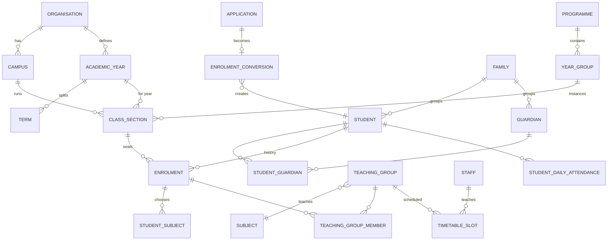

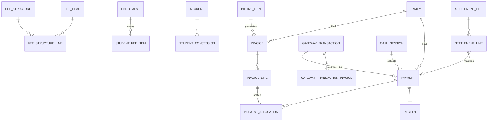

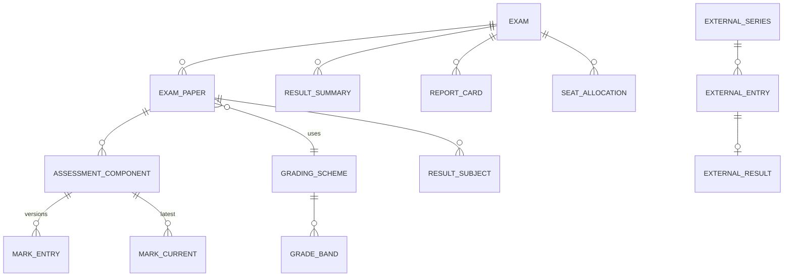

### 6.20 Partitioning, indexing, retention

| Table | Partition | Retention (hot) | Archive |
|---|---|---|---|
| `att.student_daily_attendance`, `att.period_attendance`, `att.staff_attendance` | yearly by date | current + 2 years | older partitions detached → read-only archive schema (CORE-13 "archived read-only but searchable") |
| `att.device_event`, `sec.gate_event` | monthly | 13 months | dump to object storage (Parquet) |
| `trn.gps_ping` | daily | 90 days | aggregated trips kept |
| `com.outbound_message` | monthly | 24 months | archive |
| `audit.audit_event` | monthly | 7 years (configurable per legal advice) | cold storage partitions, sealed |

Every partitioned table also gets a `DEFAULT` partition as a safety net (an insert with no matching partition would
otherwise fail — e.g. the audit trigger would abort the business transaction); a nightly check alerts if the default
partition is non-empty, and `pg_partman` pre-creates partitions 3 periods ahead.

Indexing rules:
* Every FK used in joins gets an index (checked in CI with a catalog query).
* Partial indexes for "open" work queues (`status IN ('pending',...)`) keep them tiny.
* Trigram GIN for name/phone search; B-tree `(campus_id, date)` for operational lists; BRIN on huge time-series.
* Keyset pagination indexes `(campus_id, created_at DESC, id DESC)` on big lists.
* `pg_stat_statements` + auto_explain (>200 ms) in staging/production to catch regressions.

### 6.21 KPI data dictionary (governed definitions, §5.9)

| KPI | Definition |
|---|---|
| Attendance % (student, period) | `(present + late + half_day×0.5) / (instructional days enrolled − approved leave if policy excludes)` × 100 |
| Collection rate | `collected_paisa for invoices due in period / net_paisa due in period` × 100 (exclude void) |
| Outstanding | `Σ (net − paid)` of invoices with status issued/partially_paid |
| Overdue | Outstanding where `due_date < today` |
| Seat fill rate | `active enrolments / Σ section capacity` per campus/year group |
| Conversion rate | `admitted enquiries / enquiries created` in period, by source |
| Pass % | `students with is_pass on all compulsory papers / students sat` |
| Teacher load | `Σ periods/week across teaching_group_teacher` vs `max_periods` setting |

---

## 7. Back-end implementation design (class-based)

> **Detailed backend design:** [`docs/backend/`](docs/backend/README.md): architecture, cross-cutting concerns, all 21 modules
> (use cases, endpoints, events, jobs), sequence flows, operations and backend ADRs, aligned with the real schema in `db/`.

### 7.1 Request lifecycle

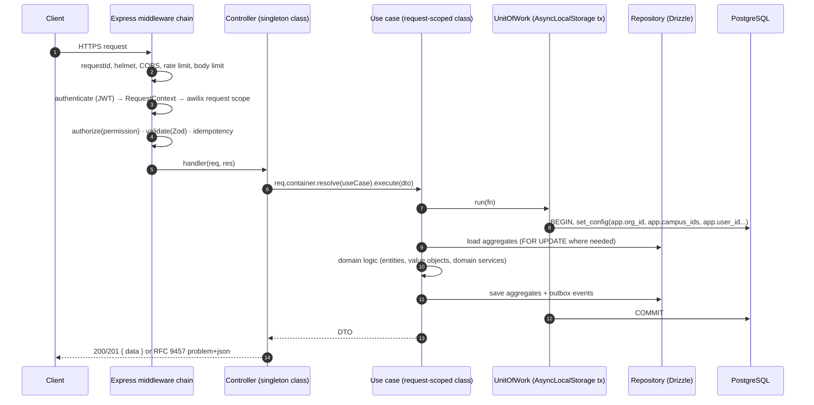

### 7.2 Shared kernel (domain)

```ts
// shared/domain/Entity.ts
export abstract class Entity<TProps> {
  protected constructor(readonly id: string, protected props: TProps) {}
  equals(other?: Entity<TProps>) { return !!other && other.id === this.id; }
}

// shared/domain/AggregateRoot.ts
export abstract class AggregateRoot<TProps> extends Entity<TProps> {
  private readonly events: DomainEvent[] = [];
  protected version: number;
  protected constructor(id: string, props: TProps, version = 0) { super(id, props); this.version = version; }
  protected record(event: DomainEvent) { this.events.push(event); }
  pullEvents(): DomainEvent[] { return this.events.splice(0, this.events.length); }
  get rowVersion() { return this.version; }
}

// shared/domain/DomainEvent.ts
export interface DomainEvent<TPayload = unknown> {
  readonly type: string;              // 'fee.payment_received.v1'  (versioned contract)
  readonly aggregateType: string;
  readonly aggregateId: string;
  readonly orgId: string;
  readonly occurredAt: Date;
  readonly payload: TPayload;
}

// shared/domain/Money.ts — paisa as safe integer (BDT max ≈ 90 trillion taka, far beyond need)
export class Money {
  private constructor(readonly paisa: number) {
    if (!Number.isSafeInteger(paisa)) throw new InvariantError('Money must be an integer number of paisa');
  }
  static zero() { return new Money(0); }
  static ofPaisa(p: number) { return new Money(p); }
  static fromTaka(text: string): Money {                 // '1250.50' -> 125050 (no float math)
    const m = /^(-)?(\d+)(?:\.(\d{1,2}))?$/.exec(text.trim());
    if (!m) throw new InvariantError(`Invalid amount: ${text}`);
    const paisa = Number(m[2]) * 100 + Number((m[3] ?? '0').padEnd(2, '0'));
    return new Money(m[1] ? -paisa : paisa);
  }
  add(o: Money) { return new Money(this.paisa + o.paisa); }
  subtract(o: Money) { return new Money(this.paisa - o.paisa); }
  min(o: Money) { return this.paisa <= o.paisa ? this : o; }
  percent(pct: number) { return new Money(Math.round((this.paisa * Math.round(pct * 100)) / 10_000)); }
  isZero() { return this.paisa === 0; }
  isPositive() { return this.paisa > 0; }
  gt(o: Money) { return this.paisa > o.paisa; }
  format(locale: 'en' | 'bn' = 'en') {                    // lakh/crore grouping: ৳6,60,000.00
    return new Intl.NumberFormat(locale === 'bn' ? 'bn-BD' : 'en-IN',
      { style: 'currency', currency: 'BDT', minimumFractionDigits: 2 }).format(this.paisa / 100);
  }
}

// shared/domain/errors.ts — mapped to RFC 9457 by the error handler
export abstract class AppError extends Error {
  abstract readonly status: number;
  abstract readonly code: string;                        // stable, documented in packages/contracts/errors.ts
  constructor(message: string, readonly details?: Record<string, unknown>) { super(message); }
}
export class InvariantError   extends AppError { status = 422; code = 'INVARIANT_VIOLATION'; }
export class NotFoundError    extends AppError { status = 404; code = 'NOT_FOUND'; }
export class ForbiddenError   extends AppError { status = 403; code = 'FORBIDDEN'; }
export class ConflictError    extends AppError { status = 409; code = 'CONFLICT'; }
export class StaleWriteError  extends AppError { status = 412; code = 'PRECONDITION_FAILED'; }
```

### 7.3 Domain entity example — `Invoice`

```ts
// modules/fee/domain/entities/Invoice.ts
export class Invoice extends AggregateRoot<InvoiceProps> {
  static reconstitute(id: string, props: InvoiceProps, version: number) { return new Invoice(id, props, version); }

  get familyId() { return this.props.familyId; }
  get campusId() { return this.props.campusId; }
  get dueDate() { return this.props.dueDate; }
  get outstanding(): Money {
    return this.props.lines.reduce((sum, l) => sum.add(l.outstanding), Money.zero());
  }

  /** Allocates up to `available` across lines by priority (fines first, then by head priority). */
  allocate(available: Money): Array<{ lineId: string; amount: Money }> {
    if (this.props.status === 'void') throw new InvariantError('Cannot pay a void invoice');
    const result: Array<{ lineId: string; amount: Money }> = [];
    let remaining = available;
    for (const line of [...this.props.lines].sort((a, b) => a.priority - b.priority)) {
      if (!remaining.isPositive()) break;
      const take = remaining.min(line.outstanding);
      if (take.isPositive()) {
        line.applyPayment(take);
        result.push({ lineId: line.id, amount: take });
        remaining = remaining.subtract(take);
      }
    }
    this.props.status = this.outstanding.isZero() ? 'paid' : 'partially_paid';
    return result;
  }

  void(reason: string, now: Date) {
    if (this.props.paid.isPositive()) throw new InvariantError('Reverse allocations before voiding a paid invoice');
    this.props.status = 'void';
    this.props.voidReason = reason;
    this.record({ type: 'fee.invoice_voided.v1', aggregateType: 'invoice', aggregateId: this.id,
                  orgId: this.props.orgId, occurredAt: now, payload: { invoiceId: this.id, reason } });
  }
}
```

### 7.4 Unit of Work with RLS context

```ts
// shared/infrastructure/db/UnitOfWork.ts
export class UnitOfWork {
  private static readonly als = new AsyncLocalStorage<Transaction<DB>>();

  constructor(private readonly deps: { db: Database; replicaDb: Database; ctx: RequestContext }) {}

  /** Current transaction if inside run(), else throws — repositories must never run outside a UoW (RLS needs GUCs). */
  tx(): Executor {
    const trx = UnitOfWork.als.getStore();
    if (!trx) throw new Error('Repository used outside UnitOfWork.run()');
    return trx;
  }

  async run<T>(fn: () => Promise<T>, opts: { readOnly?: boolean; isolation?: IsolationLevel } = {}): Promise<T> {
    if (UnitOfWork.als.getStore()) return fn();                         // join outer transaction
    const base = opts.readOnly ? this.deps.replicaDb : this.deps.db;
    return withSerializationRetry(() =>
      base.transaction().setIsolationLevel(opts.isolation ?? 'read committed').execute(async (trx) => {
        const { ctx } = this.deps;
        await sql`SELECT set_config('app.org_id', ${ctx.user.orgId}, true),
                         set_config('app.user_id', ${ctx.user.id}, true),
                         set_config('app.campus_ids', ${ctx.campusIds === '*' ? '*' : ctx.campusIds.join(',')}, true),
                         set_config('app.request_id', ${ctx.requestId}, true),
                         set_config('app.client_ip', ${ctx.ip}, true)`.execute(trx);
        if (opts.readOnly) await sql`SET TRANSACTION READ ONLY`.execute(trx);
        return UnitOfWork.als.run(trx, fn);
      }));
  }
}
```

### 7.5 Use-case base classes

```ts
// shared/application/UseCase.ts
export abstract class UseCase<I, O> {
  protected constructor(protected readonly uow: UnitOfWork) {}
  execute(input: I): Promise<O> { return this.uow.run(() => this.handle(input)); }
  protected abstract handle(input: I): Promise<O>;
}

export abstract class Query<I, O> {                       // read side: replica, read-only, no aggregates
  protected constructor(protected readonly uow: UnitOfWork) {}
  execute(input: I): Promise<O> { return this.uow.run(() => this.handle(input), { readOnly: true }); }
  protected abstract handle(input: I): Promise<O>;
}
```

### 7.6 Use-case example — `RecordCounterPayment` (FEE-05)

```ts
// modules/fee/application/use-cases/RecordCounterPayment.ts
type Deps = {
  uow: UnitOfWork; ctx: RequestContext; clock: Clock;
  invoiceRepo: InvoiceRepository; paymentRepo: PaymentRepository; cashSessionRepo: CashSessionRepository;
  coreApi: CoreModuleApi;            // numbering (public API of CORE)
  scopePolicy: ScopePolicy; outbox: OutboxWriter;
};

export class RecordCounterPayment extends UseCase<RecordCounterPaymentInput, PaymentResultDto> {
  constructor(private readonly d: Deps) { super(d.uow); }

  protected async handle(input: RecordCounterPaymentInput): Promise<PaymentResultDto> {
    const { ctx, clock } = this.d;
    const campusId = this.d.scopePolicy.requireCampus(input.campusId);          // campus in user's scope

    const session = await this.d.cashSessionRepo.findOpen(ctx.user.id);
    if (input.channel === 'cash' && !session) throw new ConflictError('Open a cash session before collecting cash');

    // Lock invoices in id order (deadlock-safe), only open ones of ONE family
    const invoices = await this.d.invoiceRepo.lockOpenByIds(input.invoiceIds);
    if (invoices.length !== input.invoiceIds.length) throw new NotFoundError('Invoice not found or not payable');
    const familyId = invoices[0].familyId;
    if (invoices.some((i) => i.familyId !== familyId || i.campusId !== campusId))
      throw new InvariantError('All invoices must belong to the same family and campus');

    const amount = Money.ofPaisa(input.amountPaisa);
    const payment = Payment.receive({
      orgId: ctx.user.orgId, campusId, familyId, amount, channel: input.channel,
      instrument: input.instrument, cashSessionId: session?.id, collectedBy: ctx.user.id,
      paymentNo: await this.d.coreApi.nextNumber({ campusId, key: 'payment' }),
      receiptNo: await this.d.coreApi.nextNumber({ campusId, key: 'receipt' }),
      now: clock.now(),
    });

    let remaining = amount;                                                     // oldest due first
    for (const invoice of invoices.sort((a, b) => +a.dueDate - +b.dueDate)) {
      const parts = invoice.allocate(remaining);
      parts.forEach((p) => payment.addAllocation(invoice.id, p.lineId, p.amount));
      remaining = remaining.subtract(parts.reduce((s, p) => s.add(p.amount), Money.zero()));
    }
    // remaining > 0 stays as family credit (advance), visible in fee.v_family_credit

    await this.d.paymentRepo.insert(payment);             // payment + allocations + receipt rows
    await this.d.outbox.write(payment.pullEvents());       // PaymentReceived -> COM (SMS), ACC (ledger), BI
    return PaymentMapper.toResultDto(payment, remaining);
  }
}
```

### 7.7 Repository: port + Drizzle adapter

```ts
// modules/fee/domain/repositories/InvoiceRepository.ts
export interface InvoiceRepository {
  findById(id: string): Promise<Invoice | null>;
  lockOpenByIds(ids: string[]): Promise<Invoice[]>;
  insertMany(invoices: Invoice[]): Promise<void>;
}

// modules/fee/infrastructure/persistence/DrizzleInvoiceRepository.ts
export class DrizzleInvoiceRepository implements InvoiceRepository {
  constructor(private readonly d: { uow: UnitOfWork }) {}

  async lockOpenByIds(ids: string[]): Promise<Invoice[]> {
    const tx = this.d.uow.tx();                              // Drizzle transaction with RLS context
    const rows = await tx.select().from(fee.invoice)
      .where(and(inArray(fee.invoice.id, ids), inArray(fee.invoice.status, ['issued', 'partially_paid'])))
      .orderBy(fee.invoice.id).for('update');               // RLS already restricts campus
    if (rows.length === 0) return [];
    const lines = await tx.select().from(fee.invoiceLine)
      .where(inArray(fee.invoiceLine.invoiceId, rows.map((r) => r.id)));
    return rows.map((r) => InvoiceMapper.toDomain(r, lines.filter((l) => l.invoiceId === r.id)));
  }
  // ...
}
```

### 7.8 Class-based controllers and route registration

```ts
// shared/http/RouteDefinition.ts
export interface RouteDefinition {
  method: 'get' | 'post' | 'put' | 'patch' | 'delete';
  path: string;
  handler: (req: Request, res: Response) => Promise<unknown>;
  permission?: PermissionCode;                 // 'fee.payment.create'
  public?: boolean;                            // no auth (webhooks, public website API with API key)
  auth?: 'user' | 'apiKey' | 'device' | 'webhook';
  schema?: { params?: ZodType; query?: ZodType; body?: ZodType; response?: ZodType };
  idempotent?: boolean;                        // requires Idempotency-Key header
  rateLimit?: { points: number; durationSec: number };
  summary?: string;                            // OpenAPI
}

// shared/http/BaseController.ts
export abstract class BaseController {
  abstract readonly basePath: string;          // '/fee/payments'
  abstract readonly tag: string;               // OpenAPI tag
  abstract routes(): RouteDefinition[];

  protected useCase<T>(req: Request, name: string): T { return req.container.resolve<T>(name); }
  protected ok<T>(res: Response, data: T, meta?: object) { return res.status(200).json({ data, ...(meta && { meta }) }); }
  protected created<T>(res: Response, data: T, location?: string) {
    if (location) res.location(location);
    return res.status(201).json({ data });
  }
  protected accepted(res: Response, jobId: string) { return res.status(202).json({ data: { jobId, status: 'queued' } }); }
  protected noContent(res: Response) { return res.status(204).end(); }
  protected page<T>(res: Response, p: Page<T>) { return res.json({ data: p.items, meta: { nextCursor: p.nextCursor, total: p.total } }); }
  protected withEtag(res: Response, version: number) { res.setHeader('ETag', `"${version}"`); return this; }
}
```

```ts
// modules/fee/presentation/http/PaymentController.ts
export class PaymentController extends BaseController {
  readonly basePath = '/fee/payments';
  readonly tag = 'Fees · Payments';

  routes(): RouteDefinition[] {
    return [
      { method: 'post', path: '/counter', handler: this.recordCounter, permission: 'fee.payment.create',
        schema: { body: RecordCounterPaymentSchema, response: PaymentResultSchema }, idempotent: true,
        summary: 'Record a counter payment (cash/cheque/POS/bank deposit)' },
      { method: 'post', path: '/online/start', handler: this.startOnline, permission: 'fee.payment.pay_online',
        schema: { body: StartOnlinePaymentSchema }, idempotent: true, rateLimit: { points: 10, durationSec: 60 } },
      { method: 'get', path: '/:id', handler: this.getById, permission: 'fee.payment.view',
        schema: { params: IdParamSchema, response: PaymentDetailSchema } },
      { method: 'post', path: '/:id/reverse', handler: this.reverse, permission: 'fee.payment.approve',
        schema: { params: IdParamSchema, body: ReversePaymentSchema } },
    ];
  }

  private recordCounter = async (req: Request, res: Response) => {
    const result = await this.useCase<RecordCounterPayment>(req, 'recordCounterPayment').execute(req.body);
    return this.created(res, result, `/api/v1/fee/payments/${result.paymentId}`);
  };

  private startOnline = async (req: Request, res: Response) =>
    this.created(res, await this.useCase<StartOnlinePayment>(req, 'startOnlinePayment').execute(req.body));

  private getById = async (req: Request, res: Response) => {
    const dto = await this.useCase<GetPayment>(req, 'getPayment').execute({ id: req.params.id });
    return this.withEtag(res, dto.rowVersion).ok(res, dto);
  };

  private reverse = async (req: Request, res: Response) =>
    this.ok(res, await this.useCase<ReversePayment>(req, 'reversePayment')
      .execute({ id: req.params.id, ...req.body, ifMatch: req.header('If-Match') }));
}
```

```ts
// shared/http/mountController.ts — one place builds the middleware chain AND the OpenAPI document
export function mountController(router: Router, c: BaseController, registry: OpenAPIRegistry) {
  for (const r of c.routes()) {
    const chain: RequestHandler[] = [];
    if (r.auth === 'apiKey') chain.push(apiKeyAuth());
    else if (r.auth === 'webhook') chain.push(rawBodyCapture());          // signature verified in use case
    else if (r.auth === 'device') chain.push(deviceHmacAuth());
    else if (!r.public) chain.push(authenticate());
    if (r.rateLimit) chain.push(rateLimit(r.rateLimit));
    if (r.permission) chain.push(authorize(r.permission));
    if (r.schema) chain.push(validate(r.schema));                        // strict Zod => no mass assignment
    if (r.idempotent) chain.push(idempotency());
    router[r.method](c.basePath + r.path, ...chain, r.handler);
    registry.registerPath(toOpenApi(c, r));
  }
}
```

### 7.9 Dependency injection (awilix)

```ts
// modules/fee/fee.module.ts
export class FeeModule implements ModuleDefinition {
  readonly name = 'fee';
  register(c: AwilixContainer) {
    c.register({
      // repositories & use cases are request-scoped (they receive ctx + uow of the request)
      invoiceRepo:          asClass(DrizzleInvoiceRepository).scoped(),
      paymentRepo:          asClass(DrizzlePaymentRepository).scoped(),
      cashSessionRepo:      asClass(DrizzleCashSessionRepository).scoped(),
      recordCounterPayment: asClass(RecordCounterPayment).scoped(),
      startOnlinePayment:   asClass(StartOnlinePayment).scoped(),
      handleGatewayCallback: asClass(HandleGatewayCallback).scoped(),
      generateBillingRun:   asClass(GenerateBillingRun).scoped(),
      getPayment:           asClass(GetPayment).scoped(),
      // stateless adapters are singletons
      paymentGatewayFactory: asClass(PaymentGatewayFactory).singleton(),
      sslcommerzGateway:    asClass(SslCommerzGateway).singleton(),
      bkashGateway:         asClass(BkashGateway).singleton(),
      // public API for other modules
      feeApi:               asClass(FeeModuleApiImpl).scoped(),
    });
  }
  controllers() { return [InvoiceController, PaymentController, GatewayWebhookController, FeeStructureController,
                          ConcessionController, BillingRunController, CashSessionController, FeeReportController]; }
  jobs() { return [BillingRunJob, LateFeeJob, FeeReminderJob, GatewaySweeperJob, SettlementImportJob, ReceiptPdfJob]; }
  subscriptions() { return [OnStudentEnrolledCreateFeePlan, OnTransportAssigned, OnLibraryFineRaised, OnApprovalDecided]; }
  schedules() { return [{ job: 'fee.late_fee', cron: '30 0 * * *' }, { job: 'fee.reminders', cron: '0 10 * * *' },
                        { job: 'fee.gateway_sweeper', every: '5m' }]; }
}
```

Container modes: `injectionMode: InjectionMode.PROXY` (constructor receives the cradle object → safe with minification).
`awilix-express` `scopePerRequest` creates a child scope per request; the `authenticate` middleware registers `ctx`
(`asValue(requestContext)`) into that scope. Workers create a scope per job with a system `RequestContext`.

### 7.10 Module public API and event subscribers

```ts
// modules/sis/public-api/SisModuleApi.ts — the only SIS import allowed elsewhere
export interface SisModuleApi {
  getActiveEnrolment(studentId: string, on?: Date): Promise<EnrolmentSummary | null>;
  getPrimaryContact(studentId: string): Promise<GuardianContact | null>;
  getGuardiansForStudents(studentIds: string[]): Promise<Map<string, GuardianContact[]>>;
  listStudentIdsForAudience(audience: AudienceSpec): Promise<string[]>;
  isGuardianOf(guardianId: string, studentId: string): Promise<boolean>;    // ScopePolicy own_children
}
```

```ts
// modules/com/presentation/subscriptions/OnStudentMarkedAbsent.ts
export class OnStudentMarkedAbsent implements EventSubscription<StudentMarkedAbsentV1> {
  readonly eventType = 'att.student_marked_absent.v1';
  readonly consumer = 'com.absence_alert';                         // inbox key (sys.processed_event)

  constructor(private readonly d: { sisApi: SisModuleApi; notifier: NotificationService }) {}

  async handle(e: DomainEvent<StudentMarkedAbsentV1>) {
    const contact = await this.d.sisApi.getPrimaryContact(e.payload.studentId);
    if (!contact) return;
    await this.d.notifier.dispatch({
      eventCode: e.payload.status === 'late' ? 'att.late' : 'att.absent',
      recipient: { userId: contact.userId, phone: contact.phone, locale: contact.locale },
      data: { student_name: e.payload.studentName, date: e.payload.date, class: e.payload.sectionName },
      dedupeKey: `att.${e.payload.status}:${e.payload.studentId}:${e.payload.date}`,  // re-marking never double-sends
      campusId: e.payload.campusId,
    });
  }
}
```

The **subscription runner** (worker) wraps each `handle` in a UnitOfWork with a system context and inserts into
`sys.processed_event (consumer, event_id) ON CONFLICT DO NOTHING` first — if 0 rows inserted, the event was already
processed → skip (exactly-once effect on top of at-least-once delivery).

### 7.11 Error handling (RFC 9457)

```ts
export const errorHandler: ErrorRequestHandler = (err, req, res, _next) => {
  const p = toProblem(err);              // AppError | ZodError | pg error | unknown
  if (p.status >= 500) req.log.error({ err }, 'unhandled'); else req.log.info({ code: p.code }, 'handled');
  res.status(p.status).type('application/problem+json').json({
    type: `https://docs.school.example/errors/${p.code}`, title: p.title, status: p.status,
    code: p.code, detail: p.detail, errors: p.fieldErrors, requestId: req.id,
  });
};
// pg mapping: 23505 unique_violation → 409 DUPLICATE; 23514 check_violation → 422; 23P01 exclusion_violation → 409 OVERLAP;
//             40001/40P01 serialization/deadlock → retried by UnitOfWork, then 503; 55P03 lock_not_available → 409 BUSY
```

### 7.12 Configuration & secrets

* `config.ts` parses `process.env` with Zod at boot — the process refuses to start on invalid config.
* Secrets (DB passwords, JWT signing keys, gateway credentials, field-encryption KEK) come from a vault / cloud secret
  manager injected as env or files; never in Git. Gateway sandbox credentials in non-production.
* Field encryption: envelope encryption — data key per organisation encrypted by KMS KEK; AES-256-GCM via Node `crypto`;
  blind index = HMAC-SHA256(normalised value, separate key). Key rotation via `key_version` prefix in ciphertext.

---

## 8. API design & endpoint catalogue

### 8.1 Conventions

| Topic | Convention |
|---|---|
| Base URLs | `https://api.<school-domain>/api/v1` (authenticated), `/public/v1` (API key, CDN-cached), `/webhooks/*`, `/devices/v1` |
| Style | REST, JSON, OpenAPI 3.1 generated from route definitions + Zod (served at `/api/docs`) |
| Naming | `/{module}/{resource}` plural kebab-case; actions that are not CRUD use sub-resources: `POST /exm/papers/{id}/lock` |
| Auth | Web: `__Host-access` httpOnly cookie (+ CSRF header); apps: `Authorization: Bearer <jwt>`; public: `X-Api-Key`; devices: HMAC signature |
| Campus context | `X-Campus-Id` header for writes (validated ∈ user's campus scope); lists filter `?campusId=` |
| Language | `Accept-Language: bn` → localised labels/messages; data always returns both `_en`/`_bn` fields |
| Envelope | `{ "data": ..., "meta": { "nextCursor": "...", "total": 123 } }`; errors = RFC 9457 problem+json |
| Pagination | Cursor (keyset) `?limit=50&cursor=…` for big lists; `?page=&pageSize=` only for small admin tables |
| Filtering / sorting | `?status=active&classSectionId=…&q=rahman&sort=-createdAt&fields=id,fullNameEn` |
| Concurrency | `ETag: "<row_version>"` on GET; `If-Match` required on PUT/PATCH of master data → 412 on mismatch |
| Idempotency | `Idempotency-Key` (UUID) **required** on payments, attendance batches, billing runs, mark uploads, offline sync |
| Async work | `202 Accepted { jobId }` → `GET /jobs/{id}` → `resultUrl` (signed, 15-minute expiry) |
| Money | Integer paisa in JSON (`"amountPaisa": 125050`) + formatted string where helpful |
| Dates | ISO-8601; `date` for school days, `date-time` in UTC (`Z`) |
| Versioning | URL major version; additive changes only within v1; events carry `.v1` suffix |
| Rate limits | Login/OTP: 5/min/IP+identity; payments: 10/min/user; public API: per key; general: 600/min/user |

### 8.2 Endpoint catalogue (Phase 1)

**IAM / CORE**

| Method & path | Purpose | Permission |
|---|---|---|
| `POST /auth/login` | Username/email + password (+ captcha after failures) | public |
| `POST /auth/otp/request` · `POST /auth/otp/verify` | Parent phone OTP login | public (rate-limited) |
| `POST /auth/mfa/verify` | TOTP / SMS second factor | partial session |
| `POST /auth/refresh` · `POST /auth/logout` | Rotate refresh token / revoke family | cookie |
| `GET /me` · `GET /me/permissions` · `PATCH /me/preferences` | Profile, effective grants, locale/notification prefs | self |
| `GET/POST/PATCH /iam/users` · `POST /iam/users/{id}/roles` | User admin & role assignment | `iam.user.*` |
| `GET/POST/PUT /iam/roles` · `PUT /iam/roles/{id}/permissions` | Role & permission matrix (§5.6) | `iam.role.*` |
| `GET/POST/PATCH /core/campuses`, `/core/academic-years`, `/core/terms`, `/core/shifts`, `/core/rooms` | Master data | `core.master.*` |
| `POST /core/academic-years/{id}/rollover:preview` · `:commit` | Year rollover wizard (promotion, fee carry-forward, class re-creation) | `core.year.approve` |
| `GET/POST /core/calendar-events` · `GET /core/calendar.ics?token=` | Academic calendar + iCal feed | `core.calendar.*` |
| `GET/PUT /core/settings/{key}` · `GET/PUT /core/number-sequences` | Settings, numbering formats | `core.settings.*` |
| `GET /search?q=` | Global search (students, guardians, staff, invoices, receipts) | per entity |
| `POST /imports` · `GET /imports/{id}` · `POST /imports/{id}/commit` | Excel/CSV import with dry-run report | `core.import.*` |
| `POST /exports` · `GET /jobs/{id}` | Async exports honouring scope (audited) | `<module>.*.export` |
| `GET /wf/inbox` · `POST /wf/requests/{id}/actions` | Approval inbox; approve/reject/return/delegate | approver |
| `GET /audit/events?entity=&id=` | Audit trail viewer | `audit.event.view` |
| `POST /files/uploads` → presigned PUT · `POST /files/{id}/complete` · `GET /files/{id}/url` | Upload/download via object storage | per purpose |

**ADM**

| Method & path | Purpose |
|---|---|
| `GET/POST/PATCH /adm/enquiries` · `POST /adm/enquiries/{id}/activities` · `POST /adm/enquiries/{id}/stage` | Inbox, follow-ups, pipeline |
| `POST /public/v1/admission/enquiries` | Website form (captcha, UTM) |
| `POST /adm/applications` · `PATCH /adm/applications/{id}` · `POST /adm/applications/{id}/submit` | Online application with draft-save |
| `POST /adm/applications/{id}/documents` | Document upload |
| `GET/POST /adm/test-sessions` · `POST /adm/test-sessions/{id}/candidates` · `PUT /adm/test-sessions/{id}/scores` | Tests, admit cards, scores |
| `POST /adm/merit-lists:generate` · `POST /adm/merit-lists/{id}/approve` | Rule-based merit/waitlist |
| `POST /adm/offers` · `POST /adm/offers/{id}/accept` · `/decline` | Offers (guardian accepts in portal) |
| `POST /adm/applications/{id}/enrol` | One-click conversion → student, enrolment, portal account, fee plan (idempotent) |
| `GET /adm/seat-availability` | Seats by campus/year group |

**SIS**

| Method & path | Purpose |
|---|---|
| `GET /sis/students` · `GET /sis/students/{id}` · `POST /sis/students` · `PATCH /sis/students/{id}` | Profiles (scope-filtered) |
| `GET/POST/PATCH /sis/guardians` · `PUT /sis/students/{id}/guardians` | Guardians & relationships |
| `GET /sis/families/{id}` | Family view (siblings across campuses, combined dues) |
| `GET/POST /sis/students/{id}/documents` · `POST /sis/documents/{id}/verify` | Document vault |
| `POST /sis/enrolments:bulk-allocate` · `POST /sis/enrolments/{id}/transfer` · `POST /sis/sections/{id}/rolls:generate` | Section balancing, transfers, roll rules |
| `POST /sis/promotions:preview` · `POST /sis/promotions:commit` | Year-end promotion with review screen |
| `POST /sis/withdrawals` · `POST /sis/withdrawals/{id}/clearance` · `/complete` | Withdrawal + clearance + TC |
| `POST /sis/id-cards:batch` | ID card batch PDF |
| `GET/POST /sis/profile-change-requests` · `POST …/{id}/decide` | Guardian edit requests |

**ACA**

| Method & path | Purpose |
|---|---|
| `GET/POST /aca/programmes`, `/aca/year-groups`, `/aca/subjects`, `/aca/subject-groups`, `/aca/curriculum` | Curriculum setup |
| `GET/POST /aca/sections` · `GET/POST /aca/teaching-groups` · `PUT /aca/teaching-groups/{id}/teachers` | Classes & allocation |
| `GET /aca/teacher-load?academicYearId=` | Overloaded/idle report |
| `GET/POST /aca/timetables` · `PUT /aca/timetables/{id}/slots` · `POST /aca/timetables/{id}/validate` · `/publish` | Builder + clash check |
| `GET /aca/timetables/{id}/views/{class\|teacher\|room}/{refId}` | Printable routines |
| `GET /aca/substitutions?date=` · `GET /aca/substitutions/{slotId}/candidates` · `POST /aca/substitutions` | Cover management |
| `GET /aca/my-day` | Class-teacher dashboard (periods, absentees, pending tasks) |

**ATT**

| Method & path | Purpose |
|---|---|
| `GET /att/sections/{id}/daily?date=` | Register sheet (prefilled with leave) |
| `PUT /att/sections/{id}/daily?date=` | Mark whole class in one call (idempotent, < 1 min UX) |
| `PUT /att/teaching-groups/{id}/periods/{periodId}?date=` | Period attendance |
| `POST /att/sync` | Offline batch from teacher app (Idempotency-Key per batch) |
| `POST /att/corrections` | Late correction with reason (audited) |
| `POST /devices/v1/events:batch` | Device bridge push (HMAC, store-and-forward) |
| `GET/POST /att/student-leaves` · `POST …/{id}/decide` | Leave applications |
| `GET /att/students/{id}/summary?termId=` | Attendance % and flags |
| `GET/POST /att/staff` (punch) · `GET/POST /att/staff-leaves` · `GET /att/staff-leaves/balances` | Staff attendance & leave |

**LRN / EXM**

| Method & path | Purpose |
|---|---|
| `GET/POST /lrn/homework` · `POST /lrn/homework/{id}/submissions` · `PUT /lrn/submissions/{id}/grade` | Homework loop |
| `GET/PUT /lrn/sections/{id}/diary?date=` | Class diary |
| `GET/POST /lrn/resources` | Learning resources |
| `GET/POST /lrn/gradebook-items` · `PUT /lrn/gradebook-items/{id}/scores` | Continuous assessment |
| `GET/POST /exm/grading-schemes` | Configurable grading |
| `GET/POST /exm/exams` · `POST /exm/exams/{id}/papers` · `POST /exm/exams/{id}/schedule:validate` | Exam & date sheet (elective clash check) |
| `POST /exm/exams/{id}/seating:generate` · `POST /exm/exams/{id}/admit-cards` | Seating & admit cards (PDF job) |
| `GET /exm/papers/{id}/marksheet` · `PUT /exm/papers/{id}/marks` · `POST /exm/papers/{id}/marks:upload` | Mark entry (web/Excel) |
| `POST /exm/papers/{id}/submit` · `/moderate` · `/lock` · `/reopen-requests` | Moderation & lock |
| `POST /exm/exams/{id}/results:compute` · `GET /exm/exams/{id}/tabulation` | Grading, tabulation sheet |
| `POST /exm/exams/{id}/report-cards:generate` (202) · `POST /exm/exams/{id}/publish` | Batch PDFs, embargoed publish |
| `GET /exm/students/{id}/transcript` | Multi-year transcript |
| `GET /exm/exams/{id}/analysis` | Result analysis |

**FEE**

| Method & path | Purpose |
|---|---|
| `GET/POST /fee/heads` · `GET/POST /fee/structures` · `POST /fee/structures/{id}/activate` | Fee structure builder |
| `GET/POST /fee/concessions` · (approval via `/wf`) | Concessions & waivers |
| `POST /fee/billing-runs` · `POST /fee/billing-runs/{id}/preview` · `/post` | Bulk monthly/term invoices |
| `GET /fee/invoices` · `GET /fee/invoices/{id}` · `POST /fee/invoices` (ad-hoc) · `POST /fee/invoices/{id}/void` | Invoices |
| `GET /fee/invoices/lookup?code=` | Barcode/QR lookup at counter |
| `POST /fee/payments/counter` · `POST /fee/payments/{id}/reverse` | Counter collection |
| `POST /fee/payments/online/start` → `{ redirectUrl }` | Start gateway checkout |
| `POST /webhooks/payments/{provider}` · `GET /pay/return/{provider}` | IPN + browser return |
| `GET /pay/{payToken}` | SMS pay-link landing (no login, invoice-scoped) |
| `GET/POST /fee/cash-sessions` · `POST /fee/cash-sessions/{id}/close` | Day-end closing & handover |
| `GET /fee/families/{id}/statement` · `GET /fee/receipts/{id}/pdf` | Statements & receipts |
| `GET /fee/due-list` · `GET /fee/reports/{collection\|aging\|concessions\|channels}` | Reports |
| `GET /fee/clearance/{studentId}` | Fee clearance for TC/admit card |

**HRM / COM / DOC / PRT / WEB / BI**

| Method & path | Purpose |
|---|---|
| `GET/POST/PATCH /hrm/staff` · `/hrm/contracts` · `/hrm/salary-components` | Staff master & pay structure |
| `POST /hrm/payroll-runs` · `/{id}/compute` · `/{id}/submit` · `/{id}/lock` · `GET /{id}/bank-advice` | Payroll |
| `GET /hrm/me/payslips` | Staff self-service |
| `GET/POST /com/notices` · `POST /com/notices/{id}/publish` · `GET /com/notices/{id}/reads` | Notices with read receipts |
| `GET/POST /com/templates` · `POST /com/templates/{id}/activate` | Template library |
| `POST /com/sms/estimate` | Segment & cost estimator (UCS-2 aware) |
| `POST /com/broadcasts` | Emergency broadcast (priority queue) |
| `GET /com/inbox` · `POST /com/inbox/{id}/read` | In-app notifications |
| `POST /webhooks/sms/{provider}/dlr` | Delivery reports |
| `GET/POST /doc/templates` · `POST /doc/issue` · `GET /doc/register` · `POST /doc/bulk-letters` | Certificates & letters |
| `GET /public/v1/verify/{code}` | Certificate/report-card verification (name, class, issue date only) |
| `GET /portal/children` · `GET /portal/children/{id}/dashboard` · `/attendance` · `/homework` · `/results` · `/invoices` | Parent/student portal aggregates |
| `GET /public/v1/notices` · `/events` · `/calendar` · `/news` · `/gallery` · `/vacancies` | Website feeds (CDN) |
| `GET /bi/dashboards/{principal\|campus\|accounts\|admission\|hr\|teacher}` · `GET /bi/campus-comparison` | Dashboards |
| `GET /bi/reports/catalogue` · `POST /bi/reports/{code}/run` | Standard report library (Appendix B) |

### 8.3 Example payloads

```http
PUT /api/v1/att/sections/0192f3.../daily?date=2026-11-03
Idempotency-Key: 8f2a6c1e-...
X-Campus-Id: 0192a1...
Content-Type: application/json

{ "entries": [
    { "studentId": "0192f4...", "status": "present" },
    { "studentId": "0192f5...", "status": "absent" },
    { "studentId": "0192f6...", "status": "late", "arrivedAt": "2026-11-03T02:47:00Z", "remarks": "traffic" } ] }
```

```json
HTTP/1.1 200 OK
{ "data": { "date": "2026-11-03", "classSectionId": "0192f3...", "present": 31, "absent": 1, "late": 1,
            "alertsQueued": 2, "editableUntil": "2026-11-03T17:59:59Z" } }
```

```json
HTTP/1.1 409 Conflict
Content-Type: application/problem+json
{ "type": "https://docs.school.example/errors/PAPER_LOCKED", "title": "Marks are locked", "status": 409,
  "code": "PAPER_LOCKED", "detail": "Physics (Y10, Mid-term) was locked on 2026-11-20 by the Head of Section.",
  "requestId": "req_01J..." }
```

---

## 9. Key end-to-end flows

### 9.1 Online fee payment (FEE-04, I-4)

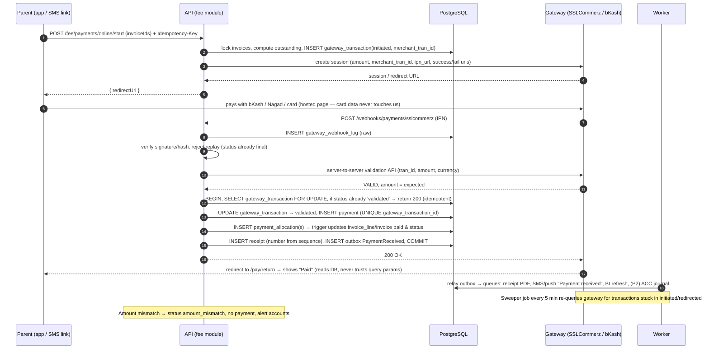

### 9.2 Daily attendance & instant absence alert (ATT-01, ATT-03)

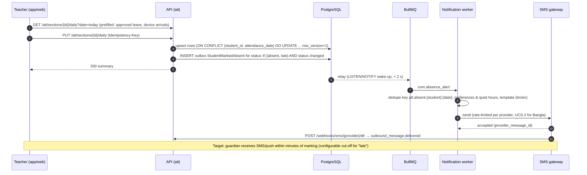

### 9.3 Examination: marks → moderation → lock → publish

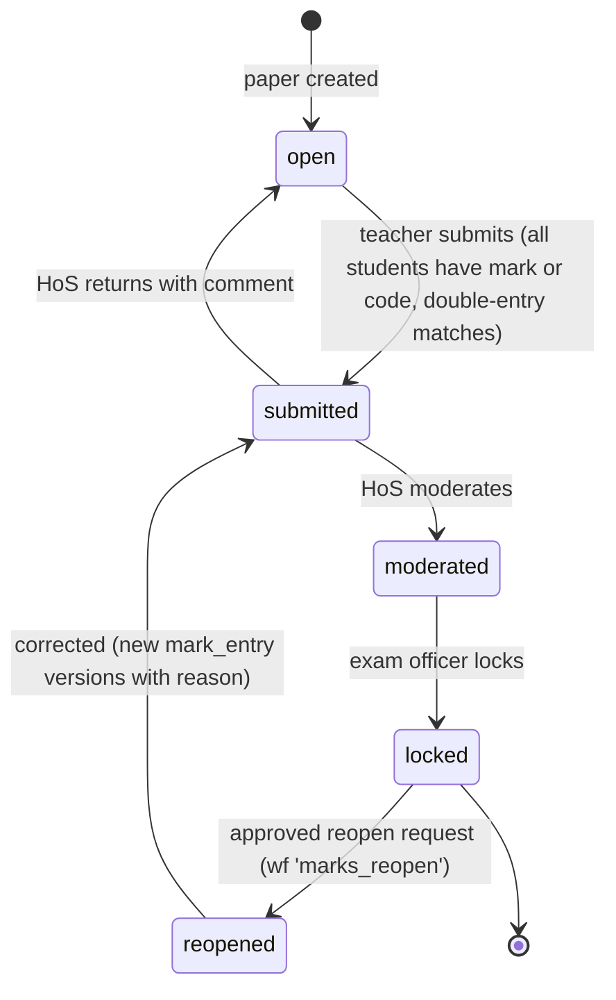

Exam level: `scheduled → in_progress → marking → moderation → locked → published`. On **publish**:
results frozen (`result_subject`/`result_summary` with scheme version), report cards generated in batch, `published_at`
set; portal endpoints only return results where `published_at IS NOT NULL AND now() >= result_embargo_until`; event
`ResultsPublished` → push + SMS to guardians in throttled waves; portal result pages pre-warmed in Redis (1,500
simultaneous logins target).

### 9.4 Admission → enrolment (ADM-08)

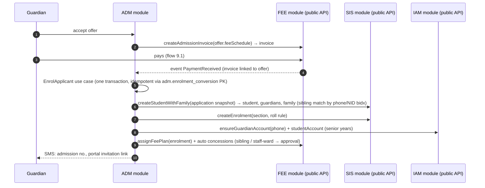

### 9.5 Year-end rollover (CORE-02 / SIS-05)

1. Create next academic year + terms (status `planned`).
2. Copy/adjust sections, curriculum, fee structures (versioned) → review screen.
3. Promotion preview: rule engine (results + attendance + conditions) proposes `promote / conditional / repeat / graduate`.
4. Commit (batch job, resumable): close current enrolments (`status='promoted'`), create next-year enrolments, carry
   forward unpaid balances (they stay as open invoices of the old year — nothing is rewritten), deactivate graduated
   accounts → alumni.
5. Lock old year (`status='locked'`): writes rejected by domain + RLS-adjacent check; archive after N years.

---

## 10. Background jobs, events & integrations

### 10.1 Queues (BullMQ on Redis)

| Queue | Producers | Concurrency / limits | Retry |
|---|---|---|---|
| `outbox.relay` | DB outbox (poll 1 s + LISTEN/NOTIFY) | 1 leader (Redis lock) | continuous |
| `events.<module>` | relay fan-out per subscriber | 10 | 8× exp. back-off → DLQ |
| `notify.sms` | NotificationService | per-provider limiter (e.g. 50 msg/s); priority lane for emergency | 5× back-off, failover provider |
| `notify.push` / `notify.email` / `notify.whatsapp` | NotificationService | 50 / 20 / 20 | 5× |
| `pdf.render` | report cards, receipts, certificates, admit cards | 4 Chromium pages per worker (1,000 PDFs < 10 min) | 3× |
| `billing.run` | billing run preview/post | 1 per campus (group key) | resumable, idempotent per enrolment+period |
| `fee.reminders` / `fee.late_fee` | scheduler (daily) | 1 | idempotent by `source_ref` / dedupe key |
| `fee.gateway_sweeper` | every 5 min | 1 | — |
| `reports.export` | users | 2 (runs on replica) | 2× |
| `import.validate` / `import.commit` | users | 2 | manual |
| `device.ingest` | device API | 4 | — |
| `files.scan` | upload complete | 2 (ClamAV) | 3× |
| `bi.refresh` | every 15 min | 1 | — |
| `audit.seal` / `audit.verify` | every minute / nightly | 1 | — |
| `wf.escalation` | every 15 min | 1 | — |
| `maintenance` | nightly | partitions (pg_partman), purge dedupe/idempotency keys, expiry alerts (documents, vehicle papers, contracts) | — |

Workers run the **same modules** (shared DI registrations) via `main.worker.ts`. Every job handler is idempotent and
records progress in `sys.job_run` for user-visible jobs.

### 10.2 Domain event catalogue (initial)

| Event | Producer | Consumers |
|---|---|---|
| `adm.offer_accepted.v1` | ADM | FEE (admission invoice), COM |
| `sis.student_enrolled.v1` | SIS | FEE (fee plan), IAM (accounts), SEARCH, BI |
| `sis.student_withdrawn.v1` | SIS | FEE (stop billing), TRN, LIB, IAM (disable) |
| `att.student_marked_absent.v1` / `att.student_marked_late.v1` | ATT | COM, BI |
| `att.leave_approved.v1` | ATT | ATT (auto-mark), COM |
| `att.threshold_breached.v1` | ATT | COM, EXM (eligibility), DOC (warning letter) |
| `aca.cover_assigned.v1` | ACA | COM, HRM (cover pay) |
| `exm.results_published.v1` | EXM | COM, BI, PRT cache warm-up |
| `fee.invoice_issued.v1` | FEE | COM (pay link), BI |
| `fee.payment_received.v1` | FEE | COM (receipt SMS), ACC (journal, P2), BI, ADM (enrolment trigger) |
| `fee.payment_reversed.v1` | FEE | ACC, COM |
| `hrm.payroll_locked.v1` | HRM | ACC, COM (payslips) |
| `wf.request_decided.v1` | WF | owning module (applies decision) |
| `*.changed.v1` (student/guardian/staff/invoice) | owners | SEARCH read model |

### 10.3 Integration adapters (ports & adapters)

```ts
// modules/fee/application/ports/PaymentGateway.ts
export interface PaymentGateway {
  readonly provider: 'sslcommerz' | 'bkash' | 'nagad' | 'aamarpay';
  createCheckout(req: { merchantTranId: string; amount: Money; customer: { name: string; phone: string };
                        returnUrls: ReturnUrls; ipnUrl: string }): Promise<{ redirectUrl: string; raw: unknown }>;
  verifyCallback(raw: { headers: Record<string, string>; body: unknown }): CallbackVerification;  // signature/hash
  validateTransaction(merchantTranId: string, providerTxnId?: string): Promise<GatewayValidation>; // server-to-server
  queryStatus(merchantTranId: string): Promise<GatewayValidation>;                                 // sweeper
  refund?(providerTxnId: string, amount: Money, reason: string): Promise<RefundResult>;
  parseSettlementFile?(file: Buffer): AsyncIterable<SettlementRow>;
}

// modules/com/application/ports/SmsProvider.ts
export interface SmsProvider {
  readonly name: string;                       // BTRC-licensed aggregator
  send(msg: { to: string; text: string; senderId: string; unicode: boolean }): Promise<{ providerMessageId: string }>;
  parseDeliveryReport(raw: unknown): DeliveryReport;
  balance(): Promise<number>;
}
```

| Integration | Adapter | Notes |
|---|---|---|
| SSLCommerz / bKash PGW / Nagad / aamarPay | `PaymentGateway` impls | Hosted checkout only; IPN + validation API; sandbox in non-prod |
| SMS (BTRC-licensed) | `SmsProvider` impls (primary + fallback) | Masking sender ID; UCS-2 segmenting (70/67 chars) for Bangla; DLR webhooks |
| E-mail | SES / SendGrid / Google Workspace SMTP | SPF/DKIM/DMARC |
| Push | FCM HTTP v1 (Android, web), APNs via FCM | Token cleanup on `UNREGISTERED` |
| WhatsApp (P2) | WhatsApp Business Cloud API via BSP | Approved templates only; opt-in tracked in `iam.consent_record` |
| Devices (P2) | `apps/device-bridge` on campus LAN | Pulls ZKTeco/Hikvision logs (SDK/push protocol), queues locally (SQLite), pushes HTTPS outbound with HMAC; no inbound firewall holes |
| Google/Microsoft (P2) | `openid-client`, Calendar API | Staff SSO; meeting links for online classes |
| Pearson Edexcel (P2) | CSV/Excel exporter/importer | Formats configurable per series; no public API assumed |
| Accounting (P2) | `AccountingConnector` (file/REST) | Mapping table maintained by finance |
| Public website (Next.js) | `/public/v1` + API key + CDN | Read-only feeds + form posts with captcha |

---

## 11. Front-end design (Next.js)

### 11.1 Applications

| App | Users | Rendering | Notes |
|---|---|---|---|
| `apps/web` — **Staff workspace** (`/app/...`) | Office, teachers, accounts, exam office, management | Mostly client components inside an authenticated shell; server components for initial data | Dense grids, keyboard-first entry, campus switcher, PWA for teachers |
| `apps/web` — **Family & student portal** (`/portal/...`) | Parents, senior students | Server components + streaming, small JS bundles | Mobile-first, low-bandwidth mode, child switcher, bn/en |
| `apps/site` — **Public website** | Public, applicants | SSG/ISR, JSON-LD, sitemap, WebP/AVIF | Reads `/public/v1` only; admission enquiry/application forms |
| Mobile (later) | Parents, teachers | React Native (Expo) | Reuses `packages/contracts` + `api-client` |

### 11.2 `apps/web` structure (App Router)

```
apps/web/src/
├─ app/
│  ├─ [locale]/                         # 'en' | 'bn' (next-intl routing)
│  │  ├─ (auth)/login, otp, mfa, reset
│  │  ├─ app/                           # staff workspace (requires staff session)
│  │  │  ├─ layout.tsx                  # shell: sidebar by permissions, campus switcher, global search (Ctrl+K)
│  │  │  ├─ dashboard/                  # role-based dashboards (BI-01)
│  │  │  ├─ admissions/{enquiries,applications,tests,merit,offers}/
│  │  │  ├─ students/[id]/{profile,guardians,documents,attendance,results,fees,timeline}/
│  │  │  ├─ academics/{structure,sections,teaching-groups,timetable,substitutions,calendar}/
│  │  │  ├─ attendance/{daily,period,leaves,staff}/
│  │  │  ├─ learning/{homework,diary,resources,gradebook}/
│  │  │  ├─ exams/[examId]/{schedule,seating,marks/[paperId],moderation,results,report-cards}/
│  │  │  ├─ fees/{structures,concessions,billing-runs,invoices,counter,cash-sessions,reports}/
│  │  │  ├─ hr/{staff,leave,payroll}/
│  │  │  ├─ communication/{notices,templates,broadcast,inbox}/
│  │  │  ├─ documents/{templates,issue,register}/
│  │  │  ├─ approvals/                  # wf inbox
│  │  │  ├─ reports/                    # report library + exports (jobs)
│  │  │  └─ settings/{campuses,years,roles,users,numbering,integrations,audit}/
│  │  ├─ portal/                        # parent / student
│  │  │  ├─ layout.tsx                  # child switcher (multi-campus)
│  │  │  ├─ page.tsx                    # today: attendance, homework, dues, exams, notices (PRT-01)
│  │  │  ├─ [childId]/{attendance,homework,results,report-cards,timetable,leave}/
│  │  │  ├─ fees/{invoices,pay,receipts,statement}/
│  │  │  ├─ notices/, messages/, forms/, profile/
│  │  ├─ pay/[payToken]/                # SMS pay-link (no login, invoice-scoped)
│  │  └─ verify/[code]/                 # certificate / report-card verification
│  └─ api/                              # minimal BFF routes (auth cookie bridging, file proxy if needed)
├─ features/                            # feature slices mirroring back-end modules
│  └─ fees/{components,hooks,queries.ts,forms/}
├─ lib/{api-client.ts,auth.ts,permissions.ts,format.ts (Money, Bangla digits, Hijri)}
└─ middleware.ts                        # locale routing + session presence + portal/staff segregation
```

### 11.3 Key UI decisions

| Concern | Decision |
|---|---|
| Data fetching | Server components call API with forwarded cookies for first paint; **TanStack Query** for client-side mutation, cache, optimistic updates |
| Forms | React Hook Form + **Zod schemas from `packages/contracts`** (same validation as server) |
| Data entry grids | TanStack Table + virtualisation; **Enter moves to next field**, arrow-key navigation, bulk paste from Excel into mark sheets, autosave with idempotency keys |
| Permissions in UI | `useCan('fee.payment.create')` hides/disables actions; server remains the authority |
| i18n | `next-intl` with `en`/`bn` catalogues; Bangla digits toggle; `Intl.NumberFormat('bn-BD')`; lakh/crore grouping; Hijri via `Intl.DateTimeFormat('bn-BD-u-ca-islamic-umalqura')` + org offsets |
| Typography | Noto Sans Bengali / Hind Siliguri + Inter, `font-display: swap`, subsetted |
| Design system | Tailwind + shadcn/ui (Radix) in `packages/ui`; school theme tokens; dark mode optional |
| Accessibility | WCAG 2.2 AA: focus order, labels, contrast, `aria-live` for save status; axe checks in CI |
| Low bandwidth | Portal pages < 150 KB JS; images via Next/Image (AVIF/WebP); `?fields=` sparse responses; skeletons |
| Offline (teachers) | PWA service worker; attendance & marks queued in IndexedDB with Idempotency-Key; sync on reconnect; conflict shown if paper locked |
| Auth on web | API sets `__Host-access` (15 min) + `__Host-refresh` (httpOnly, Secure, SameSite=Lax, path-scoped) cookies; `middleware.ts` redirects when absent; silent refresh on 401 |
| CSRF | SameSite cookies + `X-CSRF-Token` double-submit header on state-changing requests |
| Errors | Problem+json mapped to localised toasts/field errors by `code` |

### 11.4 Screens that matter most (≤ 3 minutes per common task, §5.10)

1. **Take attendance** — one screen, all students default "present", tap exceptions, single save (one API call).
2. **Collect a fee** — scan invoice QR / search family → outstanding lines pre-allocated → channel → save → receipt prints.
3. **Enter marks** — grid by component, keyboard navigation, live validation (max marks, absence codes), autosave.
4. **Parent home** — per child cards: today's attendance, homework due, dues with Pay button, latest results, notices.

---

## 12. Non-functional requirements → design

| NFR (spec §5.10) | Target | How the design meets it |
|---|---|---|
| Capacity | 3 campuses / 3,000 students / 400 staff; scale to 10,000 / 5 campuses | Stateless API scaled horizontally; PG single primary sized §14; partitioned time-series |
| Concurrency | 500 users; 1,500 parent logins at result publish; 300 payments/h | Results precomputed + Redis cache; report-card PDFs from object storage via CDN-signed URLs; OTP login rate-limited & queued SMS; payments trivial for PG |
| Response time | API p95 < 500 ms; pages p95 < 2 s on 4G | Indexed keyset queries, replica for reports, summary tables, compression, small payloads, SSR for portal |
| PDF throughput | 1,000 report cards < 10 min | Playwright pool: 2 workers × 4 pages ≈ 8 concurrent × ~0.5 s/page ⇒ ~1,000 in ~1–2 min |
| Notifications | ≥ 10,000 SMS/push per hour | BullMQ limiter per provider, back-pressure, priority lane, provider failover |
| Availability | 99.5 % monthly; 99.9 % school hours | 2+ API instances, rolling deploys, PG replica + documented failover, health checks |
| Recovery | RPO 15 min, RTO 4 h | WAL archiving (pgBackRest/WAL-G) continuous + daily full, off-site encrypted; quarterly restore drill |
| Integrity | Paisa-exact, no negative stock, no duplicate payment, locked marks | `bigint` paisa, CHECKs, unique gateway ids, triggers, append-only tables, row locks |
| Usability | Common tasks ≤ 3 min | §11.4 screens, keyboard-first |
| Accessibility | WCAG 2.2 AA | §11.3 |
| Localisation | en/bn, BDT lakh grouping, Asia/Dhaka, Hijri optional | §11.3, ICU collations |
| Maintainability | ≥ 80 % branch coverage on fees/marks/permissions; zero-downtime migrations | §15; expand/contract migrations |

---

## 13. Security & privacy

| Control (spec §5.5) | Implementation |
|---|---|
| Passwords | argon2id (m=64 MB, t=3, p=1); min length 10 + HIBP k-anonymity breach check; lockout with exponential back-off; captcha after 3 failures |
| Parent login | Phone OTP (6 digits, 5 min, 5 attempts, hashed), device binding optional; biometric unlock in app = local key protecting refresh token |
| MFA | TOTP mandatory for PRINCIPAL, ACCOUNTANT, HR, IT_ADMIN (`iam.role.requires_mfa`) |
| Tokens | EdDSA JWT access 15 min (claims: sub, org, type, authz_version); refresh rotation with **reuse detection** (reuse ⇒ revoke whole family) |
| Authorisation | Route permission + use-case scope policy + repository scoping + **PostgreSQL RLS** (§5.3) |
| IDOR | Opaque UUIDv7 ids are not a control; every fetch checks scope; tests for cross-campus & cross-family access |
| Mass assignment | Zod `.strict()` DTOs; mappers whitelist fields; no `req.body` spread into persistence |
| Injection / XSS / CSRF / SSRF | Parameterised Drizzle queries only; React escaping + sanitize-html for rich notices; CSRF tokens; outbound HTTP allow-list for adapters |
| Headers | helmet: strict CSP (nonce-based on Next.js), HSTS preload, X-Content-Type-Options, Referrer-Policy, frame-ancestors none |
| Uploads | Presigned PUT with size/type policy; magic-byte sniffing; ClamAV scan before `clean`; images re-encoded (sharp) and EXIF stripped; files only via signed GET (5–15 min) |
| Encryption | TLS 1.2+ everywhere; disk/bucket encryption; column-level AES-256-GCM for NID, birth certificate, health, SEN, bank; blind indexes for lookup |
| Payments | Hosted gateway pages; signature + server-to-server validation; idempotent callbacks; amount/currency match; no card data stored |
| Audit & monitoring | Trigger audit + app audit (logins, exports, break-glass, certificate issue); alerts: export volume spikes, off-hours admin activity, repeated failed logins, RLS denials |
| Confidential records | SEN, counselling, safeguarding: separate permissions, break-glass reason prompt, reviewed weekly |
| Children's data | Data minimisation; photo/media consent enforced in gallery & website; retention schedules per data class; right-to-correct via profile change requests |
| Supply chain | `pnpm audit`, Renovate, lockfile, SBOM (CycloneDX), signed images, Trivy scans |
| Testing | OWASP ZAP baseline in CI; ASVS L2 checklist; independent pen-test before go-live and major releases |

---

## 14. DevOps, environments & observability

### 14.1 Environments

| Env | Purpose | Data | Integrations |
|---|---|---|---|
| Local | Docker Compose: postgres, redis, minio, clamav, mailpit, api, worker, web | Seed + synthetic | Mocks |
| Dev / Test (UAT) | Feature testing, UAT by campus staff | Anonymised copy of real data | Gateway/SMS sandboxes |
| Staging | Production-like rehearsal, load tests | Anonymised | Sandboxes |
| Production | Live | Real | Live credentials (separate secrets) |

### 14.2 Starting production footprint (spec §5.11)

| Component | Size |
|---|---|
| API | 2 × (4 vCPU, 8 GB) containers, Node cluster mode 2–4 processes each |
| Worker | 1–2 × (4 vCPU, 8 GB) incl. Chromium for PDFs |
| Web (Next.js) | 2 × (2 vCPU, 4 GB) |
| PostgreSQL | Primary + streaming replica (4 vCPU, 16 GB, 200 GB SSD); PgBouncer (transaction mode) |
| Redis | 2 GB (AOF on; BullMQ needs `maxmemory-policy noeviction`) |
| Object storage | 500 GB, ~150 GB/year growth |
| Edge | Cloudflare (DNS, CDN, WAF, DDoS) → Nginx |

### 14.3 CI/CD pipeline

```
PR → lint + typecheck + dependency-cruiser boundaries
   → unit tests (Vitest) → integration tests (Testcontainers: PG 18 + Redis) → migration up/down check
   → OpenAPI diff (breaking-change gate) → build images → Trivy scan → ZAP baseline (ephemeral env)
main → deploy staging → Playwright E2E + k6 smoke → manual approval → production (outside school hours)
     → migrations (expand) → rolling API/worker/web → post-deploy checks → contract migration in a later release
Rollback: previous image tag (one click); migrations are backward-compatible for one release.
```

### 14.4 Observability

* **Logs**: pino JSON with `requestId`, `userId`, `campusId` (no PII values); shipped to Loki.
* **Metrics**: Prometheus — HTTP RED metrics, PG pool, queue depth/latency, SMS sent/failed, payment success rate,
  gateway validation latency, PDF throughput, outbox lag.
* **Traces**: OpenTelemetry (HTTP → use case → SQL → queue) to Tempo/Jaeger.
* **Errors**: Sentry (API, worker, web) with release tags.
* **Alerts**: payment failure rate > 5 %, outbox lag > 60 s, SMS failure > 10 %, DLQ non-empty, replica lag > 30 s,
  disk > 80 %, backup missing, audit chain verification failure.
* **Monthly service report** auto-generated for the school (uptime, incidents, volumes).

---

## 15. Testing & quality gates

| Level | Tooling | Focus |
|---|---|---|
| Domain unit | Vitest | Money, allocation, concessions, late fees, grading bands, promotion rules, timetable clash checker, holiday-aware leave days |
| Use-case integration | Vitest + Testcontainers (real PostgreSQL with RLS + triggers) | Payment idempotency, over-allocation rejection, mark lock, cross-campus isolation, outbox written in same tx |
| API contract | Supertest + OpenAPI response validation | Status codes, problem+json, permissions matrix (data-driven from §5.6) |
| Security | Permission matrix tests (each role × endpoint), IDOR suite, ZAP, dependency audit | ASVS L2 |
| E2E | Playwright | Admission→enrolment, monthly fee cycle with sandbox gateway, exam cycle to report card, attendance → SMS mock |
| Load | k6 | 500 concurrent users mix, 1,500 logins burst, 300 payments/h, 10k notifications/h |
| Accessibility | axe + Playwright | Portal & public pages |
| Migration | Restore anonymised prod dump → migrate → smoke | Zero-downtime safety |

Acceptance gates mirror spec §5.13: all P1 "must" features pass UAT; fee calculations and one month of invoices
reconcile with existing records; load test meets §12; pen-test criticals/highs closed; backup restore demonstrated;
staff trained and sign-off. Every feature ID (e.g. `FEE-04`) maps to test cases (tagged `@FEE-04`).

---

## 16. Delivery roadmap

| Release | Modules & scope | Data model delivered | Exit criteria |
|---|---|---|---|
| **0. Discovery** (3–4 w) | Workshops, fee/grading policies, data inventory, UI prototypes | Schema review against real data; migration mapping workbook | Signed baseline |
| **1. Foundation** (12–14 w) | CORE (tenancy, RBAC, audit, workflows, notifications, search, import), ACA, SIS, ADM, ATT (manual), COM (notices, SMS, push), PRT parent portal, BI essentials | `core, iam, audit, wf, sys, search, aca, sis, adm, att, com, bi` | Pilot campus live: attendance, notices, student records, admissions |
| **2. Money & results** (8–10 w) | FEE + online payments, EXM + report cards, DOC, WEB integration, HRM essentials (staff, leave, payroll), LRN P1 | `fee, exm, doc, web, hrm, lrn` | Fee cycle end-to-end in parallel run; term report cards; all campuses live |
| **3. Operations** (12–16 w) | Devices (ATT-02, SEC), TRN, LIB, INV, HLT, CCA, SEC, WhatsApp, Edexcel entries, payroll extensions, ACC connector, refunds, reconciliation | `trn, lib, inv, hlt, cca, sec, acc, prt` + `exm.external_*`, `fee.settlement_*` | Modules live as campuses are ready |
| **4. Optimisation** (roadmap) | GPS, procurement, online testing, early-warning analytics, alumni, assets | `trn.gps_ping`, `acc.purchase_*`, `lrn.quiz*`, `bi` models | Chosen by value after 6 months |

Migration (spec §5.12): import templates → dry-run report (`sys.import_batch`) → current-year students, guardians,
staff, fee plans, opening balances (`fee_head OPENING_BAL` invoices / `opening_balance` payments) → historical results as
read-only → one parallel fee cycle → sign-off.

---

## 17. Architecture decision records

| ADR | Decision | Alternatives | Rationale |
|---|---|---|---|
| 001 | Node.js + Express 5 + TypeScript instead of ASP.NET Core | .NET (spec default), NestJS | Customer/stack preference; spec §5.3 allows alternatives; one language across back end, web and mobile |
| 002 | Modular monolith with Clean Architecture, class-based use cases/controllers | Microservices; transaction-script controllers | School-sized ops team; strong boundaries keep extraction possible; testable domain |
| 003 | Drizzle (query builder) + SQL-first migrations (revised from Kysely, 23 Oct 2026) | Kysely, Prisma, TypeORM | Full PostgreSQL feature use (RLS, partitions, triggers, exclusion constraints, `SKIP LOCKED`); type-safe without ORM magic |
| 004 | PostgreSQL RLS as defence in depth for campus isolation | App-only filtering; schema-per-campus | Single org, shared policies; RLS catches app bugs; transaction-local GUCs work with PgBouncer |
| 005 | Money as integer paisa (`bigint`) | `numeric(12,2)` | Exactness, simpler arithmetic, matches spec §5.4 |
| 006 | UUIDv7 keys; identity `bigint` for append-only high-volume tables | Serial everywhere; UUIDv4 | Index locality + safe exposure; mergeable across sister schools |
| 007 | Transactional outbox + BullMQ | Direct queue publish; RabbitMQ | No lost/phantom events; Redis already required; RabbitMQ optional later |
| 008 | Cross-module FKs only to kernel tables; no cross-module queries in code | No cross-schema FKs; shared DB free-for-all | Integrity where it matters most while preserving module autonomy |
| 009 | Append-only marks/fees with trigger-maintained current/paid projections | Mutable rows + audit only | Spec §5.4 requirement; history is first-class; DB enforces invariants |
| 010 | TeachingGroup separate from ClassSection | Timetable per section only | Electives/IGCSE/IAL sets span sections |
| 011 | Text + CHECK for code-owned states; lookup tables for school-configurable lists | PG enums | Easier evolution; configuration stays data |
| 012 | Playwright/Chromium for PDFs | PDFKit, wkhtmltopdf | Correct Bangla shaping; templates editable as HTML |
| 013 | Next.js App Router for staff + portal + public site | React SPA (Vite) + separate Next.js site | One framework; SSR for portal performance on 4G; shared design system |

---

## 18. Open questions & risks

| # | Question / risk | Impact | Mitigation |
|---|---|---|---|
| 1 | Programmes per campus (e.g. IAL only at Dhanmondi?) | Structure, fees, timetable | Configurable per campus; confirm in Discovery |
| 2 | Exact report-card formats and grading rules to reproduce | EXM templates & calculator tests | Golden-file tests from past report cards |
| 3 | Existing payment merchant accounts / aggregator | Gateway adapters, settlement | Adapter interface; start with one aggregator |
| 4 | Biometric/RFID brand & model | Device bridge | Bridge abstraction; pilot one device |
| 5 | Data residency (cloud region vs Dhaka DC) | Hosting, latency | Containerised, cloud-agnostic; S3-compatible storage |
| 6 | Bangladesh data-protection law at go-live | Retention, consent | Configurable retention; legal review |
| 7 | Quality of legacy data (spreadsheets, paper) | Migration effort | Dry-run validation, parallel run |
| 8 | SMS cost growth (Bangla = UCS-2, 70 chars/segment) | Opex | Push-first policy, segment estimator, per-event channel rules |
| 9 | Result-publication spike (1,500 logins) | Availability | Precompute, cache, staggered notifications, load test |
| 10 | Accounting package to integrate | ACC connector scope | Connector with mapping table; built-in ledger fallback |
