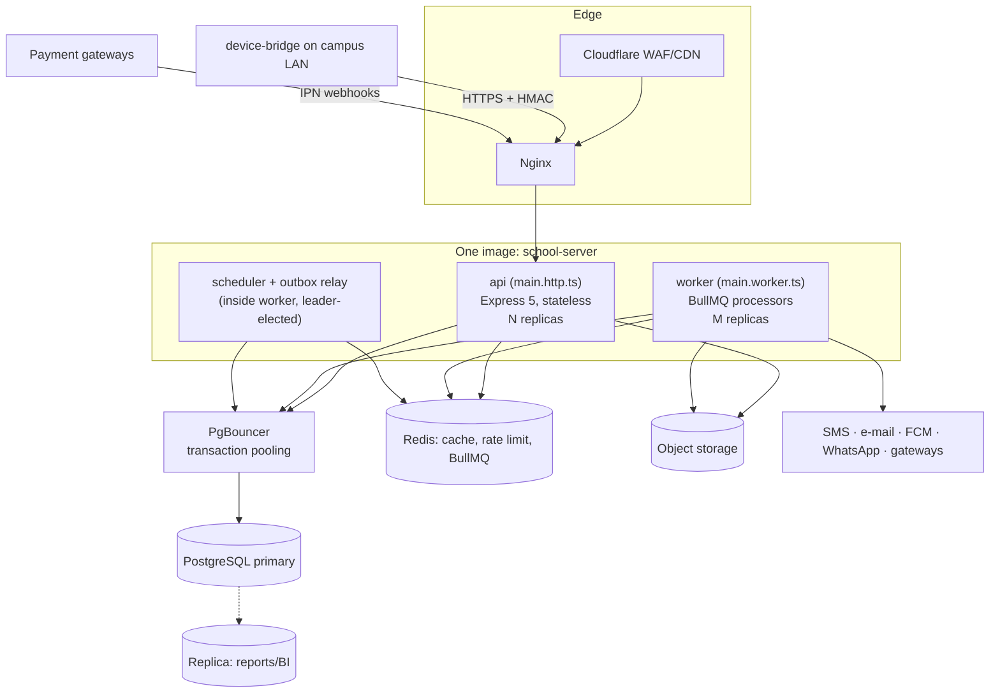
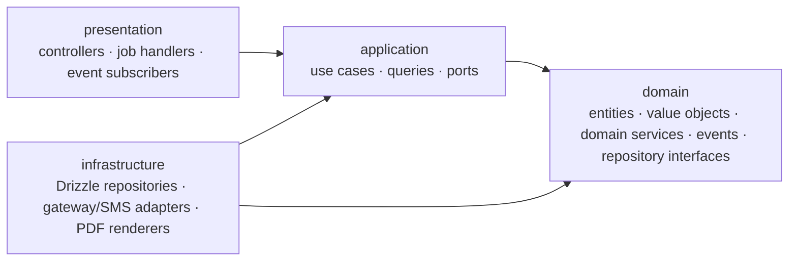

# Backend System Design — School Management Platform

| Item | Value |
|---|---|
| Runtime | Node.js 24 LTS · TypeScript 5 (strict) · Express 5 |
| Style | Modular monolith · Clean Architecture per module · class-based controllers, use cases, repositories |
| Database | PostgreSQL 18 — schema in [`db/`](../../db/README.md), documented in [`docs/database`](../database/README.md) |
| Async | Redis 7 + BullMQ 5 · PostgreSQL transactional outbox |
| Clients | Next.js web (staff + portal), Next.js public site, React Native apps (later), device bridge |
| Requirements | [`School_Management_Software_Feature_List_and_Technical_Specification.pdf`](../../School_Management_Software_Feature_List_and_Technical_Specification.pdf) (172 features, 21 modules) |
| Status | Design baseline v1.0 — 23 Oct 2026 |

> **Implementation:** the cross-cutting design is implemented in [`backend/`](../../backend/README.md)
> (Express 5, Drizzle ORM, awilix, BullMQ). ORM decision: **Drizzle** (see ADR B-03 in operations.md).

This folder is the backend design. It builds on [`SYSTEM_DESIGN.md`](../../SYSTEM_DESIGN.md), which covers the whole
system. This folder gets specific: every module, use case, table and job here is named after the real schema in
`db/migrations`.

| Document | Contents |
|---|---|
| **README.md** (this file) | Goals, architecture, runtime processes, tech stack, project structure, module boundaries |
| [`cross-cutting.md`](cross-cutting.md) | Composition root, HTTP layer, authentication, authorization, persistence & RLS, idempotency, events, jobs, notifications, files, PDFs, search, caching, errors, observability, security, i18n |
| [`modules.md`](modules.md) | The 21 modules: responsibilities, aggregates, use cases (commands/queries), endpoints, events, jobs, public APIs |
| [`flows.md`](flows.md) | Sequence diagrams for the critical journeys (login, payments, billing, attendance, exams, admission, rollover, workflows, notifications, uploads) |
| [`operations.md`](operations.md) | Deployment, scaling, configuration, CI/CD, testing strategy, observability, runbooks, backend ADRs |

---

## 1. Design goals

| Goal | Consequence for the backend |
|---|---|
| Correct money and marks | Domain invariants are checked in code **and** enforced by the database (triggers, checks, append-only grants). The backend never edits financial or mark history: it adds rows. |
| Campus isolation | Every request runs in a transaction that sets `app.org_id`, `app.campus_ids`, `app.user_id`. PostgreSQL row-level security therefore applies even when the code has a bug. |
| Small ops footprint | One codebase and one image with two entrypoints (`api`, `worker`). No microservices. |
| Replaceable parts | Modules talk only through public interfaces and events. Gateways, SMS providers and devices sit behind ports. |
| Predictable performance | Keyset pagination, replica reads, pre-aggregated BI tables, queues for heavy work, caching only where invalidation is simple. |
| Safe evolution | Versioned events, additive API changes, expand/contract migrations, feature flags per module (`core.org_module`). |

Targets (spec §5.10): API p95 < 500 ms, 500 concurrent users, 1,500 logins at result publication, 300 online payments/h,
10,000 notifications/h, 1,000 report-card PDFs < 10 min, RPO 15 min / RTO 4 h.

---

## 2. Architecture

### 2.1 Runtime processes



| Process | Entry | Responsibilities | Scaling |
|---|---|---|---|
| `api` | `src/main.http.ts` | REST API for every client, webhooks, device ingest, public API | Horizontal (stateless), 2+ |
| `worker` | `src/main.worker.ts` | Queue processors: notifications, PDFs, billing runs, imports/exports, event subscribers, reconciliation | Horizontal by queue; PDF workers separate if needed |
| scheduler / relay | inside `worker`, leader-elected via Redis lock | Repeatable jobs (reminders, late fees, BI refresh, escalations, partitions, audit seal); outbox relay | Exactly one active leader |
| `device-bridge` | `apps/device-bridge` | On-campus: pulls ZKTeco/Hikvision logs, store-and-forward to `/devices/v1` | One per campus |

### 2.2 Layers inside each module (Clean Architecture)



* **domain**: pure TypeScript with no I/O. It holds the business rules (allocation, grading, promotion, leave days).
* **application**: one class per use case. It orchestrates the transaction, authorization scope checks, repositories,
  other modules' public APIs and outbox events.
* **infrastructure**: Drizzle repositories and adapters that implement the ports.
* **presentation**: HTTP controllers, queue job handlers and event subscribers. Thin.

### 2.3 Module interaction rules

1. A module may import only another module's **`public-api/`** (interfaces + DTOs). It never imports another module's
   repositories, domain or tables.
2. A synchronous call (e.g. FEE → `SisModuleApi.getActiveEnrolment`) runs inside the caller's transaction.
3. Side effects in other modules go through **domain events** (outbox → queue → subscriber). Subscribers are idempotent.
4. Cross-module reads for screens (dashboards, search, portal home) use **read models** (`bi.*`, `search.document`) or
   portal aggregator queries that call several public APIs.
5. These rules are enforced by `dependency-cruiser` in CI (see [`operations.md`](operations.md#5-ci-cd)).

---

## 3. Technology stack

| Concern | Library / tool | Version line | Notes |
|---|---|---|---|
| Runtime | Node.js | 24 LTS | `--enable-source-maps`; cluster via container replicas, not `cluster` module |
| Language | TypeScript | 5.x | `strict`, `noUncheckedIndexedAccess`, `exactOptionalPropertyTypes` |
| HTTP | Express | 5.x | Native promise error propagation |
| DI | awilix + awilix-express | 12.x | `InjectionMode.PROXY`; request scopes |
| Validation / contracts | Zod | 4.x | Shared with web via `packages/contracts`; OpenAPI via `@asteasolutions/zod-to-openapi` |
| SQL | **Drizzle ORM** (query builder) + `pg` | 0.45 / 8.x | Type-safe SQL; table definitions generated from the migrated database (`npm run db:schema`) |
| Cache / locks | ioredis, `rate-limiter-flexible`, Redlock pattern | 5.x | |
| Queues | BullMQ | 5.x | Job schedulers, groups, rate limiter, flows |
| Auth | `jose` (EdDSA JWT), `@node-rs/argon2`, `otplib`, `openid-client` | — | |
| Files | `@aws-sdk/client-s3`, `@aws-sdk/s3-request-presigner`, `sharp`, `file-type`, ClamAV (`clamscan`) | — | |
| Documents | Playwright (Chromium), Handlebars, `qrcode`, `bwip-js`, `exceljs` | — | Bangla shaping via Chromium/HarfBuzz |
| Logging / tracing | pino, OpenTelemetry SDK, `prom-client`, Sentry | — | |
| Testing | Vitest, Supertest, Testcontainers (or `db/tools/rebuild-and-test.sh`), k6, Playwright | — | |
| Lint / boundaries | ESLint (typescript-eslint), dependency-cruiser, Prettier | — | |

---

## 4. Project structure

```
school-platform/                          # pnpm workspace + Turborepo
├─ apps/
│  ├─ server/                             # the backend (this design)
│  │  ├─ src/
│  │  │  ├─ main.http.ts                  # start API
│  │  │  ├─ main.worker.ts                # start workers + leader (scheduler, relay)
│  │  │  ├─ bootstrap/
│  │  │  │  ├─ config.ts                  # Zod-validated environment
│  │  │  │  ├─ container.ts               # awilix root container (infrastructure singletons)
│  │  │  │  ├─ modules.ts                 # module registry (enabled per org via core.org_module)
│  │  │  │  ├─ http-app.ts                # Express app factory: middleware chain, routers, error handler
│  │  │  │  ├─ worker-app.ts              # queue processors, subscription runner, schedules
│  │  │  │  └─ shutdown.ts                # graceful shutdown (drain HTTP, close queues, end pools)
│  │  │  ├─ shared/                       # shared kernel — no module business rules
│  │  │  │  ├─ domain/                    # Entity, AggregateRoot, ValueObject, DomainEvent, Money, Percent,
│  │  │  │  │                             # LocalDate, Result, AppError family, Clock port
│  │  │  │  ├─ application/               # UseCase, Query, RequestContext, ScopePolicy, Page, ports
│  │  │  │  │                             # (EventPublisher, FileStorage, Notifier, NumberAllocator, Cache)
│  │  │  │  ├─ infrastructure/
│  │  │  │  │  ├─ db/                     # client.ts, UnitOfWork.ts, pg-errors.ts, NumberAllocator.ts, schema/ (generated)
│  │  │  │  │  ├─ events/                 # OutboxWriter, OutboxRelay, SubscriptionRunner, InboxGuard
│  │  │  │  │  ├─ queue/                  # QueueFactory, JobHandler base, leader election
│  │  │  │  │  ├─ cache/                  # RedisCache, keys.ts
│  │  │  │  │  ├─ storage/                # S3FileStorage, presign, scanner client
│  │  │  │  │  ├─ crypto/                 # FieldCipher (AES-GCM envelope), BlindIndex, PasswordHasher
│  │  │  │  │  ├─ pdf/                    # BrowserPool, HtmlPdfRenderer, fonts
│  │  │  │  │  ├─ i18n/                   # message catalogues, Bangla numerals, Hijri formatter
│  │  │  │  │  └─ observability/          # logger, metrics, tracing
│  │  │  │  └─ http/                      # BaseController, RouteDefinition, mountController, middleware/,
│  │  │  │                                # problem.ts, openapi.ts
│  │  │  └─ modules/
│  │  │     ├─ core/  iam/  audit/  wf/  search/          # platform modules
│  │  │     ├─ sis/  adm/  aca/  att/  lrn/  exm/          # academic modules
│  │  │     ├─ fee/  acc/  hrm/                           # finance & people
│  │  │     ├─ com/  prt/  doc/  web/  bi/                # engagement & reporting
│  │  │     └─ trn/  lib/  inv/  hlt/  cca/  sec/         # operations (P2/P3)
│  │  └─ test/
│  │     ├─ unit/                          # domain + use cases with fakes
│  │     ├─ integration/                   # real PostgreSQL (RLS, triggers) + Redis
│  │     ├─ api/                           # Supertest against the app
│  │     └─ fixtures/                      # builders: aStudent(), anInvoice(), ...
│  └─ device-bridge/
├─ packages/
│  ├─ contracts/                           # Zod DTO schemas, permission codes, event payload types, error codes
│  ├─ api-client/                          # generated typed client for web/mobile
│  └─ config/                              # tsconfig/eslint presets
└─ db/                                     # migrations, seeds, tests, tools (already built)
```

### 4.1 One module, fully expanded (`fee`)

```
modules/fee/
├─ fee.module.ts                    # ModuleDefinition: register(), controllers(), jobs(), subscriptions(), schedules()
├─ public-api/
│  ├─ FeeModuleApi.ts               # interface used by ADM, LIB, TRN, INV, EXM, SIS, PRT
│  └─ dto.ts
├─ domain/
│  ├─ Invoice.ts  InvoiceLine.ts  Payment.ts  GatewayTransaction.ts  CashSession.ts  BillingRun.ts
│  ├─ FeeStructure.ts  StudentConcession.ts  Refund.ts
│  ├─ services/  ConcessionCalculator.ts  InvoiceBuilder.ts  AllocationPolicy.ts  LateFeeCalculator.ts
│  │             ProrationPolicy.ts  SettlementMatcher.ts
│  ├─ events.ts                     # InvoiceIssued, PaymentReceived, PaymentReversed, ...
│  ├─ errors.ts
│  └─ repositories.ts               # InvoiceRepository, PaymentRepository, ... (interfaces)
├─ application/
│  ├─ commands/                     # one class per use case (see modules.md §FEE)
│  ├─ queries/                      # read-side classes (statements, due lists, reports)
│  └─ ports/                        # PaymentGateway, ReceiptRenderer, SettlementParser
├─ infrastructure/
│  ├─ persistence/                  # Drizzle repositories + mappers
│  ├─ gateways/                     # SslCommerzGateway, BkashGateway, NagadGateway, AamarPayGateway
│  └─ pdf/                          # receipt/invoice templates
└─ presentation/
   ├─ http/                         # InvoiceController, PaymentController, GatewayWebhookController, ...
   ├─ jobs/                         # BillingRunJob, LateFeeJob, FeeReminderJob, GatewaySweeperJob, ...
   └─ subscriptions/                # OnStudentEnrolled, OnTransportAssigned, OnLibraryFineRaised, ...
```

---

## 5. Module map

| Module | Schemas owned | Phase | May call (public APIs) | Main events published |
|---|---|---|---|---|
| `core` | `core` | P1 | — | `core.academic_year_rolled_over`, `core.calendar_changed` |
| `iam` | `iam` | P1 | core | `iam.user_created`, `iam.authz_changed` |
| `audit` | `audit` | P1 | — | — |
| `wf` | `wf` | P1 | iam | `wf.request_submitted`, `wf.request_decided` |
| `search` | `search` | P1 | — | — |
| `sis` | `sis` | P1 | core, iam, aca, wf | `sis.student_enrolled`, `sis.student_transferred`, `sis.student_withdrawn`, `sis.guardian_changed` |
| `adm` | `adm` | P1 | core, iam, aca, sis, fee, doc | `adm.application_submitted`, `adm.offer_issued`, `adm.offer_accepted`, `adm.applicant_enrolled` |
| `aca` | `aca` | P1 | core, hrm | `aca.timetable_published`, `aca.cover_assigned` |
| `att` | `att` | P1 | core, sis, aca, hrm, wf | `att.student_marked_absent`, `att.student_marked_late`, `att.leave_decided`, `att.threshold_breached` |
| `lrn` | `lrn` | P1/P2 | aca, sis | `lrn.homework_assigned`, `lrn.diary_published` |
| `exm` | `exm` | P1/P2 | core, aca, sis, att, lrn, doc, fee, wf | `exm.admit_cards_ready`, `exm.results_published` |
| `fee` | `fee` | P1/P2 | core, sis, adm, wf, doc | `fee.invoice_issued`, `fee.payment_received`, `fee.payment_reversed`, `fee.refund_paid` |
| `acc` | `acc` | P2/P3 | core, wf | `acc.journal_posted` |
| `hrm` | `hrm` | P1/P2 | core, iam, att, aca, wf, doc | `hrm.staff_joined`, `hrm.staff_left`, `hrm.payroll_locked` |
| `com` | `com` | P1/P2 | iam, sis, aca, hrm | `com.notice_published` |
| `prt` | `prt` | P1/P2 | sis, att, lrn, exm, fee, com, aca (read aggregation) | `prt.form_submitted` |
| `doc` | `doc` | P1 | core, sis, hrm, wf | `doc.document_issued` |
| `web` | `web` | P1 | com, core, hrm, adm | — |
| `bi` | `bi` | P1 | all (read models via events + replica queries) | — |
| `trn` | `trn` | P2/P3 | sis, fee, hrm | `trn.assignment_changed`, `trn.boarding_scanned` |
| `lib` | `lib` | P2/P3 | sis, fee, hrm | `lib.fine_raised`, `lib.item_overdue` |
| `inv` | `inv` | P2/P3 | fee, acc, wf | `inv.stock_low`, `inv.sale_completed` |
| `hlt` | `hlt` | P1/P2 | sis, com | `hlt.sickbay_visit_recorded`, `hlt.behaviour_recorded` |
| `cca` | `cca` | P1/P2 | sis, fee, doc, prt | `cca.house_points_awarded`, `cca.club_joined` |
| `sec` | `sec` | P2/P3 | sis, att, com | `sec.student_released`, `sec.visitor_checked_in` |

`hrm` is called by `aca`/`att` and calls `att`. This cycle is broken by keeping staff identity data behind
`HrmModuleApi` (read-only) and having `att` own staff attendance and leave.

---

## 6. Glossary

| Term | Meaning |
|---|---|
| RequestContext | Per-request identity: user, organisation, campus scope, grants, locale, ids |
| UnitOfWork (UoW) | Wraps one DB transaction. It sets the RLS GUCs and exposes the transaction to repositories through AsyncLocalStorage |
| Data scope | How far a permission reaches: `org`, `campus`, `section`, `own_classes`, `own_subjects`, `own_children`, `self` |
| Outbox | `sys.outbox_event`. Events written in the business transaction and relayed to queues afterwards |
| Inbox | `sys.processed_event`. Records which events a consumer has already handled |
| Projection | Table maintained by triggers or subscribers (`exm.mark_current`, `inv.stock_balance`, `bi.*`, `search.document`) |
| Break-glass | Logged access to confidential records (`iam.break_glass_access`) |
