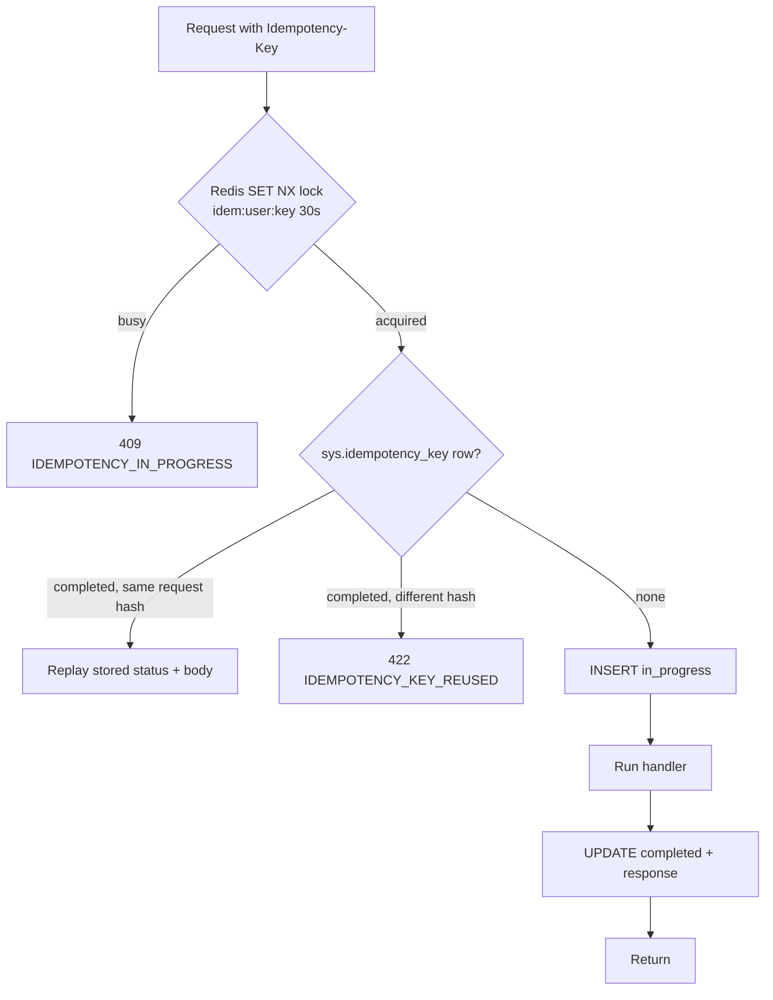

# Backend Cross-Cutting Design

Concerns shared by all 21 modules. The code shown is the reference shape for the implementation. Names match
`db/migrations` exactly.

## Contents

1. [Composition root & lifecycle](#1-composition-root--lifecycle)
2. [Configuration](#2-configuration)
3. [HTTP layer](#3-http-layer)
4. [Authentication](#4-authentication)
5. [Authorization](#5-authorization)
6. [Persistence, transactions & RLS](#6-persistence-transactions--rls)
7. [Domain modeling rules](#7-domain-modeling-rules)
8. [Idempotency](#8-idempotency)
9. [Domain events: outbox → queue → subscribers](#9-domain-events-outbox--queue--subscribers)
10. [Background jobs & scheduling](#10-background-jobs--scheduling)
11. [Approval workflow engine](#11-approval-workflow-engine)
12. [Notification hub](#12-notification-hub)
13. [Files & object storage](#13-files--object-storage)
14. [Documents & PDF rendering](#14-documents--pdf-rendering)
15. [Global search](#15-global-search)
16. [Caching](#16-caching)
17. [Errors](#17-errors)
18. [Observability](#18-observability)
19. [Security controls](#19-security-controls)
20. [Localisation, time & numbers](#20-localisation-time--numbers)

---

## 1. Composition root & lifecycle

```ts
// src/main.http.ts
const config = loadConfig();                                   // throws on invalid env (fail fast)
const container = buildContainer(config);                      // pools, redis, logger, adapters (singletons)
const modules = enabledModules(MODULES, config);               // all code modules; per-org switches checked at runtime
modules.forEach((m) => m.register(container));
const app = createHttpApp(container, modules);                 // middleware + mountController for every controller
const server = app.listen(config.PORT);
registerShutdown({ server, container, timeoutMs: 25_000 });    // SIGTERM: stop accepting, drain, close pools/queues
```

```ts
// src/main.worker.ts
const container = buildContainer(loadConfig());
MODULES.forEach((m) => m.register(container));
const worker = createWorkerApp(container, MODULES);            // processors for every jobs() + subscriptions()
await worker.start();                                          // + leader election for schedules() and outbox relay
registerShutdown({ worker, container, timeoutMs: 60_000 });    // finish in-flight jobs, then exit
```

Registration lifetimes:

| Lifetime | What |
|---|---|
| Singleton | `config`, `logger`, `db` (primary Drizzle), `replicaDb`, `redis`, queue factory, S3 client, browser pool, gateway/SMS adapters, `clock`, `fieldCipher` |
| Scoped (per request or per job) | `ctx` (RequestContext), `uow`, repositories, use cases, queries, `scopePolicy`, `outbox`, module public-API implementations |

Health endpoints (no auth, not logged at info): `GET /health/live` (process up) and `GET /health/ready` (PG `SELECT 1`,
Redis `PING`, migrations at the expected version from `sys.schema_migration`).

---

## 2. Configuration

All configuration comes from environment variables, validated with Zod at boot. Secrets are injected by the platform
(vault / secret manager) and are never committed.

| Variable | Example | Notes |
|---|---|---|
| `NODE_ENV` | `production` | |
| `PORT` | `8080` | |
| `PUBLIC_BASE_URL` | `https://api.lighthouseschoolbd.com` | Webhook/IPN URLs, links in SMS |
| `WEB_BASE_URL` | `https://app.lighthouseschoolbd.com` | CORS origin, pay-links |
| `DATABASE_URL` / `DATABASE_REPLICA_URL` | `postgres://sms_app@pgbouncer:6432/school_platform` | Runtime role `sms_app` (`sms_worker` in worker) |
| `DB_POOL_MAX` | `20` | Per process; PgBouncer multiplexes |
| `REDIS_URL` | `redis://redis:6379/0` | `maxmemory-policy noeviction` |
| `JWT_PRIVATE_KEY` / `JWT_PUBLIC_KEYS` | PEM (Ed25519) | Multiple public keys allow rotation (`kid`) |
| `FIELD_KEK_ID` + KMS credentials | | Envelope encryption master key |
| `BLIND_INDEX_KEY` | 32 bytes base64 | HMAC key for `*_bidx` |
| `S3_ENDPOINT`, `S3_BUCKET_PRIVATE`, `S3_BUCKET_PUBLIC`, `S3_REGION` | | Private bucket for documents, public for website media |
| `CLAMAV_HOST` | `clamav:3310` | |
| `SMS_PROVIDERS` | `["alpha","beta"]` + per-provider credentials | Primary + fallback |
| `PAYMENT_PROVIDERS` | `sslcommerz,bkash` + credentials, `*_SANDBOX=true` in non-prod | |
| `FCM_CREDENTIALS`, `SMTP_URL` / `SES_*`, `WHATSAPP_*` | | |
| `OTEL_EXPORTER_OTLP_ENDPOINT`, `SENTRY_DSN`, `LOG_LEVEL` | | |
| `FEATURE_FLAGS` | `{"exm.double_entry":true}` | Global flags; per-org module switches live in `core.org_module` |

Organisation-level, school-editable configuration lives in the database (`core.setting`, `com.notification_rule`,
`fee.late_fee_rule`, grading schemes, ...). It is read through `CoreModuleApi.getSetting(key, campusId?)` and cached
(§16).

---

## 3. HTTP layer

### 3.1 Middleware order

```
1  requestId            X-Request-Id in/out (ULID), AsyncLocalStorage log context
2  httpLogger           pino-http (method, route template, status, latency; no bodies)
3  helmet               security headers (CSP for API: default-src 'none')
4  cors                 allow-list: WEB_BASE_URL, site origin; credentials: true
5  compression          brotli/gzip > 1 KB
6  rawBody capture      only for /webhooks/* (signature verification)
7  body parsers         json 1 MB default (route can raise for imports); urlencoded for gateway IPNs
8  scopePerRequest      awilix child container per request
9  rateLimitGlobal      Redis sliding window: 600 req/min/user or IP
10 router               per route (built by mountController):
   ├─ authenticate      JWT (cookie or bearer) | apiKey | deviceHmac | webhook (none)
   ├─ rateLimit         route-specific (login, OTP, payments)
   ├─ authorize         permission code present in grants
   ├─ validate          Zod params/query/body (strict) → req.valid
   ├─ idempotency       Idempotency-Key for flagged routes
   └─ handler           controller method (async; Express 5 forwards rejections)
11 notFound             404 problem
12 errorHandler         AppError | ZodError | pg error → RFC 9457 problem+json
```

### 3.2 Controllers (class-based)

```ts
export interface RouteDefinition {
  method: 'get' | 'post' | 'put' | 'patch' | 'delete';
  path: string;
  handler: (req: Request, res: Response) => Promise<unknown>;
  auth?: 'user' | 'apiKey' | 'device' | 'webhook' | 'none';  // default 'user'
  permission?: PermissionCode;                                 // e.g. 'fee.payment.create'
  schema?: { params?: ZodType; query?: ZodType; body?: ZodType; response?: ZodType };
  idempotent?: boolean;
  rateLimit?: { points: number; durationSec: number; key: 'ip' | 'user' | 'identity' };
  bodyLimit?: string;                                          // '10mb' for imports
  summary: string;                                             // OpenAPI
}

export abstract class BaseController {
  abstract readonly basePath: string;
  abstract readonly tag: string;
  abstract routes(): RouteDefinition[];
  protected resolve<T>(req: Request, name: string): T { return req.container.resolve<T>(name); }
  protected ok<T>(res: Response, data: T) { return res.json({ data }); }
  protected created<T>(res: Response, data: T, location?: string) { if (location) res.location(location); return res.status(201).json({ data }); }
  protected accepted(res: Response, job: { jobId: string }) { return res.status(202).json({ data: job }); }
  protected page<T>(res: Response, p: Page<T>) { return res.json({ data: p.items, meta: { nextCursor: p.nextCursor } }); }
  protected etag(res: Response, rowVersion: number) { res.setHeader('ETag', `"${rowVersion}"`); }
}
```

`mountController()` builds the middleware chain from each `RouteDefinition` and registers the OpenAPI path from the
same object. The documented contract is therefore the enforced one. Response schemas are validated in
development and test only, to catch drift between the contract and the handlers.

### 3.3 Conventions

| Topic | Rule |
|---|---|
| URLs | `/api/v1/{module}/{resource}`; actions as sub-resources (`POST /exm/papers/{id}/lock`) |
| Envelope | `{ data, meta? }`; errors RFC 9457 |
| Pagination | Keyset: `?limit=50&cursor=<base64url(json{k:[sortValues], id})>`; `limit` ≤ 200; `ORDER BY <sort>, id` |
| Filters | Whitelisted per endpoint in the Zod query schema; `q` = trigram search |
| Sparse fields | `?fields=` whitelist for heavy list endpoints (portal, mobile) |
| Concurrency | `ETag` = `row_version`; `If-Match` required on PUT/PATCH of master data → `412` on mismatch |
| Long work | `202 { jobId }` → `GET /api/v1/jobs/{id}` (reads `sys.job_run`) → signed `resultUrl` |
| Dates | `YYYY-MM-DD` for school days (Asia/Dhaka), ISO UTC for instants |
| Money | integer paisa (`amountPaisa`) + optional `amountFormatted` |
| Campus context | `X-Campus-Id` on writes. It must be in `ctx.campusIds` and becomes `ctx.activeCampusId` |

---

## 4. Authentication

### 4.1 Credentials by user type

| User type | Primary | Second factor | Session |
|---|---|---|---|
| Staff | username/e-mail + password (argon2id) | TOTP mandatory if any role has `requires_mfa` | Web cookies / app bearer |
| Guardian | phone OTP (SMS) | — (device binding optional) | Long refresh (90 days) on app, 30 days web |
| Student (senior) | username + password | — | Web |
| Staff SSO (P2) | Google / Microsoft OIDC → `iam.external_identity` | TOTP still applies | |
| Public website | API key (`web.api_client`, `X-Api-Key`) | — | — |
| Device bridge | HMAC-SHA256 of body + timestamp with `att.device.secret_hash` | — | — |
| Payment/SMS webhooks | Provider signature + server-to-server validation | — | — |

### 4.2 Tokens

* **Access token**: JWT, EdDSA, 15 min. Claims: `sub` (user id), `org`, `typ` (user type), `av` (`authz_version`),
  `sid` (refresh family), `kid`. It carries no permissions. Grants are loaded server-side (§5) so they can change
  immediately.
* **Refresh token**: 256-bit random opaque value. Only `sha256` is stored (`iam.refresh_token.token_hash`). Rotated
  on every use. If an already-rotated token is presented again, the whole family is revoked (`revoke_reason = 'reuse'`)
  and a security alert is raised.
* **Web**: `__Host-access` and `__Host-refresh` cookies (`HttpOnly; Secure; SameSite=Lax; Path=/`). State-changing
  requests need the `X-CSRF-Token` header matching the `csrf` cookie (double submit). **Apps**: bearer access token;
  refresh token kept in the OS secure storage.
* **Logout**: revoke the family. **Password change / role change**: bump `iam.user_account.authz_version`, which
  invalidates cached grants and makes old access tokens fail the `av` check.

### 4.3 Brute-force protection

| Control | Rule |
|---|---|
| Login | 5 failures / 15 min per identity+IP → captcha; 10 → `locked_until` with exponential back-off; audit `LOGIN_FAILED` |
| OTP request | 3 per phone per 15 min, 10 per IP per hour; 6 digits, 5 min expiry, 5 attempts, hashed (`iam.otp_challenge`) |
| Enumeration | Same response for "unknown user" and "wrong password"; OTP request always answers "sent if registered" |
| Password policy | ≥ 10 characters; checked against the breached-password list (HIBP k-anonymity); no forced periodic rotation |

---

## 5. Authorization

### 5.1 Grant resolution

At login and on cache miss, the backend loads all active `iam.role_assignment` rows for the user, joins
`iam.role_permission`, and reduces them to:

```ts
interface Grants {
  campusIds: string[] | '*';                         // union of campus scopes ('*' if any org-scope assignment)
  byPermission: Map<PermissionCode, ScopeGrant[]>;   // e.g. 'att.daily.edit' -> [{scope:'own_classes', campusId:'…DHN'}]
}
```

Cached in Redis: `authz:{userId}:{authzVersion}`, TTL 10 min. Changing roles bumps `authz_version`, which makes the
key unreachable; no explicit delete is needed.

### 5.2 Three checks per request

| Layer | Check | Failure |
|---|---|---|
| Route | `grants.has(permission)` | 403 `FORBIDDEN` |
| Use case | `scopePolicy.assert(permission, target)`: is the target inside one of the granted scopes? | 403 `OUT_OF_SCOPE` (404 for guardians, to avoid revealing records) |
| Database | RLS by `app.campus_ids` | Rows invisible / `42501` on write |

### 5.3 Data scopes → SQL predicates

`ScopePolicy` turns a scope into a predicate used both for checks and for list filtering (`ScopedQuery`):

| Scope | Predicate on a student-related query |
|---|---|
| `org` | none (RLS limits to org) |
| `campus` | `campus_id = ANY(:grantedCampuses)` |
| `section` | `class_section_id IN (sections where ctx.staffId is head_of_section_staff_id)` |
| `own_classes` | `class_section_id IN (sections where class_teacher_staff_id = ctx.staffId)` ∪ teaching groups taught |
| `own_subjects` | `student_id IN (members of teaching groups where teaching_group_teacher.staff_id = ctx.staffId)` |
| `own_children` | `student_id IN (SELECT student_id FROM sis.student_guardian WHERE guardian_id = ctx.guardianId AND portal_access)` |
| `self` | `student_id = ctx.studentId` / `staff_id = ctx.staffId` |

The sets for `own_classes`, `own_subjects` and `own_children` are cached per request (and per user in Redis for 5 min),
because every portal request needs them.

### 5.4 Confidential records

Permissions flagged `is_sensitive` (SEN, counselling, safeguarding, IAM) require a **reason**
(`X-Access-Reason` header or body field) on read. The use case writes `iam.break_glass_access` in the same
transaction. A weekly review job sends unreviewed entries to the Principal.

---

## 6. Persistence, transactions & RLS

### 6.1 Pools and types

* Two Drizzle instances (node-postgres pools): `db` (primary) and `replicaDb` (read replica). Both connect through PgBouncer in
  transaction mode.
* `pg` type parsers: `int8` → `number` (guarded by `Number.isSafeInteger`; paisa values fit easily); `numeric` →
  `string` (converted to decimal value objects in the domain); `date` → `string` (`LocalDate`, never a JS `Date`).
* Table definitions are generated from the migrated database: `npm run db:schema` (`backend/scripts/gen-db-schema.ts`)
  → `src/shared/infrastructure/db/schema/<schema>.ts`, one file per module schema, with domain types mapped
  (`core.paisa` → number, `citext`, `bytea` → Buffer) and single-column `CHECK (... IN ...)` turned into literal unions.

### 6.2 UnitOfWork

Implementation: [`backend/src/shared/infrastructure/db/UnitOfWork.ts`](../../backend/src/shared/infrastructure/db/UnitOfWork.ts).
It stores the Drizzle transaction in AsyncLocalStorage, sets the five `app.*` settings with `set_config(..., true)`,
retries `40001/40P01`, joins nested calls, and runs `afterCommit()` hooks (e.g. enqueue jobs) only after COMMIT.

```ts
const uow = scope.resolve<UnitOfWork>('uow');          // request-scoped, knows ctx
await uow.run(async () => {
  const rows = await uow.tx().select().from(room);        // RLS applies (campus scope of ctx)
  uow.afterCommit(() => jobQueue.enqueue('notify', 'sms', payload));
});
```

* Every use case runs in exactly one `uow.run()`. Queries use `{ readOnly: true }` (replica). The replica can lag
  (< 1 s normally), so "read your own writes" screens such as receipt-after-payment read from the primary.
* Workers build a system `RequestContext` (`userId` = system user, `campusIds = '*'`, per organisation).
* External I/O (gateway, SMS, S3) never happens inside an open transaction. Use cases split work into "prepare in
  tx → call provider → record result in tx", or they push it to a job.

### 6.3 Repositories

* One repository per aggregate, interface in `domain/`, Drizzle class in `infrastructure/`.
* Load with an explicit lock when mutating money or stock: `.forUpdate()`, always `ORDER BY id` (deadlock-safe).
* Save the aggregate's changes plus `pullEvents()` → `OutboxWriter.write(events)` in the same transaction.
* Append-only tables (`fee.payment_allocation`, `exm.mark_entry`, `inv.stock_movement`, ...) expose only `append()`.
  Projections (`exm.mark_current`, `inv.stock_balance`) have read-only repositories.

### 6.4 Numbering

`NumberAllocator.next({ campusId, key, periodKey })` runs
`UPDATE core.number_sequence SET next_value = next_value + 1 ... RETURNING next_value - 1, format` inside the current
transaction and renders the format (`{CAMPUS}`, `{YYYY}`, `{YY}`, `{YYMM}`, `{SEQ:n}`). Because it holds a row lock
until commit, numbers are gap-free per campus and sequence. The row is created lazily for a new `period_key`
(`INSERT ... ON CONFLICT DO NOTHING`, then `UPDATE`).

### 6.5 Optimistic concurrency

Master-data updates use `UPDATE ... WHERE id = :id AND row_version = :expected RETURNING row_version`. Zero rows means
`StaleWriteError` (412). Financial and mark tables don't need this, because they are append-only.

---

## 7. Domain modeling rules

| Rule | Example |
|---|---|
| Aggregates guard their invariants; the DB guards them again | `Invoice.allocate()` refuses void invoices; `fee.tg_apply_allocation` and the `CHECK` reject over-allocation |
| Value objects for money, percent, dates, phone, codes | `Money.ofPaisa()`, `Percent.of('12.50')`, `LocalDate.parse('2026-11-03')`, `Phone.parseBd()` |
| No floating-point money | Percent discounts: `round_half_up(amount × bp / 10000)` in integer basis points |
| Domain services for cross-aggregate rules | `ConcessionCalculator`, `GradeCalculator`, `PromotionPolicy`, `LeaveDayCounter`, `TimetableClashChecker` |
| Domain events named in past tense, versioned | `fee.payment_received.v1` |
| No I/O in domain | Time via `Clock` port; holidays via a `SchoolCalendar` value object supplied by the use case |
| Configuration is data | Grading bands, late-fee rules and workflow steps are loaded and passed into domain services |

---

## 8. Idempotency

Required on: payments (counter, online start), attendance batches/sync, billing-run post, mark uploads, enrolment
conversion, bulk messages, imports commit.



* `request_hash` = sha256(method + path + canonical JSON body).
* Rows expire after 48 h (nightly purge).
* Domain-level idempotency also exists for every external callback: `fee.gateway_transaction.merchant_tran_id`,
  `att.device_event (device_id, bridge_seq)`, `adm.enrolment_conversion`, `fee.invoice_line (invoice_id, source, source_ref)`,
  `com.message_dedupe`.

---

## 9. Domain events: outbox → queue → subscribers

### 9.1 Contract

```ts
export interface DomainEvent<P = unknown> {
  type: `${string}.${string}.v${number}`;   // 'att.student_marked_absent.v1'
  aggregateType: string;
  aggregateId: string;
  orgId: string;
  campusId?: string;
  occurredAt: string;                        // ISO
  payload: P;                                // JSON, no PII beyond what consumers need
}
```

Payload types live in `packages/contracts/events/*.ts`. A breaking change means a new version (`.v2`). The producer
emits both versions until every consumer has migrated.

### 9.2 Pipeline

1. **Write**: `OutboxWriter.write(events)` inserts into `sys.outbox_event` inside the business transaction, then
   `NOTIFY outbox` (delivered on commit).
2. **Relay** (leader only): it `LISTEN`s, and also polls every 1 s as a safety net:
   `SELECT ... WHERE published_at IS NULL ORDER BY id LIMIT 500 FOR UPDATE SKIP LOCKED`. For each event it adds one
   BullMQ job per subscriber (`queue = events.<consumer-module>`, `jobId = <event_id>:<consumer>` so duplicates are
   ignored), then sets `published_at`.
3. **Consume**: `SubscriptionRunner` opens a UoW with a system context and inserts into
   `sys.processed_event (consumer, event_id) ON CONFLICT DO NOTHING`. If nothing was inserted, the event was already
   handled and is skipped. Otherwise it runs `handle()` and commits. The handler's effect and the inbox record share
   one transaction, which gives an exactly-once effect.
4. **Failures**: exponential back-off ×8, then the DLQ (`events.dlq`), with an alert and an admin replay screen.
5. Ordering is per aggregate (BullMQ group key = `aggregateId` for consumers that need order, e.g. search updates).

### 9.3 Subscriber shape

```ts
export class OnPaymentReceivedSendReceipt implements EventSubscription<PaymentReceivedV1> {
  readonly eventType = 'fee.payment_received.v1';
  readonly consumer = 'com.payment_receipt_notification';
  constructor(private d: { notifier: NotificationService; sisApi: SisModuleApi }) {}
  async handle(e: DomainEvent<PaymentReceivedV1>) {
    const payer = await this.d.sisApi.getFeePayerContact(e.payload.familyId);
    await this.d.notifier.dispatch({ eventCode: 'fee.payment_received', recipients: [payer],
      data: { amount: e.payload.amountFormatted, receipt_no: e.payload.receiptNo },
      dedupeKey: `fee.payment_received:${e.payload.paymentId}`, campusId: e.campusId });
  }
}
```

---

## 10. Background jobs & scheduling

### 10.1 Queues

| Queue | Concurrency | Limiter / grouping | Retries | Producer |
|---|---|---|---|---|
| `events.<module>` | 10 | group by aggregate where ordered | 8 exp → DLQ | outbox relay |
| `notify.sms` | 20 | per-provider limiter (e.g. 50/s); priority 1 = emergency | 5, then failover provider | NotificationService |
| `notify.push` / `notify.email` / `notify.whatsapp` | 50 / 20 / 20 | provider limits | 5 | NotificationService |
| `pdf.render` | 4 pages / worker | — | 3 | report cards, receipts, certificates, admit cards, payslips |
| `billing` | 1 per campus (group key) | — | resumable | `fee.billing_run` preview/post |
| `imports` / `exports` | 2 | exports on replica | 2 | users |
| `devices.ingest` | 4 | group by device | 5 | `/devices/v1/events:batch` |
| `files.scan` | 2 | — | 3 | upload completion |
| `payments.sweeper` / `payments.settlement` | 1 | — | — | schedule / upload |
| `maintenance` | 1 | — | — | schedule |

### 10.2 Job handler shape

```ts
export abstract class JobHandler<D> {
  abstract readonly queue: string;
  abstract readonly name: string;
  abstract handle(data: D, job: JobContext): Promise<void>;    // runs inside a scoped container + system ctx
}
// JobContext: updateProgress(pct) -> sys.job_run.progress, log(), attemptsMade, orgId
```

User-visible jobs (exports, PDF batches, billing runs, imports) create a `sys.job_run` row when they are queued and
update it as they run. Large batches are **chunked** (e.g. 200 invoices per child job, BullMQ flows), so a crash
resumes from the last committed chunk.

### 10.3 Schedules (leader-only, Asia/Dhaka)

| Schedule | Cron / interval | Job |
|---|---|---|
| Outbox relay | continuous (LISTEN + 1 s poll) | relay |
| Gateway sweeper | every 5 min | re-query `initiated/redirected/callback_received` older than 10 min |
| Escalations | every 15 min | `wf.approval_request.due_at` passed → escalate |
| BI refresh | every 15 min | `bi.campus_daily_kpi`, `bi.section_attendance_daily`, `bi.fee_aging` |
| Absence sweep | 10:30 on school days | flag sections not yet marked → remind class teachers |
| Late fees | 00:30 daily | apply `fee.late_fee_rule` → fine lines (`source_ref = late:{rule}:{stage}`) |
| Fee reminders | 10:00 daily | T-3 / due / +7 / +15 (`fee.reminder_offsets_days`) |
| Offer expiry | hourly | expire `adm.offer` past `expires_at`, promote waitlist |
| Attendance thresholds | 22:00 daily | compute %, raise `att.attendance_flag` |
| Expiry alerts | 08:00 daily | staff documents, vehicle papers, contracts, concessions |
| Partitions | 02:00 daily | `core.ensure_partitions(...)`, check default partitions empty |
| Purge | 03:00 daily | `sys.idempotency_key`, `com.message_dedupe`, expired OTPs, revoked refresh tokens > 90 days |
| Audit seal / verify | every min / 04:00 | `audit.audit_seal` chain |
| Scheduled reports | per `bi.saved_report.schedule_cron` | e-mail reports (BI-05) |
| SMS balance | hourly | `com.sms_provider_balance` low alert |

---

## 11. Approval workflow engine

A generic engine in `wf`, used by every module that needs approvals (leave, concessions, waivers, refunds,
certificates, marks re-open, payroll, purchases, payment reversal).

```ts
interface WorkflowModuleApi {
  submit(req: { definitionCode: string; subject: { module: string; type: string; id: string };
                summary: string; payload: Record<string, unknown>; campusId?: string }): Promise<{ requestId: string }>;
  cancel(requestId: string): Promise<void>;
}
```

* `submit` resolves the steps whose `condition` matches the `payload` (e.g. `{"amount_paisa":{"gt":1000000}}`). It
  then resolves the approvers for step 1 (role → users holding that role at the campus; `class_teacher`,
  `head_of_section` and `reporting_manager` resolved through SIS/ACA/HRM public APIs), creates
  `wf.approval_task` rows, and notifies the approvers.
* `POST /wf/requests/{id}/actions` → `approve | reject | return | delegate | comment`, written to
  `wf.approval_action` (append-only). Active `wf.delegation` rows are honoured.
* When the last step is approved (or on any reject), the engine publishes `wf.request_decided.v1 { subject, decision }`.
  The owning module's subscriber applies the decision, e.g. FEE sets `student_concession.status = 'approved'`.
* Escalation job: when `due_at` passes, a task goes to `escalate_to_role_id` and the approver is reminded.
* The approver inbox is a query on `wf.approval_task WHERE assignee_user_id = me AND status = 'open'`.

---

## 12. Notification hub

```mermaid
flowchart LR
  EV[Domain event / use case] --> NS[NotificationService.dispatch]
  NS --> R[Resolve recipients<br/>notification_rule + public APIs]
  R --> P[Preferences & quiet hours<br/>notification_preference]
  P --> T[Render template<br/>message_template active, locale]
  T --> DD[Dedupe<br/>Redis SETNX + com.message_dedupe]
  DD --> OM[INSERT com.outbound_message queued]
  OM --> Q{channel queue}
  Q --> SMS[SmsProvider adapters<br/>primary / fallback]
  Q --> PUSH[FCM]
  Q --> MAIL[SES / SMTP]
  Q --> WA[WhatsApp BSP]
  SMS --> DLR[/webhooks/sms/provider/dlr] --> OM2[UPDATE status delivered/failed]
```

| Rule | Detail |
|---|---|
| Channel choice | From `com.notification_rule` (Appendix C defaults). Push is preferred; SMS is used when the rule demands it, or as fallback if the user has no active push device |
| Quiet hours | Normal/low priority waits until the window ends (`scheduled_for`). `high`/`emergency` ignore quiet hours |
| Language | Recipient `preferred_locale` (guardians default `bn`); falls back to `en` template |
| SMS encoding | Any non-GSM-7 character → UCS-2 (Bangla): 70 chars single / 67 per segment. Segments and cost are stored per message. `POST /com/sms/estimate` exposes this to the UI |
| Dedupe | `dedupeKey` (e.g. `att.absent:{student}:{date}`) prevents duplicates when attendance is re-saved |
| Failover | Provider error or timeout → retry with back-off → after 2 failures switch to the fallback provider |
| Emergency broadcast | Priority-1 lane on all channel queues. Fan-out is chunked by 500 recipients |
| Delivery reports | `/webhooks/sms/{provider}/dlr`, FCM responses (`UNREGISTERED` → revoke `com.push_device`) |
| In-app | `channel = 'in_app'` rows are the inbox. `read_at` is set by `POST /com/inbox/{id}/read` |

---

## 13. Files & object storage

1. `POST /files/uploads { purpose, mimeType, sizeBytes, fileName }` → validates against the purpose policy (type
   whitelist, maximum size, who may upload). It creates `sys.stored_file (scan_status='pending')` and returns a
   presigned PUT (5 min, content-type and length locked).
2. The client uploads directly to S3.
3. `POST /files/{id}/complete` → server `HEAD` check (size, ETag), magic-byte sniff (`file-type`), queue `files.scan`.
4. Scan job: ClamAV → `clean` or `infected` (the object is deleted, the uploader notified, the event audited).
   Images are re-encoded with `sharp` (EXIF stripped, max 2048 px, WebP copy for the web).
5. Business use cases accept only `clean` files (e.g. attaching to `sis.student_document`).
6. Downloads: `GET /files/{id}/url` → permission check by purpose and owner → presigned GET (5–15 min,
   `Content-Disposition` set). PII is never put in object keys (`{org}/{module}/{yyyy}/{mm}/{uuid}`).
7. Website media go to a public bucket behind the CDN. Everything else goes to the private bucket with SSE.

---

## 14. Documents & PDF rendering

* Templates live in `doc.template` (Handlebars HTML + print CSS, `merge_schema` JSON schema), are versioned, and are
  edited by admins. Report-card templates are per programme.
* `DocumentService.render(templateCode, data, locale)` validates the data against `merge_schema`, renders the HTML,
  and passes it to `HtmlPdfRenderer`. That renderer uses a **BrowserPool** (Playwright Chromium, 1 browser per
  worker, 4 pages, recycled after 200 renders) with embedded Noto Sans Bengali / Hind Siliguri fonts. The PDF is
  uploaded to S3 and stored in `sys.stored_file`.
* QR codes encode `https://<site>/verify/<verification_code>`. Codes are 20-character base32 random values with no
  information inside. The public verify endpoint shows only `public_fields`.
* Batches (report cards for an exam, ID cards for a class) use a BullMQ flow: one parent job plus a child job per
  50 documents. When all children finish, an optional ZIP/merged PDF is produced. Progress is shown in `sys.job_run`.
* Certificates are issued in one transaction: serial number (`core.number_sequence`) → `doc.issued_document`
  (`data_snapshot` frozen) → render job. Reprints reuse the snapshot and increment `print_count`.

---

## 15. Global search

* Every owning module publishes `*.changed.v1` events for searchable entities: student, guardian, staff, invoice,
  receipt, application.
* The `search` subscriber upserts `search.document` (title, subtitle, `search_text`, route, `required_permission`).
  It is grouped by aggregate, so updates stay in order.
* `GET /search?q=` queries
  `WHERE search_text % :q OR search_text ILIKE :q || '%' ORDER BY similarity DESC LIMIT 20`, filtered by campus (RLS)
  and by the user's grants (`required_permission`). Exact numeric matches (admission number, phone, invoice number)
  are boosted.
* A nightly rebuild job can repopulate the read model from source modules (public API `listForSearch(cursor)`).

---

## 16. Caching

| Key | Content | TTL | Invalidation |
|---|---|---|---|
| `authz:{user}:{authzVersion}` | Grants | 10 min | Version bump on role/password change |
| `scope:{user}:{kind}` | own_classes / own_subjects / own_children id sets | 5 min | Events: allocation changed, guardian link changed |
| `settings:{org}:{campus}` | Merged `core.setting` | 5 min | `core.setting_changed` event |
| `ref:{org}:{name}` | Grading schemes, fee heads, lookups, templates | 30 min | Change events |
| `portal:results:{student}:{exam}` | Published result payload | 24 h | Warm-up on `exm.results_published`; removed on republish |
| `rate:*`, `idem:*`, `lock:*` | Rate limits, idempotency locks, leader/job locks | short | Expiry |

Nothing financial (balances, dues) is cached. Those values are always read from the database.

---

## 17. Errors

| Class | HTTP | Code examples |
|---|---|---|
| `ValidationError` (Zod) | 422 | `VALIDATION_FAILED` + `errors[{path, code, message}]` |
| `InvariantError` | 422 | `INVOICE_VOID`, `ALLOCATION_EXCEEDS_DUE`, `LEAVE_BALANCE_INSUFFICIENT`, `PAPER_LOCKED` |
| `NotFoundError` | 404 | `NOT_FOUND` |
| `ForbiddenError` | 403 | `FORBIDDEN`, `OUT_OF_SCOPE`, `MFA_REQUIRED`, `REASON_REQUIRED` |
| `AuthError` | 401 | `UNAUTHENTICATED`, `TOKEN_EXPIRED`, `REFRESH_REUSED` |
| `ConflictError` | 409 | `DUPLICATE`, `OVERLAP`, `IDEMPOTENCY_IN_PROGRESS`, `CASH_SESSION_REQUIRED` |
| `StaleWriteError` | 412 | `PRECONDITION_FAILED` |
| `RateLimitError` | 429 | `RATE_LIMITED` (+ `Retry-After`) |
| `DependencyError` | 502/503 | `GATEWAY_UNAVAILABLE`, `SMS_PROVIDER_DOWN` |

PostgreSQL mapping: `23505` → 409 `DUPLICATE` · `23514` / `P0001` raised by business triggers → 422 (the trigger
message is mapped to a stable code via a constraint/trigger-name table) · `23P01` → 409 `OVERLAP` · `23503` → 422
`REFERENCE_INVALID` · `42501` → 403 · `40001/40P01` → retried by UoW, then 503.

Every problem body includes `code`, `title` (localised), `detail`, `requestId`. Stack traces are never returned.

---

## 18. Observability

| Signal | Implementation |
|---|---|
| Logs | pino JSON: `time, level, msg, requestId, userId, orgId, campusId, module, useCase, durationMs`. PII redaction paths: `*.password`, `*.otp`, `*.nid`, `*.phone` (masked), auth headers, cookies |
| Metrics | `http_request_duration_seconds{route,method,status}`, `usecase_duration_seconds{name}`, `db_pool_*`, `outbox_lag_seconds`, `queue_waiting{queue}`, `queue_failed_total`, `sms_sent_total{provider,status}`, `payment_attempts_total{provider,status}`, `pdf_render_seconds`, `rls_denied_total` |
| Traces | OpenTelemetry auto-instrumentation (http, express, pg, ioredis, bullmq) + manual spans per use case; trace id in logs and problem bodies |
| Errors | Sentry (api + worker) with release, user id (no PII), request id |
| Audit | DB trigger audit plus app events (`LOGIN`, `LOGIN_FAILED`, `EXPORT`, `BREAK_GLASS`, `CERT_ISSUE`, `IMPERSONATION` (disabled by default)) |

---

## 19. Security controls

| Area | Control |
|---|---|
| Input | Zod `.strict()` schemas. Unknown fields are rejected (mass assignment). Strings are length-limited. HTML only in notices/templates, sanitized with `sanitize-html` allow-list |
| SQL | Drizzle query builder / `sql` tagged templates (parameterised) only. `sql.raw` is banned by lint (`no-restricted-syntax`) |
| SSRF | Outbound HTTP only to configured provider hosts (undici dispatcher with an allow-list) |
| Secrets | Env/vault only. Gateway credentials never logged. Keys rotated with `kid` |
| Field encryption | `FieldCipher.encrypt(plain)` → `v1:` + AES-256-GCM. A data key per organisation is wrapped by the KMS KEK and cached in memory for 1 h. `BlindIndex.of(normalised)` = HMAC-SHA256 → `*_bidx`. Rotation re-encrypts lazily on write |
| Headers | HSTS, `X-Content-Type-Options`, `Referrer-Policy: no-referrer`, `frame-ancestors 'none'` |
| CORS | Exact origins. Credentials only for the web app origin |
| Webhooks | Signature + timestamp tolerance (5 min) + replay protection (stored provider id) + server-to-server validation before any state change |
| Device API | HMAC per device, clock-skew window, `bridge_seq` dedupe, per-device rate limit |
| Data exports | Permission `*.export`; audited; large exports watermarked with user/time; alert on volume spikes |
| Dependency hygiene | Renovate, `pnpm audit`, SBOM, image scanning (Trivy) |

---

## 20. Localisation, time & numbers

* `Accept-Language` (`bn` or `en`) sets `ctx.locale`. Message catalogues for problem titles, notification templates
  and PDF labels.
* School dates are computed in **Asia/Dhaka** (`LocalDate.today(clock, 'Asia/Dhaka')`). This matters for attendance
  dates, due dates and late-fee runs after midnight UTC+6.
* The working week comes from `core.setting 'week.working_days'` (default Sat–Thu). Holidays come from
  `core.calendar_event` (`is_instructional = false`). `SchoolCalendar` answers `isSchoolDay(date, campusId)`.
* Hijri dates: `Intl.DateTimeFormat('bn-BD-u-ca-islamic-umalqura')` plus the `core.hijri_adjustment` offset.
* Number formatting: `Intl.NumberFormat('bn-BD')` (Bangla digits) or `'en-IN'` (lakh/crore grouping); currency ৳.
