# Backend Flows

Sequence diagrams for the critical journeys. Participants are modules or components. "DB" means one transaction with
the RLS context set (see [cross-cutting §6](cross-cutting.md#6-persistence-transactions--rls)).

## Contents

1. [Staff login with MFA](#1-staff-login-with-mfa)
2. [Guardian OTP login & refresh rotation](#2-guardian-otp-login--refresh-rotation)
3. [Monthly billing run](#3-monthly-billing-run)
4. [Online payment (gateway)](#4-online-payment-gateway)
5. [Counter payment & cash session](#5-counter-payment--cash-session)
6. [Late fees & reminders](#6-late-fees--reminders)
7. [Daily attendance & absence alert](#7-daily-attendance--absence-alert)
8. [Device ingest (biometric / RFID)](#8-device-ingest-biometric--rfid)
9. [Leave with approval workflow](#9-leave-with-approval-workflow)
10. [Marks → moderation → lock → results → report cards](#10-marks--moderation--lock--results--report-cards)
11. [Admission → enrolment](#11-admission--enrolment)
12. [Academic-year rollover](#12-academic-year-rollover)
13. [Notification dispatch](#13-notification-dispatch)
14. [File upload](#14-file-upload)
15. [Teacher cover (substitution)](#15-teacher-cover-substitution)
16. [Payroll](#16-payroll)

---

## 1. Staff login with MFA

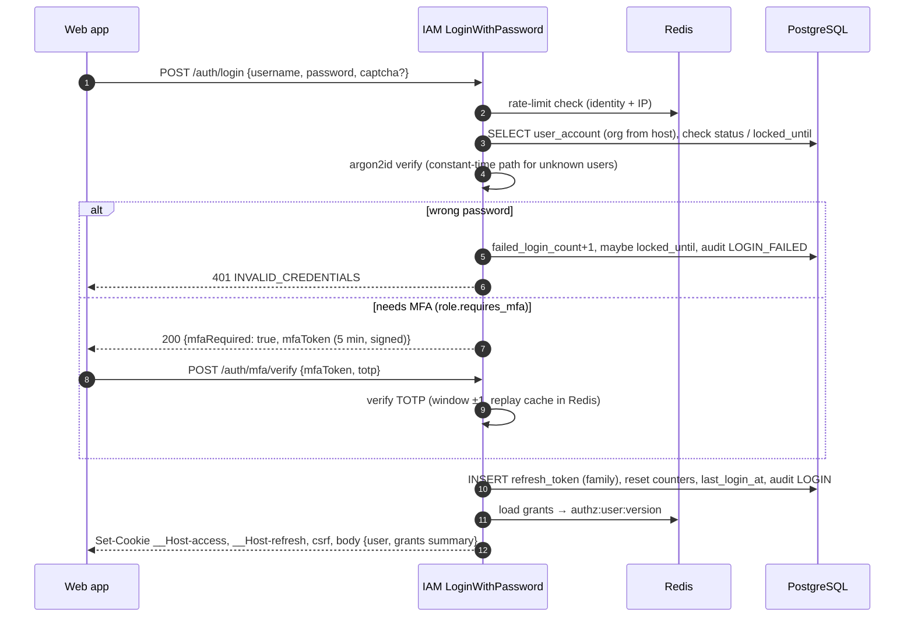

## 2. Guardian OTP login & refresh rotation

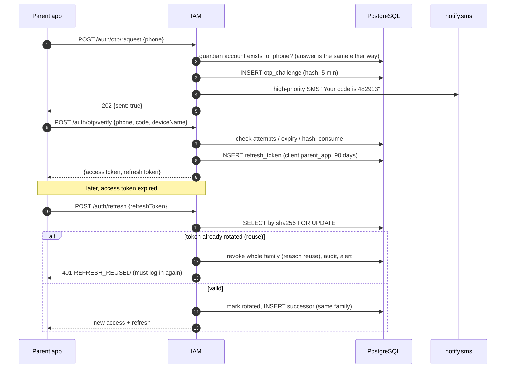

## 3. Monthly billing run

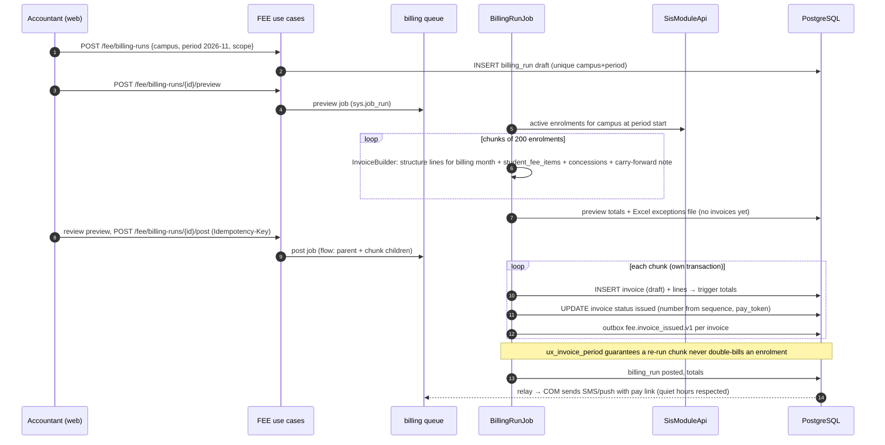

## 4. Online payment (gateway)

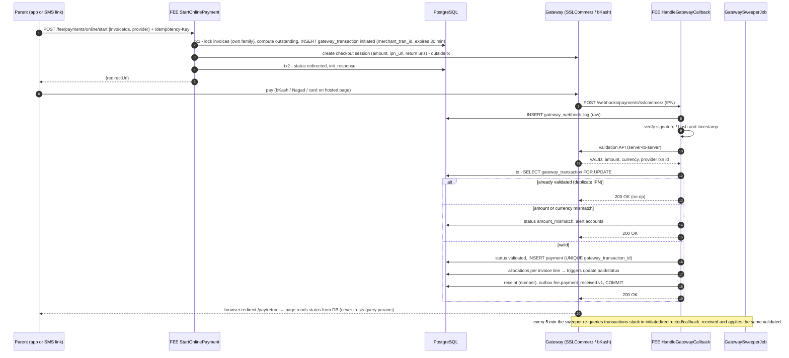

## 5. Counter payment & cash session

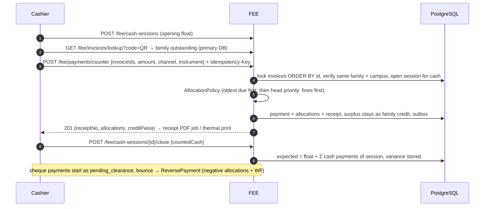

## 6. Late fees & reminders

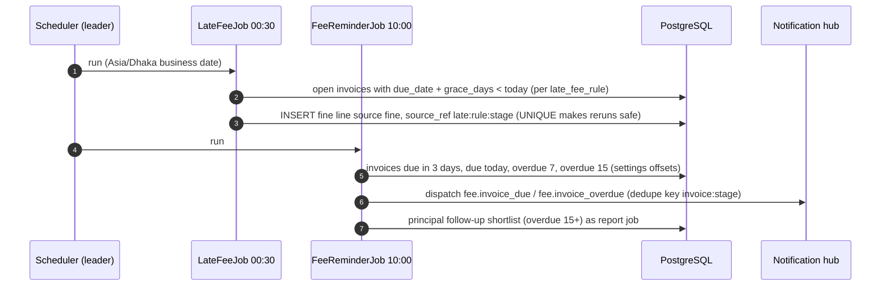

## 7. Daily attendance & absence alert

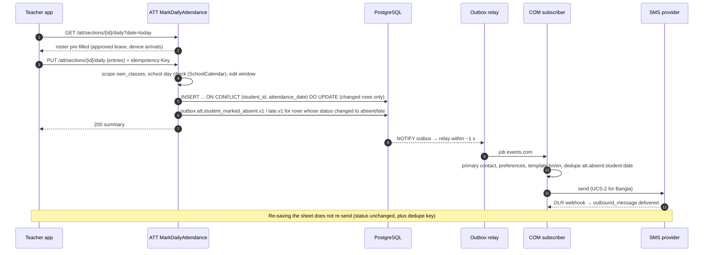

## 8. Device ingest (biometric / RFID)

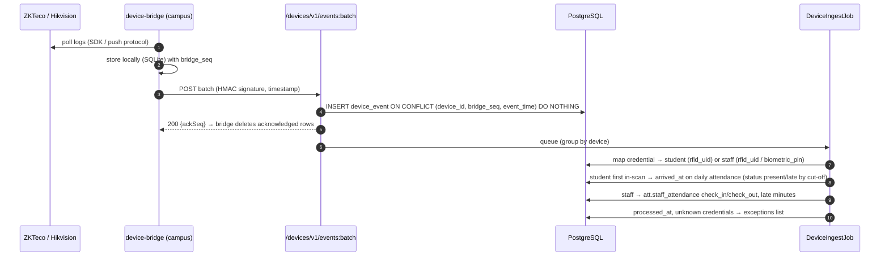

## 9. Leave with approval workflow

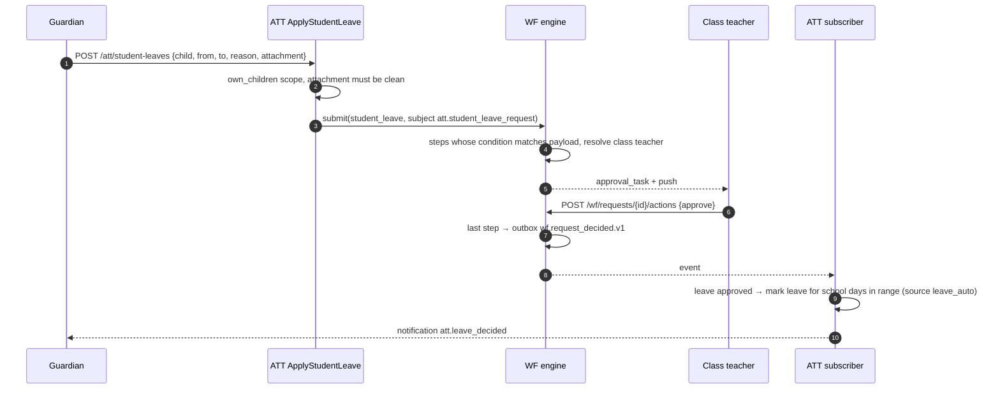

## 10. Marks → moderation → lock → results → report cards

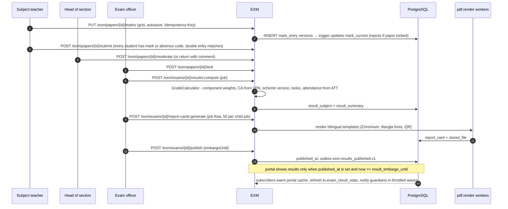

## 11. Admission → enrolment

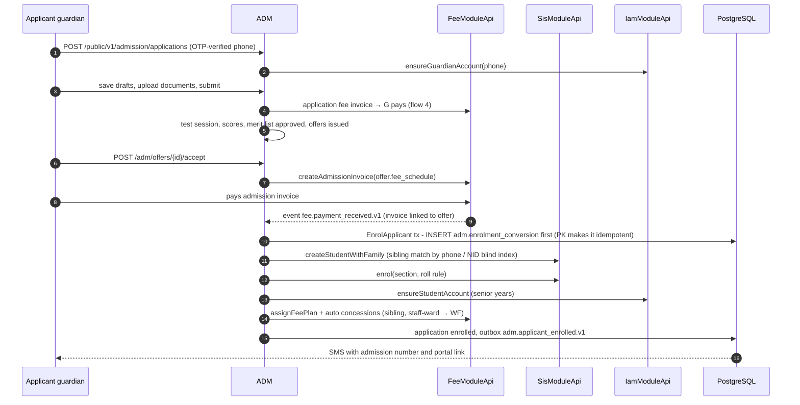

## 12. Academic-year rollover

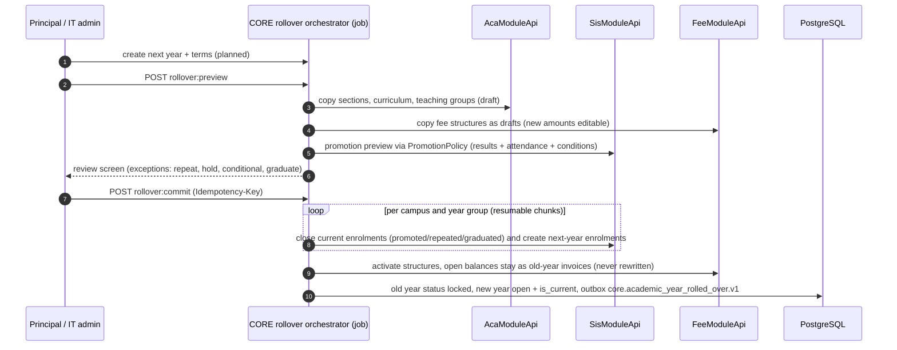

## 13. Notification dispatch

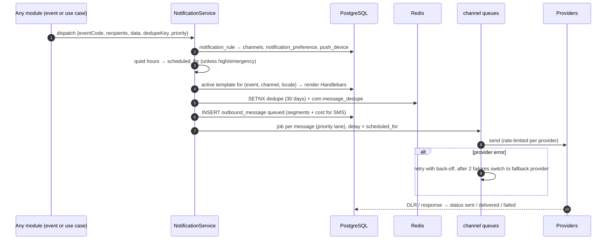

## 14. File upload

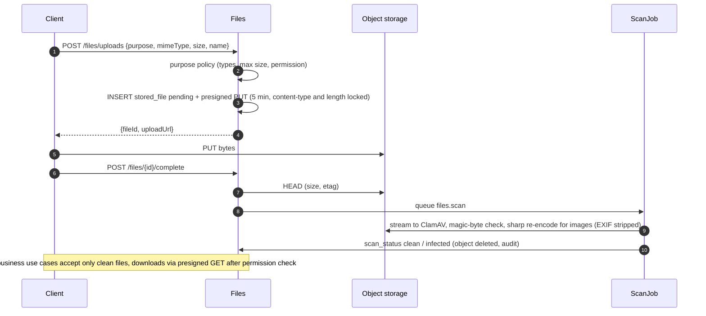

## 15. Teacher cover (substitution)

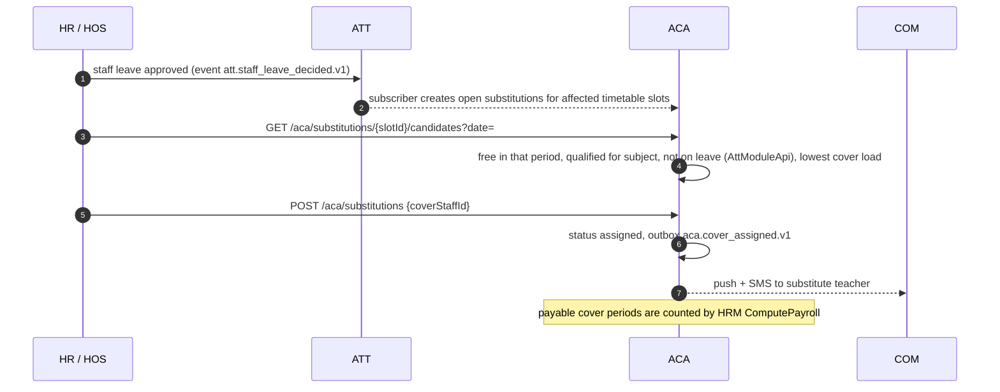

## 16. Payroll

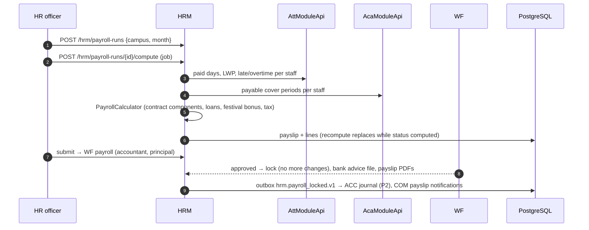
