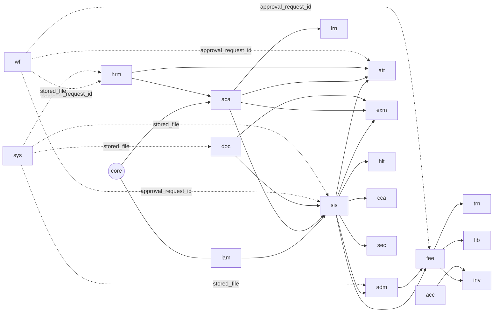
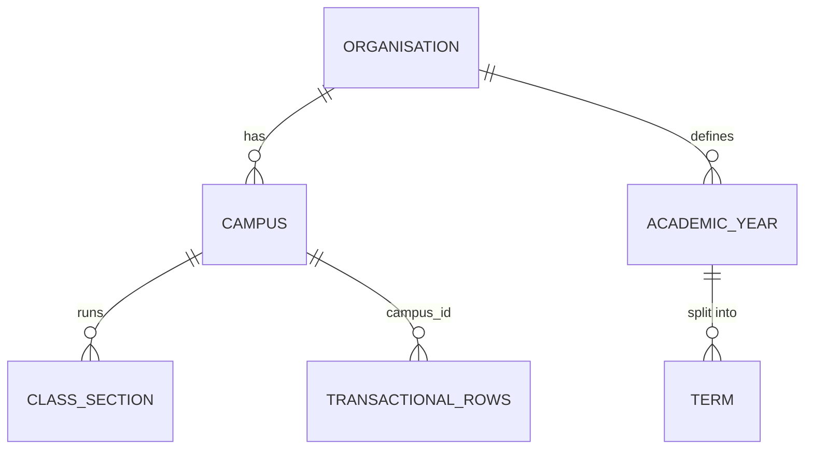
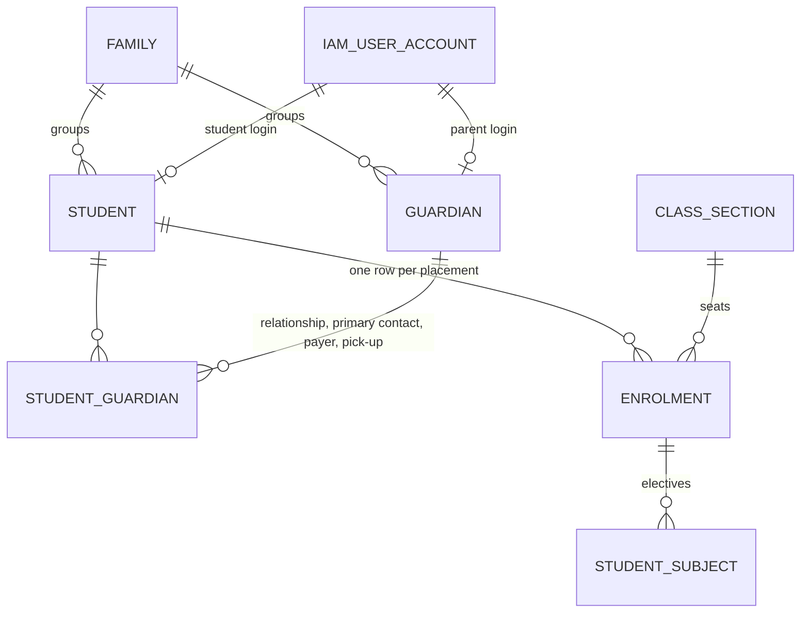
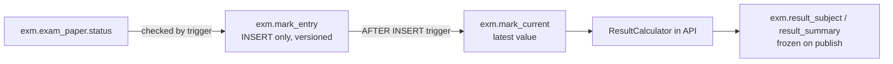
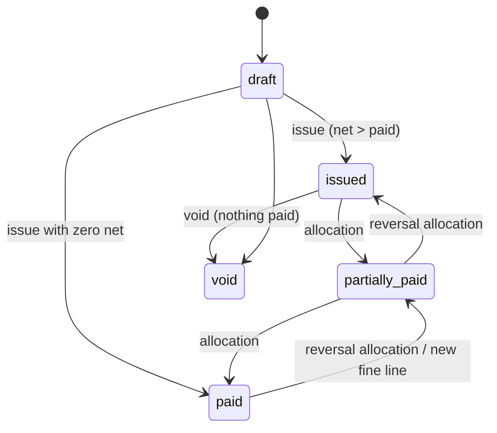

# School Management Platform — Database Design & Documentation

| Item | Value |
|---|---|
| Engine | PostgreSQL 18 (16+ supported; PG 16/17 need app-generated UUIDv7 instead of `uuidv7()`) |
| Source of truth | [`db/migrations/`](../../db/migrations) (SQL-first, ordered) |
| Data dictionary | [`docs/database/schemas/`](schemas/README.md) — generated from the live database |
| Design context | [`SYSTEM_DESIGN.md`](../../SYSTEM_DESIGN.md) §5–6 (architecture, tenancy, rationale) |
| Size | 26 schemas · 280 tables · 3,228 columns · 759 foreign keys · 293 check constraints · 7 exclusion constraints · 883 indexes · 8 partitioned tables |
| Verified | Rebuilt from scratch and tested on PostgreSQL 18 — 24/24 invariant tests pass as the runtime role |

---

## Contents

1. [Quick start](#1-quick-start)
2. [Folder layout](#2-folder-layout)
3. [Schema map](#3-schema-map)
4. [Core model walkthrough](#4-core-model-walkthrough)
5. [Modeling conventions](#5-modeling-conventions)
6. [Security inside the database](#6-security-inside-the-database)
7. [Integrity rules enforced by the database](#7-integrity-rules-enforced-by-the-database)
8. [Triggers](#8-triggers)
9. [Partitioning & maintenance](#9-partitioning--maintenance)
10. [Reference data (seeds)](#10-reference-data-seeds)
11. [Migration workflow](#11-migration-workflow)
12. [Contract for the application (Node.js API)](#12-contract-for-the-application-nodejs-api)
13. [Known limitations & next steps](#13-known-limitations--next-steps)

---

## 1. Quick start

Prerequisites: PostgreSQL 18 server, `psql` on `PATH`, Bash (Linux/macOS, or Git Bash on Windows), Python 3.10+
(only for regenerating docs).

```bash
# 1. One-time, as a superuser: roles, database, untrusted extensions
psql -U postgres -d postgres -v db=school_platform -f db/migrations/0000_bootstrap.sql
#    then set passwords out-of-band, e.g. ALTER ROLE sms_owner PASSWORD '...'; (never commit them)

# 2. Migrations, as the schema owner (tracks versions in sys.schema_migration)
PGUSER=sms_owner PGDATABASE=school_platform bash db/tools/migrate.sh

# 3. Reference data for one organisation (idempotent)
psql -U sms_owner -d school_platform -v org_code=LIS -v org_name='Lighthouse International School' \
     -f db/seeds/0001_permissions.sql -f db/seeds/0002_organisation_reference_data.sql

# 4. Invariant tests, as the RUNTIME role (RLS + grants enforced; everything rolled back)
psql -U sms_app -d school_platform -v ON_ERROR_STOP=1 -f db/tests/invariants.sql

# Dev/CI shortcut: drop + rebuild + seed + test a throw-away database (refuses the prod name)
DB=school_platform_dev PGSUPERUSER=postgres bash db/tools/rebuild-and-test.sh

# Regenerate comments migration and the data dictionary after schema changes
python db/tools/gen_comments.py
PGUSER=sms_owner PGDATABASE=school_platform_dev python db/tools/gen_docs.py
```

---

## 2. Folder layout

```
db/
├─ migrations/
│  ├─ 0000_bootstrap.sql          # superuser: roles, database, pg_stat_statements
│  ├─ 0001_foundation.sql         # schemas, extensions, collations, domains, RLS/audit/touch helpers
│  ├─ 0002_core.sql … 0016_doc_web_bi.sql   # Phase-1 modules (one file per module)
│  ├─ 0017_lrn_p2.sql … 0026_sec_prt.sql    # Phase-2/3 modules
│  ├─ 0029_cross_module_fks.sql   # FKs across schemas + convention FKs (org/campus/file/approval)
│  ├─ 0030_standardize.sql        # [repeatable] touch triggers, RLS policies, audit triggers by catalog
│  ├─ 0031_partitions.sql         # core.ensure_partitions() + initial partitions
│  ├─ 0032_grants.sql             # [repeatable] least-privilege grants, append-only revokes
│  ├─ 0033_fk_indexes.sql         # [repeatable] index every unindexed FK
│  └─ 0090_comments.sql           # [repeatable, GENERATED] table/column comments
├─ seeds/
│  ├─ 0001_permissions.sql        # 264 permission codes
│  └─ 0002_organisation_reference_data.sql  # org, campuses, roles+matrix, grading, fees, leave, workflows, templates
├─ tests/invariants.sql           # 24 executable invariant checks
└─ tools/
   ├─ migrate.sh                  # ordered, checksummed migration runner
   ├─ rebuild-and-test.sh         # dev/CI full rebuild
   ├─ gen_comments.py             # builds 0090_comments.sql from TABLE_DESC + inline SQL comments
   └─ gen_docs.py                 # builds docs/database/schemas/*.md from the live catalog
```

---

## 3. Schema map

One schema per module (spec §5.1 "own database schema namespaces"). Click a schema for its ER diagram and full
column-level dictionary.

| Schema | Module | Phase | Tables | Highlights |
|---|---|---|---|---|
| [`core`](schemas/core.md) | Organisation, campuses, years, terms, rooms, calendar, settings, numbering | P1 | 12 | Overlap-free years/terms (exclusion constraints), gap-free `number_sequence` |
| [`iam`](schemas/iam.md) | Users, roles, permissions, sessions, consent | P1 | 10 | Permission × data scope × campus; rotating refresh tokens |
| [`audit`](schemas/audit.md) | Audit trail | P1 | 2 | Monthly partitions, hash-chain seals, append-only |
| [`wf`](schemas/wf.md) | Approval workflows | P1 | 6 | Multi-step, conditions, delegation, escalation |
| [`sys`](schemas/sys.md) | Outbox, idempotency, files, imports, jobs, migrations | P1 | 7 | Transactional outbox, idempotency keys |
| [`search`](schemas/search.md) | Global search read model | P1 | 1 | Trigram GIN over English + Bangla + IDs + phones |
| [`sis`](schemas/sis.md) | Students, guardians, families, enrolment history | P1 | 13 | `enrolment` history with no overlaps; one family across campuses |
| [`adm`](schemas/adm.md) | Enquiry → application → test → merit → offer | P1 | 11 | Idempotent `enrolment_conversion` |
| [`aca`](schemas/aca.md) | Programmes, sections, teaching groups, timetable | P1 | 15 | Clash-free slots (teacher/room/group uniqueness) |
| [`att`](schemas/att.md) | Student/staff attendance, devices, leave | P1 | 11 | Yearly partitions; leave balances cannot be overdrawn |
| [`lrn`](schemas/lrn.md) | Homework, diary, resources, gradebook, quizzes | P1/P2 | 14 | |
| [`exm`](schemas/exm.md) | Exams, marks, grading, results, report cards, Edexcel | P1/P2 | 19 | Append-only versioned marks, lock enforced by trigger |
| [`fee`](schemas/fee.md) | Structures, invoices, payments, gateways, reconciliation | P1/P2 | 20 | Paisa-exact, trigger-maintained totals, no over-allocation |
| [`acc`](schemas/acc.md) | Chart of accounts, journals, budgets, procurement | P2/P3 | 15 | Balanced journals checked at COMMIT |
| [`hrm`](schemas/hrm.md) | Staff, contracts, payroll, recruitment, appraisal | P1/P2 | 23 | Non-overlapping contracts, locked payroll |
| [`com`](schemas/com.md) | Notices, templates, notification hub, messaging | P1/P2 | 22 | Monthly-partitioned outbound messages with DLR status |
| [`prt`](schemas/prt.md) | Portal forms & consents | P2 | 2 | E-signature submissions |
| [`doc`](schemas/doc.md) | Templates, issued documents | P1 | 2 | Serial numbers + QR verification code |
| [`web`](schemas/web.md) | Website CMS, API clients | P1 | 4 | Photo consent flags |
| [`bi`](schemas/bi.md) | KPI snapshots, saved reports | P1 | 5 | Refreshed every 15 min |
| [`trn`](schemas/trn.md) | Transport | P2/P3 | 13 | No overlapping route assignment; GPS daily partitions |
| [`lib`](schemas/lib.md) | Library | P2/P3 | 8 | One active loan per copy |
| [`inv`](schemas/inv.md) | Inventory, POS, assets, maintenance | P2/P3 | 13 | Stock ledger + never-negative balance |
| [`hlt`](schemas/hlt.md) | Health, behaviour, counselling, safeguarding | P1/P2 | 10 | Encrypted details, restricted tables |
| [`cca`](schemas/cca.md) | Houses, clubs, events, Quran progress, donations | P1/P2/P3 | 14 | Donations kept separate from fees |
| [`sec`](schemas/sec.md) | Visitors, safe pick-up, gate events, drills | P2/P3 | 8 | Pick-up only via active authorisation |

### Module dependencies (foreign keys)



---

## 4. Core model walkthrough

### 4.1 Tenancy



* Every business row carries `org_id`; every transactional row also carries `campus_id` (nullable only for org-wide
  rows such as a notice to all campuses or an org-level setting).
* Campus isolation is enforced twice: by the API (permission scope) and by PostgreSQL row-level security (§6.3).

### 4.2 People, families and enrolment history



* **Family** is the billing and login unit: siblings on different campuses share one family, one parent login and one
  combined fee statement (SIS-02, PRT-08).
* **Enrolment** is history, not a column on the student: a mid-year section/campus transfer closes one row and opens
  another (`previous_enrolment_id`). An exclusion constraint makes overlapping placements impossible; year rollover
  creates next year's rows. `sis.student.campus_id` is a denormalised "current campus".
* Exactly one primary contact per student (partial unique index) receives absence SMS.

### 4.3 Academic structure: ClassSection vs TeachingGroup

* **ClassSection** = registration/pastoral class (Year 7 - A): class teacher, roll numbers, daily attendance.
* **TeachingGroup** = instructional group for one subject: either a whole section or an elective set that spans sections
  (IGCSE/IAL options). Timetable slots, homework, gradebook and period attendance reference teaching groups.
* `aca.timetable_slot` has three uniqueness rules per (timetable, day, period): group, teacher, room → clash-free by
  construction. Student-level clashes across elective groups are validated by the application before publishing.

### 4.4 Examinations: append-only marks



* Every change is a new `mark_entry` row (`version`, `change_reason`); the runtime role has no UPDATE/DELETE grant.
* `exm.mark_current` (trigger-maintained, not writable by the app) gives the latest value per component and student.
* Entries are rejected unless the paper is `open` or `reopened`; reopening requires the `marks_reopen` workflow.
* Grade bands per scheme cannot overlap (exclusion constraint on `numrange`).

### 4.5 Fees: invoice lifecycle and allocation



* Money is `bigint` paisa everywhere (`core.paisa`, `core.paisa_nn`).
* `invoice.gross/discount/net` = sum of lines (trigger). Lines can change only while the invoice is a draft; afterwards
  corrections are new lines (`source = 'adjustment'` may be negative; `'fine'` adds late fees idempotently via
  `UNIQUE (invoice_id, source, source_ref)`).
* `payment_allocation` is append-only: positive rows apply money to a line, negative rows (with
  `reverses_allocation_id`) undo it. A trigger updates `invoice_line.paid_paisa` and `invoice.paid_paisa/status`;
  `CHECK (paid ≤ net)` makes over-allocation impossible.
* One payment per gateway transaction (`fee.payment.gateway_transaction_id UNIQUE`) and `merchant_tran_id UNIQUE`
  → duplicate webhooks cannot create duplicate payments.
* Unallocated money is family credit, visible in the view `fee.v_family_credit`.

### 4.6 Accounting and stock (P2/P3)

* `acc.journal_line` has exactly one non-zero side; a **deferred constraint trigger** checks Σ debit = Σ credit and that
  the fiscal period is not locked, at COMMIT time. Posted journals are corrected by reversal journals.
* `inv.stock_movement` is the append-only stock ledger; a trigger upserts `inv.stock_balance` whose
  `CHECK (qty_on_hand >= 0)` rejects any movement that would make stock negative, atomically.

---

## 5. Modeling conventions

| Topic | Rule |
|---|---|
| Keys | `uuid DEFAULT uuidv7()` (time-ordered, index-friendly, safe to expose). High-volume append-only tables use `bigint GENERATED ALWAYS AS IDENTITY`. |
| Naming | `snake_case`; singular table names; FK column = `<entity>_id`; index `ix_<table>_<cols>`, unique `ux_…`, FK index `…_fk` |
| Standard columns | `LIKE core.std_cols INCLUDING DEFAULTS` → `created_at, created_by, updated_at, updated_by, row_version`; `trg_touch` maintains the last three |
| Optimistic concurrency | API sends `ETag: "<row_version>"`; updates use `WHERE id = $1 AND row_version = $2` |
| Money | `core.paisa` (signed) / `core.paisa_nn` (≥ 0) — integer paisa, never floats |
| Percent / marks | `core.percent` = `numeric(5,2)` 0–100; marks `numeric(6,2)` |
| Time | `timestamptz` (UTC); `date` for school days; display in Asia/Dhaka |
| Bilingual | `*_en` / `*_bn` columns; Bangla names use `COLLATE core.bn_bd` (ICU) for correct sorting |
| Phone | `core.phone_e164` domain (`+8801…`) |
| Status fields | `text` + `CHECK (… IN …)` (379 such checks) for code-owned state machines; configurable lists live in `core.lookup_value` or dedicated config tables |
| JSONB | Only for genuinely variable shapes (form answers, rule configs, gateway payloads, snapshots) |
| Soft delete | `deleted_at` on master data with retention needs (student, guardian, staff, documents, users); unique indexes are partial `WHERE deleted_at IS NULL` |
| Append-only | Marks, allocations, ledgers, histories, audit: no UPDATE/DELETE grants; corrections are new rows |
| Encrypted fields | `*_enc bytea` (AES-256-GCM in the app, envelope keys) + `*_bidx bytea` HMAC blind index for exact lookup; auto-redacted from audit |
| Search | Generated `search_text` columns + trigram GIN indexes (English, Bangla, IDs, phones) |

---

## 6. Security inside the database

### 6.1 Roles

| Role | Login | Purpose | Rights |
|---|---|---|---|
| `sms_owner` | yes | Owns all objects; runs migrations and seeds | DDL; subject to RLS (`FORCE ROW LEVEL SECURITY`) |
| `sms_app` | yes | Node.js API | DML on module tables, minus append-only/projection revokes; `NOBYPASSRLS` |
| `sms_worker` | yes | Background workers | Same as `sms_app` |
| `sms_readonly` | yes | BI / report builder on the replica | `SELECT` only; no confidential welfare/SEN/IAM tables |
| `sms_audit_sealer` | yes | Audit hash-chain job | `SELECT audit_event`, `INSERT audit_seal` |

### 6.2 Grants that encode business rules

* **INSERT-only** (no UPDATE/DELETE): `audit.audit_event`, `audit.audit_seal`, `exm.mark_entry`,
  `exm.paper_status_history`, `fee.payment_allocation`, `fee.gateway_webhook_log`, `wf.approval_action`,
  `inv.stock_movement`, `inv.asset_event`, `cca.house_point`, `hlt.counselling_note`, `hlt.safeguarding_action`,
  `sec.pickup_log`, `com.complaint_note`.
* **Trigger-only projections** (app cannot write): `exm.mark_current`, `inv.stock_balance`.
* **Never deleted** (reverse instead): `fee.payment`, `fee.invoice`, `fee.receipt`, `acc.journal`, `acc.journal_line`.

### 6.3 Row-level security

The API opens a transaction per request and sets transaction-local settings (safe with PgBouncer transaction pooling):

```sql
SELECT set_config('app.org_id',     '<org uuid>',               true),
       set_config('app.user_id',    '<user uuid>',              true),
       set_config('app.campus_ids', '<uuid>,<uuid>' or '*',     true),
       set_config('app.request_id', '<request id>',             true),
       set_config('app.client_ip',  '<ip>',                     true);
```

| Policy | Applied to | Predicate |
|---|---|---|
| `p_campus` | 135 tables with `org_id` + `campus_id` | `core.campus_visible(org_id, campus_id)` — same org AND (`'*'` OR campus in list OR org-wide row) |
| `p_org` | 46 tables with `org_id` only (and all `iam` tables) | `core.org_visible(org_id)` |
| none | `sys.outbox_event`, `sys.processed_event`, `sys.idempotency_key`, `web.api_client`, `iam.permission`, `core.organisation`, audit schema, child tables without `org_id` | Read before a request context exists, cross-org system plumbing, or reached only through an RLS-protected parent |

Without settings, RLS tables return **no rows** (fail closed). Guardian "own children" and teacher "own classes" scopes
are enforced by the API (a family spans campuses, so they cannot be expressed as campus RLS).

### 6.4 Audit

* `audit.tg_row_audit()` (SECURITY DEFINER) is attached to 78 sensitive tables: before/after JSON, changed columns,
  actor (`app.user_id`), request id and IP. Columns ending in `_enc` and secret hashes are redacted automatically.
* High-volume attendance tables audit only UPDATE/DELETE (corrections), not daily inserts.
* On partitioned tables the logical table name is recorded (not the partition name).
* `audit.audit_seal` chains SHA-256 hashes over batches (sealer job); a nightly verifier recomputes the chain.

---

## 7. Integrity rules enforced by the database

Each rule below is enforced by PostgreSQL itself (not only by application code) and covered by `db/tests/invariants.sql`.

| # | Rule | Mechanism | Test |
|---|---|---|---|
| I-1 | Users only see/write their campuses | RLS `p_campus` USING + WITH CHECK | `rls: …` (3 tests) |
| I-2 | Money exact to the paisa | `bigint` domains; no float columns | (schema) |
| I-3 | Marks, allocations, ledgers, audit are append-only | Grants + reversal rows | `fee: allocations are append-only`, `exm: mark entries are append-only`, `audit: audit trail is append-only` |
| I-4 | One payment per gateway transaction | `UNIQUE (gateway_transaction_id)`, `UNIQUE (merchant_tran_id)` | `fee: one payment per gateway transaction` |
| I-5 | Never allocate more than a line's net | `CHECK (paid_paisa ≤ net)` updated by trigger | `fee: over-allocation … rejected` |
| I-6 | Marks locked after approval | `trg_mark_entry_apply` checks paper status | `exm: marks rejected once the paper is locked` |
| I-7 | Invoice totals always equal their lines | `trg_invoice_totals` | `fee: invoice totals maintained` |
| I-8 | Issued invoice lines immutable; paid invoices cannot be voided; drafts cannot be paid | `trg_invoice_totals`, `trg_invoice_guard`, allocation trigger | 3 `fee:` tests |
| I-9 | No negative stock | `stock_balance CHECK (qty_on_hand >= 0)` via `trg_apply_movement` | `inv: sale beyond stock … rejected` |
| I-10 | Balanced journals; locked periods closed | Deferred constraint trigger `trg_journal_balanced` | `acc: unbalanced journal rejected` |
| I-11 | One student, one placement at a time | Exclusion constraint on `sis.enrolment` daterange | `enrolment: overlapping placement rejected` |
| I-12 | Grade bands never overlap | Exclusion constraint on `numrange` | `exm: overlapping grade bands rejected` |
| I-13 | No overlapping academic years, terms, contracts, transport assignments, fiscal periods | Exclusion constraints | (schema) |
| I-14 | Timetable has no teacher/room/group clash | Unique constraints on `aca.timetable_slot` | (schema) |
| I-15 | One active loan per library copy | Partial unique index | `lib: a copy cannot be on two active loans` |
| I-16 | Leave balance cannot be overdrawn | `CHECK (taken + pending ≤ entitled + carried)` | (schema) |
| I-17 | Never double-bill a month | `ux_invoice_period` partial unique index | (schema) |
| I-18 | Every sensitive change audited with actor; secrets redacted | `trg_audit` | 2 `audit:` tests |
| I-19 | `row_version` / `updated_at` always maintained | `trg_touch` | `core: row_version …` |

---

## 8. Triggers

| Trigger | Table | When | Function | Purpose |
|---|---|---|---|---|
| `trg_touch` | 110 tables with standard columns | BEFORE UPDATE | `core.tg_touch()` | `updated_at`, `updated_by`, `row_version + 1` |
| `trg_audit` | 78 sensitive tables | AFTER I/U/D | `audit.tg_row_audit()` | Audit trail |
| `trg_apply_allocation` | `fee.payment_allocation` | AFTER INSERT | `fee.tg_apply_allocation()` | Paid amounts + invoice status |
| `trg_invoice_totals` | `fee.invoice_line` | AFTER INSERT/DELETE/UPDATE OF amount, discount | `fee.tg_invoice_totals()` | Totals; immutability after issue |
| `trg_invoice_guard` | `fee.invoice` | BEFORE UPDATE | `fee.tg_invoice_guard()` | Lifecycle guard (void, zero-net, no return to draft) |
| `trg_mark_entry_apply` | `exm.mark_entry` | AFTER INSERT | `exm.tg_mark_entry_apply()` | Lock check + `mark_current` projection |
| `trg_journal_balanced` | `acc.journal_line` | AFTER I/U/D, DEFERRABLE INITIALLY DEFERRED | `acc.tg_journal_balanced()` | Balanced journals at COMMIT |
| `trg_apply_movement` | `inv.stock_movement` | AFTER INSERT | `inv.tg_apply_movement()` | Stock balance + moving average cost |

Business triggers are `SECURITY DEFINER` with a fixed `search_path`, so they can maintain projections the app role
cannot write, while still being subject to RLS (tables use `FORCE ROW LEVEL SECURITY`).

---

## 9. Partitioning & maintenance

| Table | Partition key | Grain | Initial range |
|---|---|---|---|
| `att.student_daily_attendance`, `att.period_attendance`, `att.staff_attendance` | `attendance_date` | year | 2025 → 2028 |
| `att.device_event` | `event_time` | month | Jul 2026 → +12 |
| `sec.gate_event` | `at` | month | Jul 2026 → +12 |
| `com.outbound_message` | `created_at` | month | Jul 2026 → +12 |
| `audit.audit_event` | `occurred_at` | month | Jul 2026 → +12 |
| `trn.gps_ping` | `recorded_at` | day | today → +14 |

* `core.ensure_partitions(parent, grain, from, ahead)` is idempotent and also creates a `<table>_default` partition as a
  safety net. The worker's nightly maintenance job calls it to stay ahead and alerts if any default partition holds rows.
* Retention (configurable): attendance hot for current + 2 years then detached to a read-only archive; device/gate
  events 13 months; outbound messages 24 months; audit 7 years; GPS 90 days.
* Nightly: purge expired `sys.idempotency_key` and `com.message_dedupe` rows; `ANALYZE` on new partitions.

---

## 10. Reference data (seeds)

| Seed | Content |
|---|---|
| `0001_permissions.sql` | 264 permission codes `module.resource.action` (sensitive ones flagged for break-glass logging) |
| `0002_organisation_reference_data.sql` | Organisation + 3 campuses; module switches (P1 on, P2/P3 off); **20 system roles** and the default permission matrix from spec §5.6 (724 grants with data scopes); grading schemes (Edexcel IGCSE 9–1, IAL A*–E, GPA 5.00, Lower-Secondary A–E, Primary descriptors) with bands; programmes EY → IAL and 16 year groups with promotion chain; exam types; 13 fee heads with allocation priority; 5 concession types; late-fee rule; 5 staff leave types; attendance rule (80 %); lookup lists (lead sources, document types, occupations, reasons, behaviour & complaint categories); settings; number-sequence formats per campus; 10 approval workflows with steps; notification rules (Appendix C); bilingual SMS templates |

Seeds are idempotent (`ON CONFLICT DO NOTHING`), so they can be re-run after upgrades. Values marked "illustrative" in
the spec (grade bands, fee rules) must be confirmed by the school.

---

## 11. Migration workflow

1. Add a new file `NNNN_<what>.sql` (next number). **Never edit an applied migration** — `migrate.sh` stores a
   checksum and refuses modified non-repeatable files.
2. Repeatable migrations (re-applied when changed): `0030_standardize`, `0032_grants`, `0033_fk_indexes`,
   `0090_comments`. New tables automatically get touch triggers, RLS, grants and FK indexes when these re-run;
   add a new table to the `audited` list in `0030_standardize.sql` if it is sensitive.
3. Zero-downtime changes use expand → migrate → contract across releases (add nullable column / backfill / enforce
   `NOT NULL` later; create indexes `CONCURRENTLY` in a separate non-transactional migration for big tables).
4. After schema changes: `python db/tools/gen_comments.py` (add the new table to `TABLE_DESC`), migrate, then
   `python db/tools/gen_docs.py` and commit the regenerated docs.
5. CI runs `rebuild-and-test.sh` on every pull request.

---

## 12. Contract for the application (Node.js API)

| Rule | Why |
|---|---|
| Connect as `sms_app` (API) / `sms_worker` (jobs), never as `sms_owner` | Least privilege; RLS applies |
| Every request = one transaction that first calls `set_config(..., true)` for `app.org_id`, `app.user_id`, `app.campus_ids`, `app.request_id`, `app.client_ip` | RLS and audit depend on them; transaction-local is PgBouncer-safe |
| Workers use a system user id and `app.campus_ids = '*'` per organisation | Cross-campus jobs (billing runs, reminders) |
| Allocate numbers with `UPDATE core.number_sequence … RETURNING` inside the business transaction | Gap-free; rolled back with the transaction |
| Write domain events to `sys.outbox_event` in the same transaction | No lost or phantom events |
| Lock in a consistent order (`ORDER BY id … FOR UPDATE`) when touching several invoices/rows | Deadlock avoidance |
| Map SQLSTATEs: `23505` → 409, `23514` → 422, `23P01` → 409, `42501` → 403, `40001/40P01` → retry | Consistent API errors |
| Use `row_version` for optimistic concurrency (`If-Match`) on master data | Lost-update protection |
| Regenerate Drizzle table definitions with `npm run db:schema` (backend) against a migrated database | Types match the schema |

---

## 13. Known limitations & next steps

* **Tested invariants** cover RLS, fees, marks, journals, stock, enrolment, audit and library; payroll, transport fee
  proration and admission conversion rules live in application use cases and need integration tests there.
* **pg_partman** is optional; without it the nightly job must call `core.ensure_partitions` (already idempotent).
* **Student-level timetable clashes** across elective groups and **promotion rules** are validated in the application,
  not by constraints.
* **Column comments** exist for ~260 key columns; extend inline `--` comments in migrations for more coverage.
* Grade bands, fee amounts and workflow approvers in the seeds are illustrative defaults to be confirmed in Discovery.
