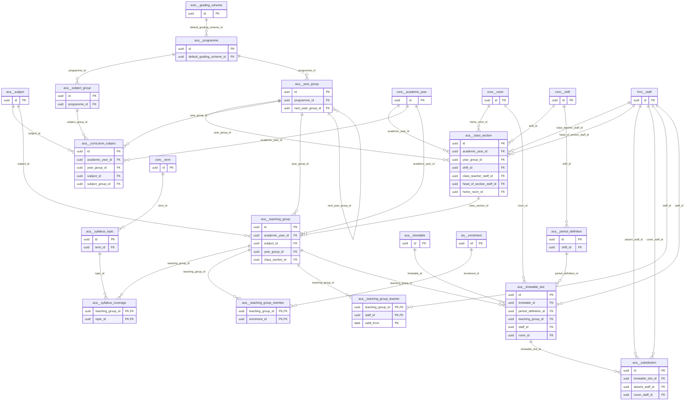

# Schema `aca`

> ACA: programmes, classes, subjects, teaching groups, timetable

Generated from the live database by `db/tools/gen_docs.py` — do not edit by hand.

**Tables:** 15

## Entity-relationship diagram

Convention FKs to `core.organisation`, `core.campus`, `sys.stored_file` and `wf.approval_request` are omitted from the diagram (see table details).

## Tables

- [`aca.class_section`](#acaclasssection) — Registration class for a campus/year (e.g. Year 7 - A) with class teacher and capacity.
- [`aca.curriculum_subject`](#acacurriculumsubject) — Subjects studied by a year group in a given academic year. [what a year group studies in a given year]
- [`aca.period_definition`](#acaperioddefinition) — Bell schedule per campus/shift (regular or Ramadan), including prayer and break periods. [bell schedule per campus/shift]
- [`aca.programme`](#acaprogramme) — Curriculum stage: Early Years, Primary, Lower Secondary, IGCSE, IAL. [EY, PRIMARY, LOWER_SEC, IGCSE, IAL]
- [`aca.subject`](#acasubject) — Subject catalogue (core, elective, language, religious) with Edexcel spec code.
- [`aca.subject_group`](#acasubjectgroup) — Elective choice group with min/max choices and combination rules. [ACA-02 choice groups (pick 1 of Physics/Business...)]
- [`aca.substitution`](#acasubstitution) — Cover assignment for an absent teacher's period; feeds cover-period pay. [ACA-05]
- [`aca.syllabus_coverage`](#acasyllabuscoverage) — Coverage reported by teachers per teaching group and topic.
- [`aca.syllabus_topic`](#acasyllabustopic) — Term-wise syllabus topic with Edexcel spec reference. [ACA-09 / LRN-01 (P2)]
- [`aca.teaching_group`](#acateachinggroup) — Instructional group for one subject: a whole section or an elective set spanning sections.
- [`aca.teaching_group_member`](#acateachinggroupmember) — Explicit student membership of an elective teaching group. [explicit membership (electives)]
- [`aca.teaching_group_teacher`](#acateachinggroupteacher) — Teacher allocation to a teaching group with periods per week. [ACA-03 teacher-subject-class allocation]
- [`aca.timetable`](#acatimetable) — Versioned weekly timetable per campus and year (draft/published).
- [`aca.timetable_slot`](#acatimetableslot) — One timetable cell; unique teacher, room and group per period (clash-free).
- [`aca.year_group`](#acayeargroup) — Year group within a programme with promotion order and admission age limits. [Nursery..Y13 / AS / A2]

### `aca.class_section`

Registration class for a campus/year (e.g. Year 7 - A) with class teacher and capacity.

- Row-level security: `p_campus: core.campus_visible(org_id, campus_id)`

| Column | Type | Null | Default | Description |
|---|---|---|---|---|
| `id` | uuid |  | uuidv7() |  |
| `org_id` | uuid |  |  |  |
| `campus_id` | uuid |  |  |  |
| `academic_year_id` | uuid |  |  |  |
| `year_group_id` | uuid |  |  |  |
| `shift_id` | uuid | yes |  |  |
| `name` | text |  |  | 'A', 'Rose', 'Boys-1' |
| `display_name` | text |  |  | 'Year 7 - A' |
| `class_teacher_staff_id` | uuid | yes |  | FK hrm.staff |
| `head_of_section_staff_id` | uuid | yes |  |  |
| `home_room_id` | uuid | yes |  |  |
| `capacity` | smallint |  |  |  |
| `gender_policy` | text |  | 'mixed'::text |  |
| `created_at` | timestamp with time zone |  | now() |  |
| `created_by` | uuid | yes | core.current_user_id() |  |
| `updated_at` | timestamp with time zone |  | now() |  |
| `updated_by` | uuid | yes |  |  |
| `row_version` | integer |  | 1 |  |

| Constraint | Kind | Definition |
|---|---|---|
| `class_section_pkey` | PK | `PRIMARY KEY (id)` |
| `class_section_campus_id_academic_year_id_year_group_id_name_key` | UNIQUE | `UNIQUE (campus_id, academic_year_id, year_group_id, name)` |
| `class_section_academic_year_id_fkey` | FK | `FOREIGN KEY (academic_year_id) REFERENCES core.academic_year(id)` |
| `class_section_campus_id_fkey` | FK | `FOREIGN KEY (campus_id) REFERENCES core.campus(id)` |
| `class_section_class_teacher_staff_id_fkey` | FK | `FOREIGN KEY (class_teacher_staff_id) REFERENCES hrm.staff(id)` |
| `class_section_head_of_section_staff_id_fkey` | FK | `FOREIGN KEY (head_of_section_staff_id) REFERENCES hrm.staff(id)` |
| `class_section_home_room_id_fkey` | FK | `FOREIGN KEY (home_room_id) REFERENCES core.room(id)` |
| `class_section_org_id_fkey` | FK | `FOREIGN KEY (org_id) REFERENCES core.organisation(id)` |
| `class_section_shift_id_fkey` | FK | `FOREIGN KEY (shift_id) REFERENCES core.shift(id)` |
| `class_section_year_group_id_fkey` | FK | `FOREIGN KEY (year_group_id) REFERENCES aca.year_group(id)` |
| `class_section_capacity_check` | CHECK | `CHECK ((capacity > 0))` |
| `class_section_gender_policy_check` | CHECK | `CHECK ((gender_policy = ANY (ARRAY['mixed'::text, 'boys'::text, 'girls'::text])))` |

**Indexes**

- `CREATE INDEX ix_class_section_academic_year_id_fk ON aca.class_section USING btree (academic_year_id)`
- `CREATE INDEX ix_class_section_class_teacher_staff_id_fk ON aca.class_section USING btree (class_teacher_staff_id)`
- `CREATE INDEX ix_class_section_head_of_section_staff_id_fk ON aca.class_section USING btree (head_of_section_staff_id)`
- `CREATE INDEX ix_class_section_home_room_id_fk ON aca.class_section USING btree (home_room_id)`
- `CREATE INDEX ix_class_section_shift_id_fk ON aca.class_section USING btree (shift_id)`
- `CREATE INDEX ix_class_section_year_group_id_fk ON aca.class_section USING btree (year_group_id)`

**Triggers**

- `trg_audit` — AFTER INSERT UPDATE DELETE → `tg_row_audit()`
- `trg_touch` — BEFORE UPDATE → `tg_touch()`

### `aca.curriculum_subject`

Subjects studied by a year group in a given academic year. [what a year group studies in a given year]

| Column | Type | Null | Default | Description |
|---|---|---|---|---|
| `id` | uuid |  | uuidv7() |  |
| `academic_year_id` | uuid |  |  |  |
| `year_group_id` | uuid |  |  |  |
| `subject_id` | uuid |  |  |  |
| `subject_group_id` | uuid | yes |  | NULL = compulsory |
| `periods_per_week` | smallint |  | 0 |  |
| `grading_scheme_id` | uuid | yes |  | override of programme default |
| `report_order` | smallint |  | 0 |  |

| Constraint | Kind | Definition |
|---|---|---|
| `curriculum_subject_pkey` | PK | `PRIMARY KEY (id)` |
| `curriculum_subject_academic_year_id_year_group_id_subject_i_key` | UNIQUE | `UNIQUE (academic_year_id, year_group_id, subject_id)` |
| `curriculum_subject_academic_year_id_fkey` | FK | `FOREIGN KEY (academic_year_id) REFERENCES core.academic_year(id)` |
| `curriculum_subject_subject_group_id_fkey` | FK | `FOREIGN KEY (subject_group_id) REFERENCES aca.subject_group(id)` |
| `curriculum_subject_subject_id_fkey` | FK | `FOREIGN KEY (subject_id) REFERENCES aca.subject(id)` |
| `curriculum_subject_year_group_id_fkey` | FK | `FOREIGN KEY (year_group_id) REFERENCES aca.year_group(id)` |

**Indexes**

- `CREATE INDEX ix_curriculum_subject_subject_group_id_fk ON aca.curriculum_subject USING btree (subject_group_id)`
- `CREATE INDEX ix_curriculum_subject_subject_id_fk ON aca.curriculum_subject USING btree (subject_id)`
- `CREATE INDEX ix_curriculum_subject_year_group_id_fk ON aca.curriculum_subject USING btree (year_group_id)`

### `aca.period_definition`

Bell schedule per campus/shift (regular or Ramadan), including prayer and break periods. [bell schedule per campus/shift]

- Row-level security: `p_campus: core.campus_visible(org_id, campus_id)`

| Column | Type | Null | Default | Description |
|---|---|---|---|---|
| `id` | uuid |  | uuidv7() |  |
| `org_id` | uuid |  |  |  |
| `campus_id` | uuid |  |  |  |
| `shift_id` | uuid |  |  |  |
| `schedule_code` | text |  | 'regular'::text | 'regular' \| 'ramadan' (CCA-07) |
| `period_no` | smallint |  |  |  |
| `label` | text |  |  | 'P1', 'Break', 'Zuhr' |
| `kind` | text |  |  |  |
| `starts_at` | time without time zone |  |  |  |
| `ends_at` | time without time zone |  |  |  |

| Constraint | Kind | Definition |
|---|---|---|
| `period_definition_pkey` | PK | `PRIMARY KEY (id)` |
| `period_definition_shift_id_schedule_code_period_no_key` | UNIQUE | `UNIQUE (shift_id, schedule_code, period_no)` |
| `period_definition_campus_id_fkey` | FK | `FOREIGN KEY (campus_id) REFERENCES core.campus(id)` |
| `period_definition_org_id_fkey` | FK | `FOREIGN KEY (org_id) REFERENCES core.organisation(id)` |
| `period_definition_shift_id_fkey` | FK | `FOREIGN KEY (shift_id) REFERENCES core.shift(id)` |
| `period_definition_check` | CHECK | `CHECK ((ends_at > starts_at))` |
| `period_definition_kind_check` | CHECK | `CHECK ((kind = ANY (ARRAY['teaching'::text, 'break'::text, 'prayer'::text, 'assembly'::text, 'registration'::text])))` |

**Indexes**

- `CREATE INDEX ix_period_definition_campus_id_fk ON aca.period_definition USING btree (campus_id)`

### `aca.programme`

Curriculum stage: Early Years, Primary, Lower Secondary, IGCSE, IAL. [EY, PRIMARY, LOWER_SEC, IGCSE, IAL]

- Row-level security: `p_org: core.org_visible(org_id)`

| Column | Type | Null | Default | Description |
|---|---|---|---|---|
| `id` | uuid |  | uuidv7() |  |
| `org_id` | uuid |  |  |  |
| `code` | text |  |  |  |
| `name_en` | text |  |  |  |
| `name_bn` | text | yes |  |  |
| `awarding_body` | text | yes |  | 'PEARSON_EDEXCEL' \| NULL (internal) |
| `default_grading_scheme_id` | uuid | yes |  | FK added after exm.grading_scheme |
| `seq` | smallint |  |  |  |
| `created_at` | timestamp with time zone |  | now() |  |
| `created_by` | uuid | yes | core.current_user_id() |  |
| `updated_at` | timestamp with time zone |  | now() |  |
| `updated_by` | uuid | yes |  |  |
| `row_version` | integer |  | 1 |  |

| Constraint | Kind | Definition |
|---|---|---|
| `programme_pkey` | PK | `PRIMARY KEY (id)` |
| `programme_org_id_code_key` | UNIQUE | `UNIQUE (org_id, code)` |
| `programme_default_grading_scheme_id_fkey` | FK | `FOREIGN KEY (default_grading_scheme_id) REFERENCES exm.grading_scheme(id)` |
| `programme_org_id_fkey` | FK | `FOREIGN KEY (org_id) REFERENCES core.organisation(id)` |

**Indexes**

- `CREATE INDEX ix_programme_default_grading_scheme_id_fk ON aca.programme USING btree (default_grading_scheme_id)`

**Triggers**

- `trg_touch` — BEFORE UPDATE → `tg_touch()`

### `aca.subject`

Subject catalogue (core, elective, language, religious) with Edexcel spec code.

- Row-level security: `p_org: core.org_visible(org_id)`

| Column | Type | Null | Default | Description |
|---|---|---|---|---|
| `id` | uuid |  | uuidv7() |  |
| `org_id` | uuid |  |  |  |
| `code` | text |  |  | 'PHY', 'BAN', 'ISL' |
| `name_en` | text |  |  |  |
| `name_bn` | text | yes |  |  |
| `kind` | text |  |  |  |
| `external_code` | text | yes |  | Edexcel spec code e.g. '4PH1' |
| `is_graded` | boolean |  | true |  |
| `created_at` | timestamp with time zone |  | now() |  |
| `created_by` | uuid | yes | core.current_user_id() |  |
| `updated_at` | timestamp with time zone |  | now() |  |
| `updated_by` | uuid | yes |  |  |
| `row_version` | integer |  | 1 |  |

| Constraint | Kind | Definition |
|---|---|---|
| `subject_pkey` | PK | `PRIMARY KEY (id)` |
| `subject_org_id_code_key` | UNIQUE | `UNIQUE (org_id, code)` |
| `subject_org_id_fkey` | FK | `FOREIGN KEY (org_id) REFERENCES core.organisation(id)` |
| `subject_kind_check` | CHECK | `CHECK ((kind = ANY (ARRAY['core'::text, 'optional'::text, 'elective'::text, 'co_curricular'::text, 'religious'::text, 'language'::text])))` |

**Triggers**

- `trg_touch` — BEFORE UPDATE → `tg_touch()`

### `aca.subject_group`

Elective choice group with min/max choices and combination rules. [ACA-02 choice groups (pick 1 of Physics/Business...)]

| Column | Type | Null | Default | Description |
|---|---|---|---|---|
| `id` | uuid |  | uuidv7() |  |
| `programme_id` | uuid |  |  |  |
| `code` | text |  |  |  |
| `name_en` | text |  |  |  |
| `min_choose` | smallint |  | 1 |  |
| `max_choose` | smallint |  | 1 |  |
| `rules` | jsonb |  | '{}'::jsonb | incompatibilities, prerequisites (validated in domain) |

| Constraint | Kind | Definition |
|---|---|---|
| `subject_group_pkey` | PK | `PRIMARY KEY (id)` |
| `subject_group_programme_id_code_key` | UNIQUE | `UNIQUE (programme_id, code)` |
| `subject_group_programme_id_fkey` | FK | `FOREIGN KEY (programme_id) REFERENCES aca.programme(id)` |
| `subject_group_check` | CHECK | `CHECK ((max_choose >= min_choose))` |

### `aca.substitution`

Cover assignment for an absent teacher's period; feeds cover-period pay. [ACA-05]

- Row-level security: `p_campus: core.campus_visible(org_id, campus_id)`

| Column | Type | Null | Default | Description |
|---|---|---|---|---|
| `id` | uuid |  | uuidv7() |  |
| `org_id` | uuid |  |  |  |
| `campus_id` | uuid |  |  |  |
| `cover_date` | date |  |  |  |
| `timetable_slot_id` | uuid |  |  |  |
| `absent_staff_id` | uuid |  |  |  |
| `cover_staff_id` | uuid | yes |  |  |
| `reason` | text | yes |  |  |
| `status` | text |  | 'open'::text |  |
| `payable` | boolean |  | true | HRM cover-period pay |
| `assigned_by` | uuid | yes |  |  |
| `notified_at` | timestamp with time zone | yes |  |  |
| `created_at` | timestamp with time zone |  | now() |  |
| `created_by` | uuid | yes | core.current_user_id() |  |
| `updated_at` | timestamp with time zone |  | now() |  |
| `updated_by` | uuid | yes |  |  |
| `row_version` | integer |  | 1 |  |

| Constraint | Kind | Definition |
|---|---|---|
| `substitution_pkey` | PK | `PRIMARY KEY (id)` |
| `substitution_cover_date_timetable_slot_id_key` | UNIQUE | `UNIQUE (cover_date, timetable_slot_id)` |
| `substitution_absent_staff_id_fkey` | FK | `FOREIGN KEY (absent_staff_id) REFERENCES hrm.staff(id)` |
| `substitution_campus_id_fkey` | FK | `FOREIGN KEY (campus_id) REFERENCES core.campus(id)` |
| `substitution_cover_staff_id_fkey` | FK | `FOREIGN KEY (cover_staff_id) REFERENCES hrm.staff(id)` |
| `substitution_org_id_fkey` | FK | `FOREIGN KEY (org_id) REFERENCES core.organisation(id)` |
| `substitution_timetable_slot_id_fkey` | FK | `FOREIGN KEY (timetable_slot_id) REFERENCES aca.timetable_slot(id)` |
| `substitution_status_check` | CHECK | `CHECK ((status = ANY (ARRAY['open'::text, 'assigned'::text, 'accepted'::text, 'cancelled'::text, 'completed'::text])))` |

**Indexes**

- `CREATE INDEX ix_substitution_absent_staff_id_fk ON aca.substitution USING btree (absent_staff_id)`
- `CREATE INDEX ix_substitution_campus_id_fk ON aca.substitution USING btree (campus_id)`
- `CREATE INDEX ix_substitution_cover ON aca.substitution USING btree (cover_staff_id, cover_date)`
- `CREATE INDEX ix_substitution_timetable_slot_id_fk ON aca.substitution USING btree (timetable_slot_id)`

**Triggers**

- `trg_audit` — AFTER INSERT UPDATE DELETE → `tg_row_audit()`
- `trg_touch` — BEFORE UPDATE → `tg_touch()`

### `aca.syllabus_coverage`

Coverage reported by teachers per teaching group and topic.

| Column | Type | Null | Default | Description |
|---|---|---|---|---|
| `teaching_group_id` | uuid |  |  |  |
| `topic_id` | uuid |  |  |  |
| `covered_on` | date |  |  |  |
| `percent_covered` | core.percent |  |  |  |
| `reported_by` | uuid |  |  |  |
| `reviewed_by` | uuid | yes |  |  |

| Constraint | Kind | Definition |
|---|---|---|
| `syllabus_coverage_pkey` | PK | `PRIMARY KEY (teaching_group_id, topic_id)` |
| `syllabus_coverage_teaching_group_id_fkey` | FK | `FOREIGN KEY (teaching_group_id) REFERENCES aca.teaching_group(id)` |
| `syllabus_coverage_topic_id_fkey` | FK | `FOREIGN KEY (topic_id) REFERENCES aca.syllabus_topic(id)` |

**Indexes**

- `CREATE INDEX ix_syllabus_coverage_topic_id_fk ON aca.syllabus_coverage USING btree (topic_id)`

### `aca.syllabus_topic`

Term-wise syllabus topic with Edexcel spec reference. [ACA-09 / LRN-01 (P2)]

| Column | Type | Null | Default | Description |
|---|---|---|---|---|
| `id` | uuid |  | uuidv7() |  |
| `academic_year_id` | uuid |  |  |  |
| `year_group_id` | uuid |  |  |  |
| `subject_id` | uuid |  |  |  |
| `term_id` | uuid | yes |  |  |
| `seq` | smallint |  |  |  |
| `title` | text |  |  |  |
| `spec_reference` | text | yes |  | Edexcel spec point |
| `planned_periods` | smallint | yes |  |  |

| Constraint | Kind | Definition |
|---|---|---|
| `syllabus_topic_pkey` | PK | `PRIMARY KEY (id)` |
| `syllabus_topic_term_id_fkey` | FK | `FOREIGN KEY (term_id) REFERENCES core.term(id)` |

**Indexes**

- `CREATE INDEX ix_syllabus_topic_term_id_fk ON aca.syllabus_topic USING btree (term_id)`

### `aca.teaching_group`

Instructional group for one subject: a whole section or an elective set spanning sections.

- Row-level security: `p_campus: core.campus_visible(org_id, campus_id)`

| Column | Type | Null | Default | Description |
|---|---|---|---|---|
| `id` | uuid |  | uuidv7() |  |
| `org_id` | uuid |  |  |  |
| `campus_id` | uuid |  |  |  |
| `academic_year_id` | uuid |  |  |  |
| `subject_id` | uuid |  |  |  |
| `year_group_id` | uuid |  |  |  |
| `name` | text |  |  | 'Y10 Physics Set 1' |
| `membership` | text |  |  |  |
| `class_section_id` | uuid | yes |  | when whole_section |
| `created_at` | timestamp with time zone |  | now() |  |
| `created_by` | uuid | yes | core.current_user_id() |  |
| `updated_at` | timestamp with time zone |  | now() |  |
| `updated_by` | uuid | yes |  |  |
| `row_version` | integer |  | 1 |  |

| Constraint | Kind | Definition |
|---|---|---|
| `teaching_group_pkey` | PK | `PRIMARY KEY (id)` |
| `teaching_group_academic_year_id_fkey` | FK | `FOREIGN KEY (academic_year_id) REFERENCES core.academic_year(id)` |
| `teaching_group_campus_id_fkey` | FK | `FOREIGN KEY (campus_id) REFERENCES core.campus(id)` |
| `teaching_group_class_section_id_fkey` | FK | `FOREIGN KEY (class_section_id) REFERENCES aca.class_section(id)` |
| `teaching_group_org_id_fkey` | FK | `FOREIGN KEY (org_id) REFERENCES core.organisation(id)` |
| `teaching_group_subject_id_fkey` | FK | `FOREIGN KEY (subject_id) REFERENCES aca.subject(id)` |
| `teaching_group_year_group_id_fkey` | FK | `FOREIGN KEY (year_group_id) REFERENCES aca.year_group(id)` |
| `teaching_group_check` | CHECK | `CHECK (((membership = 'whole_section'::text) = (class_section_id IS NOT NULL)))` |
| `teaching_group_membership_check` | CHECK | `CHECK ((membership = ANY (ARRAY['whole_section'::text, 'explicit'::text])))` |

**Indexes**

- `CREATE INDEX ix_teaching_group_academic_year_id_fk ON aca.teaching_group USING btree (academic_year_id)`
- `CREATE INDEX ix_teaching_group_campus_id_fk ON aca.teaching_group USING btree (campus_id)`
- `CREATE INDEX ix_teaching_group_class_section_id_fk ON aca.teaching_group USING btree (class_section_id)`
- `CREATE INDEX ix_teaching_group_subject_id_fk ON aca.teaching_group USING btree (subject_id)`
- `CREATE INDEX ix_teaching_group_year_group_id_fk ON aca.teaching_group USING btree (year_group_id)`

**Triggers**

- `trg_audit` — AFTER INSERT UPDATE DELETE → `tg_row_audit()`
- `trg_touch` — BEFORE UPDATE → `tg_touch()`

### `aca.teaching_group_member`

Explicit student membership of an elective teaching group. [explicit membership (electives)]

| Column | Type | Null | Default | Description |
|---|---|---|---|---|
| `teaching_group_id` | uuid |  |  |  |
| `enrolment_id` | uuid |  |  | FK sis.enrolment |
| `joined_on` | date |  |  |  |
| `left_on` | date | yes |  |  |

| Constraint | Kind | Definition |
|---|---|---|
| `teaching_group_member_pkey` | PK | `PRIMARY KEY (teaching_group_id, enrolment_id)` |
| `teaching_group_member_enrolment_id_fkey` | FK | `FOREIGN KEY (enrolment_id) REFERENCES sis.enrolment(id)` |
| `teaching_group_member_teaching_group_id_fkey` | FK | `FOREIGN KEY (teaching_group_id) REFERENCES aca.teaching_group(id) ON DELETE CASCADE` |

**Indexes**

- `CREATE INDEX ix_teaching_group_member_enrolment_id_fk ON aca.teaching_group_member USING btree (enrolment_id)`

### `aca.teaching_group_teacher`

Teacher allocation to a teaching group with periods per week. [ACA-03 teacher-subject-class allocation]

| Column | Type | Null | Default | Description |
|---|---|---|---|---|
| `teaching_group_id` | uuid |  |  |  |
| `staff_id` | uuid |  |  |  |
| `role` | text |  | 'main'::text |  |
| `periods_per_week` | smallint |  | 0 |  |
| `valid_from` | date |  |  |  |
| `valid_to` | date | yes |  |  |

| Constraint | Kind | Definition |
|---|---|---|
| `teaching_group_teacher_pkey` | PK | `PRIMARY KEY (teaching_group_id, staff_id, valid_from)` |
| `teaching_group_teacher_staff_id_fkey` | FK | `FOREIGN KEY (staff_id) REFERENCES hrm.staff(id)` |
| `teaching_group_teacher_teaching_group_id_fkey` | FK | `FOREIGN KEY (teaching_group_id) REFERENCES aca.teaching_group(id) ON DELETE CASCADE` |
| `teaching_group_teacher_role_check` | CHECK | `CHECK ((role = ANY (ARRAY['main'::text, 'assistant'::text])))` |

**Indexes**

- `CREATE INDEX ix_teaching_group_teacher_staff_id_fk ON aca.teaching_group_teacher USING btree (staff_id)`

### `aca.timetable`

Versioned weekly timetable per campus and year (draft/published).

- Row-level security: `p_campus: core.campus_visible(org_id, campus_id)`

| Column | Type | Null | Default | Description |
|---|---|---|---|---|
| `id` | uuid |  | uuidv7() |  |
| `org_id` | uuid |  |  |  |
| `campus_id` | uuid |  |  |  |
| `academic_year_id` | uuid |  |  |  |
| `name` | text |  |  |  |
| `status` | text |  | 'draft'::text |  |
| `effective_from` | date |  |  |  |
| `effective_to` | date | yes |  |  |
| `created_at` | timestamp with time zone |  | now() |  |
| `created_by` | uuid | yes | core.current_user_id() |  |
| `updated_at` | timestamp with time zone |  | now() |  |
| `updated_by` | uuid | yes |  |  |
| `row_version` | integer |  | 1 |  |

| Constraint | Kind | Definition |
|---|---|---|
| `timetable_pkey` | PK | `PRIMARY KEY (id)` |
| `timetable_campus_id_fkey` | FK | `FOREIGN KEY (campus_id) REFERENCES core.campus(id)` |
| `timetable_org_id_fkey` | FK | `FOREIGN KEY (org_id) REFERENCES core.organisation(id)` |
| `timetable_status_check` | CHECK | `CHECK ((status = ANY (ARRAY['draft'::text, 'published'::text, 'archived'::text])))` |

**Indexes**

- `CREATE UNIQUE INDEX ux_timetable_published ON aca.timetable USING btree (campus_id, academic_year_id, effective_from) WHERE (status = 'published'::text)`

**Triggers**

- `trg_audit` — AFTER INSERT UPDATE DELETE → `tg_row_audit()`
- `trg_touch` — BEFORE UPDATE → `tg_touch()`

### `aca.timetable_slot`

One timetable cell; unique teacher, room and group per period (clash-free).

| Column | Type | Null | Default | Description |
|---|---|---|---|---|
| `id` | uuid |  | uuidv7() |  |
| `timetable_id` | uuid |  |  |  |
| `day_of_week` | smallint |  |  | 6 = Saturday (BD week Sat-Thu) |
| `period_definition_id` | uuid |  |  |  |
| `teaching_group_id` | uuid |  |  |  |
| `staff_id` | uuid |  |  |  |
| `room_id` | uuid | yes |  |  |
| `online_meeting_url` | text | yes |  | LRN-05 |

| Constraint | Kind | Definition |
|---|---|---|
| `timetable_slot_pkey` | PK | `PRIMARY KEY (id)` |
| `timetable_slot_timetable_id_day_of_week_period_definition__key1` | UNIQUE | `UNIQUE (timetable_id, day_of_week, period_definition_id, staff_id)` |
| `timetable_slot_timetable_id_day_of_week_period_definition__key2` | UNIQUE | `UNIQUE (timetable_id, day_of_week, period_definition_id, room_id)` |
| `timetable_slot_timetable_id_day_of_week_period_definition_i_key` | UNIQUE | `UNIQUE (timetable_id, day_of_week, period_definition_id, teaching_group_id)` |
| `timetable_slot_period_definition_id_fkey` | FK | `FOREIGN KEY (period_definition_id) REFERENCES aca.period_definition(id)` |
| `timetable_slot_room_id_fkey` | FK | `FOREIGN KEY (room_id) REFERENCES core.room(id)` |
| `timetable_slot_staff_id_fkey` | FK | `FOREIGN KEY (staff_id) REFERENCES hrm.staff(id)` |
| `timetable_slot_teaching_group_id_fkey` | FK | `FOREIGN KEY (teaching_group_id) REFERENCES aca.teaching_group(id)` |
| `timetable_slot_timetable_id_fkey` | FK | `FOREIGN KEY (timetable_id) REFERENCES aca.timetable(id) ON DELETE CASCADE` |
| `timetable_slot_day_of_week_check` | CHECK | `CHECK (((day_of_week >= 0) AND (day_of_week <= 6)))` |

**Indexes**

- `CREATE INDEX ix_timetable_slot_period_definition_id_fk ON aca.timetable_slot USING btree (period_definition_id)`
- `CREATE INDEX ix_timetable_slot_room_id_fk ON aca.timetable_slot USING btree (room_id)`
- `CREATE INDEX ix_timetable_slot_staff_id_fk ON aca.timetable_slot USING btree (staff_id)`
- `CREATE INDEX ix_timetable_slot_teaching_group_id_fk ON aca.timetable_slot USING btree (teaching_group_id)`

### `aca.year_group`

Year group within a programme with promotion order and admission age limits. [Nursery..Y13 / AS / A2]

| Column | Type | Null | Default | Description |
|---|---|---|---|---|
| `id` | uuid |  | uuidv7() |  |
| `programme_id` | uuid |  |  |  |
| `code` | text |  |  | 'Y7' |
| `name_en` | text |  |  |  |
| `name_bn` | text | yes |  |  |
| `seq` | smallint |  |  | global ordering for promotion (Y7 -> Y8) |
| `next_year_group_id` | uuid | yes |  |  |
| `min_age_months` | smallint | yes |  | admission age cut-off |
| `max_age_months` | smallint | yes |  |  |
| `created_at` | timestamp with time zone |  | now() |  |
| `created_by` | uuid | yes | core.current_user_id() |  |
| `updated_at` | timestamp with time zone |  | now() |  |
| `updated_by` | uuid | yes |  |  |
| `row_version` | integer |  | 1 |  |

| Constraint | Kind | Definition |
|---|---|---|
| `year_group_pkey` | PK | `PRIMARY KEY (id)` |
| `year_group_programme_id_code_key` | UNIQUE | `UNIQUE (programme_id, code)` |
| `year_group_next_year_group_id_fkey` | FK | `FOREIGN KEY (next_year_group_id) REFERENCES aca.year_group(id)` |
| `year_group_programme_id_fkey` | FK | `FOREIGN KEY (programme_id) REFERENCES aca.programme(id)` |

**Indexes**

- `CREATE INDEX ix_year_group_next_year_group_id_fk ON aca.year_group USING btree (next_year_group_id)`

**Triggers**

- `trg_touch` — BEFORE UPDATE → `tg_touch()`

