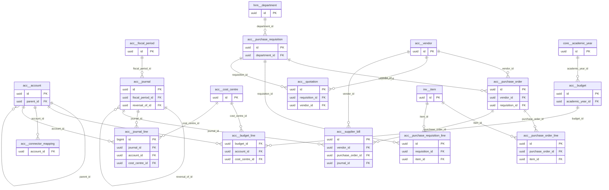

# Schema `acc`

> ACC: chart of accounts, journals, budgets, procurement

Generated from the live database by `db/tools/gen_docs.py` — do not edit by hand.

**Tables:** 15

## Entity-relationship diagram

Convention FKs to `core.organisation`, `core.campus`, `sys.stored_file` and `wf.approval_request` are omitted from the diagram (see table details).

## Tables

- [`acc.account`](#accaccount) — Chart of accounts (tree). [ACC-01 chart of accounts (tree)]
- [`acc.budget`](#accbudget) — Annual budget per campus. [ACC-03 (P3)]
- [`acc.budget_line`](#accbudgetline) — Monthly budget amount per account/cost centre.
- [`acc.connector_mapping`](#accconnectormapping) — Mapping of fee heads/channels/components to accounts or an external package. [ACC-06 third-party accounting connector]
- [`acc.cost_centre`](#acccostcentre) — Cost centre/campus dimension for postings.
- [`acc.fiscal_period`](#accfiscalperiod) — Accounting period with open/locked status. [period lock]
- [`acc.journal`](#accjournal) — Voucher (receipt/payment/journal/contra); posted journals are reversed, never edited. [receipt / payment / journal / contra vouchers]
- [`acc.journal_line`](#accjournalline) — Debit or credit line; journals must balance at commit.
- [`acc.purchase_order`](#accpurchaseorder) — Purchase order to a vendor.
- [`acc.purchase_order_line`](#accpurchaseorderline) — Ordered item with received quantity.
- [`acc.purchase_requisition`](#accpurchaserequisition) — Departmental purchase requisition with approval. [ACC-04 (P3)]
- [`acc.purchase_requisition_line`](#accpurchaserequisitionline) — Requested item/quantity.
- [`acc.quotation`](#accquotation) — Vendor quotation for a requisition (one selected).
- [`acc.supplier_bill`](#accsupplierbill) — Supplier bill with VAT/TDS and payment status.
- [`acc.vendor`](#accvendor) — Supplier master with tax fields and payment terms. [ACC-05 (P3)]

### `acc.account`

Chart of accounts (tree). [ACC-01 chart of accounts (tree)]

- Row-level security: `p_org: core.org_visible(org_id)`

| Column | Type | Null | Default | Description |
|---|---|---|---|---|
| `id` | uuid |  | uuidv7() |  |
| `org_id` | uuid |  |  |  |
| `code` | text |  |  | '4100' |
| `name_en` | text |  |  |  |
| `name_bn` | text | yes |  |  |
| `kind` | text |  |  |  |
| `parent_id` | uuid | yes |  |  |
| `is_postable` | boolean |  | true | false for group/header accounts |
| `is_bank` | boolean |  | false |  |
| `is_cash` | boolean |  | false |  |
| `is_active` | boolean |  | true |  |
| `created_at` | timestamp with time zone |  | now() |  |
| `created_by` | uuid | yes | core.current_user_id() |  |
| `updated_at` | timestamp with time zone |  | now() |  |
| `updated_by` | uuid | yes |  |  |
| `row_version` | integer |  | 1 |  |

| Constraint | Kind | Definition |
|---|---|---|
| `account_pkey` | PK | `PRIMARY KEY (id)` |
| `account_org_id_code_key` | UNIQUE | `UNIQUE (org_id, code)` |
| `account_org_id_fkey` | FK | `FOREIGN KEY (org_id) REFERENCES core.organisation(id)` |
| `account_parent_id_fkey` | FK | `FOREIGN KEY (parent_id) REFERENCES acc.account(id)` |
| `account_kind_check` | CHECK | `CHECK ((kind = ANY (ARRAY['asset'::text, 'liability'::text, 'equity'::text, 'income'::text, 'expense'::text])))` |

**Indexes**

- `CREATE INDEX ix_account_parent_id_fk ON acc.account USING btree (parent_id)`

**Triggers**

- `trg_touch` — BEFORE UPDATE → `tg_touch()`

### `acc.budget`

Annual budget per campus. [ACC-03 (P3)]

- Row-level security: `p_campus: core.campus_visible(org_id, campus_id)`

| Column | Type | Null | Default | Description |
|---|---|---|---|---|
| `id` | uuid |  | uuidv7() |  |
| `org_id` | uuid |  |  |  |
| `campus_id` | uuid |  |  |  |
| `academic_year_id` | uuid |  |  |  |
| `name` | text |  |  |  |
| `status` | text |  | 'draft'::text |  |
| `approval_request_id` | uuid | yes |  |  |
| `created_at` | timestamp with time zone |  | now() |  |
| `created_by` | uuid | yes | core.current_user_id() |  |
| `updated_at` | timestamp with time zone |  | now() |  |
| `updated_by` | uuid | yes |  |  |
| `row_version` | integer |  | 1 |  |

| Constraint | Kind | Definition |
|---|---|---|
| `budget_pkey` | PK | `PRIMARY KEY (id)` |
| `budget_academic_year_id_fkey` | FK | `FOREIGN KEY (academic_year_id) REFERENCES core.academic_year(id)` |
| `budget_approval_request_id_fkey` | FK | `FOREIGN KEY (approval_request_id) REFERENCES wf.approval_request(id)` |
| `budget_campus_id_fkey` | FK | `FOREIGN KEY (campus_id) REFERENCES core.campus(id)` |
| `budget_org_id_fkey` | FK | `FOREIGN KEY (org_id) REFERENCES core.organisation(id)` |
| `budget_status_check` | CHECK | `CHECK ((status = ANY (ARRAY['draft'::text, 'approved'::text, 'closed'::text])))` |

**Indexes**

- `CREATE INDEX ix_budget_academic_year_id_fk ON acc.budget USING btree (academic_year_id)`
- `CREATE INDEX ix_budget_campus_id_fk ON acc.budget USING btree (campus_id)`

**Triggers**

- `trg_touch` — BEFORE UPDATE → `tg_touch()`

### `acc.budget_line`

Monthly budget amount per account/cost centre.

| Column | Type | Null | Default | Description |
|---|---|---|---|---|
| `budget_id` | uuid |  |  |  |
| `account_id` | uuid |  |  |  |
| `cost_centre_id` | uuid | yes |  |  |
| `month_no` | smallint |  |  |  |
| `amount_paisa` | core.paisa_nn |  |  |  |

| Constraint | Kind | Definition |
|---|---|---|
| `budget_line_budget_id_account_id_cost_centre_id_month_no_key` | UNIQUE | `UNIQUE NULLS NOT DISTINCT (budget_id, account_id, cost_centre_id, month_no)` |
| `budget_line_account_id_fkey` | FK | `FOREIGN KEY (account_id) REFERENCES acc.account(id)` |
| `budget_line_budget_id_fkey` | FK | `FOREIGN KEY (budget_id) REFERENCES acc.budget(id) ON DELETE CASCADE` |
| `budget_line_cost_centre_id_fkey` | FK | `FOREIGN KEY (cost_centre_id) REFERENCES acc.cost_centre(id)` |
| `budget_line_month_no_check` | CHECK | `CHECK (((month_no >= 1) AND (month_no <= 12)))` |

**Indexes**

- `CREATE INDEX ix_budget_line_account_id_fk ON acc.budget_line USING btree (account_id)`
- `CREATE INDEX ix_budget_line_cost_centre_id_fk ON acc.budget_line USING btree (cost_centre_id)`

### `acc.connector_mapping`

Mapping of fee heads/channels/components to accounts or an external package. [ACC-06 third-party accounting connector]

- Row-level security: `p_campus: core.campus_visible(org_id, campus_id)`

| Column | Type | Null | Default | Description |
|---|---|---|---|---|
| `org_id` | uuid |  |  |  |
| `source_key` | text |  |  | 'fee_head:TUITION', 'payment_channel:bkash', 'salary_component:BASIC' |
| `campus_id` | uuid | yes |  |  |
| `account_id` | uuid | yes |  |  |
| `external_code` | text | yes |  | code in the external package |

| Constraint | Kind | Definition |
|---|---|---|
| `connector_mapping_org_id_source_key_campus_id_key` | UNIQUE | `UNIQUE NULLS NOT DISTINCT (org_id, source_key, campus_id)` |
| `connector_mapping_account_id_fkey` | FK | `FOREIGN KEY (account_id) REFERENCES acc.account(id)` |
| `connector_mapping_campus_id_fkey` | FK | `FOREIGN KEY (campus_id) REFERENCES core.campus(id)` |
| `connector_mapping_org_id_fkey` | FK | `FOREIGN KEY (org_id) REFERENCES core.organisation(id)` |

**Indexes**

- `CREATE INDEX ix_connector_mapping_account_id_fk ON acc.connector_mapping USING btree (account_id)`
- `CREATE INDEX ix_connector_mapping_campus_id_fk ON acc.connector_mapping USING btree (campus_id)`

### `acc.cost_centre`

Cost centre/campus dimension for postings.

- Row-level security: `p_campus: core.campus_visible(org_id, campus_id)`

| Column | Type | Null | Default | Description |
|---|---|---|---|---|
| `id` | uuid |  | uuidv7() |  |
| `org_id` | uuid |  |  |  |
| `campus_id` | uuid | yes |  |  |
| `code` | text |  |  |  |
| `name_en` | text |  |  |  |

| Constraint | Kind | Definition |
|---|---|---|
| `cost_centre_pkey` | PK | `PRIMARY KEY (id)` |
| `cost_centre_org_id_code_key` | UNIQUE | `UNIQUE (org_id, code)` |
| `cost_centre_campus_id_fkey` | FK | `FOREIGN KEY (campus_id) REFERENCES core.campus(id)` |
| `cost_centre_org_id_fkey` | FK | `FOREIGN KEY (org_id) REFERENCES core.organisation(id)` |

**Indexes**

- `CREATE INDEX ix_cost_centre_campus_id_fk ON acc.cost_centre USING btree (campus_id)`

### `acc.fiscal_period`

Accounting period with open/locked status. [period lock]

- Row-level security: `p_org: core.org_visible(org_id)`

| Column | Type | Null | Default | Description |
|---|---|---|---|---|
| `id` | uuid |  | uuidv7() |  |
| `org_id` | uuid |  |  |  |
| `code` | text |  |  | '2026-11' |
| `starts_on` | date |  |  |  |
| `ends_on` | date |  |  |  |
| `status` | text |  | 'open'::text |  |
| `locked_by` | uuid | yes |  |  |
| `locked_at` | timestamp with time zone | yes |  |  |

| Constraint | Kind | Definition |
|---|---|---|
| `fiscal_period_pkey` | PK | `PRIMARY KEY (id)` |
| `fiscal_period_org_id_code_key` | UNIQUE | `UNIQUE (org_id, code)` |
| `fiscal_period_org_id_fkey` | FK | `FOREIGN KEY (org_id) REFERENCES core.organisation(id)` |
| `fiscal_period_org_id_daterange_excl` | EXCLUDE | `EXCLUDE USING gist (org_id WITH =, daterange(starts_on, ends_on, '[]'::text) WITH &&)` |
| `fiscal_period_status_check` | CHECK | `CHECK ((status = ANY (ARRAY['open'::text, 'soft_locked'::text, 'locked'::text])))` |

**Triggers**

- `trg_audit` — AFTER INSERT UPDATE DELETE → `tg_row_audit()`

### `acc.journal`

Voucher (receipt/payment/journal/contra); posted journals are reversed, never edited. [receipt / payment / journal / contra vouchers]

- Row-level security: `p_campus: core.campus_visible(org_id, campus_id)`

| Column | Type | Null | Default | Description |
|---|---|---|---|---|
| `id` | uuid |  | uuidv7() |  |
| `org_id` | uuid |  |  |  |
| `campus_id` | uuid |  |  |  |
| `journal_no` | text |  |  |  |
| `voucher_type` | text |  |  |  |
| `journal_date` | date |  |  |  |
| `fiscal_period_id` | uuid |  |  |  |
| `narration` | text |  |  |  |
| `source_module` | text | yes |  | 'fee','hrm','inv' (auto-posted) or NULL (manual) |
| `source_type` | text | yes |  |  |
| `source_id` | text | yes |  |  |
| `status` | text |  | 'posted'::text |  |
| `reversal_of_id` | uuid | yes |  | reversing journal (never edit posted) |
| `approval_request_id` | uuid | yes |  |  |
| `created_at` | timestamp with time zone |  | now() |  |
| `created_by` | uuid | yes | core.current_user_id() |  |
| `updated_at` | timestamp with time zone |  | now() |  |
| `updated_by` | uuid | yes |  |  |
| `row_version` | integer |  | 1 |  |

| Constraint | Kind | Definition |
|---|---|---|
| `journal_pkey` | PK | `PRIMARY KEY (id)` |
| `journal_org_id_journal_no_key` | UNIQUE | `UNIQUE (org_id, journal_no)` |
| `journal_reversal_of_id_key` | UNIQUE | `UNIQUE (reversal_of_id)` |
| `journal_approval_request_id_fkey` | FK | `FOREIGN KEY (approval_request_id) REFERENCES wf.approval_request(id)` |
| `journal_campus_id_fkey` | FK | `FOREIGN KEY (campus_id) REFERENCES core.campus(id)` |
| `journal_fiscal_period_id_fkey` | FK | `FOREIGN KEY (fiscal_period_id) REFERENCES acc.fiscal_period(id)` |
| `journal_org_id_fkey` | FK | `FOREIGN KEY (org_id) REFERENCES core.organisation(id)` |
| `journal_reversal_of_id_fkey` | FK | `FOREIGN KEY (reversal_of_id) REFERENCES acc.journal(id)` |
| `journal_status_check` | CHECK | `CHECK ((status = ANY (ARRAY['draft'::text, 'pending_approval'::text, 'posted'::text])))` |
| `journal_voucher_type_check` | CHECK | `CHECK ((voucher_type = ANY (ARRAY['receipt'::text, 'payment'::text, 'journal'::text, 'contra'::text])))` |

**Indexes**

- `CREATE INDEX ix_journal_campus_id_fk ON acc.journal USING btree (campus_id)`
- `CREATE INDEX ix_journal_fiscal_period_id_fk ON acc.journal USING btree (fiscal_period_id)`
- `CREATE UNIQUE INDEX ux_journal_source ON acc.journal USING btree (source_module, source_type, source_id) WHERE ((source_id IS NOT NULL) AND (reversal_of_id IS NULL))`

**Triggers**

- `trg_audit` — AFTER INSERT UPDATE DELETE → `tg_row_audit()`
- `trg_touch` — BEFORE UPDATE → `tg_touch()`

### `acc.journal_line`

Debit or credit line; journals must balance at commit.

- Row-level security: `p_campus: core.campus_visible(org_id, campus_id)`

| Column | Type | Null | Default | Description |
|---|---|---|---|---|
| `id` | bigint |  |  |  |
| `journal_id` | uuid |  |  |  |
| `org_id` | uuid |  |  |  |
| `campus_id` | uuid |  |  |  |
| `account_id` | uuid |  |  |  |
| `cost_centre_id` | uuid | yes |  |  |
| `party_type` | text | yes |  |  |
| `party_id` | uuid | yes |  |  |
| `debit_paisa` | core.paisa_nn |  | 0 |  |
| `credit_paisa` | core.paisa_nn |  | 0 |  |
| `memo` | text | yes |  |  |

| Constraint | Kind | Definition |
|---|---|---|
| `journal_line_pkey` | PK | `PRIMARY KEY (id)` |
| `journal_line_account_id_fkey` | FK | `FOREIGN KEY (account_id) REFERENCES acc.account(id)` |
| `journal_line_campus_id_fkey` | FK | `FOREIGN KEY (campus_id) REFERENCES core.campus(id)` |
| `journal_line_cost_centre_id_fkey` | FK | `FOREIGN KEY (cost_centre_id) REFERENCES acc.cost_centre(id)` |
| `journal_line_journal_id_fkey` | FK | `FOREIGN KEY (journal_id) REFERENCES acc.journal(id) ON DELETE CASCADE` |
| `journal_line_org_id_fkey` | FK | `FOREIGN KEY (org_id) REFERENCES core.organisation(id)` |
| `journal_line_check` | CHECK | `CHECK ((((debit_paisa)::bigint = 0) <> ((credit_paisa)::bigint = 0)))` |
| `journal_line_party_type_check` | CHECK | `CHECK ((party_type = ANY (ARRAY['family'::text, 'vendor'::text, 'staff'::text])))` |

**Indexes**

- `CREATE INDEX ix_journal_line_account ON acc.journal_line USING btree (account_id, journal_id)`
- `CREATE INDEX ix_journal_line_campus_id_fk ON acc.journal_line USING btree (campus_id)`
- `CREATE INDEX ix_journal_line_cost_centre_id_fk ON acc.journal_line USING btree (cost_centre_id)`
- `CREATE INDEX ix_journal_line_journal_id_fk ON acc.journal_line USING btree (journal_id)`
- `CREATE INDEX ix_journal_line_party ON acc.journal_line USING btree (party_type, party_id) WHERE (party_id IS NOT NULL)`

**Triggers**

- `trg_audit` — AFTER INSERT UPDATE DELETE → `tg_row_audit()`
- `trg_journal_balanced` — AFTER INSERT UPDATE DELETE → `tg_journal_balanced()` (deferred constraint trigger)

### `acc.purchase_order`

Purchase order to a vendor.

- Row-level security: `p_campus: core.campus_visible(org_id, campus_id)`

| Column | Type | Null | Default | Description |
|---|---|---|---|---|
| `id` | uuid |  | uuidv7() |  |
| `org_id` | uuid |  |  |  |
| `campus_id` | uuid |  |  |  |
| `po_no` | text |  |  |  |
| `vendor_id` | uuid |  |  |  |
| `requisition_id` | uuid | yes |  |  |
| `order_date` | date |  |  |  |
| `expected_on` | date | yes |  |  |
| `total_paisa` | core.paisa_nn |  |  |  |
| `status` | text |  | 'issued'::text |  |
| `created_at` | timestamp with time zone |  | now() |  |
| `created_by` | uuid | yes | core.current_user_id() |  |
| `updated_at` | timestamp with time zone |  | now() |  |
| `updated_by` | uuid | yes |  |  |
| `row_version` | integer |  | 1 |  |

| Constraint | Kind | Definition |
|---|---|---|
| `purchase_order_pkey` | PK | `PRIMARY KEY (id)` |
| `purchase_order_org_id_po_no_key` | UNIQUE | `UNIQUE (org_id, po_no)` |
| `purchase_order_campus_id_fkey` | FK | `FOREIGN KEY (campus_id) REFERENCES core.campus(id)` |
| `purchase_order_org_id_fkey` | FK | `FOREIGN KEY (org_id) REFERENCES core.organisation(id)` |
| `purchase_order_requisition_id_fkey` | FK | `FOREIGN KEY (requisition_id) REFERENCES acc.purchase_requisition(id)` |
| `purchase_order_vendor_id_fkey` | FK | `FOREIGN KEY (vendor_id) REFERENCES acc.vendor(id)` |
| `purchase_order_status_check` | CHECK | `CHECK ((status = ANY (ARRAY['draft'::text, 'issued'::text, 'partially_received'::text, 'received'::text, 'billed'::text, 'closed'::text, 'cancelled'::text])))` |

**Indexes**

- `CREATE INDEX ix_purchase_order_campus_id_fk ON acc.purchase_order USING btree (campus_id)`
- `CREATE INDEX ix_purchase_order_requisition_id_fk ON acc.purchase_order USING btree (requisition_id)`
- `CREATE INDEX ix_purchase_order_vendor_id_fk ON acc.purchase_order USING btree (vendor_id)`

**Triggers**

- `trg_touch` — BEFORE UPDATE → `tg_touch()`

### `acc.purchase_order_line`

Ordered item with received quantity.

| Column | Type | Null | Default | Description |
|---|---|---|---|---|
| `id` | uuid |  | uuidv7() |  |
| `purchase_order_id` | uuid |  |  |  |
| `item_id` | uuid | yes |  |  |
| `description` | text |  |  |  |
| `quantity` | numeric(12,3) |  |  |  |
| `unit_paisa` | core.paisa_nn |  |  |  |
| `received_qty` | numeric(12,3) |  | 0 |  |

| Constraint | Kind | Definition |
|---|---|---|
| `purchase_order_line_pkey` | PK | `PRIMARY KEY (id)` |
| `purchase_order_line_item_id_fkey` | FK | `FOREIGN KEY (item_id) REFERENCES inv.item(id)` |
| `purchase_order_line_purchase_order_id_fkey` | FK | `FOREIGN KEY (purchase_order_id) REFERENCES acc.purchase_order(id) ON DELETE CASCADE` |
| `purchase_order_line_check` | CHECK | `CHECK (((received_qty >= (0)::numeric) AND (received_qty <= quantity)))` |
| `purchase_order_line_quantity_check` | CHECK | `CHECK ((quantity > (0)::numeric))` |

**Indexes**

- `CREATE INDEX ix_purchase_order_line_item_id_fk ON acc.purchase_order_line USING btree (item_id)`
- `CREATE INDEX ix_purchase_order_line_purchase_order_id_fk ON acc.purchase_order_line USING btree (purchase_order_id)`

### `acc.purchase_requisition`

Departmental purchase requisition with approval. [ACC-04 (P3)]

- Row-level security: `p_campus: core.campus_visible(org_id, campus_id)`

| Column | Type | Null | Default | Description |
|---|---|---|---|---|
| `id` | uuid |  | uuidv7() |  |
| `org_id` | uuid |  |  |  |
| `campus_id` | uuid |  |  |  |
| `pr_no` | text |  |  |  |
| `department_id` | uuid | yes |  |  |
| `requested_by` | uuid |  |  |  |
| `needed_by` | date | yes |  |  |
| `justification` | text | yes |  |  |
| `status` | text |  | 'draft'::text |  |
| `approval_request_id` | uuid | yes |  |  |
| `created_at` | timestamp with time zone |  | now() |  |
| `created_by` | uuid | yes | core.current_user_id() |  |
| `updated_at` | timestamp with time zone |  | now() |  |
| `updated_by` | uuid | yes |  |  |
| `row_version` | integer |  | 1 |  |

| Constraint | Kind | Definition |
|---|---|---|
| `purchase_requisition_pkey` | PK | `PRIMARY KEY (id)` |
| `purchase_requisition_org_id_pr_no_key` | UNIQUE | `UNIQUE (org_id, pr_no)` |
| `purchase_requisition_approval_request_id_fkey` | FK | `FOREIGN KEY (approval_request_id) REFERENCES wf.approval_request(id)` |
| `purchase_requisition_campus_id_fkey` | FK | `FOREIGN KEY (campus_id) REFERENCES core.campus(id)` |
| `purchase_requisition_department_id_fkey` | FK | `FOREIGN KEY (department_id) REFERENCES hrm.department(id)` |
| `purchase_requisition_org_id_fkey` | FK | `FOREIGN KEY (org_id) REFERENCES core.organisation(id)` |
| `purchase_requisition_status_check` | CHECK | `CHECK ((status = ANY (ARRAY['draft'::text, 'submitted'::text, 'approved'::text, 'rejected'::text, 'ordered'::text, 'closed'::text])))` |

**Indexes**

- `CREATE INDEX ix_purchase_requisition_campus_id_fk ON acc.purchase_requisition USING btree (campus_id)`
- `CREATE INDEX ix_purchase_requisition_department_id_fk ON acc.purchase_requisition USING btree (department_id)`

**Triggers**

- `trg_touch` — BEFORE UPDATE → `tg_touch()`

### `acc.purchase_requisition_line`

Requested item/quantity.

| Column | Type | Null | Default | Description |
|---|---|---|---|---|
| `id` | uuid |  | uuidv7() |  |
| `requisition_id` | uuid |  |  |  |
| `item_id` | uuid | yes |  | inv.item |
| `description` | text |  |  |  |
| `quantity` | numeric(12,3) |  |  |  |
| `est_unit_paisa` | core.paisa_nn | yes |  |  |

| Constraint | Kind | Definition |
|---|---|---|
| `purchase_requisition_line_pkey` | PK | `PRIMARY KEY (id)` |
| `purchase_requisition_line_item_id_fkey` | FK | `FOREIGN KEY (item_id) REFERENCES inv.item(id)` |
| `purchase_requisition_line_requisition_id_fkey` | FK | `FOREIGN KEY (requisition_id) REFERENCES acc.purchase_requisition(id) ON DELETE CASCADE` |
| `purchase_requisition_line_quantity_check` | CHECK | `CHECK ((quantity > (0)::numeric))` |

**Indexes**

- `CREATE INDEX ix_purchase_requisition_line_item_id_fk ON acc.purchase_requisition_line USING btree (item_id)`
- `CREATE INDEX ix_purchase_requisition_line_requisition_id_fk ON acc.purchase_requisition_line USING btree (requisition_id)`

### `acc.quotation`

Vendor quotation for a requisition (one selected).

| Column | Type | Null | Default | Description |
|---|---|---|---|---|
| `id` | uuid |  | uuidv7() |  |
| `requisition_id` | uuid |  |  |  |
| `vendor_id` | uuid |  |  |  |
| `total_paisa` | core.paisa_nn |  |  |  |
| `valid_until` | date | yes |  |  |
| `file_id` | uuid | yes |  |  |
| `is_selected` | boolean |  | false |  |

| Constraint | Kind | Definition |
|---|---|---|
| `quotation_pkey` | PK | `PRIMARY KEY (id)` |
| `quotation_file_id_fkey` | FK | `FOREIGN KEY (file_id) REFERENCES sys.stored_file(id)` |
| `quotation_requisition_id_fkey` | FK | `FOREIGN KEY (requisition_id) REFERENCES acc.purchase_requisition(id)` |
| `quotation_vendor_id_fkey` | FK | `FOREIGN KEY (vendor_id) REFERENCES acc.vendor(id)` |

**Indexes**

- `CREATE INDEX ix_quotation_vendor_id_fk ON acc.quotation USING btree (vendor_id)`
- `CREATE UNIQUE INDEX ux_quotation_selected ON acc.quotation USING btree (requisition_id) WHERE is_selected`

### `acc.supplier_bill`

Supplier bill with VAT/TDS and payment status.

- Row-level security: `p_campus: core.campus_visible(org_id, campus_id)`

| Column | Type | Null | Default | Description |
|---|---|---|---|---|
| `id` | uuid |  | uuidv7() |  |
| `org_id` | uuid |  |  |  |
| `campus_id` | uuid |  |  |  |
| `vendor_id` | uuid |  |  |  |
| `purchase_order_id` | uuid | yes |  |  |
| `bill_no` | text |  |  |  |
| `bill_date` | date |  |  |  |
| `due_date` | date |  |  |  |
| `gross_paisa` | core.paisa_nn |  |  |  |
| `vat_paisa` | core.paisa_nn |  | 0 |  |
| `tds_paisa` | core.paisa_nn |  | 0 |  |
| `net_payable_paisa` | core.paisa_nn |  |  |  |
| `paid_paisa` | core.paisa_nn |  | 0 |  |
| `status` | text |  | 'open'::text |  |
| `journal_id` | uuid | yes |  |  |
| `created_at` | timestamp with time zone |  | now() |  |
| `created_by` | uuid | yes | core.current_user_id() |  |
| `updated_at` | timestamp with time zone |  | now() |  |
| `updated_by` | uuid | yes |  |  |
| `row_version` | integer |  | 1 |  |

| Constraint | Kind | Definition |
|---|---|---|
| `supplier_bill_pkey` | PK | `PRIMARY KEY (id)` |
| `supplier_bill_vendor_id_bill_no_key` | UNIQUE | `UNIQUE (vendor_id, bill_no)` |
| `supplier_bill_campus_id_fkey` | FK | `FOREIGN KEY (campus_id) REFERENCES core.campus(id)` |
| `supplier_bill_journal_id_fkey` | FK | `FOREIGN KEY (journal_id) REFERENCES acc.journal(id)` |
| `supplier_bill_org_id_fkey` | FK | `FOREIGN KEY (org_id) REFERENCES core.organisation(id)` |
| `supplier_bill_purchase_order_id_fkey` | FK | `FOREIGN KEY (purchase_order_id) REFERENCES acc.purchase_order(id)` |
| `supplier_bill_vendor_id_fkey` | FK | `FOREIGN KEY (vendor_id) REFERENCES acc.vendor(id)` |
| `supplier_bill_check` | CHECK | `CHECK (((paid_paisa)::bigint <= (net_payable_paisa)::bigint))` |
| `supplier_bill_status_check` | CHECK | `CHECK ((status = ANY (ARRAY['open'::text, 'partially_paid'::text, 'paid'::text, 'cancelled'::text])))` |

**Indexes**

- `CREATE INDEX ix_supplier_bill_campus_id_fk ON acc.supplier_bill USING btree (campus_id)`
- `CREATE INDEX ix_supplier_bill_journal_id_fk ON acc.supplier_bill USING btree (journal_id)`
- `CREATE INDEX ix_supplier_bill_purchase_order_id_fk ON acc.supplier_bill USING btree (purchase_order_id)`

**Triggers**

- `trg_touch` — BEFORE UPDATE → `tg_touch()`

### `acc.vendor`

Supplier master with tax fields and payment terms. [ACC-05 (P3)]

- Row-level security: `p_org: core.org_visible(org_id)`

| Column | Type | Null | Default | Description |
|---|---|---|---|---|
| `id` | uuid |  | uuidv7() |  |
| `org_id` | uuid |  |  |  |
| `code` | text |  |  |  |
| `name` | text |  |  |  |
| `phone` | core.phone_e164 | yes |  |  |
| `email` | citext | yes |  |  |
| `address` | text | yes |  |  |
| `tin` | text | yes |  |  |
| `bin_vat` | text | yes |  |  |
| `tds_rate_pct` | numeric(5,2) | yes |  |  |
| `vat_rate_pct` | numeric(5,2) | yes |  |  |
| `payment_terms_days` | smallint |  | 30 |  |
| `performance_note` | text | yes |  |  |
| `is_active` | boolean |  | true |  |
| `created_at` | timestamp with time zone |  | now() |  |
| `created_by` | uuid | yes | core.current_user_id() |  |
| `updated_at` | timestamp with time zone |  | now() |  |
| `updated_by` | uuid | yes |  |  |
| `row_version` | integer |  | 1 |  |

| Constraint | Kind | Definition |
|---|---|---|
| `vendor_pkey` | PK | `PRIMARY KEY (id)` |
| `vendor_org_id_code_key` | UNIQUE | `UNIQUE (org_id, code)` |
| `vendor_org_id_fkey` | FK | `FOREIGN KEY (org_id) REFERENCES core.organisation(id)` |

**Triggers**

- `trg_touch` — BEFORE UPDATE → `tg_touch()`

