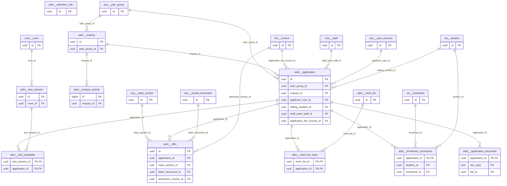

# Schema `adm`

> ADM: enquiry, application, tests, merit list, offers

Generated from the live database by `db/tools/gen_docs.py` — do not edit by hand.

**Tables:** 11

## Entity-relationship diagram

Convention FKs to `core.organisation`, `core.campus`, `sys.stored_file` and `wf.approval_request` are omitted from the diagram (see table details).

## Tables

- [`adm.application`](#admapplication) — Online admission application (draft to enrolled) with form snapshot.
- [`adm.application_document`](#admapplicationdocument) — Documents uploaded with an application.
- [`adm.enquiry`](#admenquiry) — Admission enquiry/lead with source, stage and follow-up.
- [`adm.enquiry_activity`](#admenquiryactivity) — Calls, visits, notes and stage changes on an enquiry. [calls, visits, notes, stage changes]
- [`adm.enrolment_conversion`](#admenrolmentconversion) — Idempotent record of converting an application into a student and enrolment. [ADM-08 idempotent conversion record]
- [`adm.merit_list`](#admmeritlist) — Generated merit list (per round) awaiting approval/publication.
- [`adm.merit_list_entry`](#admmeritlistentry) — Ranked applicant with decision offer/waitlist/reject.
- [`adm.offer`](#admoffer) — Offer letter with fee schedule and expiry; accepted offers trigger enrolment. [ADM-06]
- [`adm.selection_rule`](#admselectionrule) — Shortlisting rules: age cut-off, minimum score, sibling/staff-ward weights, seats. [ADM-05 rule-based shortlisting]
- [`adm.test_candidate`](#admtestcandidate) — Applicant seated in a test session with scores and interview notes.
- [`adm.test_session`](#admtestsession) — Admission test or interview session per campus/year group. [ADM-04]

### `adm.application`

Online admission application (draft to enrolled) with form snapshot.

- Row-level security: `p_campus: core.campus_visible(org_id, campus_id)`

| Column | Type | Null | Default | Description |
|---|---|---|---|---|
| `id` | uuid |  | uuidv7() |  |
| `org_id` | uuid |  |  |  |
| `campus_id` | uuid |  |  |  |
| `academic_year_id` | uuid |  |  |  |
| `year_group_id` | uuid |  |  |  |
| `enquiry_id` | uuid | yes |  |  |
| `application_no` | text | yes |  | assigned on submit |
| `applicant_user_id` | uuid | yes |  | guardian account created at draft |
| `status` | text |  | 'draft'::text |  |
| `child_first_name` | text |  |  |  |
| `child_last_name` | text | yes |  |  |
| `child_name_bn` | text | yes |  |  |
| `child_gender` | text |  |  |  |
| `child_dob` | date |  |  |  |
| `previous_school` | text | yes |  |  |
| `form_data` | jsonb |  | '{}'::jsonb | guardians, addresses, medical, answers (snapshot until enrolment) |
| `sibling_student_id` | uuid | yes |  |  |
| `staff_ward_staff_id` | uuid | yes |  |  |
| `application_fee_invoice_id` | uuid | yes |  |  |
| `submitted_at` | timestamp with time zone | yes |  |  |
| `created_at` | timestamp with time zone |  | now() |  |
| `created_by` | uuid | yes | core.current_user_id() |  |
| `updated_at` | timestamp with time zone |  | now() |  |
| `updated_by` | uuid | yes |  |  |
| `row_version` | integer |  | 1 |  |

| Constraint | Kind | Definition |
|---|---|---|
| `application_pkey` | PK | `PRIMARY KEY (id)` |
| `application_applicant_user_id_fkey` | FK | `FOREIGN KEY (applicant_user_id) REFERENCES iam.user_account(id)` |
| `application_application_fee_invoice_id_fkey` | FK | `FOREIGN KEY (application_fee_invoice_id) REFERENCES fee.invoice(id)` |
| `application_campus_id_fkey` | FK | `FOREIGN KEY (campus_id) REFERENCES core.campus(id)` |
| `application_enquiry_id_fkey` | FK | `FOREIGN KEY (enquiry_id) REFERENCES adm.enquiry(id)` |
| `application_org_id_fkey` | FK | `FOREIGN KEY (org_id) REFERENCES core.organisation(id)` |
| `application_sibling_student_id_fkey` | FK | `FOREIGN KEY (sibling_student_id) REFERENCES sis.student(id)` |
| `application_staff_ward_staff_id_fkey` | FK | `FOREIGN KEY (staff_ward_staff_id) REFERENCES hrm.staff(id)` |
| `application_year_group_id_fkey` | FK | `FOREIGN KEY (year_group_id) REFERENCES aca.year_group(id)` |
| `application_child_gender_check` | CHECK | `CHECK ((child_gender = ANY (ARRAY['male'::text, 'female'::text])))` |
| `application_status_check` | CHECK | `CHECK ((status = ANY (ARRAY['draft'::text, 'submitted'::text, 'fee_pending'::text, 'under_review'::text, 'test_scheduled'::text, 'tested'::text, 'shortlisted'::text, 'waitlisted'::text, 'offered'::text, 'accepted'::text, 'declined'::text, 'enrolled'::text, 'rejected'::text, 'withdrawn'::text, 'expired'::text])))` |

**Indexes**

- `CREATE INDEX ix_application_applicant_user_id_fk ON adm.application USING btree (applicant_user_id)`
- `CREATE INDEX ix_application_application_fee_invoice_id_fk ON adm.application USING btree (application_fee_invoice_id)`
- `CREATE INDEX ix_application_enquiry_id_fk ON adm.application USING btree (enquiry_id)`
- `CREATE INDEX ix_application_sibling_student_id_fk ON adm.application USING btree (sibling_student_id)`
- `CREATE INDEX ix_application_staff_ward_staff_id_fk ON adm.application USING btree (staff_ward_staff_id)`
- `CREATE INDEX ix_application_status ON adm.application USING btree (campus_id, academic_year_id, year_group_id, status)`
- `CREATE INDEX ix_application_year_group_id_fk ON adm.application USING btree (year_group_id)`
- `CREATE UNIQUE INDEX ux_application_no ON adm.application USING btree (org_id, application_no) WHERE (application_no IS NOT NULL)`

**Triggers**

- `trg_audit` — AFTER INSERT UPDATE DELETE → `tg_row_audit()`
- `trg_touch` — BEFORE UPDATE → `tg_touch()`

### `adm.application_document`

Documents uploaded with an application.

| Column | Type | Null | Default | Description |
|---|---|---|---|---|
| `application_id` | uuid |  |  |  |
| `doc_type` | text |  |  |  |
| `file_id` | uuid |  |  |  |
| `verified` | boolean |  | false |  |

| Constraint | Kind | Definition |
|---|---|---|
| `application_document_pkey` | PK | `PRIMARY KEY (application_id, doc_type, file_id)` |
| `application_document_application_id_fkey` | FK | `FOREIGN KEY (application_id) REFERENCES adm.application(id) ON DELETE CASCADE` |
| `application_document_file_id_fkey` | FK | `FOREIGN KEY (file_id) REFERENCES sys.stored_file(id)` |

### `adm.enquiry`

Admission enquiry/lead with source, stage and follow-up.

- Row-level security: `p_campus: core.campus_visible(org_id, campus_id)`

| Column | Type | Null | Default | Description |
|---|---|---|---|---|
| `id` | uuid |  | uuidv7() |  |
| `org_id` | uuid |  |  |  |
| `campus_id` | uuid |  |  |  |
| `academic_year_id` | uuid |  |  |  |
| `year_group_id` | uuid | yes |  |  |
| `source_code` | text |  |  | lookup 'lead_source': website, phone, walk_in, facebook, qr, referral |
| `campaign_code` | text | yes |  |  |
| `utm` | jsonb | yes |  |  |
| `child_name` | text |  |  |  |
| `child_dob` | date | yes |  |  |
| `guardian_name` | text |  |  |  |
| `phone` | core.phone_e164 |  |  |  |
| `email` | citext | yes |  |  |
| `stage` | text |  | 'enquiry'::text |  |
| `lost_reason_code` | text | yes |  |  |
| `assigned_to` | uuid | yes |  | counsellor user |
| `next_follow_up_at` | timestamp with time zone | yes |  |  |
| `created_at` | timestamp with time zone |  | now() |  |
| `created_by` | uuid | yes | core.current_user_id() |  |
| `updated_at` | timestamp with time zone |  | now() |  |
| `updated_by` | uuid | yes |  |  |
| `row_version` | integer |  | 1 |  |

| Constraint | Kind | Definition |
|---|---|---|
| `enquiry_pkey` | PK | `PRIMARY KEY (id)` |
| `enquiry_campus_id_fkey` | FK | `FOREIGN KEY (campus_id) REFERENCES core.campus(id)` |
| `enquiry_org_id_fkey` | FK | `FOREIGN KEY (org_id) REFERENCES core.organisation(id)` |
| `enquiry_year_group_id_fkey` | FK | `FOREIGN KEY (year_group_id) REFERENCES aca.year_group(id)` |
| `enquiry_stage_check` | CHECK | `CHECK ((stage = ANY (ARRAY['enquiry'::text, 'visit_scheduled'::text, 'visited'::text, 'applied'::text, 'test_scheduled'::text, 'tested'::text, 'offered'::text, 'admitted'::text, 'lost'::text])))` |

**Indexes**

- `CREATE INDEX ix_enquiry_followup ON adm.enquiry USING btree (assigned_to, next_follow_up_at) WHERE (stage <> ALL (ARRAY['admitted'::text, 'lost'::text]))`
- `CREATE INDEX ix_enquiry_pipeline ON adm.enquiry USING btree (campus_id, academic_year_id, stage)`
- `CREATE INDEX ix_enquiry_year_group_id_fk ON adm.enquiry USING btree (year_group_id)`

**Triggers**

- `trg_audit` — AFTER INSERT UPDATE DELETE → `tg_row_audit()`
- `trg_touch` — BEFORE UPDATE → `tg_touch()`

### `adm.enquiry_activity`

Calls, visits, notes and stage changes on an enquiry. [calls, visits, notes, stage changes]

| Column | Type | Null | Default | Description |
|---|---|---|---|---|
| `id` | bigint |  |  |  |
| `enquiry_id` | uuid |  |  |  |
| `kind` | text |  |  |  |
| `notes` | text | yes |  |  |
| `due_at` | timestamp with time zone | yes |  |  |
| `done_at` | timestamp with time zone | yes |  |  |
| `actor_id` | uuid | yes |  |  |
| `created_at` | timestamp with time zone |  | now() |  |

| Constraint | Kind | Definition |
|---|---|---|
| `enquiry_activity_pkey` | PK | `PRIMARY KEY (id)` |
| `enquiry_activity_enquiry_id_fkey` | FK | `FOREIGN KEY (enquiry_id) REFERENCES adm.enquiry(id) ON DELETE CASCADE` |
| `enquiry_activity_kind_check` | CHECK | `CHECK ((kind = ANY (ARRAY['call'::text, 'sms'::text, 'email'::text, 'visit'::text, 'note'::text, 'stage_change'::text, 'task'::text])))` |

**Indexes**

- `CREATE INDEX ix_enquiry_activity_enquiry_id_fk ON adm.enquiry_activity USING btree (enquiry_id)`

### `adm.enrolment_conversion`

Idempotent record of converting an application into a student and enrolment. [ADM-08 idempotent conversion record]

| Column | Type | Null | Default | Description |
|---|---|---|---|---|
| `application_id` | uuid |  |  |  |
| `student_id` | uuid |  |  |  |
| `enrolment_id` | uuid |  |  |  |
| `converted_at` | timestamp with time zone |  | now() |  |
| `converted_by` | uuid |  |  |  |

| Constraint | Kind | Definition |
|---|---|---|
| `enrolment_conversion_pkey` | PK | `PRIMARY KEY (application_id)` |
| `enrolment_conversion_application_id_fkey` | FK | `FOREIGN KEY (application_id) REFERENCES adm.application(id)` |
| `enrolment_conversion_enrolment_id_fkey` | FK | `FOREIGN KEY (enrolment_id) REFERENCES sis.enrolment(id)` |
| `enrolment_conversion_student_id_fkey` | FK | `FOREIGN KEY (student_id) REFERENCES sis.student(id)` |

**Indexes**

- `CREATE INDEX ix_enrolment_conversion_enrolment_id_fk ON adm.enrolment_conversion USING btree (enrolment_id)`
- `CREATE INDEX ix_enrolment_conversion_student_id_fk ON adm.enrolment_conversion USING btree (student_id)`

### `adm.merit_list`

Generated merit list (per round) awaiting approval/publication.

- Row-level security: `p_campus: core.campus_visible(org_id, campus_id)`

| Column | Type | Null | Default | Description |
|---|---|---|---|---|
| `id` | uuid |  | uuidv7() |  |
| `org_id` | uuid |  |  |  |
| `campus_id` | uuid |  |  |  |
| `academic_year_id` | uuid |  |  |  |
| `year_group_id` | uuid |  |  |  |
| `round_no` | smallint |  | 1 |  |
| `status` | text |  | 'draft'::text |  |
| `generated_at` | timestamp with time zone |  | now() |  |
| `approved_by` | uuid | yes |  |  |

| Constraint | Kind | Definition |
|---|---|---|
| `merit_list_pkey` | PK | `PRIMARY KEY (id)` |
| `merit_list_campus_id_academic_year_id_year_group_id_round_n_key` | UNIQUE | `UNIQUE (campus_id, academic_year_id, year_group_id, round_no)` |
| `merit_list_campus_id_fkey` | FK | `FOREIGN KEY (campus_id) REFERENCES core.campus(id)` |
| `merit_list_org_id_fkey` | FK | `FOREIGN KEY (org_id) REFERENCES core.organisation(id)` |
| `merit_list_status_check` | CHECK | `CHECK ((status = ANY (ARRAY['draft'::text, 'approved'::text, 'published'::text])))` |

**Triggers**

- `trg_audit` — AFTER INSERT UPDATE DELETE → `tg_row_audit()`

### `adm.merit_list_entry`

Ranked applicant with decision offer/waitlist/reject.

| Column | Type | Null | Default | Description |
|---|---|---|---|---|
| `merit_list_id` | uuid |  |  |  |
| `application_id` | uuid |  |  |  |
| `rank` | integer |  |  |  |
| `score` | numeric(7,3) |  |  |  |
| `decision` | text |  |  |  |
| `waitlist_position` | integer | yes |  |  |

| Constraint | Kind | Definition |
|---|---|---|
| `merit_list_entry_pkey` | PK | `PRIMARY KEY (merit_list_id, application_id)` |
| `merit_list_entry_merit_list_id_rank_key` | UNIQUE | `UNIQUE (merit_list_id, rank)` |
| `merit_list_entry_application_id_fkey` | FK | `FOREIGN KEY (application_id) REFERENCES adm.application(id)` |
| `merit_list_entry_merit_list_id_fkey` | FK | `FOREIGN KEY (merit_list_id) REFERENCES adm.merit_list(id) ON DELETE CASCADE` |
| `merit_list_entry_decision_check` | CHECK | `CHECK ((decision = ANY (ARRAY['offer'::text, 'waitlist'::text, 'reject'::text])))` |

**Indexes**

- `CREATE INDEX ix_merit_list_entry_application_id_fk ON adm.merit_list_entry USING btree (application_id)`

### `adm.offer`

Offer letter with fee schedule and expiry; accepted offers trigger enrolment. [ADM-06]

- Row-level security: `p_campus: core.campus_visible(org_id, campus_id)`

| Column | Type | Null | Default | Description |
|---|---|---|---|---|
| `id` | uuid |  | uuidv7() |  |
| `org_id` | uuid |  |  |  |
| `campus_id` | uuid |  |  |  |
| `application_id` | uuid |  |  |  |
| `offer_no` | text |  |  |  |
| `class_section_id` | uuid | yes |  | optional pre-allocation |
| `fee_schedule` | jsonb |  |  | snapshot of fees shown in the letter |
| `issued_at` | timestamp with time zone |  | now() |  |
| `expires_at` | timestamp with time zone |  |  |  |
| `status` | text |  | 'issued'::text |  |
| `responded_at` | timestamp with time zone | yes |  |  |
| `letter_document_id` | uuid | yes |  |  |
| `admission_invoice_id` | uuid | yes |  | ADM-07 |
| `created_at` | timestamp with time zone |  | now() |  |
| `created_by` | uuid | yes | core.current_user_id() |  |
| `updated_at` | timestamp with time zone |  | now() |  |
| `updated_by` | uuid | yes |  |  |
| `row_version` | integer |  | 1 |  |

| Constraint | Kind | Definition |
|---|---|---|
| `offer_pkey` | PK | `PRIMARY KEY (id)` |
| `offer_org_id_offer_no_key` | UNIQUE | `UNIQUE (org_id, offer_no)` |
| `offer_admission_invoice_id_fkey` | FK | `FOREIGN KEY (admission_invoice_id) REFERENCES fee.invoice(id)` |
| `offer_application_id_fkey` | FK | `FOREIGN KEY (application_id) REFERENCES adm.application(id)` |
| `offer_campus_id_fkey` | FK | `FOREIGN KEY (campus_id) REFERENCES core.campus(id)` |
| `offer_class_section_id_fkey` | FK | `FOREIGN KEY (class_section_id) REFERENCES aca.class_section(id)` |
| `offer_letter_document_id_fkey` | FK | `FOREIGN KEY (letter_document_id) REFERENCES doc.issued_document(id)` |
| `offer_org_id_fkey` | FK | `FOREIGN KEY (org_id) REFERENCES core.organisation(id)` |
| `offer_status_check` | CHECK | `CHECK ((status = ANY (ARRAY['issued'::text, 'accepted'::text, 'declined'::text, 'expired'::text, 'revoked'::text])))` |

**Indexes**

- `CREATE INDEX ix_offer_admission_invoice_id_fk ON adm.offer USING btree (admission_invoice_id)`
- `CREATE INDEX ix_offer_campus_id_fk ON adm.offer USING btree (campus_id)`
- `CREATE INDEX ix_offer_class_section_id_fk ON adm.offer USING btree (class_section_id)`
- `CREATE INDEX ix_offer_expiry ON adm.offer USING btree (expires_at) WHERE (status = 'issued'::text)`
- `CREATE INDEX ix_offer_letter_document_id_fk ON adm.offer USING btree (letter_document_id)`
- `CREATE UNIQUE INDEX ux_offer_live ON adm.offer USING btree (application_id) WHERE (status = ANY (ARRAY['issued'::text, 'accepted'::text]))`

**Triggers**

- `trg_audit` — AFTER INSERT UPDATE DELETE → `tg_row_audit()`
- `trg_touch` — BEFORE UPDATE → `tg_touch()`

### `adm.selection_rule`

Shortlisting rules: age cut-off, minimum score, sibling/staff-ward weights, seats. [ADM-05 rule-based shortlisting]

- Row-level security: `p_campus: core.campus_visible(org_id, campus_id)`

| Column | Type | Null | Default | Description |
|---|---|---|---|---|
| `id` | uuid |  | uuidv7() |  |
| `org_id` | uuid |  |  |  |
| `campus_id` | uuid |  |  |  |
| `academic_year_id` | uuid |  |  |  |
| `year_group_id` | uuid |  |  |  |
| `age_reference_date` | date |  |  |  |
| `min_age_months` | smallint | yes |  |  |
| `max_age_months` | smallint | yes |  |  |
| `min_total_score` | numeric(6,2) | yes |  |  |
| `weights` | jsonb |  | '{}'::jsonb | {"test": 0.8, "interview": 0.2, "sibling_bonus": 5, "staff_ward_bonus": 5} |
| `seats` | smallint |  |  |  |

| Constraint | Kind | Definition |
|---|---|---|
| `selection_rule_pkey` | PK | `PRIMARY KEY (id)` |
| `selection_rule_campus_id_academic_year_id_year_group_id_key` | UNIQUE | `UNIQUE (campus_id, academic_year_id, year_group_id)` |
| `selection_rule_campus_id_fkey` | FK | `FOREIGN KEY (campus_id) REFERENCES core.campus(id)` |
| `selection_rule_org_id_fkey` | FK | `FOREIGN KEY (org_id) REFERENCES core.organisation(id)` |

### `adm.test_candidate`

Applicant seated in a test session with scores and interview notes.

| Column | Type | Null | Default | Description |
|---|---|---|---|---|
| `test_session_id` | uuid |  |  |  |
| `application_id` | uuid |  |  |  |
| `admit_card_no` | text |  |  |  |
| `seat_no` | text | yes |  |  |
| `attended` | boolean | yes |  |  |
| `scores` | jsonb |  | '{}'::jsonb | {"ENG": 41, "MATH": 38} |
| `total_score` | numeric(6,2) | yes |  |  |
| `interviewer_ids` | uuid[] |  | '{}'::uuid[] |  |
| `interview_notes` | text | yes |  |  |
| `rating` | smallint | yes |  |  |

| Constraint | Kind | Definition |
|---|---|---|
| `test_candidate_pkey` | PK | `PRIMARY KEY (test_session_id, application_id)` |
| `test_candidate_application_id_fkey` | FK | `FOREIGN KEY (application_id) REFERENCES adm.application(id)` |
| `test_candidate_test_session_id_fkey` | FK | `FOREIGN KEY (test_session_id) REFERENCES adm.test_session(id)` |
| `test_candidate_rating_check` | CHECK | `CHECK (((rating >= 1) AND (rating <= 5)))` |

**Indexes**

- `CREATE INDEX ix_test_candidate_application_id_fk ON adm.test_candidate USING btree (application_id)`

### `adm.test_session`

Admission test or interview session per campus/year group. [ADM-04]

- Row-level security: `p_campus: core.campus_visible(org_id, campus_id)`

| Column | Type | Null | Default | Description |
|---|---|---|---|---|
| `id` | uuid |  | uuidv7() |  |
| `org_id` | uuid |  |  |  |
| `campus_id` | uuid |  |  |  |
| `academic_year_id` | uuid |  |  |  |
| `year_group_id` | uuid |  |  |  |
| `kind` | text |  |  |  |
| `starts_at` | timestamp with time zone |  |  |  |
| `ends_at` | timestamp with time zone |  |  |  |
| `room_id` | uuid | yes |  |  |
| `capacity` | smallint |  |  |  |
| `components` | jsonb |  | '[]'::jsonb | [{"code":"ENG","max":50},{"code":"MATH","max":50}] |
| `created_at` | timestamp with time zone |  | now() |  |
| `created_by` | uuid | yes | core.current_user_id() |  |
| `updated_at` | timestamp with time zone |  | now() |  |
| `updated_by` | uuid | yes |  |  |
| `row_version` | integer |  | 1 |  |

| Constraint | Kind | Definition |
|---|---|---|
| `test_session_pkey` | PK | `PRIMARY KEY (id)` |
| `test_session_campus_id_fkey` | FK | `FOREIGN KEY (campus_id) REFERENCES core.campus(id)` |
| `test_session_org_id_fkey` | FK | `FOREIGN KEY (org_id) REFERENCES core.organisation(id)` |
| `test_session_room_id_fkey` | FK | `FOREIGN KEY (room_id) REFERENCES core.room(id)` |
| `test_session_kind_check` | CHECK | `CHECK ((kind = ANY (ARRAY['written_test'::text, 'interview'::text, 'assessment_play'::text])))` |

**Indexes**

- `CREATE INDEX ix_test_session_campus_id_fk ON adm.test_session USING btree (campus_id)`
- `CREATE INDEX ix_test_session_room_id_fk ON adm.test_session USING btree (room_id)`

**Triggers**

- `trg_touch` — BEFORE UPDATE → `tg_touch()`

