# Schema `att`

> ATT: student & staff attendance, devices, leave

Generated from the live database by `db/tools/gen_docs.py` — do not edit by hand.

**Tables:** 11

## Entity-relationship diagram

Convention FKs to `core.organisation`, `core.campus`, `sys.stored_file` and `wf.approval_request` are omitted from the diagram (see table details).

```mermaid
erDiagram
  att__attendance_flag {
    uuid id PK
    uuid student_id FK
    uuid rule_id FK
    uuid term_id FK
  }
  att__attendance_rule {
    uuid id PK
    uuid programme_id FK
  }
  att__device {
    uuid id PK
  }
  att__device_event {
    bigint id PK
    uuid device_id FK
    timestamp_with_time_zone event_time PK
  }
  att__period_attendance {
    date attendance_date PK
    uuid period_definition_id PK, FK
    uuid teaching_group_id FK
    uuid student_id PK, FK
  }
  att__staff_attendance {
    date attendance_date PK
    uuid staff_id PK, FK
  }
  att__staff_leave_balance {
    uuid staff_id PK, FK
    uuid leave_type_id PK, FK
    smallint leave_year PK
  }
  att__staff_leave_request {
    uuid id PK
    uuid staff_id FK
    uuid leave_type_id FK
  }
  att__staff_leave_type {
    uuid id PK
  }
  att__student_daily_attendance {
    date attendance_date PK
    uuid student_id PK, FK
    uuid enrolment_id FK
    uuid class_section_id FK
    uuid leave_request_id FK
  }
  att__student_leave_request {
    uuid id PK
    uuid student_id FK
    uuid enrolment_id FK
  }
  aca__class_section {
    uuid id PK
  }
  aca__period_definition {
    uuid id PK
  }
  aca__programme {
    uuid id PK
  }
  aca__teaching_group {
    uuid id PK
  }
  core__term {
    uuid id PK
  }
  hrm__staff {
    uuid id PK
  }
  sis__enrolment {
    uuid id PK
  }
  sis__student {
    uuid id PK
  }
  aca__class_section ||--o{ att__student_daily_attendance : "class_section_id"
  aca__period_definition ||--o{ att__period_attendance : "period_definition_id"
  aca__programme ||--o{ att__attendance_rule : "programme_id"
  aca__teaching_group ||--o{ att__period_attendance : "teaching_group_id"
  att__attendance_rule ||--o{ att__attendance_flag : "rule_id"
  att__device ||--o{ att__device_event : "device_id"
  att__staff_leave_type ||--o{ att__staff_leave_balance : "leave_type_id"
  att__staff_leave_type ||--o{ att__staff_leave_request : "leave_type_id"
  att__student_leave_request ||--o{ att__student_daily_attendance : "leave_request_id"
  core__term ||--o{ att__attendance_flag : "term_id"
  hrm__staff ||--o{ att__staff_attendance : "staff_id"
  hrm__staff ||--o{ att__staff_leave_balance : "staff_id"
  hrm__staff ||--o{ att__staff_leave_request : "staff_id"
  sis__enrolment ||--o{ att__student_daily_attendance : "enrolment_id"
  sis__enrolment ||--o{ att__student_leave_request : "enrolment_id"
  sis__student ||--o{ att__attendance_flag : "student_id"
  sis__student ||--o{ att__period_attendance : "student_id"
  sis__student ||--o{ att__student_daily_attendance : "student_id"
  sis__student ||--o{ att__student_leave_request : "student_id"
```

## Tables

- [`att.attendance_flag`](#attattendanceflag) — Warning/ineligibility flag raised for a student by the threshold job. [generated warnings / eligibility flags]
- [`att.attendance_rule`](#attattendancerule) — Minimum attendance % and warning thresholds (exam eligibility). [ATT-05 thresholds]
- [`att.device`](#attdevice) — Biometric/RFID/QR device registered for attendance or gate scans. [ATT-02 (P2)]
- [`att.device_event`](#attdeviceevent) — Raw punch/scan from devices via the on-campus bridge - monthly partitions. [raw punches, store-and-forward from bridge]
- [`att.period_attendance`](#attperiodattendance) — Period-wise attendance per teaching group for senior years - yearly partitions. [senior years, per teaching group & period]
- [`att.staff_attendance`](#attstaffattendance) — Daily staff attendance with late/early/overtime minutes - yearly partitions.
- [`att.staff_leave_balance`](#attstaffleavebalance) — Leave balance per staff, type and year; cannot be overdrawn.
- [`att.staff_leave_request`](#attstaffleaverequest) — Staff leave request with holiday-aware day count and approval.
- [`att.staff_leave_type`](#attstaffleavetype) — Staff leave types with quota, carry-forward and paid flag.
- [`att.student_daily_attendance`](#attstudentdailyattendance) — Daily student attendance (one row per student per day) - yearly partitions. [ATT-01, ~660k rows/yr; yearly partitions]
- [`att.student_leave_request`](#attstudentleaverequest) — Leave applied by a guardian, approved by the class teacher. [ATT-04]

### `att.attendance_flag`

Warning/ineligibility flag raised for a student by the threshold job. [generated warnings / eligibility flags]

- Row-level security: `p_campus: core.campus_visible(org_id, campus_id)`

| Column | Type | Null | Default | Description |
|---|---|---|---|---|
| `id` | uuid |  | uuidv7() |  |
| `org_id` | uuid |  |  |  |
| `campus_id` | uuid |  |  |  |
| `student_id` | uuid |  |  |  |
| `rule_id` | uuid |  |  |  |
| `term_id` | uuid | yes |  |  |
| `percent` | core.percent |  |  |  |
| `level` | text |  |  |  |
| `raised_at` | timestamp with time zone |  | now() |  |
| `letter_document_id` | uuid | yes |  |  |
| `resolved_at` | timestamp with time zone | yes |  |  |

| Constraint | Kind | Definition |
|---|---|---|
| `attendance_flag_pkey` | PK | `PRIMARY KEY (id)` |
| `attendance_flag_campus_id_fkey` | FK | `FOREIGN KEY (campus_id) REFERENCES core.campus(id)` |
| `attendance_flag_org_id_fkey` | FK | `FOREIGN KEY (org_id) REFERENCES core.organisation(id)` |
| `attendance_flag_rule_id_fkey` | FK | `FOREIGN KEY (rule_id) REFERENCES att.attendance_rule(id)` |
| `attendance_flag_student_id_fkey` | FK | `FOREIGN KEY (student_id) REFERENCES sis.student(id)` |
| `attendance_flag_term_id_fkey` | FK | `FOREIGN KEY (term_id) REFERENCES core.term(id)` |
| `attendance_flag_level_check` | CHECK | `CHECK ((level = ANY (ARRAY['warning_1'::text, 'warning_2'::text, 'ineligible'::text])))` |

**Indexes**

- `CREATE INDEX ix_attendance_flag_campus_id_fk ON att.attendance_flag USING btree (campus_id)`
- `CREATE INDEX ix_attendance_flag_rule_id_fk ON att.attendance_flag USING btree (rule_id)`
- `CREATE INDEX ix_attendance_flag_student_id_fk ON att.attendance_flag USING btree (student_id)`
- `CREATE INDEX ix_attendance_flag_term_id_fk ON att.attendance_flag USING btree (term_id)`

### `att.attendance_rule`

Minimum attendance % and warning thresholds (exam eligibility). [ATT-05 thresholds]

- Row-level security: `p_org: core.org_visible(org_id)`

| Column | Type | Null | Default | Description |
|---|---|---|---|---|
| `id` | uuid |  | uuidv7() |  |
| `org_id` | uuid |  |  |  |
| `programme_id` | uuid | yes |  | NULL = all |
| `min_percent` | core.percent |  |  | e.g. 80.00 for exam eligibility |
| `warning_levels` | numeric(5,2)[] |  | '{90,85}'::numeric[] |  |
| `late_counts_as` | numeric(3,2) |  | 1.00 | 3 lates = 1 absence => 0.33 |
| `period` | text |  |  |  |
| `is_active` | boolean |  | true |  |

| Constraint | Kind | Definition |
|---|---|---|
| `attendance_rule_pkey` | PK | `PRIMARY KEY (id)` |
| `attendance_rule_org_id_fkey` | FK | `FOREIGN KEY (org_id) REFERENCES core.organisation(id)` |
| `attendance_rule_programme_id_fkey` | FK | `FOREIGN KEY (programme_id) REFERENCES aca.programme(id)` |
| `attendance_rule_period_check` | CHECK | `CHECK ((period = ANY (ARRAY['term'::text, 'academic_year'::text, 'exam_window'::text])))` |

**Indexes**

- `CREATE INDEX ix_attendance_rule_programme_id_fk ON att.attendance_rule USING btree (programme_id)`

### `att.device`

Biometric/RFID/QR device registered for attendance or gate scans. [ATT-02 (P2)]

- Row-level security: `p_campus: core.campus_visible(org_id, campus_id)`

| Column | Type | Null | Default | Description |
|---|---|---|---|---|
| `id` | uuid |  | uuidv7() |  |
| `org_id` | uuid |  |  |  |
| `campus_id` | uuid |  |  |  |
| `vendor` | text |  |  |  |
| `serial_no` | text |  |  |  |
| `kind` | text |  |  |  |
| `location` | text | yes |  |  |
| `direction` | text | yes |  |  |
| `secret_hash` | bytea |  |  | device-bridge HMAC credential |
| `last_seen_at` | timestamp with time zone | yes |  |  |
| `is_active` | boolean |  | true |  |

| Constraint | Kind | Definition |
|---|---|---|
| `device_pkey` | PK | `PRIMARY KEY (id)` |
| `device_org_id_serial_no_key` | UNIQUE | `UNIQUE (org_id, serial_no)` |
| `device_campus_id_fkey` | FK | `FOREIGN KEY (campus_id) REFERENCES core.campus(id)` |
| `device_org_id_fkey` | FK | `FOREIGN KEY (org_id) REFERENCES core.organisation(id)` |
| `device_direction_check` | CHECK | `CHECK ((direction = ANY (ARRAY['in'::text, 'out'::text, 'both'::text])))` |
| `device_kind_check` | CHECK | `CHECK ((kind = ANY (ARRAY['biometric'::text, 'rfid_gate'::text, 'qr_scanner'::text, 'bus_reader'::text])))` |
| `device_vendor_check` | CHECK | `CHECK ((vendor = ANY (ARRAY['zkteco'::text, 'hikvision'::text, 'generic_qr'::text, 'generic_rfid'::text])))` |

**Indexes**

- `CREATE INDEX ix_device_campus_id_fk ON att.device USING btree (campus_id)`

### `att.device_event`

Raw punch/scan from devices via the on-campus bridge - monthly partitions. [raw punches, store-and-forward from bridge]

- Partitioned `RANGE (event_time)` (14 partitions incl. default)
- Row-level security: `p_campus: core.campus_visible(org_id, campus_id)`

| Column | Type | Null | Default | Description |
|---|---|---|---|---|
| `id` | bigint |  |  |  |
| `org_id` | uuid |  |  |  |
| `campus_id` | uuid |  |  |  |
| `device_id` | uuid |  |  |  |
| `event_time` | timestamp with time zone |  |  |  |
| `credential` | text |  |  | card uid / enrolled user pin |
| `person_type` | text | yes |  |  |
| `person_id` | uuid | yes |  |  |
| `direction` | text | yes |  |  |
| `bridge_seq` | bigint |  |  | de-dup key from bridge |
| `processed_at` | timestamp with time zone | yes |  |  |
| `raw` | jsonb | yes |  |  |

| Constraint | Kind | Definition |
|---|---|---|
| `device_event_pkey` | PK | `PRIMARY KEY (id, event_time)` |
| `device_event_device_id_bridge_seq_event_time_key` | UNIQUE | `UNIQUE (device_id, bridge_seq, event_time)` |
| `device_event_campus_id_fkey` | FK | `FOREIGN KEY (campus_id) REFERENCES core.campus(id)` |
| `device_event_device_id_fkey` | FK | `FOREIGN KEY (device_id) REFERENCES att.device(id)` |
| `device_event_org_id_fkey` | FK | `FOREIGN KEY (org_id) REFERENCES core.organisation(id)` |
| `device_event_direction_check` | CHECK | `CHECK ((direction = ANY (ARRAY['in'::text, 'out'::text])))` |
| `device_event_person_type_check` | CHECK | `CHECK ((person_type = ANY (ARRAY['student'::text, 'staff'::text, 'unknown'::text])))` |

**Indexes**

- `CREATE INDEX ix_device_event_campus_id_fk ON ONLY att.device_event USING btree (campus_id)`
- `CREATE INDEX ix_device_event_unprocessed ON ONLY att.device_event USING btree (event_time) WHERE (processed_at IS NULL)`

### `att.period_attendance`

Period-wise attendance per teaching group for senior years - yearly partitions. [senior years, per teaching group & period]

- Partitioned `RANGE (attendance_date)` (5 partitions incl. default)
- Row-level security: `p_campus: core.campus_visible(org_id, campus_id)`

| Column | Type | Null | Default | Description |
|---|---|---|---|---|
| `org_id` | uuid |  |  |  |
| `campus_id` | uuid |  |  |  |
| `attendance_date` | date |  |  |  |
| `period_definition_id` | uuid |  |  |  |
| `teaching_group_id` | uuid |  |  |  |
| `student_id` | uuid |  |  |  |
| `status` | text |  |  |  |
| `source` | text |  | 'teacher'::text |  |
| `marked_by` | uuid | yes |  |  |
| `marked_at` | timestamp with time zone |  | now() |  |

| Constraint | Kind | Definition |
|---|---|---|
| `period_attendance_pkey` | PK | `PRIMARY KEY (student_id, attendance_date, period_definition_id)` |
| `period_attendance_campus_id_fkey` | FK | `FOREIGN KEY (campus_id) REFERENCES core.campus(id)` |
| `period_attendance_org_id_fkey` | FK | `FOREIGN KEY (org_id) REFERENCES core.organisation(id)` |
| `period_attendance_period_definition_id_fkey` | FK | `FOREIGN KEY (period_definition_id) REFERENCES aca.period_definition(id)` |
| `period_attendance_student_id_fkey` | FK | `FOREIGN KEY (student_id) REFERENCES sis.student(id)` |
| `period_attendance_teaching_group_id_fkey` | FK | `FOREIGN KEY (teaching_group_id) REFERENCES aca.teaching_group(id)` |
| `period_attendance_source_check` | CHECK | `CHECK ((source = ANY (ARRAY['teacher'::text, 'online_join_log'::text, 'correction'::text])))` |
| `period_attendance_status_check` | CHECK | `CHECK ((status = ANY (ARRAY['present'::text, 'absent'::text, 'late'::text, 'excused'::text])))` |

**Indexes**

- `CREATE INDEX ix_pa_group_date ON ONLY att.period_attendance USING btree (teaching_group_id, attendance_date)`
- `CREATE INDEX ix_period_attendance_campus_id_fk ON ONLY att.period_attendance USING btree (campus_id)`
- `CREATE INDEX ix_period_attendance_period_definition_id_fk ON ONLY att.period_attendance USING btree (period_definition_id)`

**Triggers**

- `trg_audit` — AFTER UPDATE DELETE → `tg_row_audit()`

### `att.staff_attendance`

Daily staff attendance with late/early/overtime minutes - yearly partitions.

- Partitioned `RANGE (attendance_date)` (5 partitions incl. default)
- Row-level security: `p_campus: core.campus_visible(org_id, campus_id)`

| Column | Type | Null | Default | Description |
|---|---|---|---|---|
| `org_id` | uuid |  |  |  |
| `campus_id` | uuid |  |  |  |
| `attendance_date` | date |  |  |  |
| `staff_id` | uuid |  |  |  |
| `check_in_at` | timestamp with time zone | yes |  |  |
| `check_out_at` | timestamp with time zone | yes |  |  |
| `status` | text |  |  |  |
| `late_minutes` | smallint |  | 0 |  |
| `early_leave_minutes` | smallint |  | 0 |  |
| `overtime_minutes` | smallint |  | 0 |  |
| `source` | text |  |  |  |
| `geo_lat` | numeric(9,6) | yes |  |  |
| `geo_lng` | numeric(9,6) | yes |  |  |

| Constraint | Kind | Definition |
|---|---|---|
| `staff_attendance_pkey` | PK | `PRIMARY KEY (staff_id, attendance_date)` |
| `staff_attendance_campus_id_fkey` | FK | `FOREIGN KEY (campus_id) REFERENCES core.campus(id)` |
| `staff_attendance_org_id_fkey` | FK | `FOREIGN KEY (org_id) REFERENCES core.organisation(id)` |
| `staff_attendance_staff_id_fkey` | FK | `FOREIGN KEY (staff_id) REFERENCES hrm.staff(id)` |
| `staff_attendance_source_check` | CHECK | `CHECK ((source = ANY (ARRAY['device'::text, 'mobile_geo'::text, 'manual'::text, 'leave_auto'::text])))` |
| `staff_attendance_status_check` | CHECK | `CHECK ((status = ANY (ARRAY['present'::text, 'absent'::text, 'late'::text, 'leave'::text, 'half_day'::text, 'holiday'::text, 'weekly_off'::text, 'on_duty'::text])))` |

**Indexes**

- `CREATE INDEX ix_staff_attendance_campus_id_fk ON ONLY att.staff_attendance USING btree (campus_id)`

**Triggers**

- `trg_audit` — AFTER UPDATE DELETE → `tg_row_audit()`

### `att.staff_leave_balance`

Leave balance per staff, type and year; cannot be overdrawn.

| Column | Type | Null | Default | Description |
|---|---|---|---|---|
| `staff_id` | uuid |  |  |  |
| `leave_type_id` | uuid |  |  |  |
| `leave_year` | smallint |  |  |  |
| `entitled_days` | numeric(5,1) |  |  |  |
| `carried_days` | numeric(5,1) |  | 0 |  |
| `taken_days` | numeric(5,1) |  | 0 |  |
| `pending_days` | numeric(5,1) |  | 0 |  |

| Constraint | Kind | Definition |
|---|---|---|
| `staff_leave_balance_pkey` | PK | `PRIMARY KEY (staff_id, leave_type_id, leave_year)` |
| `staff_leave_balance_leave_type_id_fkey` | FK | `FOREIGN KEY (leave_type_id) REFERENCES att.staff_leave_type(id)` |
| `staff_leave_balance_staff_id_fkey` | FK | `FOREIGN KEY (staff_id) REFERENCES hrm.staff(id)` |
| `staff_leave_balance_check` | CHECK | `CHECK (((taken_days + pending_days) <= (entitled_days + carried_days)))` |

**Indexes**

- `CREATE INDEX ix_staff_leave_balance_leave_type_id_fk ON att.staff_leave_balance USING btree (leave_type_id)`

### `att.staff_leave_request`

Staff leave request with holiday-aware day count and approval.

- Row-level security: `p_campus: core.campus_visible(org_id, campus_id)`

| Column | Type | Null | Default | Description |
|---|---|---|---|---|
| `id` | uuid |  | uuidv7() |  |
| `org_id` | uuid |  |  |  |
| `campus_id` | uuid |  |  |  |
| `staff_id` | uuid |  |  |  |
| `leave_type_id` | uuid |  |  |  |
| `from_date` | date |  |  |  |
| `to_date` | date |  |  |  |
| `half_day` | boolean |  | false |  |
| `days` | numeric(5,1) |  |  | computed holiday-aware |
| `reason` | text | yes |  |  |
| `attachment_file_id` | uuid | yes |  |  |
| `status` | text |  | 'pending'::text |  |
| `approval_request_id` | uuid | yes |  |  |
| `created_at` | timestamp with time zone |  | now() |  |
| `created_by` | uuid | yes | core.current_user_id() |  |
| `updated_at` | timestamp with time zone |  | now() |  |
| `updated_by` | uuid | yes |  |  |
| `row_version` | integer |  | 1 |  |

| Constraint | Kind | Definition |
|---|---|---|
| `staff_leave_request_pkey` | PK | `PRIMARY KEY (id)` |
| `staff_leave_request_approval_request_id_fkey` | FK | `FOREIGN KEY (approval_request_id) REFERENCES wf.approval_request(id)` |
| `staff_leave_request_attachment_file_id_fkey` | FK | `FOREIGN KEY (attachment_file_id) REFERENCES sys.stored_file(id)` |
| `staff_leave_request_campus_id_fkey` | FK | `FOREIGN KEY (campus_id) REFERENCES core.campus(id)` |
| `staff_leave_request_leave_type_id_fkey` | FK | `FOREIGN KEY (leave_type_id) REFERENCES att.staff_leave_type(id)` |
| `staff_leave_request_org_id_fkey` | FK | `FOREIGN KEY (org_id) REFERENCES core.organisation(id)` |
| `staff_leave_request_staff_id_fkey` | FK | `FOREIGN KEY (staff_id) REFERENCES hrm.staff(id)` |
| `staff_leave_request_check` | CHECK | `CHECK ((to_date >= from_date))` |
| `staff_leave_request_status_check` | CHECK | `CHECK ((status = ANY (ARRAY['pending'::text, 'approved'::text, 'rejected'::text, 'cancelled'::text])))` |

**Indexes**

- `CREATE INDEX ix_staff_leave_calendar ON att.staff_leave_request USING gist (campus_id, daterange(from_date, to_date, '[]'::text)) WHERE (status = 'approved'::text)`
- `CREATE INDEX ix_staff_leave_request_leave_type_id_fk ON att.staff_leave_request USING btree (leave_type_id)`
- `CREATE INDEX ix_staff_leave_request_staff_id_fk ON att.staff_leave_request USING btree (staff_id)`

**Triggers**

- `trg_audit` — AFTER INSERT UPDATE DELETE → `tg_row_audit()`
- `trg_touch` — BEFORE UPDATE → `tg_touch()`

### `att.staff_leave_type`

Staff leave types with quota, carry-forward and paid flag.

- Row-level security: `p_org: core.org_visible(org_id)`

| Column | Type | Null | Default | Description |
|---|---|---|---|---|
| `id` | uuid |  | uuidv7() |  |
| `org_id` | uuid |  |  |  |
| `code` | text |  |  | CL, SL, EL, ML, LWP |
| `name_en` | text |  |  |  |
| `name_bn` | text | yes |  |  |
| `annual_quota_days` | numeric(5,1) |  |  |  |
| `max_carry_forward` | numeric(5,1) |  | 0 |  |
| `is_paid` | boolean |  | true |  |
| `gender_restriction` | text | yes |  |  |
| `requires_document_after_days` | smallint | yes |  |  |
| `counts_holidays` | boolean |  | false | holiday-aware day counting |

| Constraint | Kind | Definition |
|---|---|---|
| `staff_leave_type_pkey` | PK | `PRIMARY KEY (id)` |
| `staff_leave_type_org_id_code_key` | UNIQUE | `UNIQUE (org_id, code)` |
| `staff_leave_type_org_id_fkey` | FK | `FOREIGN KEY (org_id) REFERENCES core.organisation(id)` |
| `staff_leave_type_gender_restriction_check` | CHECK | `CHECK ((gender_restriction = ANY (ARRAY['male'::text, 'female'::text])))` |

### `att.student_daily_attendance`

Daily student attendance (one row per student per day) - yearly partitions. [ATT-01, ~660k rows/yr; yearly partitions]

- Partitioned `RANGE (attendance_date)` (5 partitions incl. default)
- Row-level security: `p_campus: core.campus_visible(org_id, campus_id)`

| Column | Type | Null | Default | Description |
|---|---|---|---|---|
| `org_id` | uuid |  |  |  |
| `campus_id` | uuid |  |  |  |
| `attendance_date` | date |  |  |  |
| `student_id` | uuid |  |  |  |
| `enrolment_id` | uuid |  |  |  |
| `class_section_id` | uuid |  |  |  |
| `status` | text |  |  |  |
| `arrived_at` | timestamp with time zone | yes |  |  |
| `departed_at` | timestamp with time zone | yes |  |  |
| `source` | text |  |  |  |
| `leave_request_id` | uuid | yes |  |  |
| `remarks` | text | yes |  |  |
| `marked_by` | uuid | yes |  |  |
| `marked_at` | timestamp with time zone |  | now() |  |
| `row_version` | integer |  | 1 |  |

| Constraint | Kind | Definition |
|---|---|---|
| `student_daily_attendance_pkey` | PK | `PRIMARY KEY (student_id, attendance_date)` |
| `student_daily_attendance_campus_id_fkey` | FK | `FOREIGN KEY (campus_id) REFERENCES core.campus(id)` |
| `student_daily_attendance_class_section_id_fkey` | FK | `FOREIGN KEY (class_section_id) REFERENCES aca.class_section(id)` |
| `student_daily_attendance_enrolment_id_fkey` | FK | `FOREIGN KEY (enrolment_id) REFERENCES sis.enrolment(id)` |
| `student_daily_attendance_leave_request_id_fkey` | FK | `FOREIGN KEY (leave_request_id) REFERENCES att.student_leave_request(id)` |
| `student_daily_attendance_org_id_fkey` | FK | `FOREIGN KEY (org_id) REFERENCES core.organisation(id)` |
| `student_daily_attendance_student_id_fkey` | FK | `FOREIGN KEY (student_id) REFERENCES sis.student(id)` |
| `student_daily_attendance_source_check` | CHECK | `CHECK ((source = ANY (ARRAY['teacher'::text, 'device'::text, 'import'::text, 'leave_auto'::text, 'correction'::text])))` |
| `student_daily_attendance_status_check` | CHECK | `CHECK ((status = ANY (ARRAY['present'::text, 'absent'::text, 'late'::text, 'leave'::text, 'half_day'::text, 'excused'::text, 'holiday'::text])))` |

**Indexes**

- `CREATE INDEX ix_sda_absent ON ONLY att.student_daily_attendance USING btree (campus_id, attendance_date) WHERE (status = ANY (ARRAY['absent'::text, 'late'::text]))`
- `CREATE INDEX ix_sda_section_date ON ONLY att.student_daily_attendance USING btree (class_section_id, attendance_date)`
- `CREATE INDEX ix_student_daily_attendance_enrolment_id_fk ON ONLY att.student_daily_attendance USING btree (enrolment_id)`
- `CREATE INDEX ix_student_daily_attendance_leave_request_id_fk ON ONLY att.student_daily_attendance USING btree (leave_request_id)`

**Triggers**

- `trg_audit` — AFTER UPDATE DELETE → `tg_row_audit()`

### `att.student_leave_request`

Leave applied by a guardian, approved by the class teacher. [ATT-04]

- Row-level security: `p_campus: core.campus_visible(org_id, campus_id)`

| Column | Type | Null | Default | Description |
|---|---|---|---|---|
| `id` | uuid |  | uuidv7() |  |
| `org_id` | uuid |  |  |  |
| `campus_id` | uuid |  |  |  |
| `student_id` | uuid |  |  |  |
| `enrolment_id` | uuid |  |  |  |
| `from_date` | date |  |  |  |
| `to_date` | date |  |  |  |
| `reason_code` | text |  |  |  |
| `reason_note` | text | yes |  |  |
| `attachment_file_id` | uuid | yes |  |  |
| `requested_by_user` | uuid |  |  |  |
| `status` | text |  | 'pending'::text |  |
| `approval_request_id` | uuid | yes |  |  |
| `decided_by` | uuid | yes |  |  |
| `decided_at` | timestamp with time zone | yes |  |  |
| `created_at` | timestamp with time zone |  | now() |  |
| `created_by` | uuid | yes | core.current_user_id() |  |
| `updated_at` | timestamp with time zone |  | now() |  |
| `updated_by` | uuid | yes |  |  |
| `row_version` | integer |  | 1 |  |

| Constraint | Kind | Definition |
|---|---|---|
| `student_leave_request_pkey` | PK | `PRIMARY KEY (id)` |
| `student_leave_request_approval_request_id_fkey` | FK | `FOREIGN KEY (approval_request_id) REFERENCES wf.approval_request(id)` |
| `student_leave_request_attachment_file_id_fkey` | FK | `FOREIGN KEY (attachment_file_id) REFERENCES sys.stored_file(id)` |
| `student_leave_request_campus_id_fkey` | FK | `FOREIGN KEY (campus_id) REFERENCES core.campus(id)` |
| `student_leave_request_enrolment_id_fkey` | FK | `FOREIGN KEY (enrolment_id) REFERENCES sis.enrolment(id)` |
| `student_leave_request_org_id_fkey` | FK | `FOREIGN KEY (org_id) REFERENCES core.organisation(id)` |
| `student_leave_request_student_id_fkey` | FK | `FOREIGN KEY (student_id) REFERENCES sis.student(id)` |
| `student_leave_request_check` | CHECK | `CHECK ((to_date >= from_date))` |
| `student_leave_request_status_check` | CHECK | `CHECK ((status = ANY (ARRAY['pending'::text, 'approved'::text, 'rejected'::text, 'cancelled'::text])))` |

**Indexes**

- `CREATE INDEX ix_student_leave_request_campus_id_fk ON att.student_leave_request USING btree (campus_id)`
- `CREATE INDEX ix_student_leave_request_enrolment_id_fk ON att.student_leave_request USING btree (enrolment_id)`
- `CREATE INDEX ix_student_leave_request_student_id_fk ON att.student_leave_request USING btree (student_id)`

**Triggers**

- `trg_audit` — AFTER INSERT UPDATE DELETE → `tg_row_audit()`
- `trg_touch` — BEFORE UPDATE → `tg_touch()`

