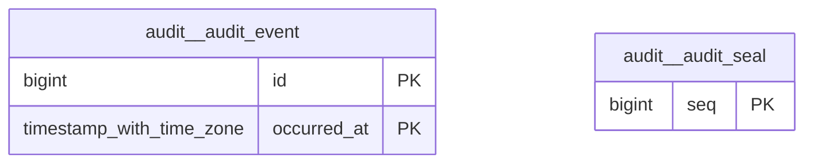

# Schema `audit`

> CORE: append-only, hash-sealed audit trail

Generated from the live database by `db/tools/gen_docs.py` — do not edit by hand.

**Tables:** 2

## Entity-relationship diagram

Convention FKs to `core.organisation`, `core.campus`, `sys.stored_file` and `wf.approval_request` are omitted from the diagram (see table details).

## Tables

- [`audit.audit_event`](#auditauditevent) — Append-only audit trail of sensitive changes (before/after, actor, request) - monthly partitions.
- [`audit.audit_seal`](#auditauditseal) — Hash-chained seals over audit batches for tamper evidence. [hash chain over batches => tamper evidence]

### `audit.audit_event`

Append-only audit trail of sensitive changes (before/after, actor, request) - monthly partitions.

- Partitioned `RANGE (occurred_at)` (14 partitions incl. default)

| Column | Type | Null | Default | Description |
|---|---|---|---|---|
| `id` | bigint |  |  |  |
| `occurred_at` | timestamp with time zone |  | clock_timestamp() |  |
| `org_id` | uuid | yes |  |  |
| `campus_id` | uuid | yes |  |  |
| `actor_user_id` | uuid | yes |  |  |
| `request_id` | text | yes |  |  |
| `ip` | inet | yes |  |  |
| `source` | text |  |  |  |
| `action` | text |  |  | INSERT/UPDATE/DELETE \| LOGIN, LOGIN_FAILED, EXPORT, BREAK_GLASS, ... |
| `schema_name` | text | yes |  |  |
| `table_name` | text | yes |  |  |
| `entity_id` | text | yes |  |  |
| `before` | jsonb | yes |  |  |
| `after` | jsonb | yes |  |  |
| `changed_cols` | text[] | yes |  |  |

| Constraint | Kind | Definition |
|---|---|---|
| `audit_event_pkey` | PK | `PRIMARY KEY (id, occurred_at)` |
| `audit_event_source_check` | CHECK | `CHECK ((source = ANY (ARRAY['trigger'::text, 'app'::text])))` |

**Indexes**

- `CREATE INDEX ix_audit_actor ON ONLY audit.audit_event USING btree (actor_user_id, occurred_at DESC)`
- `CREATE INDEX ix_audit_entity ON ONLY audit.audit_event USING btree (table_name, entity_id, occurred_at DESC)`

### `audit.audit_seal`

Hash-chained seals over audit batches for tamper evidence. [hash chain over batches => tamper evidence]

| Column | Type | Null | Default | Description |
|---|---|---|---|---|
| `seq` | bigint |  |  |  |
| `from_event_id` | bigint |  |  |  |
| `to_event_id` | bigint |  |  |  |
| `event_count` | integer |  |  |  |
| `batch_hash` | bytea |  |  | sha256(prev_hash \|\| sha256(canonical rows ordered by id)) |
| `prev_hash` | bytea | yes |  |  |
| `sealed_at` | timestamp with time zone |  | now() |  |

| Constraint | Kind | Definition |
|---|---|---|
| `audit_seal_pkey` | PK | `PRIMARY KEY (seq)` |

