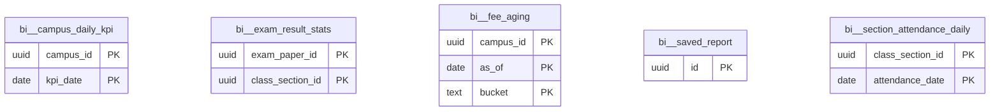

# Schema `bi`

> BI: pre-aggregated KPI tables and saved reports

Generated from the live database by `db/tools/gen_docs.py` — do not edit by hand.

**Tables:** 5

## Entity-relationship diagram

Convention FKs to `core.organisation`, `core.campus`, `sys.stored_file` and `wf.approval_request` are omitted from the diagram (see table details).

## Tables

- [`bi.campus_daily_kpi`](#bicampusdailykpi) — Pre-aggregated daily KPIs per campus (refreshed every 15 minutes).
- [`bi.exam_result_stats`](#biexamresultstats) — Result statistics per paper and section.
- [`bi.fee_aging`](#bifeeaging) — Outstanding fee aging buckets per campus.
- [`bi.saved_report`](#bisavedreport) — Saved/scheduled ad-hoc report definition.
- [`bi.section_attendance_daily`](#bisectionattendancedaily) — Daily attendance counts per class section.

### `bi.campus_daily_kpi`

Pre-aggregated daily KPIs per campus (refreshed every 15 minutes).

- Row-level security: `p_campus: core.campus_visible(org_id, campus_id)`

| Column | Type | Null | Default | Description |
|---|---|---|---|---|
| `org_id` | uuid |  |  |  |
| `campus_id` | uuid |  |  |  |
| `kpi_date` | date |  |  |  |
| `students_active` | integer |  |  |  |
| `students_present` | integer |  |  |  |
| `students_absent` | integer |  |  |  |
| `attendance_pct` | numeric(5,2) | yes |  |  |
| `staff_present` | integer | yes |  |  |
| `invoiced_paisa` | bigint |  | 0 |  |
| `collected_paisa` | bigint |  | 0 |  |
| `collected_online_paisa` | bigint |  | 0 |  |
| `outstanding_paisa` | bigint |  | 0 |  |
| `overdue_paisa` | bigint |  | 0 |  |
| `concession_paisa` | bigint |  | 0 |  |
| `enquiries_new` | integer |  | 0 |  |
| `admissions_new` | integer |  | 0 |  |
| `sms_sent` | integer |  | 0 |  |
| `refreshed_at` | timestamp with time zone |  | now() |  |

| Constraint | Kind | Definition |
|---|---|---|
| `campus_daily_kpi_pkey` | PK | `PRIMARY KEY (campus_id, kpi_date)` |
| `campus_daily_kpi_campus_id_fkey` | FK | `FOREIGN KEY (campus_id) REFERENCES core.campus(id)` |
| `campus_daily_kpi_org_id_fkey` | FK | `FOREIGN KEY (org_id) REFERENCES core.organisation(id)` |

### `bi.exam_result_stats`

Result statistics per paper and section.

- Row-level security: `p_campus: core.campus_visible(org_id, campus_id)`

| Column | Type | Null | Default | Description |
|---|---|---|---|---|
| `exam_id` | uuid | yes |  |  |
| `exam_paper_id` | uuid |  |  |  |
| `org_id` | uuid | yes |  |  |
| `campus_id` | uuid | yes |  |  |
| `class_section_id` | uuid |  |  |  |
| `sat` | integer | yes |  |  |
| `passed` | integer | yes |  |  |
| `avg_percent` | numeric(6,3) | yes |  |  |
| `grade_distribution` | jsonb | yes |  |  |

| Constraint | Kind | Definition |
|---|---|---|
| `exam_result_stats_pkey` | PK | `PRIMARY KEY (exam_paper_id, class_section_id)` |
| `exam_result_stats_campus_id_fkey` | FK | `FOREIGN KEY (campus_id) REFERENCES core.campus(id)` |
| `exam_result_stats_org_id_fkey` | FK | `FOREIGN KEY (org_id) REFERENCES core.organisation(id)` |

**Indexes**

- `CREATE INDEX ix_exam_result_stats_campus_id_fk ON bi.exam_result_stats USING btree (campus_id)`

### `bi.fee_aging`

Outstanding fee aging buckets per campus.

- Row-level security: `p_campus: core.campus_visible(org_id, campus_id)`

| Column | Type | Null | Default | Description |
|---|---|---|---|---|
| `org_id` | uuid | yes |  |  |
| `campus_id` | uuid |  |  |  |
| `as_of` | date |  |  |  |
| `bucket` | text |  |  |  |
| `family_count` | integer | yes |  |  |
| `amount_paisa` | bigint | yes |  |  |

| Constraint | Kind | Definition |
|---|---|---|
| `fee_aging_pkey` | PK | `PRIMARY KEY (campus_id, as_of, bucket)` |
| `fee_aging_campus_id_fkey` | FK | `FOREIGN KEY (campus_id) REFERENCES core.campus(id)` |
| `fee_aging_org_id_fkey` | FK | `FOREIGN KEY (org_id) REFERENCES core.organisation(id)` |
| `fee_aging_bucket_check` | CHECK | `CHECK ((bucket = ANY (ARRAY['0-30'::text, '31-60'::text, '61-90'::text, '90+'::text])))` |

### `bi.saved_report`

Saved/scheduled ad-hoc report definition.

- Row-level security: `p_org: core.org_visible(org_id)`

| Column | Type | Null | Default | Description |
|---|---|---|---|---|
| `id` | uuid |  | uuidv7() |  |
| `org_id` | uuid |  |  |  |
| `owner_id` | uuid |  |  |  |
| `name` | text |  |  |  |
| `dataset` | text |  |  |  |
| `definition` | jsonb |  |  |  |
| `shared_with_role_ids` | uuid[] |  | '{}'::uuid[] |  |
| `schedule_cron` | text | yes |  | BI-04, BI-05 |
| `recipients` | text[] | yes |  |  |
| `created_at` | timestamp with time zone |  | now() |  |
| `created_by` | uuid | yes | core.current_user_id() |  |
| `updated_at` | timestamp with time zone |  | now() |  |
| `updated_by` | uuid | yes |  |  |
| `row_version` | integer |  | 1 |  |

| Constraint | Kind | Definition |
|---|---|---|
| `saved_report_pkey` | PK | `PRIMARY KEY (id)` |
| `saved_report_org_id_fkey` | FK | `FOREIGN KEY (org_id) REFERENCES core.organisation(id)` |

**Triggers**

- `trg_touch` — BEFORE UPDATE → `tg_touch()`

### `bi.section_attendance_daily`

Daily attendance counts per class section.

- Row-level security: `p_campus: core.campus_visible(org_id, campus_id)`

| Column | Type | Null | Default | Description |
|---|---|---|---|---|
| `class_section_id` | uuid |  |  |  |
| `attendance_date` | date |  |  |  |
| `org_id` | uuid | yes |  |  |
| `campus_id` | uuid | yes |  |  |
| `enrolled` | integer | yes |  |  |
| `present` | integer | yes |  |  |
| `absent` | integer | yes |  |  |
| `late` | integer | yes |  |  |

| Constraint | Kind | Definition |
|---|---|---|
| `section_attendance_daily_pkey` | PK | `PRIMARY KEY (class_section_id, attendance_date)` |
| `section_attendance_daily_campus_id_fkey` | FK | `FOREIGN KEY (campus_id) REFERENCES core.campus(id)` |
| `section_attendance_daily_org_id_fkey` | FK | `FOREIGN KEY (org_id) REFERENCES core.organisation(id)` |

**Indexes**

- `CREATE INDEX ix_section_attendance_daily_campus_id_fk ON bi.section_attendance_daily USING btree (campus_id)`

