# Schema `cca`

> CCA: houses, clubs, events, awards, Islamic values programme

Generated from the live database by `db/tools/gen_docs.py` — do not edit by hand.

**Tables:** 14

## Entity-relationship diagram

Convention FKs to `core.organisation`, `core.campus`, `sys.stored_file` and `wf.approval_request` are omitted from the diagram (see table details).

```mermaid
erDiagram
  cca__activity_session {
    uuid id PK
    uuid club_id FK
  }
  cca__award {
    uuid id PK
    uuid student_id FK
    uuid issued_document_id FK
  }
  cca__club {
    uuid id PK
    uuid academic_year_id FK
    uuid advisor_staff_id FK
  }
  cca__club_membership {
    uuid club_id PK, FK
    uuid student_id PK, FK
    uuid fee_item_id FK
  }
  cca__competition_result {
    uuid id PK
    uuid event_id FK
    uuid student_id FK
    uuid house_id FK
  }
  cca__donation {
    uuid id PK
    uuid drive_id FK
    uuid family_id FK
  }
  cca__donation_drive {
    uuid id PK
  }
  cca__event {
    uuid id PK
    uuid consent_form_id FK
  }
  cca__event_participant {
    uuid event_id PK, FK
    uuid student_id PK, FK
  }
  cca__house {
    uuid id PK
  }
  cca__house_captain {
    uuid house_id PK, FK
    uuid academic_year_id PK, FK
    uuid campus_id PK
    uuid student_id FK
    text role PK
  }
  cca__house_point {
    bigint id PK
    uuid house_id FK
  }
  cca__quran_milestone {
    uuid id PK
  }
  cca__quran_progress {
    uuid id PK
    uuid student_id FK
    uuid milestone_id FK
  }
  core__academic_year {
    uuid id PK
  }
  doc__issued_document {
    uuid id PK
  }
  fee__student_fee_item {
    uuid id PK
  }
  hrm__staff {
    uuid id PK
  }
  prt__form_definition {
    uuid id PK
  }
  sis__family {
    uuid id PK
  }
  sis__student {
    uuid id PK
  }
  cca__club ||--o{ cca__activity_session : "club_id"
  cca__club ||--o{ cca__club_membership : "club_id"
  cca__donation_drive ||--o{ cca__donation : "drive_id"
  cca__event ||--o{ cca__competition_result : "event_id"
  cca__event ||--o{ cca__event_participant : "event_id"
  cca__house ||--o{ cca__competition_result : "house_id"
  cca__house ||--o{ cca__house_captain : "house_id"
  cca__house ||--o{ cca__house_point : "house_id"
  cca__quran_milestone ||--o{ cca__quran_progress : "milestone_id"
  core__academic_year ||--o{ cca__club : "academic_year_id"
  core__academic_year ||--o{ cca__house_captain : "academic_year_id"
  doc__issued_document ||--o{ cca__award : "issued_document_id"
  fee__student_fee_item ||--o{ cca__club_membership : "fee_item_id"
  hrm__staff ||--o{ cca__club : "advisor_staff_id"
  prt__form_definition ||--o{ cca__event : "consent_form_id"
  sis__family ||--o{ cca__donation : "family_id"
  sis__student ||--o{ cca__award : "student_id"
  sis__student ||--o{ cca__club_membership : "student_id"
  sis__student ||--o{ cca__competition_result : "student_id"
  sis__student ||--o{ cca__event_participant : "student_id"
  sis__student ||--o{ cca__house_captain : "student_id"
  sis__student ||--o{ cca__quran_progress : "student_id"
```

## Tables

- [`cca.activity_session`](#ccaactivitysession) — Club session with attendance.
- [`cca.award`](#ccaaward) — Award given to a student (certificate via DOC). [CCA-05 (certificate issued via DOC)]
- [`cca.club`](#ccaclub) — Club/activity with capacity, schedule and fee. [CCA-01]
- [`cca.club_membership`](#ccaclubmembership) — Student membership of a club.
- [`cca.competition_result`](#ccacompetitionresult) — Heat/final result and medal. [CCA-03 heats, results, medal tally]
- [`cca.donation`](#ccadonation) — Donation received with receipt.
- [`cca.donation_drive`](#ccadonationdrive) — Charity/zakat/fitra drive (separate from fees). [CCA-08 (P3) kept separate from fees]
- [`cca.event`](#ccaevent) — Field trip, sports day, competition or event. [CCA-04 field trips & events, CCA-03 sports day]
- [`cca.event_participant`](#ccaeventparticipant) — Student participation and consent for an event.
- [`cca.house`](#ccahouse) — School house. [CCA-02]
- [`cca.house_captain`](#ccahousecaptain) — House captain/prefect per year and campus.
- [`cca.house_point`](#ccahousepoint) — Append-only house points (leaderboard source). [live leaderboard source (append-only)]
- [`cca.quran_milestone`](#ccaquranmilestone) — Configurable Quran recitation/memorisation milestone. [CCA-06 configurable milestone catalogue]
- [`cca.quran_progress`](#ccaquranprogress) — Student progress on a Quran milestone.

### `cca.activity_session`

Club session with attendance.

| Column | Type | Null | Default | Description |
|---|---|---|---|---|
| `id` | uuid |  | uuidv7() |  |
| `club_id` | uuid |  |  |  |
| `session_date` | date |  |  |  |
| `attendance` | jsonb |  | '{}'::jsonb | {studentId: 'present'\|'absent'} |
| `note` | text | yes |  |  |

| Constraint | Kind | Definition |
|---|---|---|
| `activity_session_pkey` | PK | `PRIMARY KEY (id)` |
| `activity_session_club_id_session_date_key` | UNIQUE | `UNIQUE (club_id, session_date)` |
| `activity_session_club_id_fkey` | FK | `FOREIGN KEY (club_id) REFERENCES cca.club(id) ON DELETE CASCADE` |

### `cca.award`

Award given to a student (certificate via DOC). [CCA-05 (certificate issued via DOC)]

- Row-level security: `p_campus: core.campus_visible(org_id, campus_id)`

| Column | Type | Null | Default | Description |
|---|---|---|---|---|
| `id` | uuid |  | uuidv7() |  |
| `org_id` | uuid |  |  |  |
| `campus_id` | uuid |  |  |  |
| `student_id` | uuid |  |  |  |
| `kind` | text |  |  |  |
| `title` | text |  |  |  |
| `awarded_on` | date |  |  |  |
| `issued_document_id` | uuid | yes |  |  |
| `created_at` | timestamp with time zone |  | now() |  |
| `created_by` | uuid | yes | core.current_user_id() |  |
| `updated_at` | timestamp with time zone |  | now() |  |
| `updated_by` | uuid | yes |  |  |
| `row_version` | integer |  | 1 |  |

| Constraint | Kind | Definition |
|---|---|---|
| `award_pkey` | PK | `PRIMARY KEY (id)` |
| `award_campus_id_fkey` | FK | `FOREIGN KEY (campus_id) REFERENCES core.campus(id)` |
| `award_issued_document_id_fkey` | FK | `FOREIGN KEY (issued_document_id) REFERENCES doc.issued_document(id)` |
| `award_org_id_fkey` | FK | `FOREIGN KEY (org_id) REFERENCES core.organisation(id)` |
| `award_student_id_fkey` | FK | `FOREIGN KEY (student_id) REFERENCES sis.student(id)` |
| `award_kind_check` | CHECK | `CHECK ((kind = ANY (ARRAY['merit'::text, 'attendance'::text, 'participation'::text, 'sports'::text, 'academic'::text, 'character'::text])))` |

**Indexes**

- `CREATE INDEX ix_award_campus_id_fk ON cca.award USING btree (campus_id)`
- `CREATE INDEX ix_award_issued_document_id_fk ON cca.award USING btree (issued_document_id)`
- `CREATE INDEX ix_award_student_id_fk ON cca.award USING btree (student_id)`

**Triggers**

- `trg_touch` — BEFORE UPDATE → `tg_touch()`

### `cca.club`

Club/activity with capacity, schedule and fee. [CCA-01]

- Row-level security: `p_campus: core.campus_visible(org_id, campus_id)`

| Column | Type | Null | Default | Description |
|---|---|---|---|---|
| `id` | uuid |  | uuidv7() |  |
| `org_id` | uuid |  |  |  |
| `campus_id` | uuid |  |  |  |
| `academic_year_id` | uuid |  |  |  |
| `name` | text |  |  |  |
| `kind` | text |  |  |  |
| `advisor_staff_id` | uuid | yes |  |  |
| `capacity` | smallint | yes |  |  |
| `eligible_year_group_ids` | uuid[] |  | '{}'::uuid[] |  |
| `fee_paisa` | core.paisa_nn |  | 0 | activity fee -> FEE student_fee_item |
| `meets` | jsonb | yes |  | [{"dow":1,"start":"14:00","end":"15:00","room":...}] |
| `signup_opens_at` | timestamp with time zone | yes |  |  |
| `signup_closes_at` | timestamp with time zone | yes |  |  |
| `created_at` | timestamp with time zone |  | now() |  |
| `created_by` | uuid | yes | core.current_user_id() |  |
| `updated_at` | timestamp with time zone |  | now() |  |
| `updated_by` | uuid | yes |  |  |
| `row_version` | integer |  | 1 |  |

| Constraint | Kind | Definition |
|---|---|---|
| `club_pkey` | PK | `PRIMARY KEY (id)` |
| `club_academic_year_id_fkey` | FK | `FOREIGN KEY (academic_year_id) REFERENCES core.academic_year(id)` |
| `club_advisor_staff_id_fkey` | FK | `FOREIGN KEY (advisor_staff_id) REFERENCES hrm.staff(id)` |
| `club_campus_id_fkey` | FK | `FOREIGN KEY (campus_id) REFERENCES core.campus(id)` |
| `club_org_id_fkey` | FK | `FOREIGN KEY (org_id) REFERENCES core.organisation(id)` |
| `club_kind_check` | CHECK | `CHECK ((kind = ANY (ARRAY['club'::text, 'sport'::text, 'society'::text, 'quran_circle'::text, 'music'::text, 'art'::text, 'debate'::text, 'other'::text])))` |

**Indexes**

- `CREATE INDEX ix_club_academic_year_id_fk ON cca.club USING btree (academic_year_id)`
- `CREATE INDEX ix_club_advisor_staff_id_fk ON cca.club USING btree (advisor_staff_id)`
- `CREATE INDEX ix_club_campus_id_fk ON cca.club USING btree (campus_id)`

**Triggers**

- `trg_touch` — BEFORE UPDATE → `tg_touch()`

### `cca.club_membership`

Student membership of a club.

| Column | Type | Null | Default | Description |
|---|---|---|---|---|
| `club_id` | uuid |  |  |  |
| `student_id` | uuid |  |  |  |
| `status` | text |  | 'active'::text |  |
| `joined_on` | date |  | CURRENT_DATE |  |
| `left_on` | date | yes |  |  |
| `fee_item_id` | uuid | yes |  |  |

| Constraint | Kind | Definition |
|---|---|---|
| `club_membership_pkey` | PK | `PRIMARY KEY (club_id, student_id)` |
| `club_membership_club_id_fkey` | FK | `FOREIGN KEY (club_id) REFERENCES cca.club(id) ON DELETE CASCADE` |
| `club_membership_fee_item_id_fkey` | FK | `FOREIGN KEY (fee_item_id) REFERENCES fee.student_fee_item(id)` |
| `club_membership_student_id_fkey` | FK | `FOREIGN KEY (student_id) REFERENCES sis.student(id)` |
| `club_membership_status_check` | CHECK | `CHECK ((status = ANY (ARRAY['waitlisted'::text, 'active'::text, 'left'::text])))` |

**Indexes**

- `CREATE INDEX ix_club_membership_fee_item_id_fk ON cca.club_membership USING btree (fee_item_id)`
- `CREATE INDEX ix_club_membership_student_id_fk ON cca.club_membership USING btree (student_id)`

### `cca.competition_result`

Heat/final result and medal. [CCA-03 heats, results, medal tally]

| Column | Type | Null | Default | Description |
|---|---|---|---|---|
| `id` | uuid |  | uuidv7() |  |
| `event_id` | uuid |  |  |  |
| `category` | text |  |  | '100m U-12 Boys' |
| `round` | text |  | 'final'::text |  |
| `student_id` | uuid | yes |  |  |
| `house_id` | uuid | yes |  |  |
| `position` | smallint | yes |  |  |
| `result_value` | text | yes |  | time / distance / score |
| `medal` | text | yes |  |  |

| Constraint | Kind | Definition |
|---|---|---|
| `competition_result_pkey` | PK | `PRIMARY KEY (id)` |
| `competition_result_event_id_fkey` | FK | `FOREIGN KEY (event_id) REFERENCES cca.event(id) ON DELETE CASCADE` |
| `competition_result_house_id_fkey` | FK | `FOREIGN KEY (house_id) REFERENCES cca.house(id)` |
| `competition_result_student_id_fkey` | FK | `FOREIGN KEY (student_id) REFERENCES sis.student(id)` |
| `competition_result_medal_check` | CHECK | `CHECK ((medal = ANY (ARRAY['gold'::text, 'silver'::text, 'bronze'::text])))` |

**Indexes**

- `CREATE INDEX ix_competition_result_event_id_fk ON cca.competition_result USING btree (event_id)`
- `CREATE INDEX ix_competition_result_house_id_fk ON cca.competition_result USING btree (house_id)`
- `CREATE INDEX ix_competition_result_student_id_fk ON cca.competition_result USING btree (student_id)`

### `cca.donation`

Donation received with receipt.

- Row-level security: `p_campus: core.campus_visible(org_id, campus_id)`

| Column | Type | Null | Default | Description |
|---|---|---|---|---|
| `id` | uuid |  | uuidv7() |  |
| `org_id` | uuid |  |  |  |
| `campus_id` | uuid |  |  |  |
| `drive_id` | uuid |  |  |  |
| `donor_name` | text | yes |  |  |
| `family_id` | uuid | yes |  |  |
| `amount_paisa` | core.paisa_nn |  |  |  |
| `channel` | text |  |  |  |
| `receipt_no` | text |  |  |  |
| `received_at` | timestamp with time zone |  | now() |  |
| `received_by` | uuid |  |  |  |

| Constraint | Kind | Definition |
|---|---|---|
| `donation_pkey` | PK | `PRIMARY KEY (id)` |
| `donation_org_id_receipt_no_key` | UNIQUE | `UNIQUE (org_id, receipt_no)` |
| `donation_campus_id_fkey` | FK | `FOREIGN KEY (campus_id) REFERENCES core.campus(id)` |
| `donation_drive_id_fkey` | FK | `FOREIGN KEY (drive_id) REFERENCES cca.donation_drive(id)` |
| `donation_family_id_fkey` | FK | `FOREIGN KEY (family_id) REFERENCES sis.family(id)` |
| `donation_org_id_fkey` | FK | `FOREIGN KEY (org_id) REFERENCES core.organisation(id)` |
| `donation_amount_paisa_check` | CHECK | `CHECK (((amount_paisa)::bigint > 0))` |
| `donation_channel_check` | CHECK | `CHECK ((channel = ANY (ARRAY['cash'::text, 'bkash'::text, 'nagad'::text, 'bank'::text, 'card'::text])))` |

**Indexes**

- `CREATE INDEX ix_donation_campus_id_fk ON cca.donation USING btree (campus_id)`
- `CREATE INDEX ix_donation_drive_id_fk ON cca.donation USING btree (drive_id)`
- `CREATE INDEX ix_donation_family_id_fk ON cca.donation USING btree (family_id)`

### `cca.donation_drive`

Charity/zakat/fitra drive (separate from fees). [CCA-08 (P3) kept separate from fees]

- Row-level security: `p_campus: core.campus_visible(org_id, campus_id)`

| Column | Type | Null | Default | Description |
|---|---|---|---|---|
| `id` | uuid |  | uuidv7() |  |
| `org_id` | uuid |  |  |  |
| `campus_id` | uuid | yes |  |  |
| `kind` | text |  |  |  |
| `title` | text |  |  |  |
| `starts_on` | date |  |  |  |
| `ends_on` | date | yes |  |  |
| `target_paisa` | core.paisa_nn | yes |  |  |
| `created_at` | timestamp with time zone |  | now() |  |
| `created_by` | uuid | yes | core.current_user_id() |  |
| `updated_at` | timestamp with time zone |  | now() |  |
| `updated_by` | uuid | yes |  |  |
| `row_version` | integer |  | 1 |  |

| Constraint | Kind | Definition |
|---|---|---|
| `donation_drive_pkey` | PK | `PRIMARY KEY (id)` |
| `donation_drive_campus_id_fkey` | FK | `FOREIGN KEY (campus_id) REFERENCES core.campus(id)` |
| `donation_drive_org_id_fkey` | FK | `FOREIGN KEY (org_id) REFERENCES core.organisation(id)` |
| `donation_drive_kind_check` | CHECK | `CHECK ((kind = ANY (ARRAY['sadaqah'::text, 'zakat'::text, 'fitra'::text, 'relief'::text, 'other'::text])))` |

**Indexes**

- `CREATE INDEX ix_donation_drive_campus_id_fk ON cca.donation_drive USING btree (campus_id)`

**Triggers**

- `trg_touch` — BEFORE UPDATE → `tg_touch()`

### `cca.event`

Field trip, sports day, competition or event. [CCA-04 field trips & events, CCA-03 sports day]

- Row-level security: `p_campus: core.campus_visible(org_id, campus_id)`

| Column | Type | Null | Default | Description |
|---|---|---|---|---|
| `id` | uuid |  | uuidv7() |  |
| `org_id` | uuid |  |  |  |
| `campus_id` | uuid | yes |  |  |
| `kind` | text |  |  |  |
| `title` | text |  |  |  |
| `starts_at` | timestamp with time zone |  |  |  |
| `ends_at` | timestamp with time zone |  |  |  |
| `venue` | text | yes |  |  |
| `budget_paisa` | core.paisa_nn | yes |  |  |
| `requires_consent` | boolean |  | false |  |
| `consent_form_id` | uuid | yes |  | prt.form_definition |
| `transport_needed` | boolean |  | false |  |
| `status` | text |  | 'planned'::text |  |
| `created_at` | timestamp with time zone |  | now() |  |
| `created_by` | uuid | yes | core.current_user_id() |  |
| `updated_at` | timestamp with time zone |  | now() |  |
| `updated_by` | uuid | yes |  |  |
| `row_version` | integer |  | 1 |  |

| Constraint | Kind | Definition |
|---|---|---|
| `event_pkey` | PK | `PRIMARY KEY (id)` |
| `event_campus_id_fkey` | FK | `FOREIGN KEY (campus_id) REFERENCES core.campus(id)` |
| `event_consent_form_id_fkey` | FK | `FOREIGN KEY (consent_form_id) REFERENCES prt.form_definition(id)` |
| `event_org_id_fkey` | FK | `FOREIGN KEY (org_id) REFERENCES core.organisation(id)` |
| `event_check` | CHECK | `CHECK ((ends_at >= starts_at))` |
| `event_kind_check` | CHECK | `CHECK ((kind = ANY (ARRAY['field_trip'::text, 'sports_day'::text, 'competition'::text, 'cultural'::text, 'religious'::text, 'charity'::text, 'other'::text])))` |
| `event_status_check` | CHECK | `CHECK ((status = ANY (ARRAY['planned'::text, 'open'::text, 'closed'::text, 'completed'::text, 'cancelled'::text])))` |

**Indexes**

- `CREATE INDEX ix_event_campus_id_fk ON cca.event USING btree (campus_id)`
- `CREATE INDEX ix_event_consent_form_id_fk ON cca.event USING btree (consent_form_id)`

**Triggers**

- `trg_touch` — BEFORE UPDATE → `tg_touch()`

### `cca.event_participant`

Student participation and consent for an event.

| Column | Type | Null | Default | Description |
|---|---|---|---|---|
| `event_id` | uuid |  |  |  |
| `student_id` | uuid |  |  |  |
| `consent` | text |  | 'pending'::text |  |
| `attended` | boolean | yes |  |  |

| Constraint | Kind | Definition |
|---|---|---|
| `event_participant_pkey` | PK | `PRIMARY KEY (event_id, student_id)` |
| `event_participant_event_id_fkey` | FK | `FOREIGN KEY (event_id) REFERENCES cca.event(id) ON DELETE CASCADE` |
| `event_participant_student_id_fkey` | FK | `FOREIGN KEY (student_id) REFERENCES sis.student(id)` |
| `event_participant_consent_check` | CHECK | `CHECK ((consent = ANY (ARRAY['not_required'::text, 'pending'::text, 'granted'::text, 'declined'::text])))` |

**Indexes**

- `CREATE INDEX ix_event_participant_student_id_fk ON cca.event_participant USING btree (student_id)`

### `cca.house`

School house. [CCA-02]

- Row-level security: `p_org: core.org_visible(org_id)`

| Column | Type | Null | Default | Description |
|---|---|---|---|---|
| `id` | uuid |  | uuidv7() |  |
| `org_id` | uuid |  |  |  |
| `code` | text |  |  |  |
| `name_en` | text |  |  |  |
| `name_bn` | text | yes |  |  |
| `colour_hex` | text | yes |  |  |
| `is_active` | boolean |  | true |  |

| Constraint | Kind | Definition |
|---|---|---|
| `house_pkey` | PK | `PRIMARY KEY (id)` |
| `house_org_id_code_key` | UNIQUE | `UNIQUE (org_id, code)` |
| `house_org_id_fkey` | FK | `FOREIGN KEY (org_id) REFERENCES core.organisation(id)` |

### `cca.house_captain`

House captain/prefect per year and campus.

| Column | Type | Null | Default | Description |
|---|---|---|---|---|
| `house_id` | uuid |  |  |  |
| `academic_year_id` | uuid |  |  |  |
| `campus_id` | uuid |  |  |  |
| `student_id` | uuid |  |  |  |
| `role` | text |  | 'captain'::text |  |

| Constraint | Kind | Definition |
|---|---|---|
| `house_captain_pkey` | PK | `PRIMARY KEY (house_id, academic_year_id, campus_id, role)` |
| `house_captain_academic_year_id_fkey` | FK | `FOREIGN KEY (academic_year_id) REFERENCES core.academic_year(id)` |
| `house_captain_campus_id_fkey` | FK | `FOREIGN KEY (campus_id) REFERENCES core.campus(id)` |
| `house_captain_house_id_fkey` | FK | `FOREIGN KEY (house_id) REFERENCES cca.house(id)` |
| `house_captain_student_id_fkey` | FK | `FOREIGN KEY (student_id) REFERENCES sis.student(id)` |
| `house_captain_role_check` | CHECK | `CHECK ((role = ANY (ARRAY['captain'::text, 'vice_captain'::text, 'prefect'::text])))` |

**Indexes**

- `CREATE INDEX ix_house_captain_academic_year_id_fk ON cca.house_captain USING btree (academic_year_id)`
- `CREATE INDEX ix_house_captain_campus_id_fk ON cca.house_captain USING btree (campus_id)`
- `CREATE INDEX ix_house_captain_student_id_fk ON cca.house_captain USING btree (student_id)`

### `cca.house_point`

Append-only house points (leaderboard source). [live leaderboard source (append-only)]

- Row-level security: `p_campus: core.campus_visible(org_id, campus_id)`

| Column | Type | Null | Default | Description |
|---|---|---|---|---|
| `id` | bigint |  |  |  |
| `org_id` | uuid |  |  |  |
| `campus_id` | uuid |  |  |  |
| `academic_year_id` | uuid |  |  |  |
| `house_id` | uuid |  |  |  |
| `student_id` | uuid | yes |  |  |
| `source` | text |  |  |  |
| `source_ref` | text | yes |  |  |
| `points` | integer |  |  |  |
| `awarded_by` | uuid |  |  |  |
| `awarded_at` | timestamp with time zone |  | now() |  |

| Constraint | Kind | Definition |
|---|---|---|
| `house_point_pkey` | PK | `PRIMARY KEY (id)` |
| `house_point_campus_id_fkey` | FK | `FOREIGN KEY (campus_id) REFERENCES core.campus(id)` |
| `house_point_house_id_fkey` | FK | `FOREIGN KEY (house_id) REFERENCES cca.house(id)` |
| `house_point_org_id_fkey` | FK | `FOREIGN KEY (org_id) REFERENCES core.organisation(id)` |
| `house_point_source_check` | CHECK | `CHECK ((source = ANY (ARRAY['academic'::text, 'sports'::text, 'behaviour'::text, 'event'::text, 'manual'::text])))` |

**Indexes**

- `CREATE INDEX ix_house_point_board ON cca.house_point USING btree (academic_year_id, house_id)`
- `CREATE INDEX ix_house_point_campus_id_fk ON cca.house_point USING btree (campus_id)`
- `CREATE INDEX ix_house_point_house_id_fk ON cca.house_point USING btree (house_id)`

### `cca.quran_milestone`

Configurable Quran recitation/memorisation milestone. [CCA-06 configurable milestone catalogue]

- Row-level security: `p_org: core.org_visible(org_id)`

| Column | Type | Null | Default | Description |
|---|---|---|---|---|
| `id` | uuid |  | uuidv7() |  |
| `org_id` | uuid |  |  |  |
| `track` | text |  |  |  |
| `code` | text |  |  | 'JUZ_30', 'SURAH_YASIN' |
| `label_en` | text |  |  |  |
| `label_bn` | text | yes |  |  |
| `seq` | smallint |  |  |  |

| Constraint | Kind | Definition |
|---|---|---|
| `quran_milestone_pkey` | PK | `PRIMARY KEY (id)` |
| `quran_milestone_org_id_track_code_key` | UNIQUE | `UNIQUE (org_id, track, code)` |
| `quran_milestone_org_id_fkey` | FK | `FOREIGN KEY (org_id) REFERENCES core.organisation(id)` |
| `quran_milestone_track_check` | CHECK | `CHECK ((track = ANY (ARRAY['recitation'::text, 'memorisation'::text, 'tajweed'::text])))` |

### `cca.quran_progress`

Student progress on a Quran milestone.

- Row-level security: `p_campus: core.campus_visible(org_id, campus_id)`

| Column | Type | Null | Default | Description |
|---|---|---|---|---|
| `id` | uuid |  | uuidv7() |  |
| `org_id` | uuid |  |  |  |
| `campus_id` | uuid |  |  |  |
| `student_id` | uuid |  |  |  |
| `milestone_id` | uuid |  |  |  |
| `status` | text |  |  |  |
| `assessed_on` | date |  |  |  |
| `rating` | smallint | yes |  |  |
| `teacher_id` | uuid |  |  |  |
| `note` | text | yes |  |  |
| `created_at` | timestamp with time zone |  | now() |  |
| `created_by` | uuid | yes | core.current_user_id() |  |
| `updated_at` | timestamp with time zone |  | now() |  |
| `updated_by` | uuid | yes |  |  |
| `row_version` | integer |  | 1 |  |

| Constraint | Kind | Definition |
|---|---|---|
| `quran_progress_pkey` | PK | `PRIMARY KEY (id)` |
| `quran_progress_student_id_milestone_id_key` | UNIQUE | `UNIQUE (student_id, milestone_id)` |
| `quran_progress_campus_id_fkey` | FK | `FOREIGN KEY (campus_id) REFERENCES core.campus(id)` |
| `quran_progress_milestone_id_fkey` | FK | `FOREIGN KEY (milestone_id) REFERENCES cca.quran_milestone(id)` |
| `quran_progress_org_id_fkey` | FK | `FOREIGN KEY (org_id) REFERENCES core.organisation(id)` |
| `quran_progress_student_id_fkey` | FK | `FOREIGN KEY (student_id) REFERENCES sis.student(id)` |
| `quran_progress_rating_check` | CHECK | `CHECK (((rating >= 1) AND (rating <= 5)))` |
| `quran_progress_status_check` | CHECK | `CHECK ((status = ANY (ARRAY['in_progress'::text, 'achieved'::text, 'revising'::text])))` |

**Indexes**

- `CREATE INDEX ix_quran_progress_campus_id_fk ON cca.quran_progress USING btree (campus_id)`
- `CREATE INDEX ix_quran_progress_milestone_id_fk ON cca.quran_progress USING btree (milestone_id)`

**Triggers**

- `trg_touch` — BEFORE UPDATE → `tg_touch()`

