# Schema `com`

> COM: notices, templates, notification hub, messaging

Generated from the live database by `db/tools/gen_docs.py` — do not edit by hand.

**Tables:** 22

## Entity-relationship diagram

Convention FKs to `core.organisation`, `core.campus`, `sys.stored_file` and `wf.approval_request` are omitted from the diagram (see table details).

```mermaid
erDiagram
  com__broadcast {
    uuid id PK
  }
  com__chat_message {
    bigint id PK
    uuid conversation_id FK
  }
  com__complaint {
    uuid id PK
    uuid student_id FK
  }
  com__complaint_note {
    bigint id PK
    uuid complaint_id FK
  }
  com__conversation {
    uuid id PK
    uuid student_id FK
    uuid class_section_id FK
    uuid teaching_group_id FK
  }
  com__conversation_member {
    uuid conversation_id PK, FK
    uuid user_id PK, FK
  }
  com__message_dedupe {
    text dedupe_key PK
  }
  com__message_template {
    uuid id PK
  }
  com__notice {
    uuid id PK
  }
  com__notice_audience {
    uuid notice_id FK
  }
  com__notice_read {
    uuid notice_id PK, FK
    uuid user_id PK
  }
  com__notification_preference {
    uuid user_id PK, FK
    text event_code PK
    text channel PK
  }
  com__notification_rule {
    uuid org_id PK
    text event_code PK
    text recipient PK
  }
  com__outbound_message {
    uuid id PK
    timestamp_with_time_zone created_at PK
  }
  com__ptm_booking {
    uuid ptm_slot_id PK, FK
    uuid student_id FK
    uuid guardian_user_id FK
  }
  com__ptm_event {
    uuid id PK
  }
  com__ptm_slot {
    uuid id PK
    uuid ptm_event_id FK
    uuid staff_id FK
  }
  com__push_device {
    uuid id PK
    uuid user_id FK
  }
  com__sms_provider_balance {
    text provider PK
  }
  com__survey {
    uuid id PK
  }
  com__survey_question {
    uuid id PK
    uuid survey_id FK
  }
  com__survey_response {
    uuid id PK
    uuid survey_id FK
  }
  aca__class_section {
    uuid id PK
  }
  aca__teaching_group {
    uuid id PK
  }
  hrm__staff {
    uuid id PK
  }
  iam__user_account {
    uuid id PK
  }
  sis__student {
    uuid id PK
  }
  aca__class_section ||--o{ com__conversation : "class_section_id"
  aca__teaching_group ||--o{ com__conversation : "teaching_group_id"
  com__complaint ||--o{ com__complaint_note : "complaint_id"
  com__conversation ||--o{ com__chat_message : "conversation_id"
  com__conversation ||--o{ com__conversation_member : "conversation_id"
  com__notice ||--o{ com__notice_audience : "notice_id"
  com__notice ||--o{ com__notice_read : "notice_id"
  com__ptm_event ||--o{ com__ptm_slot : "ptm_event_id"
  com__ptm_slot ||--o{ com__ptm_booking : "ptm_slot_id"
  com__survey ||--o{ com__survey_question : "survey_id"
  com__survey ||--o{ com__survey_response : "survey_id"
  hrm__staff ||--o{ com__ptm_slot : "staff_id"
  iam__user_account ||--o{ com__conversation_member : "user_id"
  iam__user_account ||--o{ com__notification_preference : "user_id"
  iam__user_account ||--o{ com__ptm_booking : "guardian_user_id"
  iam__user_account ||--o{ com__push_device : "user_id"
  sis__student ||--o{ com__complaint : "student_id"
  sis__student ||--o{ com__conversation : "student_id"
  sis__student ||--o{ com__ptm_booking : "student_id"
```

## Tables

- [`com.broadcast`](#combroadcast) — Emergency broadcast with delivery stats. [COM-09 emergency broadcast]
- [`com.chat_message`](#comchatmessage) — Message in a conversation (moderated, never hard-deleted).
- [`com.complaint`](#comcomplaint) — Ticketed complaint with SLA. [COM-08 ticketed complaints with SLA]
- [`com.complaint_note`](#comcomplaintnote) — Note on a complaint (internal or shared).
- [`com.conversation`](#comconversation) — Moderated parent-teacher or class conversation. [COM-05 moderated 1:1 or class-level threads]
- [`com.conversation_member`](#comconversationmember) — Participant of a conversation.
- [`com.message_dedupe`](#commessagededupe) — Cross-partition de-duplication key for messages. [cross-partition uniqueness for dedupe keys]
- [`com.message_template`](#commessagetemplate) — Versioned bilingual message template per event and channel. [COM-10 versioned bilingual templates]
- [`com.notice`](#comnotice) — Notice/circular with targeting, priority and website publishing. [COM-01]
- [`com.notice_audience`](#comnoticeaudience) — Target audience of a notice.
- [`com.notice_read`](#comnoticeread) — Read receipt of a notice.
- [`com.notification_preference`](#comnotificationpreference) — Per-user channel opt-outs and quiet hours. [per-user opt-outs and quiet hours]
- [`com.notification_rule`](#comnotificationrule) — Which event goes to which recipient on which channels. [which events go to whom on which channels (Appendix C)]
- [`com.outbound_message`](#comoutboundmessage) — Every message sent on any channel with delivery status - monthly partitions. [every message sent on any channel (delivery status)]
- [`com.ptm_booking`](#comptmbooking) — Guardian booking of a PTM slot with notes.
- [`com.ptm_event`](#comptmevent) — Parent-teacher meeting day. [COM-06 parent-teacher meeting day]
- [`com.ptm_slot`](#comptmslot) — Teacher slot in a PTM.
- [`com.push_device`](#compushdevice) — Registered push token of a user's device.
- [`com.sms_provider_balance`](#comsmsproviderbalance) — SMS provider balance for low-balance alerts. [COM-02 balance alerts]
- [`com.survey`](#comsurvey) — Survey (optionally anonymous). [COM-07]
- [`com.survey_question`](#comsurveyquestion) — Question of a survey.
- [`com.survey_response`](#comsurveyresponse) — One response per respondent.

### `com.broadcast`

Emergency broadcast with delivery stats. [COM-09 emergency broadcast]

- Row-level security: `p_campus: core.campus_visible(org_id, campus_id)`

| Column | Type | Null | Default | Description |
|---|---|---|---|---|
| `id` | uuid |  | uuidv7() |  |
| `org_id` | uuid |  |  |  |
| `campus_id` | uuid | yes |  |  |
| `audience` | jsonb |  |  |  |
| `message_en` | text |  |  |  |
| `message_bn` | text |  |  |  |
| `channels` | text[] |  | '{sms,push}'::text[] |  |
| `sent_by` | uuid |  |  |  |
| `sent_at` | timestamp with time zone |  | now() |  |
| `recipient_count` | integer | yes |  |  |
| `delivered_count` | integer | yes |  |  |

| Constraint | Kind | Definition |
|---|---|---|
| `broadcast_pkey` | PK | `PRIMARY KEY (id)` |
| `broadcast_campus_id_fkey` | FK | `FOREIGN KEY (campus_id) REFERENCES core.campus(id)` |
| `broadcast_org_id_fkey` | FK | `FOREIGN KEY (org_id) REFERENCES core.organisation(id)` |

**Indexes**

- `CREATE INDEX ix_broadcast_campus_id_fk ON com.broadcast USING btree (campus_id)`

**Triggers**

- `trg_audit` — AFTER INSERT UPDATE DELETE → `tg_row_audit()`

### `com.chat_message`

Message in a conversation (moderated, never hard-deleted).

| Column | Type | Null | Default | Description |
|---|---|---|---|---|
| `id` | bigint |  |  |  |
| `conversation_id` | uuid |  |  |  |
| `sender_user_id` | uuid |  |  |  |
| `body` | text |  |  |  |
| `attachment_file_ids` | uuid[] |  | '{}'::uuid[] |  |
| `sent_at` | timestamp with time zone |  | now() |  |
| `hidden_at` | timestamp with time zone | yes |  | moderation (never hard-deleted) |
| `hidden_by` | uuid | yes |  |  |
| `hidden_reason` | text | yes |  |  |

| Constraint | Kind | Definition |
|---|---|---|
| `chat_message_pkey` | PK | `PRIMARY KEY (id)` |
| `chat_message_conversation_id_fkey` | FK | `FOREIGN KEY (conversation_id) REFERENCES com.conversation(id) ON DELETE CASCADE` |

**Indexes**

- `CREATE INDEX ix_chat_message_conv ON com.chat_message USING btree (conversation_id, sent_at DESC)`

### `com.complaint`

Ticketed complaint with SLA. [COM-08 ticketed complaints with SLA]

- Row-level security: `p_campus: core.campus_visible(org_id, campus_id)`

| Column | Type | Null | Default | Description |
|---|---|---|---|---|
| `id` | uuid |  | uuidv7() |  |
| `org_id` | uuid |  |  |  |
| `campus_id` | uuid |  |  |  |
| `ticket_no` | text |  |  |  |
| `raised_by` | uuid |  |  |  |
| `student_id` | uuid | yes |  |  |
| `category_code` | text |  |  |  |
| `subject` | text |  |  |  |
| `description` | text |  |  |  |
| `assignee_id` | uuid | yes |  |  |
| `priority` | text |  | 'normal'::text |  |
| `sla_due_at` | timestamp with time zone | yes |  |  |
| `status` | text |  | 'open'::text |  |
| `resolution` | text | yes |  |  |
| `resolved_at` | timestamp with time zone | yes |  |  |
| `created_at` | timestamp with time zone |  | now() |  |
| `created_by` | uuid | yes | core.current_user_id() |  |
| `updated_at` | timestamp with time zone |  | now() |  |
| `updated_by` | uuid | yes |  |  |
| `row_version` | integer |  | 1 |  |

| Constraint | Kind | Definition |
|---|---|---|
| `complaint_pkey` | PK | `PRIMARY KEY (id)` |
| `complaint_org_id_ticket_no_key` | UNIQUE | `UNIQUE (org_id, ticket_no)` |
| `complaint_campus_id_fkey` | FK | `FOREIGN KEY (campus_id) REFERENCES core.campus(id)` |
| `complaint_org_id_fkey` | FK | `FOREIGN KEY (org_id) REFERENCES core.organisation(id)` |
| `complaint_student_id_fkey` | FK | `FOREIGN KEY (student_id) REFERENCES sis.student(id)` |
| `complaint_priority_check` | CHECK | `CHECK ((priority = ANY (ARRAY['low'::text, 'normal'::text, 'high'::text, 'urgent'::text])))` |
| `complaint_status_check` | CHECK | `CHECK ((status = ANY (ARRAY['open'::text, 'in_progress'::text, 'awaiting_parent'::text, 'resolved'::text, 'closed'::text])))` |

**Indexes**

- `CREATE INDEX ix_complaint_campus_id_fk ON com.complaint USING btree (campus_id)`
- `CREATE INDEX ix_complaint_student_id_fk ON com.complaint USING btree (student_id)`

**Triggers**

- `trg_touch` — BEFORE UPDATE → `tg_touch()`

### `com.complaint_note`

Note on a complaint (internal or shared).

| Column | Type | Null | Default | Description |
|---|---|---|---|---|
| `id` | bigint |  |  |  |
| `complaint_id` | uuid |  |  |  |
| `author_id` | uuid |  |  |  |
| `is_internal` | boolean |  | true |  |
| `body` | text |  |  |  |
| `created_at` | timestamp with time zone |  | now() |  |

| Constraint | Kind | Definition |
|---|---|---|
| `complaint_note_pkey` | PK | `PRIMARY KEY (id)` |
| `complaint_note_complaint_id_fkey` | FK | `FOREIGN KEY (complaint_id) REFERENCES com.complaint(id) ON DELETE CASCADE` |

**Indexes**

- `CREATE INDEX ix_complaint_note_complaint_id_fk ON com.complaint_note USING btree (complaint_id)`

### `com.conversation`

Moderated parent-teacher or class conversation. [COM-05 moderated 1:1 or class-level threads]

- Row-level security: `p_campus: core.campus_visible(org_id, campus_id)`

| Column | Type | Null | Default | Description |
|---|---|---|---|---|
| `id` | uuid |  | uuidv7() |  |
| `org_id` | uuid |  |  |  |
| `campus_id` | uuid |  |  |  |
| `kind` | text |  |  |  |
| `student_id` | uuid | yes |  | context for parent-teacher threads |
| `class_section_id` | uuid | yes |  |  |
| `teaching_group_id` | uuid | yes |  |  |
| `subject` | text | yes |  |  |
| `status` | text |  | 'open'::text |  |
| `escalated_to` | uuid | yes |  | head of section user |
| `retain_until` | date | yes |  |  |
| `created_at` | timestamp with time zone |  | now() |  |
| `created_by` | uuid | yes | core.current_user_id() |  |
| `updated_at` | timestamp with time zone |  | now() |  |
| `updated_by` | uuid | yes |  |  |
| `row_version` | integer |  | 1 |  |

| Constraint | Kind | Definition |
|---|---|---|
| `conversation_pkey` | PK | `PRIMARY KEY (id)` |
| `conversation_campus_id_fkey` | FK | `FOREIGN KEY (campus_id) REFERENCES core.campus(id)` |
| `conversation_class_section_id_fkey` | FK | `FOREIGN KEY (class_section_id) REFERENCES aca.class_section(id)` |
| `conversation_org_id_fkey` | FK | `FOREIGN KEY (org_id) REFERENCES core.organisation(id)` |
| `conversation_student_id_fkey` | FK | `FOREIGN KEY (student_id) REFERENCES sis.student(id)` |
| `conversation_teaching_group_id_fkey` | FK | `FOREIGN KEY (teaching_group_id) REFERENCES aca.teaching_group(id)` |
| `conversation_kind_check` | CHECK | `CHECK ((kind = ANY (ARRAY['direct'::text, 'class_section'::text, 'teaching_group'::text])))` |
| `conversation_status_check` | CHECK | `CHECK ((status = ANY (ARRAY['open'::text, 'escalated'::text, 'closed'::text])))` |

**Indexes**

- `CREATE INDEX ix_conversation_campus_id_fk ON com.conversation USING btree (campus_id)`
- `CREATE INDEX ix_conversation_class_section_id_fk ON com.conversation USING btree (class_section_id)`
- `CREATE INDEX ix_conversation_student_id_fk ON com.conversation USING btree (student_id)`
- `CREATE INDEX ix_conversation_teaching_group_id_fk ON com.conversation USING btree (teaching_group_id)`

**Triggers**

- `trg_touch` — BEFORE UPDATE → `tg_touch()`

### `com.conversation_member`

Participant of a conversation.

| Column | Type | Null | Default | Description |
|---|---|---|---|---|
| `conversation_id` | uuid |  |  |  |
| `user_id` | uuid |  |  |  |
| `role` | text |  |  |  |
| `can_post` | boolean |  | true |  |
| `last_read_at` | timestamp with time zone | yes |  |  |

| Constraint | Kind | Definition |
|---|---|---|
| `conversation_member_pkey` | PK | `PRIMARY KEY (conversation_id, user_id)` |
| `conversation_member_conversation_id_fkey` | FK | `FOREIGN KEY (conversation_id) REFERENCES com.conversation(id) ON DELETE CASCADE` |
| `conversation_member_user_id_fkey` | FK | `FOREIGN KEY (user_id) REFERENCES iam.user_account(id)` |
| `conversation_member_role_check` | CHECK | `CHECK ((role = ANY (ARRAY['teacher'::text, 'guardian'::text, 'moderator'::text, 'student'::text])))` |

**Indexes**

- `CREATE INDEX ix_conversation_member_user_id_fk ON com.conversation_member USING btree (user_id)`

### `com.message_dedupe`

Cross-partition de-duplication key for messages. [cross-partition uniqueness for dedupe keys]

| Column | Type | Null | Default | Description |
|---|---|---|---|---|
| `dedupe_key` | text |  |  |  |
| `message_id` | uuid |  |  |  |
| `created_at` | timestamp with time zone |  | now() | purged after 30 days |

| Constraint | Kind | Definition |
|---|---|---|
| `message_dedupe_pkey` | PK | `PRIMARY KEY (dedupe_key)` |

### `com.message_template`

Versioned bilingual message template per event and channel. [COM-10 versioned bilingual templates]

- Row-level security: `p_org: core.org_visible(org_id)`

| Column | Type | Null | Default | Description |
|---|---|---|---|---|
| `id` | uuid |  | uuidv7() |  |
| `org_id` | uuid |  |  |  |
| `event_code` | text |  |  | 'att.absent', 'fee.invoice_due', 'exm.result_published' |
| `channel` | text |  |  |  |
| `locale` | core.locale |  |  |  |
| `version` | integer |  | 1 |  |
| `subject` | text | yes |  |  |
| `body` | text |  |  | Handlebars: 'প্রিয় অভিভাবক, {{student_name}} আজ ...' |
| `whatsapp_template_name` | text | yes |  | approved WA template id |
| `is_active` | boolean |  | false |  |
| `approved_by` | uuid | yes |  |  |
| `created_at` | timestamp with time zone |  | now() |  |
| `created_by` | uuid | yes | core.current_user_id() |  |
| `updated_at` | timestamp with time zone |  | now() |  |
| `updated_by` | uuid | yes |  |  |
| `row_version` | integer |  | 1 |  |

| Constraint | Kind | Definition |
|---|---|---|
| `message_template_pkey` | PK | `PRIMARY KEY (id)` |
| `message_template_org_id_event_code_channel_locale_version_key` | UNIQUE | `UNIQUE (org_id, event_code, channel, locale, version)` |
| `message_template_org_id_fkey` | FK | `FOREIGN KEY (org_id) REFERENCES core.organisation(id)` |
| `message_template_channel_check` | CHECK | `CHECK ((channel = ANY (ARRAY['sms'::text, 'email'::text, 'push'::text, 'whatsapp'::text, 'in_app'::text])))` |

**Indexes**

- `CREATE UNIQUE INDEX ux_template_active ON com.message_template USING btree (org_id, event_code, channel, locale) WHERE is_active`

**Triggers**

- `trg_audit` — AFTER INSERT UPDATE DELETE → `tg_row_audit()`
- `trg_touch` — BEFORE UPDATE → `tg_touch()`

### `com.notice`

Notice/circular with targeting, priority and website publishing. [COM-01]

- Row-level security: `p_campus: core.campus_visible(org_id, campus_id)`

| Column | Type | Null | Default | Description |
|---|---|---|---|---|
| `id` | uuid |  | uuidv7() |  |
| `org_id` | uuid |  |  |  |
| `campus_id` | uuid | yes |  | NULL = all campuses |
| `title_en` | text |  |  |  |
| `title_bn` | text | yes |  |  |
| `body_en` | text |  |  |  |
| `body_bn` | text | yes |  |  |
| `attachment_file_ids` | uuid[] |  | '{}'::uuid[] |  |
| `priority` | text |  | 'normal'::text |  |
| `publish_at` | timestamp with time zone |  | now() |  |
| `expires_at` | timestamp with time zone | yes |  |  |
| `publish_to_website` | boolean |  | false | WEB-01 |
| `send_sms` | boolean |  | false |  |
| `status` | text |  | 'draft'::text |  |
| `created_at` | timestamp with time zone |  | now() |  |
| `created_by` | uuid | yes | core.current_user_id() |  |
| `updated_at` | timestamp with time zone |  | now() |  |
| `updated_by` | uuid | yes |  |  |
| `row_version` | integer |  | 1 |  |

| Constraint | Kind | Definition |
|---|---|---|
| `notice_pkey` | PK | `PRIMARY KEY (id)` |
| `notice_campus_id_fkey` | FK | `FOREIGN KEY (campus_id) REFERENCES core.campus(id)` |
| `notice_org_id_fkey` | FK | `FOREIGN KEY (org_id) REFERENCES core.organisation(id)` |
| `notice_priority_check` | CHECK | `CHECK ((priority = ANY (ARRAY['normal'::text, 'urgent'::text, 'emergency'::text])))` |
| `notice_status_check` | CHECK | `CHECK ((status = ANY (ARRAY['draft'::text, 'scheduled'::text, 'published'::text, 'withdrawn'::text])))` |

**Indexes**

- `CREATE INDEX ix_notice_campus_id_fk ON com.notice USING btree (campus_id)`
- `CREATE INDEX ix_notice_published ON com.notice USING btree (org_id, publish_at DESC) WHERE (status = 'published'::text)`

**Triggers**

- `trg_audit` — AFTER INSERT UPDATE DELETE → `tg_row_audit()`
- `trg_touch` — BEFORE UPDATE → `tg_touch()`

### `com.notice_audience`

Target audience of a notice.

| Column | Type | Null | Default | Description |
|---|---|---|---|---|
| `notice_id` | uuid |  |  |  |
| `audience_type` | text |  |  |  |
| `audience_id` | uuid | yes |  | NULL for 'everyone' / 'guardians' / 'students' |

| Constraint | Kind | Definition |
|---|---|---|
| `notice_audience_notice_id_audience_type_audience_id_key` | UNIQUE | `UNIQUE NULLS NOT DISTINCT (notice_id, audience_type, audience_id)` |
| `notice_audience_notice_id_fkey` | FK | `FOREIGN KEY (notice_id) REFERENCES com.notice(id) ON DELETE CASCADE` |
| `notice_audience_audience_type_check` | CHECK | `CHECK ((audience_type = ANY (ARRAY['everyone'::text, 'campus'::text, 'programme'::text, 'year_group'::text, 'class_section'::text, 'teaching_group'::text, 'house'::text, 'role'::text, 'staff'::text, 'guardians'::text, 'students'::text, 'user'::text])))` |

### `com.notice_read`

Read receipt of a notice.

| Column | Type | Null | Default | Description |
|---|---|---|---|---|
| `notice_id` | uuid |  |  |  |
| `user_id` | uuid |  |  |  |
| `read_at` | timestamp with time zone |  | now() |  |

| Constraint | Kind | Definition |
|---|---|---|
| `notice_read_pkey` | PK | `PRIMARY KEY (notice_id, user_id)` |
| `notice_read_notice_id_fkey` | FK | `FOREIGN KEY (notice_id) REFERENCES com.notice(id) ON DELETE CASCADE` |

### `com.notification_preference`

Per-user channel opt-outs and quiet hours. [per-user opt-outs and quiet hours]

| Column | Type | Null | Default | Description |
|---|---|---|---|---|
| `user_id` | uuid |  |  |  |
| `event_code` | text |  |  | '*' = all |
| `channel` | text |  |  |  |
| `enabled` | boolean |  | true |  |
| `quiet_from` | time without time zone | yes |  |  |
| `quiet_to` | time without time zone | yes |  |  |

| Constraint | Kind | Definition |
|---|---|---|
| `notification_preference_pkey` | PK | `PRIMARY KEY (user_id, event_code, channel)` |
| `notification_preference_user_id_fkey` | FK | `FOREIGN KEY (user_id) REFERENCES iam.user_account(id)` |

### `com.notification_rule`

Which event goes to which recipient on which channels. [which events go to whom on which channels (Appendix C)]

- Row-level security: `p_org: core.org_visible(org_id)`

| Column | Type | Null | Default | Description |
|---|---|---|---|---|
| `org_id` | uuid |  |  |  |
| `event_code` | text |  |  |  |
| `recipient` | text |  |  | 'primary_guardian','all_guardians','student','class_teacher','approver' |
| `channels` | text[] |  |  | '{sms,push}' |
| `priority` | text |  | 'normal'::text |  |
| `respect_quiet_hours` | boolean |  | true |  |
| `is_enabled` | boolean |  | true |  |

| Constraint | Kind | Definition |
|---|---|---|
| `notification_rule_pkey` | PK | `PRIMARY KEY (org_id, event_code, recipient)` |
| `notification_rule_org_id_fkey` | FK | `FOREIGN KEY (org_id) REFERENCES core.organisation(id)` |
| `notification_rule_priority_check` | CHECK | `CHECK ((priority = ANY (ARRAY['low'::text, 'normal'::text, 'high'::text, 'emergency'::text])))` |

### `com.outbound_message`

Every message sent on any channel with delivery status - monthly partitions. [every message sent on any channel (delivery status)]

- Partitioned `RANGE (created_at)` (14 partitions incl. default)
- Row-level security: `p_campus: core.campus_visible(org_id, campus_id)`

| Column | Type | Null | Default | Description |
|---|---|---|---|---|
| `id` | uuid |  | uuidv7() |  |
| `created_at` | timestamp with time zone |  | now() |  |
| `org_id` | uuid |  |  |  |
| `campus_id` | uuid | yes |  |  |
| `event_code` | text |  |  |  |
| `channel` | text |  |  |  |
| `priority` | text |  | 'normal'::text |  |
| `template_id` | uuid | yes |  |  |
| `template_version` | integer | yes |  |  |
| `locale` | core.locale |  |  |  |
| `recipient_user_id` | uuid | yes |  |  |
| `recipient_address` | text |  |  | phone / email / device token |
| `subject` | text | yes |  |  |
| `body` | text |  |  | rendered |
| `correlation_type` | text | yes |  | 'student_attendance','invoice' |
| `correlation_id` | text | yes |  |  |
| `dedupe_key` | text | yes |  | 'att.absent:{student}:{date}' (checked via Redis + com.message_dedupe) |
| `status` | text |  | 'queued'::text |  |
| `provider` | text | yes |  |  |
| `provider_message_id` | text | yes |  |  |
| `sms_segments` | smallint | yes |  |  |
| `sms_encoding` | text | yes |  | Bangla = UCS-2 (70 chars/segment) |
| `cost_paisa` | core.paisa | yes |  |  |
| `attempts` | smallint |  | 0 |  |
| `last_error` | text | yes |  |  |
| `scheduled_for` | timestamp with time zone | yes |  |  |
| `sent_at` | timestamp with time zone | yes |  |  |
| `delivered_at` | timestamp with time zone | yes |  |  |
| `read_at` | timestamp with time zone | yes |  | in_app / notice read receipts |

| Constraint | Kind | Definition |
|---|---|---|
| `outbound_message_pkey` | PK | `PRIMARY KEY (id, created_at)` |
| `outbound_message_campus_id_fkey` | FK | `FOREIGN KEY (campus_id) REFERENCES core.campus(id)` |
| `outbound_message_org_id_fkey` | FK | `FOREIGN KEY (org_id) REFERENCES core.organisation(id)` |
| `outbound_message_channel_check` | CHECK | `CHECK ((channel = ANY (ARRAY['sms'::text, 'email'::text, 'push'::text, 'whatsapp'::text, 'in_app'::text])))` |
| `outbound_message_sms_encoding_check` | CHECK | `CHECK ((sms_encoding = ANY (ARRAY['gsm7'::text, 'ucs2'::text])))` |
| `outbound_message_status_check` | CHECK | `CHECK ((status = ANY (ARRAY['queued'::text, 'throttled'::text, 'sending'::text, 'sent'::text, 'delivered'::text, 'failed'::text, 'undeliverable'::text, 'cancelled'::text, 'suppressed'::text])))` |

**Indexes**

- `CREATE INDEX ix_outbound_inbox ON ONLY com.outbound_message USING btree (recipient_user_id, created_at DESC) WHERE ((channel = 'in_app'::text) AND (read_at IS NULL))`
- `CREATE INDEX ix_outbound_message_campus_id_fk ON ONLY com.outbound_message USING btree (campus_id)`
- `CREATE INDEX ix_outbound_provider ON ONLY com.outbound_message USING btree (provider, provider_message_id)`
- `CREATE INDEX ix_outbound_recipient ON ONLY com.outbound_message USING btree (recipient_user_id, created_at DESC)`

### `com.ptm_booking`

Guardian booking of a PTM slot with notes.

| Column | Type | Null | Default | Description |
|---|---|---|---|---|
| `ptm_slot_id` | uuid |  |  | one booking per slot |
| `student_id` | uuid |  |  |  |
| `guardian_user_id` | uuid |  |  |  |
| `booked_at` | timestamp with time zone |  | now() |  |
| `attended` | boolean | yes |  |  |
| `notes` | text | yes |  | recorded against the student |

| Constraint | Kind | Definition |
|---|---|---|
| `ptm_booking_pkey` | PK | `PRIMARY KEY (ptm_slot_id)` |
| `ptm_booking_guardian_user_id_fkey` | FK | `FOREIGN KEY (guardian_user_id) REFERENCES iam.user_account(id)` |
| `ptm_booking_ptm_slot_id_fkey` | FK | `FOREIGN KEY (ptm_slot_id) REFERENCES com.ptm_slot(id) ON DELETE CASCADE` |
| `ptm_booking_student_id_fkey` | FK | `FOREIGN KEY (student_id) REFERENCES sis.student(id)` |

**Indexes**

- `CREATE INDEX ix_ptm_booking_guardian_user_id_fk ON com.ptm_booking USING btree (guardian_user_id)`
- `CREATE INDEX ix_ptm_booking_student_id_fk ON com.ptm_booking USING btree (student_id)`

### `com.ptm_event`

Parent-teacher meeting day. [COM-06 parent-teacher meeting day]

- Row-level security: `p_campus: core.campus_visible(org_id, campus_id)`

| Column | Type | Null | Default | Description |
|---|---|---|---|---|
| `id` | uuid |  | uuidv7() |  |
| `org_id` | uuid |  |  |  |
| `campus_id` | uuid |  |  |  |
| `title` | text |  |  |  |
| `event_date` | date |  |  |  |
| `slot_minutes` | smallint |  | 10 |  |
| `booking_opens_at` | timestamp with time zone |  |  |  |
| `booking_closes_at` | timestamp with time zone |  |  |  |
| `created_at` | timestamp with time zone |  | now() |  |
| `created_by` | uuid | yes | core.current_user_id() |  |
| `updated_at` | timestamp with time zone |  | now() |  |
| `updated_by` | uuid | yes |  |  |
| `row_version` | integer |  | 1 |  |

| Constraint | Kind | Definition |
|---|---|---|
| `ptm_event_pkey` | PK | `PRIMARY KEY (id)` |
| `ptm_event_campus_id_fkey` | FK | `FOREIGN KEY (campus_id) REFERENCES core.campus(id)` |
| `ptm_event_org_id_fkey` | FK | `FOREIGN KEY (org_id) REFERENCES core.organisation(id)` |

**Indexes**

- `CREATE INDEX ix_ptm_event_campus_id_fk ON com.ptm_event USING btree (campus_id)`

**Triggers**

- `trg_touch` — BEFORE UPDATE → `tg_touch()`

### `com.ptm_slot`

Teacher slot in a PTM.

| Column | Type | Null | Default | Description |
|---|---|---|---|---|
| `id` | uuid |  | uuidv7() |  |
| `ptm_event_id` | uuid |  |  |  |
| `staff_id` | uuid |  |  |  |
| `starts_at` | timestamp with time zone |  |  |  |
| `ends_at` | timestamp with time zone |  |  |  |
| `location` | text | yes |  |  |
| `meeting_url` | text | yes |  |  |

| Constraint | Kind | Definition |
|---|---|---|
| `ptm_slot_pkey` | PK | `PRIMARY KEY (id)` |
| `ptm_slot_staff_id_starts_at_key` | UNIQUE | `UNIQUE (staff_id, starts_at)` |
| `ptm_slot_ptm_event_id_fkey` | FK | `FOREIGN KEY (ptm_event_id) REFERENCES com.ptm_event(id) ON DELETE CASCADE` |
| `ptm_slot_staff_id_fkey` | FK | `FOREIGN KEY (staff_id) REFERENCES hrm.staff(id)` |

**Indexes**

- `CREATE INDEX ix_ptm_slot_ptm_event_id_fk ON com.ptm_slot USING btree (ptm_event_id)`

### `com.push_device`

Registered push token of a user's device.

| Column | Type | Null | Default | Description |
|---|---|---|---|---|
| `id` | uuid |  | uuidv7() |  |
| `user_id` | uuid |  |  |  |
| `app` | text |  |  |  |
| `platform` | text |  |  |  |
| `token` | text |  |  |  |
| `locale` | core.locale | yes |  |  |
| `last_seen_at` | timestamp with time zone |  | now() |  |
| `revoked_at` | timestamp with time zone | yes |  |  |

| Constraint | Kind | Definition |
|---|---|---|
| `push_device_pkey` | PK | `PRIMARY KEY (id)` |
| `push_device_token_key` | UNIQUE | `UNIQUE (token)` |
| `push_device_user_id_fkey` | FK | `FOREIGN KEY (user_id) REFERENCES iam.user_account(id)` |
| `push_device_app_check` | CHECK | `CHECK ((app = ANY (ARRAY['parent'::text, 'staff'::text, 'web_push'::text])))` |
| `push_device_platform_check` | CHECK | `CHECK ((platform = ANY (ARRAY['android'::text, 'ios'::text, 'web'::text])))` |

**Indexes**

- `CREATE INDEX ix_push_device_user_id_fk ON com.push_device USING btree (user_id)`

### `com.sms_provider_balance`

SMS provider balance for low-balance alerts. [COM-02 balance alerts]

| Column | Type | Null | Default | Description |
|---|---|---|---|---|
| `provider` | text |  |  |  |
| `balance` | numeric(12,2) | yes |  |  |
| `checked_at` | timestamp with time zone |  |  |  |
| `low_threshold` | numeric(12,2) |  |  |  |

| Constraint | Kind | Definition |
|---|---|---|
| `sms_provider_balance_pkey` | PK | `PRIMARY KEY (provider)` |

### `com.survey`

Survey (optionally anonymous). [COM-07]

- Row-level security: `p_campus: core.campus_visible(org_id, campus_id)`

| Column | Type | Null | Default | Description |
|---|---|---|---|---|
| `id` | uuid |  | uuidv7() |  |
| `org_id` | uuid |  |  |  |
| `campus_id` | uuid | yes |  |  |
| `title` | text |  |  |  |
| `audience` | jsonb |  |  |  |
| `is_anonymous` | boolean |  | false |  |
| `opens_at` | timestamp with time zone |  |  |  |
| `closes_at` | timestamp with time zone |  |  |  |
| `status` | text |  | 'draft'::text |  |
| `created_at` | timestamp with time zone |  | now() |  |
| `created_by` | uuid | yes | core.current_user_id() |  |
| `updated_at` | timestamp with time zone |  | now() |  |
| `updated_by` | uuid | yes |  |  |
| `row_version` | integer |  | 1 |  |

| Constraint | Kind | Definition |
|---|---|---|
| `survey_pkey` | PK | `PRIMARY KEY (id)` |
| `survey_campus_id_fkey` | FK | `FOREIGN KEY (campus_id) REFERENCES core.campus(id)` |
| `survey_org_id_fkey` | FK | `FOREIGN KEY (org_id) REFERENCES core.organisation(id)` |
| `survey_status_check` | CHECK | `CHECK ((status = ANY (ARRAY['draft'::text, 'open'::text, 'closed'::text])))` |

**Indexes**

- `CREATE INDEX ix_survey_campus_id_fk ON com.survey USING btree (campus_id)`

**Triggers**

- `trg_touch` — BEFORE UPDATE → `tg_touch()`

### `com.survey_question`

Question of a survey.

| Column | Type | Null | Default | Description |
|---|---|---|---|---|
| `id` | uuid |  | uuidv7() |  |
| `survey_id` | uuid |  |  |  |
| `seq` | smallint |  |  |  |
| `kind` | text |  |  |  |
| `prompt_en` | text |  |  |  |
| `prompt_bn` | text | yes |  |  |
| `options` | jsonb | yes |  |  |

| Constraint | Kind | Definition |
|---|---|---|
| `survey_question_pkey` | PK | `PRIMARY KEY (id)` |
| `survey_question_survey_id_seq_key` | UNIQUE | `UNIQUE (survey_id, seq)` |
| `survey_question_survey_id_fkey` | FK | `FOREIGN KEY (survey_id) REFERENCES com.survey(id) ON DELETE CASCADE` |
| `survey_question_kind_check` | CHECK | `CHECK ((kind = ANY (ARRAY['rating'::text, 'single'::text, 'multi'::text, 'text'::text, 'nps'::text])))` |

### `com.survey_response`

One response per respondent.

| Column | Type | Null | Default | Description |
|---|---|---|---|---|
| `id` | uuid |  | uuidv7() |  |
| `survey_id` | uuid |  |  |  |
| `respondent_hash` | bytea |  |  | HMAC(user) -> one response per user even when anonymous |
| `respondent_user_id` | uuid | yes |  | NULL when survey is anonymous |
| `answers` | jsonb |  |  |  |
| `submitted_at` | timestamp with time zone |  | now() |  |

| Constraint | Kind | Definition |
|---|---|---|
| `survey_response_pkey` | PK | `PRIMARY KEY (id)` |
| `survey_response_survey_id_respondent_hash_key` | UNIQUE | `UNIQUE (survey_id, respondent_hash)` |
| `survey_response_survey_id_fkey` | FK | `FOREIGN KEY (survey_id) REFERENCES com.survey(id)` |

