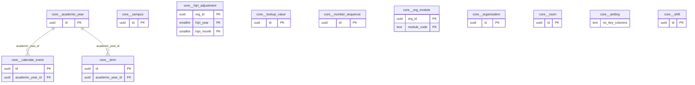

# Schema `core`

> CORE: organisation, campuses, academic calendar, settings, numbering

Generated from the live database by `db/tools/gen_docs.py` — do not edit by hand.

**Tables:** 12

## Entity-relationship diagram

Convention FKs to `core.organisation`, `core.campus`, `sys.stored_file` and `wf.approval_request` are omitted from the diagram (see table details).

## Tables

- [`core.academic_year`](#coreacademicyear) — School year with lifecycle planned > open > closing > locked > archived; no overlaps per organisation.
- [`core.calendar_event`](#corecalendarevent) — Academic calendar: holidays (national/Islamic/school), exam windows, PTMs and events. [ACA-06 academic calendar + holidays]
- [`core.campus`](#corecampus) — Physical campus (Dhanmondi, Gulshan, Lalmatia, ...); first-class scope on every transactional row.
- [`core.hijri_adjustment`](#corehijriadjustment) — Moon-sighting offsets applied to the computed Hijri calendar per month. [CCA-07 moon-sighting offsets]
- [`core.lookup_value`](#corelookupvalue) — School-configurable dropdown lists (lead sources, document types, reasons, categories). [configurable dropdowns (occupations, doc types, lost reasons...)]
- [`core.number_sequence`](#corenumbersequence) — Gap-free counters for admission, invoice, receipt, certificate numbers (row-locked). [I-8 gap-free numbering]
- [`core.org_module`](#coreorgmodule) — Feature switch per organisation and module (ships P2/P3 modules dark). [feature switches per phase]
- [`core.organisation`](#coreorganisation) — Top-level tenant (the school group); future sister schools are separate organisations.
- [`core.room`](#coreroom) — Classroom, lab, hall or other room with capacity; used by timetable, exams and bookings.
- [`core.setting`](#coresetting) — Key/value settings; campus rows override organisation defaults. [CORE-06 master settings (typed via JSON schema in app)]
- [`core.shift`](#coreshift) — Campus shift (morning/day) with start and end time.
- [`core.term`](#coreterm) — Term/semester inside an academic year; no overlapping terms.

### `core.academic_year`

School year with lifecycle planned > open > closing > locked > archived; no overlaps per organisation.

- Row-level security: `p_org: core.org_visible(org_id)`

| Column | Type | Null | Default | Description |
|---|---|---|---|---|
| `id` | uuid |  | uuidv7() |  |
| `org_id` | uuid |  |  |  |
| `code` | text |  |  | '2026-27' |
| `starts_on` | date |  |  |  |
| `ends_on` | date |  |  |  |
| `status` | text |  | 'planned'::text |  |
| `is_current` | boolean |  | false |  |
| `created_at` | timestamp with time zone |  | now() |  |
| `created_by` | uuid | yes | core.current_user_id() |  |
| `updated_at` | timestamp with time zone |  | now() |  |
| `updated_by` | uuid | yes |  |  |
| `row_version` | integer |  | 1 |  |

| Constraint | Kind | Definition |
|---|---|---|
| `academic_year_pkey` | PK | `PRIMARY KEY (id)` |
| `academic_year_org_id_code_key` | UNIQUE | `UNIQUE (org_id, code)` |
| `academic_year_org_id_fkey` | FK | `FOREIGN KEY (org_id) REFERENCES core.organisation(id)` |
| `academic_year_org_id_daterange_excl` | EXCLUDE | `EXCLUDE USING gist (org_id WITH =, daterange(starts_on, ends_on, '[]'::text) WITH &&)` |
| `academic_year_check` | CHECK | `CHECK ((ends_on > starts_on))` |
| `academic_year_status_check` | CHECK | `CHECK ((status = ANY (ARRAY['planned'::text, 'open'::text, 'closing'::text, 'locked'::text, 'archived'::text])))` |

**Indexes**

- `CREATE UNIQUE INDEX ux_academic_year_current ON core.academic_year USING btree (org_id) WHERE is_current`

**Triggers**

- `trg_audit` — AFTER INSERT UPDATE DELETE → `tg_row_audit()`
- `trg_touch` — BEFORE UPDATE → `tg_touch()`

### `core.calendar_event`

Academic calendar: holidays (national/Islamic/school), exam windows, PTMs and events. [ACA-06 academic calendar + holidays]

- Row-level security: `p_campus: core.campus_visible(org_id, campus_id)`

| Column | Type | Null | Default | Description |
|---|---|---|---|---|
| `id` | uuid |  | uuidv7() |  |
| `org_id` | uuid |  |  |  |
| `campus_id` | uuid | yes |  | NULL = all campuses |
| `academic_year_id` | uuid |  |  |  |
| `kind` | text |  |  |  |
| `title_en` | text |  |  |  |
| `title_bn` | text | yes |  |  |
| `starts_on` | date |  |  |  |
| `ends_on` | date |  |  |  |
| `is_instructional` | boolean |  | false | false => no attendance expected |
| `audience` | text |  | 'all'::text |  |
| `is_tentative` | boolean |  | false | moon-sighting dependent |
| `publish_to_web` | boolean |  | false |  |
| `created_at` | timestamp with time zone |  | now() |  |
| `created_by` | uuid | yes | core.current_user_id() |  |
| `updated_at` | timestamp with time zone |  | now() |  |
| `updated_by` | uuid | yes |  |  |
| `row_version` | integer |  | 1 |  |

| Constraint | Kind | Definition |
|---|---|---|
| `calendar_event_pkey` | PK | `PRIMARY KEY (id)` |
| `calendar_event_academic_year_id_fkey` | FK | `FOREIGN KEY (academic_year_id) REFERENCES core.academic_year(id)` |
| `calendar_event_campus_id_fkey` | FK | `FOREIGN KEY (campus_id) REFERENCES core.campus(id)` |
| `calendar_event_org_id_fkey` | FK | `FOREIGN KEY (org_id) REFERENCES core.organisation(id)` |
| `calendar_event_audience_check` | CHECK | `CHECK ((audience = ANY (ARRAY['all'::text, 'staff'::text, 'students'::text])))` |
| `calendar_event_check` | CHECK | `CHECK ((ends_on >= starts_on))` |
| `calendar_event_kind_check` | CHECK | `CHECK ((kind = ANY (ARRAY['holiday_national'::text, 'holiday_islamic'::text, 'holiday_school'::text, 'exam_window'::text, 'ptm'::text, 'event'::text, 'term_break'::text, 'ramadan_routine'::text])))` |

**Indexes**

- `CREATE INDEX ix_calendar_event_academic_year_id_fk ON core.calendar_event USING btree (academic_year_id)`
- `CREATE INDEX ix_calendar_event_campus_id_fk ON core.calendar_event USING btree (campus_id)`
- `CREATE INDEX ix_calendar_event_range ON core.calendar_event USING gist (org_id, daterange(starts_on, ends_on, '[]'::text))`

**Triggers**

- `trg_audit` — AFTER INSERT UPDATE DELETE → `tg_row_audit()`
- `trg_touch` — BEFORE UPDATE → `tg_touch()`

### `core.campus`

Physical campus (Dhanmondi, Gulshan, Lalmatia, ...); first-class scope on every transactional row.

- Row-level security: `p_org: core.org_visible(org_id)`

| Column | Type | Null | Default | Description |
|---|---|---|---|---|
| `id` | uuid |  | uuidv7() |  |
| `org_id` | uuid |  |  |  |
| `code` | text |  |  | DHN, GUL, LAL |
| `name_en` | text |  |  |  |
| `name_bn` | text | yes |  |  |
| `address_en` | text | yes |  |  |
| `address_bn` | text | yes |  |  |
| `phone` | core.phone_e164 | yes |  |  |
| `email` | citext | yes |  |  |
| `letterhead_file_id` | uuid | yes |  |  |
| `signature_file_id` | uuid | yes |  |  |
| `is_active` | boolean |  | true |  |
| `created_at` | timestamp with time zone |  | now() |  |
| `created_by` | uuid | yes | core.current_user_id() |  |
| `updated_at` | timestamp with time zone |  | now() |  |
| `updated_by` | uuid | yes |  |  |
| `row_version` | integer |  | 1 |  |

| Constraint | Kind | Definition |
|---|---|---|
| `campus_pkey` | PK | `PRIMARY KEY (id)` |
| `campus_org_id_code_key` | UNIQUE | `UNIQUE (org_id, code)` |
| `campus_letterhead_file_id_fkey` | FK | `FOREIGN KEY (letterhead_file_id) REFERENCES sys.stored_file(id)` |
| `campus_org_id_fkey` | FK | `FOREIGN KEY (org_id) REFERENCES core.organisation(id)` |
| `campus_signature_file_id_fkey` | FK | `FOREIGN KEY (signature_file_id) REFERENCES sys.stored_file(id)` |

**Triggers**

- `trg_touch` — BEFORE UPDATE → `tg_touch()`

### `core.hijri_adjustment`

Moon-sighting offsets applied to the computed Hijri calendar per month. [CCA-07 moon-sighting offsets]

- Row-level security: `p_org: core.org_visible(org_id)`

| Column | Type | Null | Default | Description |
|---|---|---|---|---|
| `org_id` | uuid |  |  |  |
| `hijri_year` | smallint |  |  |  |
| `hijri_month` | smallint |  |  |  |
| `offset_days` | smallint |  |  |  |

| Constraint | Kind | Definition |
|---|---|---|
| `hijri_adjustment_pkey` | PK | `PRIMARY KEY (org_id, hijri_year, hijri_month)` |
| `hijri_adjustment_org_id_fkey` | FK | `FOREIGN KEY (org_id) REFERENCES core.organisation(id)` |
| `hijri_adjustment_hijri_month_check` | CHECK | `CHECK (((hijri_month >= 1) AND (hijri_month <= 12)))` |
| `hijri_adjustment_offset_days_check` | CHECK | `CHECK (((offset_days >= '-2'::integer) AND (offset_days <= 2)))` |

### `core.lookup_value`

School-configurable dropdown lists (lead sources, document types, reasons, categories). [configurable dropdowns (occupations, doc types, lost reasons...)]

- Row-level security: `p_org: core.org_visible(org_id)`

| Column | Type | Null | Default | Description |
|---|---|---|---|---|
| `id` | uuid |  | uuidv7() |  |
| `org_id` | uuid |  |  |  |
| `list_code` | text |  |  |  |
| `code` | text |  |  |  |
| `label_en` | text |  |  |  |
| `label_bn` | text | yes |  |  |
| `seq` | smallint |  | 0 |  |
| `is_active` | boolean |  | true |  |
| `meta` | jsonb |  | '{}'::jsonb |  |

| Constraint | Kind | Definition |
|---|---|---|
| `lookup_value_pkey` | PK | `PRIMARY KEY (id)` |
| `lookup_value_org_id_list_code_code_key` | UNIQUE | `UNIQUE (org_id, list_code, code)` |
| `lookup_value_org_id_fkey` | FK | `FOREIGN KEY (org_id) REFERENCES core.organisation(id)` |

### `core.number_sequence`

Gap-free counters for admission, invoice, receipt, certificate numbers (row-locked). [I-8 gap-free numbering]

- Row-level security: `p_campus: core.campus_visible(org_id, campus_id)`

| Column | Type | Null | Default | Description |
|---|---|---|---|---|
| `id` | uuid |  | uuidv7() |  |
| `org_id` | uuid |  |  |  |
| `campus_id` | uuid | yes |  | NULL = org-wide |
| `seq_key` | text |  |  | 'admission_no','invoice','receipt','tc','application' |
| `period_key` | text |  | ''::text | '2026-27' \| '2026' \| '' (never resets) |
| `format` | text |  |  | '{CAMPUS}-RCP-{PERIOD}-{SEQ:6}' |
| `next_value` | bigint |  | 1 |  |

| Constraint | Kind | Definition |
|---|---|---|
| `number_sequence_pkey` | PK | `PRIMARY KEY (id)` |
| `number_sequence_org_id_campus_id_seq_key_period_key_key` | UNIQUE | `UNIQUE NULLS NOT DISTINCT (org_id, campus_id, seq_key, period_key)` |
| `number_sequence_campus_id_fkey` | FK | `FOREIGN KEY (campus_id) REFERENCES core.campus(id)` |
| `number_sequence_org_id_fkey` | FK | `FOREIGN KEY (org_id) REFERENCES core.organisation(id)` |

**Indexes**

- `CREATE INDEX ix_number_sequence_campus_id_fk ON core.number_sequence USING btree (campus_id)`

**Triggers**

- `trg_audit` — AFTER INSERT UPDATE DELETE → `tg_row_audit()`

### `core.org_module`

Feature switch per organisation and module (ships P2/P3 modules dark). [feature switches per phase]

- Row-level security: `p_org: core.org_visible(org_id)`

| Column | Type | Null | Default | Description |
|---|---|---|---|---|
| `org_id` | uuid |  |  |  |
| `module_code` | text |  |  | 'trn','lib','inv',... |
| `enabled` | boolean |  | false |  |
| `enabled_at` | timestamp with time zone | yes |  |  |

| Constraint | Kind | Definition |
|---|---|---|
| `org_module_pkey` | PK | `PRIMARY KEY (org_id, module_code)` |
| `org_module_org_id_fkey` | FK | `FOREIGN KEY (org_id) REFERENCES core.organisation(id)` |

### `core.organisation`

Top-level tenant (the school group); future sister schools are separate organisations.

| Column | Type | Null | Default | Description |
|---|---|---|---|---|
| `id` | uuid |  | uuidv7() |  |
| `code` | text |  |  |  |
| `name_en` | text |  |  |  |
| `name_bn` | text | yes |  |  |
| `timezone` | text |  | 'Asia/Dhaka'::text |  |
| `currency` | character(3) |  | 'BDT'::bpchar |  |
| `settings` | jsonb |  | '{}'::jsonb | default locale, Hijri display, branding |
| `created_at` | timestamp with time zone |  | now() |  |
| `created_by` | uuid | yes | core.current_user_id() |  |
| `updated_at` | timestamp with time zone |  | now() |  |
| `updated_by` | uuid | yes |  |  |
| `row_version` | integer |  | 1 |  |

| Constraint | Kind | Definition |
|---|---|---|
| `organisation_pkey` | PK | `PRIMARY KEY (id)` |
| `organisation_code_key` | UNIQUE | `UNIQUE (code)` |

**Triggers**

- `trg_touch` — BEFORE UPDATE → `tg_touch()`

### `core.room`

Classroom, lab, hall or other room with capacity; used by timetable, exams and bookings.

- Row-level security: `p_campus: core.campus_visible(org_id, campus_id)`

| Column | Type | Null | Default | Description |
|---|---|---|---|---|
| `id` | uuid |  | uuidv7() |  |
| `org_id` | uuid |  |  |  |
| `campus_id` | uuid |  |  |  |
| `code` | text |  |  |  |
| `name` | text |  |  |  |
| `room_type` | text |  |  |  |
| `capacity` | smallint | yes |  |  |
| `exam_capacity` | smallint | yes |  |  |
| `is_bookable` | boolean |  | false |  |
| `created_at` | timestamp with time zone |  | now() |  |
| `created_by` | uuid | yes | core.current_user_id() |  |
| `updated_at` | timestamp with time zone |  | now() |  |
| `updated_by` | uuid | yes |  |  |
| `row_version` | integer |  | 1 |  |

| Constraint | Kind | Definition |
|---|---|---|
| `room_pkey` | PK | `PRIMARY KEY (id)` |
| `room_campus_id_code_key` | UNIQUE | `UNIQUE (campus_id, code)` |
| `room_campus_id_fkey` | FK | `FOREIGN KEY (campus_id) REFERENCES core.campus(id)` |
| `room_org_id_fkey` | FK | `FOREIGN KEY (org_id) REFERENCES core.organisation(id)` |
| `room_room_type_check` | CHECK | `CHECK ((room_type = ANY (ARRAY['classroom'::text, 'lab'::text, 'ict_lab'::text, 'hall'::text, 'library'::text, 'playground'::text, 'office'::text, 'other'::text])))` |

**Triggers**

- `trg_touch` — BEFORE UPDATE → `tg_touch()`

### `core.setting`

Key/value settings; campus rows override organisation defaults. [CORE-06 master settings (typed via JSON schema in app)]

- Row-level security: `p_campus: core.campus_visible(org_id, campus_id)`

| Column | Type | Null | Default | Description |
|---|---|---|---|---|
| `org_id` | uuid |  |  |  |
| `campus_id` | uuid | yes |  | NULL = org default, campus row overrides |
| `key` | text |  |  | 'attendance.late_cutoff', 'sms.sender_id', ... |
| `value` | jsonb |  |  |  |
| `created_at` | timestamp with time zone |  | now() |  |
| `created_by` | uuid | yes | core.current_user_id() |  |
| `updated_at` | timestamp with time zone |  | now() |  |
| `updated_by` | uuid | yes |  |  |
| `row_version` | integer |  | 1 |  |

| Constraint | Kind | Definition |
|---|---|---|
| `setting_org_id_campus_id_key_key` | UNIQUE | `UNIQUE NULLS NOT DISTINCT (org_id, campus_id, key)` |
| `setting_campus_id_fkey` | FK | `FOREIGN KEY (campus_id) REFERENCES core.campus(id)` |
| `setting_org_id_fkey` | FK | `FOREIGN KEY (org_id) REFERENCES core.organisation(id)` |

**Indexes**

- `CREATE INDEX ix_setting_campus_id_fk ON core.setting USING btree (campus_id)`

**Triggers**

- `trg_audit` — AFTER INSERT UPDATE DELETE → `tg_row_audit()`
- `trg_touch` — BEFORE UPDATE → `tg_touch()`

### `core.shift`

Campus shift (morning/day) with start and end time.

- Row-level security: `p_campus: core.campus_visible(org_id, campus_id)`

| Column | Type | Null | Default | Description |
|---|---|---|---|---|
| `id` | uuid |  | uuidv7() |  |
| `org_id` | uuid |  |  |  |
| `campus_id` | uuid |  |  |  |
| `code` | text |  |  | MORNING, DAY |
| `name_en` | text |  |  |  |
| `name_bn` | text | yes |  |  |
| `starts_at` | time without time zone |  |  |  |
| `ends_at` | time without time zone |  |  |  |
| `created_at` | timestamp with time zone |  | now() |  |
| `created_by` | uuid | yes | core.current_user_id() |  |
| `updated_at` | timestamp with time zone |  | now() |  |
| `updated_by` | uuid | yes |  |  |
| `row_version` | integer |  | 1 |  |

| Constraint | Kind | Definition |
|---|---|---|
| `shift_pkey` | PK | `PRIMARY KEY (id)` |
| `shift_campus_id_code_key` | UNIQUE | `UNIQUE (campus_id, code)` |
| `shift_campus_id_fkey` | FK | `FOREIGN KEY (campus_id) REFERENCES core.campus(id)` |
| `shift_org_id_fkey` | FK | `FOREIGN KEY (org_id) REFERENCES core.organisation(id)` |

**Triggers**

- `trg_touch` — BEFORE UPDATE → `tg_touch()`

### `core.term`

Term/semester inside an academic year; no overlapping terms.

| Column | Type | Null | Default | Description |
|---|---|---|---|---|
| `id` | uuid |  | uuidv7() |  |
| `academic_year_id` | uuid |  |  |  |
| `seq` | smallint |  |  |  |
| `code` | text |  |  | T1, T2, T3 |
| `name_en` | text |  |  |  |
| `name_bn` | text | yes |  |  |
| `starts_on` | date |  |  |  |
| `ends_on` | date |  |  |  |
| `created_at` | timestamp with time zone |  | now() |  |
| `created_by` | uuid | yes | core.current_user_id() |  |
| `updated_at` | timestamp with time zone |  | now() |  |
| `updated_by` | uuid | yes |  |  |
| `row_version` | integer |  | 1 |  |

| Constraint | Kind | Definition |
|---|---|---|
| `term_pkey` | PK | `PRIMARY KEY (id)` |
| `term_academic_year_id_seq_key` | UNIQUE | `UNIQUE (academic_year_id, seq)` |
| `term_academic_year_id_fkey` | FK | `FOREIGN KEY (academic_year_id) REFERENCES core.academic_year(id) ON DELETE CASCADE` |
| `term_academic_year_id_daterange_excl` | EXCLUDE | `EXCLUDE USING gist (academic_year_id WITH =, daterange(starts_on, ends_on, '[]'::text) WITH &&)` |

**Triggers**

- `trg_touch` — BEFORE UPDATE → `tg_touch()`

