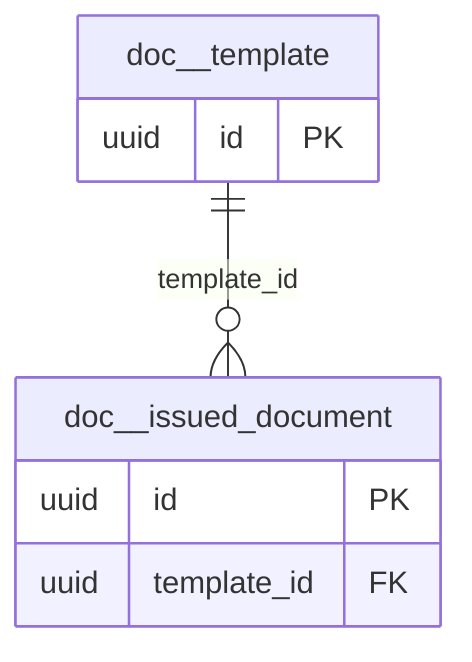

# Schema `doc`

> DOC: certificate/letter templates and issue register

Generated from the live database by `db/tools/gen_docs.py` — do not edit by hand.

**Tables:** 2

## Entity-relationship diagram

Convention FKs to `core.organisation`, `core.campus`, `sys.stored_file` and `wf.approval_request` are omitted from the diagram (see table details).

## Tables

- [`doc.issued_document`](#docissueddocument) — Issue register of certificates/letters with serial number and QR verification. [DOC-03 issue register]
- [`doc.template`](#doctemplate) — Bilingual document template (certificate, letter, report card, receipt). [DOC-01 bilingual templates with letterhead/signature]

### `doc.issued_document`

Issue register of certificates/letters with serial number and QR verification. [DOC-03 issue register]

- Row-level security: `p_campus: core.campus_visible(org_id, campus_id)`

| Column | Type | Null | Default | Description |
|---|---|---|---|---|
| `id` | uuid |  | uuidv7() |  |
| `org_id` | uuid |  |  |  |
| `campus_id` | uuid |  |  |  |
| `template_id` | uuid |  |  |  |
| `doc_code` | text |  |  |  |
| `serial_no` | text |  |  | core.number_sequence |
| `subject_type` | text |  |  |  |
| `subject_id` | uuid |  |  |  |
| `data_snapshot` | jsonb |  |  | merged data frozen at issue |
| `file_id` | uuid | yes |  |  |
| `verification_code` | text |  |  | 20-char base32 random, printed as QR |
| `public_fields` | jsonb |  |  | {name, class, issue_date} only (DOC-04) |
| `status` | text |  | 'issued'::text |  |
| `approval_request_id` | uuid | yes |  |  |
| `issued_by` | uuid |  |  |  |
| `issued_at` | timestamp with time zone |  | now() |  |
| `print_count` | smallint |  | 0 |  |
| `revoked_reason` | text | yes |  |  |

| Constraint | Kind | Definition |
|---|---|---|
| `issued_document_pkey` | PK | `PRIMARY KEY (id)` |
| `issued_document_org_id_doc_code_serial_no_key` | UNIQUE | `UNIQUE (org_id, doc_code, serial_no)` |
| `issued_document_verification_code_key` | UNIQUE | `UNIQUE (verification_code)` |
| `issued_document_approval_request_id_fkey` | FK | `FOREIGN KEY (approval_request_id) REFERENCES wf.approval_request(id)` |
| `issued_document_campus_id_fkey` | FK | `FOREIGN KEY (campus_id) REFERENCES core.campus(id)` |
| `issued_document_file_id_fkey` | FK | `FOREIGN KEY (file_id) REFERENCES sys.stored_file(id)` |
| `issued_document_org_id_fkey` | FK | `FOREIGN KEY (org_id) REFERENCES core.organisation(id)` |
| `issued_document_template_id_fkey` | FK | `FOREIGN KEY (template_id) REFERENCES doc.template(id)` |
| `issued_document_status_check` | CHECK | `CHECK ((status = ANY (ARRAY['pending_approval'::text, 'issued'::text, 'revoked'::text])))` |
| `issued_document_subject_type_check` | CHECK | `CHECK ((subject_type = ANY (ARRAY['student'::text, 'staff'::text, 'applicant'::text, 'guardian'::text])))` |

**Indexes**

- `CREATE INDEX ix_issued_document_campus_id_fk ON doc.issued_document USING btree (campus_id)`
- `CREATE INDEX ix_issued_document_template_id_fk ON doc.issued_document USING btree (template_id)`

**Triggers**

- `trg_audit` — AFTER INSERT UPDATE DELETE → `tg_row_audit()`

### `doc.template`

Bilingual document template (certificate, letter, report card, receipt). [DOC-01 bilingual templates with letterhead/signature]

- Row-level security: `p_campus: core.campus_visible(org_id, campus_id)`

| Column | Type | Null | Default | Description |
|---|---|---|---|---|
| `id` | uuid |  | uuidv7() |  |
| `org_id` | uuid |  |  |  |
| `campus_id` | uuid | yes |  |  |
| `code` | text |  |  | 'TC','CHARACTER','BONAFIDE','TESTIMONIAL','FEE_PAID','STUDY', |
| `kind` | text |  |  |  |
| `locale` | text |  |  |  |
| `version` | integer |  | 1 |  |
| `html` | text |  |  | Handlebars + CSS (print), fonts embedded |
| `page_size` | text |  | 'A4'::text |  |
| `merge_schema` | jsonb |  |  | JSON schema of merge fields (validated before render) |
| `requires_approval` | boolean |  | false |  |
| `status` | text |  | 'draft'::text |  |
| `created_at` | timestamp with time zone |  | now() |  |
| `created_by` | uuid | yes | core.current_user_id() |  |
| `updated_at` | timestamp with time zone |  | now() |  |
| `updated_by` | uuid | yes |  |  |
| `row_version` | integer |  | 1 |  |

| Constraint | Kind | Definition |
|---|---|---|
| `template_pkey` | PK | `PRIMARY KEY (id)` |
| `template_org_id_campus_id_code_locale_version_key` | UNIQUE | `UNIQUE NULLS NOT DISTINCT (org_id, campus_id, code, locale, version)` |
| `template_campus_id_fkey` | FK | `FOREIGN KEY (campus_id) REFERENCES core.campus(id)` |
| `template_org_id_fkey` | FK | `FOREIGN KEY (org_id) REFERENCES core.organisation(id)` |
| `template_kind_check` | CHECK | `CHECK ((kind = ANY (ARRAY['certificate'::text, 'letter'::text, 'report_card'::text, 'receipt'::text, 'admit_card'::text, 'id_card'::text, 'payslip'::text])))` |
| `template_locale_check` | CHECK | `CHECK ((locale = ANY (ARRAY['en'::text, 'bn'::text, 'bilingual'::text])))` |
| `template_status_check` | CHECK | `CHECK ((status = ANY (ARRAY['draft'::text, 'active'::text, 'retired'::text])))` |

**Indexes**

- `CREATE INDEX ix_template_campus_id_fk ON doc.template USING btree (campus_id)`

**Triggers**

- `trg_audit` — AFTER INSERT UPDATE DELETE → `tg_row_audit()`
- `trg_touch` — BEFORE UPDATE → `tg_touch()`

