# Schema `exm`

> EXM: exams, marks, grading, results, report cards, Edexcel

Generated from the live database by `db/tools/gen_docs.py` — do not edit by hand.

**Tables:** 19

## Entity-relationship diagram

Convention FKs to `core.organisation`, `core.campus`, `sys.stored_file` and `wf.approval_request` are omitted from the diagram (see table details).

```mermaid
erDiagram
  exm__assessment_component {
    uuid id PK
    uuid exam_paper_id FK
  }
  exm__candidate {
    uuid student_id PK, FK
    text awarding_body PK
  }
  exm__exam {
    uuid id PK
    uuid academic_year_id FK
    uuid term_id FK
    uuid exam_type_id FK
  }
  exm__exam_paper {
    uuid id PK
    uuid exam_id FK
    uuid year_group_id FK
    uuid subject_id FK
    uuid grading_scheme_id FK
  }
  exm__exam_type {
    uuid id PK
  }
  exm__external_entry {
    uuid id PK
    uuid series_id FK
    uuid student_id FK
    uuid subject_id FK
    uuid invoice_line_id FK
  }
  exm__external_result {
    uuid entry_id PK, FK
    uuid import_batch_id FK
  }
  exm__external_series {
    uuid id PK
  }
  exm__grade_band {
    uuid id PK
    uuid scheme_id FK
  }
  exm__grading_scheme {
    uuid id PK
  }
  exm__invigilation {
    uuid exam_paper_id PK, FK
    uuid room_id PK, FK
    uuid staff_id PK, FK
  }
  exm__mark_current {
    uuid component_id PK, FK
    uuid student_id PK, FK
    uuid exam_paper_id FK
    bigint mark_entry_id FK
  }
  exm__mark_entry {
    bigint id PK
    uuid exam_paper_id FK
    uuid component_id FK
    uuid student_id FK
  }
  exm__paper_status_history {
    bigint id PK
    uuid exam_paper_id FK
  }
  exm__predicted_grade {
    uuid id PK
    uuid student_id FK
    uuid subject_id FK
    uuid series_id FK
  }
  exm__report_card {
    uuid id PK
    uuid exam_id FK
    uuid student_id FK
    uuid template_id FK
  }
  exm__result_subject {
    uuid exam_id FK
    uuid exam_paper_id PK, FK
    uuid student_id PK, FK
    uuid enrolment_id FK
    uuid scheme_id FK
  }
  exm__result_summary {
    uuid exam_id PK, FK
    uuid student_id PK, FK
    uuid enrolment_id FK
  }
  exm__seat_allocation {
    uuid exam_id PK, FK
    uuid student_id PK, FK
    date session_date PK
    uuid room_id FK
  }
  aca__subject {
    uuid id PK
  }
  aca__year_group {
    uuid id PK
  }
  core__academic_year {
    uuid id PK
  }
  core__room {
    uuid id PK
  }
  core__term {
    uuid id PK
  }
  doc__template {
    uuid id PK
  }
  fee__invoice_line {
    uuid id PK
  }
  hrm__staff {
    uuid id PK
  }
  sis__enrolment {
    uuid id PK
  }
  sis__student {
    uuid id PK
  }
  sys__import_batch {
    uuid id PK
  }
  aca__subject ||--o{ exm__exam_paper : "subject_id"
  aca__subject ||--o{ exm__external_entry : "subject_id"
  aca__subject ||--o{ exm__predicted_grade : "subject_id"
  aca__year_group ||--o{ exm__exam_paper : "year_group_id"
  core__academic_year ||--o{ exm__exam : "academic_year_id"
  core__room ||--o{ exm__invigilation : "room_id"
  core__room ||--o{ exm__seat_allocation : "room_id"
  core__term ||--o{ exm__exam : "term_id"
  doc__template ||--o{ exm__report_card : "template_id"
  exm__assessment_component ||--o{ exm__mark_current : "component_id"
  exm__assessment_component ||--o{ exm__mark_entry : "component_id"
  exm__exam ||--o{ exm__exam_paper : "exam_id"
  exm__exam ||--o{ exm__report_card : "exam_id"
  exm__exam ||--o{ exm__result_subject : "exam_id"
  exm__exam ||--o{ exm__result_summary : "exam_id"
  exm__exam ||--o{ exm__seat_allocation : "exam_id"
  exm__exam_paper ||--o{ exm__assessment_component : "exam_paper_id"
  exm__exam_paper ||--o{ exm__invigilation : "exam_paper_id"
  exm__exam_paper ||--o{ exm__mark_current : "exam_paper_id"
  exm__exam_paper ||--o{ exm__mark_entry : "exam_paper_id"
  exm__exam_paper ||--o{ exm__paper_status_history : "exam_paper_id"
  exm__exam_paper ||--o{ exm__result_subject : "exam_paper_id"
  exm__exam_type ||--o{ exm__exam : "exam_type_id"
  exm__external_entry ||--o{ exm__external_result : "entry_id"
  exm__external_series ||--o{ exm__external_entry : "series_id"
  exm__external_series ||--o{ exm__predicted_grade : "series_id"
  exm__grading_scheme ||--o{ exm__exam_paper : "grading_scheme_id"
  exm__grading_scheme ||--o{ exm__grade_band : "scheme_id"
  exm__grading_scheme ||--o{ exm__result_subject : "scheme_id"
  exm__mark_entry ||--o{ exm__mark_current : "mark_entry_id"
  fee__invoice_line ||--o{ exm__external_entry : "invoice_line_id"
  hrm__staff ||--o{ exm__invigilation : "staff_id"
  sis__enrolment ||--o{ exm__result_subject : "enrolment_id"
  sis__enrolment ||--o{ exm__result_summary : "enrolment_id"
  sis__student ||--o{ exm__candidate : "student_id"
  sis__student ||--o{ exm__external_entry : "student_id"
  sis__student ||--o{ exm__mark_current : "student_id"
  sis__student ||--o{ exm__mark_entry : "student_id"
  sis__student ||--o{ exm__predicted_grade : "student_id"
  sis__student ||--o{ exm__report_card : "student_id"
  sis__student ||--o{ exm__result_subject : "student_id"
  sis__student ||--o{ exm__result_summary : "student_id"
  sis__student ||--o{ exm__seat_allocation : "student_id"
  sys__import_batch ||--o{ exm__external_result : "import_batch_id"
```

## Tables

- [`exm.assessment_component`](#exmassessmentcomponent) — Paper component (written, practical, oral, CA) with weight. [written / practical / oral / CA]
- [`exm.candidate`](#exmcandidate) — Awarding-body candidate number of a student.
- [`exm.exam`](#exmexam) — Internal examination with lifecycle up to embargoed publication.
- [`exm.exam_paper`](#exmexampaper) — One subject sitting of an exam for a year group; lockable after moderation. [one subject sitting for a year group]
- [`exm.exam_type`](#exmexamtype) — Exam type (class test, mid-term, final, mock).
- [`exm.external_entry`](#exmexternalentry) — Subject/unit entry for an external series with entry fee.
- [`exm.external_result`](#exmexternalresult) — Imported external result for an entry.
- [`exm.external_series`](#exmexternalseries) — Awarding-body exam series (e.g. Edexcel June 2027).
- [`exm.grade_band`](#exmgradeband) — Percentage band to grade/grade point; bands cannot overlap.
- [`exm.grading_scheme`](#exmgradingscheme) — Configurable grading scheme (Edexcel 9-1, A*-E, GPA 5.0, descriptors), versioned. [EXM-04 / Appendix A]
- [`exm.invigilation`](#exminvigilation) — Invigilator assignment per paper and room.
- [`exm.mark_current`](#exmmarkcurrent) — Latest mark per component and student - trigger-maintained projection. [latest round-1 value; maintained ONLY by trigger]
- [`exm.mark_entry`](#exmmarkentry) — Append-only versioned mark entries (with double-entry round).
- [`exm.paper_status_history`](#exmpaperstatushistory) — Submit / moderate / lock / reopen history of a paper. [submit / moderate / lock / reopen trail]
- [`exm.predicted_grade`](#exmpredictedgrade) — Teacher-predicted grade with evidence and approval. [EXM-08]
- [`exm.report_card`](#exmreportcard) — Generated report-card PDF with QR verification code. [EXM-05]
- [`exm.result_subject`](#exmresultsubject) — Computed subject result (percent, grade, rank) frozen at publication.
- [`exm.result_summary`](#exmresultsummary) — Computed overall result per student and exam with remarks.
- [`exm.seat_allocation`](#exmseatallocation) — Seat and room of a student per exam day; admit card number. [EXM-02]

### `exm.assessment_component`

Paper component (written, practical, oral, CA) with weight. [written / practical / oral / CA]

| Column | Type | Null | Default | Description |
|---|---|---|---|---|
| `id` | uuid |  | uuidv7() |  |
| `exam_paper_id` | uuid |  |  |  |
| `code` | text |  |  |  |
| `name_en` | text |  |  |  |
| `max_marks` | numeric(6,2) |  |  |  |
| `weight_pct` | numeric(5,2) |  |  |  |
| `source` | text |  | 'entry'::text | CA pulled from LRN |

| Constraint | Kind | Definition |
|---|---|---|
| `assessment_component_pkey` | PK | `PRIMARY KEY (id)` |
| `assessment_component_exam_paper_id_code_key` | UNIQUE | `UNIQUE (exam_paper_id, code)` |
| `assessment_component_exam_paper_id_fkey` | FK | `FOREIGN KEY (exam_paper_id) REFERENCES exm.exam_paper(id) ON DELETE CASCADE` |
| `assessment_component_max_marks_check` | CHECK | `CHECK ((max_marks > (0)::numeric))` |
| `assessment_component_source_check` | CHECK | `CHECK ((source = ANY (ARRAY['entry'::text, 'gradebook'::text])))` |
| `assessment_component_weight_pct_check` | CHECK | `CHECK (((weight_pct >= (0)::numeric) AND (weight_pct <= (100)::numeric)))` |

### `exm.candidate`

Awarding-body candidate number of a student.

| Column | Type | Null | Default | Description |
|---|---|---|---|---|
| `student_id` | uuid |  |  |  |
| `awarding_body` | text |  | 'PEARSON_EDEXCEL'::text |  |
| `candidate_no` | text |  |  |  |
| `uci` | text | yes |  | unique candidate identifier |
| `centre_no` | text |  |  |  |

| Constraint | Kind | Definition |
|---|---|---|
| `candidate_pkey` | PK | `PRIMARY KEY (student_id, awarding_body)` |
| `candidate_student_id_fkey` | FK | `FOREIGN KEY (student_id) REFERENCES sis.student(id)` |

### `exm.exam`

Internal examination with lifecycle up to embargoed publication.

- Row-level security: `p_campus: core.campus_visible(org_id, campus_id)`

| Column | Type | Null | Default | Description |
|---|---|---|---|---|
| `id` | uuid |  | uuidv7() |  |
| `org_id` | uuid |  |  |  |
| `campus_id` | uuid |  |  |  |
| `academic_year_id` | uuid |  |  |  |
| `term_id` | uuid | yes |  |  |
| `exam_type_id` | uuid |  |  |  |
| `name_en` | text |  |  |  |
| `name_bn` | text | yes |  |  |
| `starts_on` | date |  |  |  |
| `ends_on` | date |  |  |  |
| `status` | text |  | 'draft'::text |  |
| `weight_in_term` | numeric(5,2) | yes |  | e.g. MID 40%, FINAL 60% |
| `result_embargo_until` | timestamp with time zone | yes |  | EXM-06 |
| `published_at` | timestamp with time zone | yes |  |  |
| `created_at` | timestamp with time zone |  | now() |  |
| `created_by` | uuid | yes | core.current_user_id() |  |
| `updated_at` | timestamp with time zone |  | now() |  |
| `updated_by` | uuid | yes |  |  |
| `row_version` | integer |  | 1 |  |

| Constraint | Kind | Definition |
|---|---|---|
| `exam_pkey` | PK | `PRIMARY KEY (id)` |
| `exam_academic_year_id_fkey` | FK | `FOREIGN KEY (academic_year_id) REFERENCES core.academic_year(id)` |
| `exam_campus_id_fkey` | FK | `FOREIGN KEY (campus_id) REFERENCES core.campus(id)` |
| `exam_exam_type_id_fkey` | FK | `FOREIGN KEY (exam_type_id) REFERENCES exm.exam_type(id)` |
| `exam_org_id_fkey` | FK | `FOREIGN KEY (org_id) REFERENCES core.organisation(id)` |
| `exam_term_id_fkey` | FK | `FOREIGN KEY (term_id) REFERENCES core.term(id)` |
| `exam_check` | CHECK | `CHECK ((ends_on >= starts_on))` |
| `exam_status_check` | CHECK | `CHECK ((status = ANY (ARRAY['draft'::text, 'scheduled'::text, 'in_progress'::text, 'marking'::text, 'moderation'::text, 'locked'::text, 'published'::text, 'archived'::text])))` |

**Indexes**

- `CREATE INDEX ix_exam_academic_year_id_fk ON exm.exam USING btree (academic_year_id)`
- `CREATE INDEX ix_exam_campus_id_fk ON exm.exam USING btree (campus_id)`
- `CREATE INDEX ix_exam_exam_type_id_fk ON exm.exam USING btree (exam_type_id)`
- `CREATE INDEX ix_exam_term_id_fk ON exm.exam USING btree (term_id)`

**Triggers**

- `trg_audit` — AFTER INSERT UPDATE DELETE → `tg_row_audit()`
- `trg_touch` — BEFORE UPDATE → `tg_touch()`

### `exm.exam_paper`

One subject sitting of an exam for a year group; lockable after moderation. [one subject sitting for a year group]

- Row-level security: `p_campus: core.campus_visible(org_id, campus_id)`

| Column | Type | Null | Default | Description |
|---|---|---|---|---|
| `id` | uuid |  | uuidv7() |  |
| `org_id` | uuid |  |  |  |
| `campus_id` | uuid |  |  |  |
| `exam_id` | uuid |  |  |  |
| `year_group_id` | uuid |  |  |  |
| `subject_id` | uuid |  |  |  |
| `paper_code` | text |  | '1'::text |  |
| `sits_at` | timestamp with time zone | yes |  |  |
| `duration` | interval | yes |  |  |
| `max_marks` | numeric(6,2) |  |  |  |
| `pass_marks` | numeric(6,2) | yes |  |  |
| `grading_scheme_id` | uuid |  |  |  |
| `double_entry` | boolean |  | false | EXM-03 verification |
| `status` | text |  | 'open'::text |  |
| `locked_at` | timestamp with time zone | yes |  |  |
| `locked_by` | uuid | yes |  |  |
| `created_at` | timestamp with time zone |  | now() |  |
| `created_by` | uuid | yes | core.current_user_id() |  |
| `updated_at` | timestamp with time zone |  | now() |  |
| `updated_by` | uuid | yes |  |  |
| `row_version` | integer |  | 1 |  |

| Constraint | Kind | Definition |
|---|---|---|
| `exam_paper_pkey` | PK | `PRIMARY KEY (id)` |
| `exam_paper_exam_id_year_group_id_subject_id_paper_code_key` | UNIQUE | `UNIQUE (exam_id, year_group_id, subject_id, paper_code)` |
| `exam_paper_campus_id_fkey` | FK | `FOREIGN KEY (campus_id) REFERENCES core.campus(id)` |
| `exam_paper_exam_id_fkey` | FK | `FOREIGN KEY (exam_id) REFERENCES exm.exam(id) ON DELETE CASCADE` |
| `exam_paper_grading_scheme_id_fkey` | FK | `FOREIGN KEY (grading_scheme_id) REFERENCES exm.grading_scheme(id)` |
| `exam_paper_org_id_fkey` | FK | `FOREIGN KEY (org_id) REFERENCES core.organisation(id)` |
| `exam_paper_subject_id_fkey` | FK | `FOREIGN KEY (subject_id) REFERENCES aca.subject(id)` |
| `exam_paper_year_group_id_fkey` | FK | `FOREIGN KEY (year_group_id) REFERENCES aca.year_group(id)` |
| `exam_paper_max_marks_check` | CHECK | `CHECK ((max_marks > (0)::numeric))` |
| `exam_paper_status_check` | CHECK | `CHECK ((status = ANY (ARRAY['open'::text, 'submitted'::text, 'moderated'::text, 'locked'::text, 'reopened'::text])))` |

**Indexes**

- `CREATE INDEX ix_exam_paper_grading_scheme_id_fk ON exm.exam_paper USING btree (grading_scheme_id)`
- `CREATE INDEX ix_exam_paper_sitting ON exm.exam_paper USING btree (campus_id, sits_at)`
- `CREATE INDEX ix_exam_paper_subject_id_fk ON exm.exam_paper USING btree (subject_id)`
- `CREATE INDEX ix_exam_paper_year_group_id_fk ON exm.exam_paper USING btree (year_group_id)`

**Triggers**

- `trg_audit` — AFTER INSERT UPDATE DELETE → `tg_row_audit()`
- `trg_touch` — BEFORE UPDATE → `tg_touch()`

### `exm.exam_type`

Exam type (class test, mid-term, final, mock).

- Row-level security: `p_org: core.org_visible(org_id)`

| Column | Type | Null | Default | Description |
|---|---|---|---|---|
| `id` | uuid |  | uuidv7() |  |
| `org_id` | uuid |  |  |  |
| `code` | text |  |  | CT, MID, FINAL, MOCK, BOARD_PRACTICE |
| `name_en` | text |  |  |  |
| `name_bn` | text | yes |  |  |

| Constraint | Kind | Definition |
|---|---|---|
| `exam_type_pkey` | PK | `PRIMARY KEY (id)` |
| `exam_type_org_id_code_key` | UNIQUE | `UNIQUE (org_id, code)` |
| `exam_type_org_id_fkey` | FK | `FOREIGN KEY (org_id) REFERENCES core.organisation(id)` |

### `exm.external_entry`

Subject/unit entry for an external series with entry fee.

- Row-level security: `p_campus: core.campus_visible(org_id, campus_id)`

| Column | Type | Null | Default | Description |
|---|---|---|---|---|
| `id` | uuid |  | uuidv7() |  |
| `org_id` | uuid |  |  |  |
| `campus_id` | uuid |  |  |  |
| `series_id` | uuid |  |  |  |
| `student_id` | uuid |  |  |  |
| `subject_id` | uuid |  |  |  |
| `entry_code` | text |  |  | unit/option code |
| `is_resit` | boolean |  | false |  |
| `is_cash_in` | boolean |  | false |  |
| `access_arrangements` | text[] |  | '{}'::text[] |  |
| `entry_fee_paisa` | core.paisa_nn |  |  |  |
| `invoice_line_id` | uuid | yes |  | billed via FEE |
| `status` | text |  | 'draft'::text |  |
| `exported_at` | timestamp with time zone | yes |  |  |
| `created_at` | timestamp with time zone |  | now() |  |
| `created_by` | uuid | yes | core.current_user_id() |  |
| `updated_at` | timestamp with time zone |  | now() |  |
| `updated_by` | uuid | yes |  |  |
| `row_version` | integer |  | 1 |  |

| Constraint | Kind | Definition |
|---|---|---|
| `external_entry_pkey` | PK | `PRIMARY KEY (id)` |
| `external_entry_series_id_student_id_entry_code_key` | UNIQUE | `UNIQUE (series_id, student_id, entry_code)` |
| `external_entry_campus_id_fkey` | FK | `FOREIGN KEY (campus_id) REFERENCES core.campus(id)` |
| `external_entry_invoice_line_id_fkey` | FK | `FOREIGN KEY (invoice_line_id) REFERENCES fee.invoice_line(id)` |
| `external_entry_org_id_fkey` | FK | `FOREIGN KEY (org_id) REFERENCES core.organisation(id)` |
| `external_entry_series_id_fkey` | FK | `FOREIGN KEY (series_id) REFERENCES exm.external_series(id)` |
| `external_entry_student_id_fkey` | FK | `FOREIGN KEY (student_id) REFERENCES sis.student(id)` |
| `external_entry_subject_id_fkey` | FK | `FOREIGN KEY (subject_id) REFERENCES aca.subject(id)` |
| `external_entry_status_check` | CHECK | `CHECK ((status = ANY (ARRAY['draft'::text, 'confirmed'::text, 'exported'::text, 'withdrawn'::text])))` |

**Indexes**

- `CREATE INDEX ix_external_entry_campus_id_fk ON exm.external_entry USING btree (campus_id)`
- `CREATE INDEX ix_external_entry_invoice_line_id_fk ON exm.external_entry USING btree (invoice_line_id)`
- `CREATE INDEX ix_external_entry_student_id_fk ON exm.external_entry USING btree (student_id)`
- `CREATE INDEX ix_external_entry_subject_id_fk ON exm.external_entry USING btree (subject_id)`

**Triggers**

- `trg_audit` — AFTER INSERT UPDATE DELETE → `tg_row_audit()`
- `trg_touch` — BEFORE UPDATE → `tg_touch()`

### `exm.external_result`

Imported external result for an entry.

| Column | Type | Null | Default | Description |
|---|---|---|---|---|
| `entry_id` | uuid |  |  |  |
| `grade` | text |  |  |  |
| `ums` | numeric(6,1) | yes |  |  |
| `imported_at` | timestamp with time zone |  | now() |  |
| `import_batch_id` | uuid | yes |  |  |

| Constraint | Kind | Definition |
|---|---|---|
| `external_result_pkey` | PK | `PRIMARY KEY (entry_id)` |
| `external_result_entry_id_fkey` | FK | `FOREIGN KEY (entry_id) REFERENCES exm.external_entry(id)` |
| `external_result_import_batch_id_fkey` | FK | `FOREIGN KEY (import_batch_id) REFERENCES sys.import_batch(id)` |

**Indexes**

- `CREATE INDEX ix_external_result_import_batch_id_fk ON exm.external_result USING btree (import_batch_id)`

### `exm.external_series`

Awarding-body exam series (e.g. Edexcel June 2027).

- Row-level security: `p_org: core.org_visible(org_id)`

| Column | Type | Null | Default | Description |
|---|---|---|---|---|
| `id` | uuid |  | uuidv7() |  |
| `org_id` | uuid |  |  |  |
| `awarding_body` | text |  | 'PEARSON_EDEXCEL'::text |  |
| `code` | text |  |  | 'JUN-2027' |
| `entry_deadline` | date | yes |  |  |
| `late_deadline` | date | yes |  |  |
| `results_on` | date | yes |  |  |

| Constraint | Kind | Definition |
|---|---|---|
| `external_series_pkey` | PK | `PRIMARY KEY (id)` |
| `external_series_org_id_awarding_body_code_key` | UNIQUE | `UNIQUE (org_id, awarding_body, code)` |
| `external_series_org_id_fkey` | FK | `FOREIGN KEY (org_id) REFERENCES core.organisation(id)` |

### `exm.grade_band`

Percentage band to grade/grade point; bands cannot overlap.

| Column | Type | Null | Default | Description |
|---|---|---|---|---|
| `id` | uuid |  | uuidv7() |  |
| `scheme_id` | uuid |  |  |  |
| `grade` | text |  |  | '9','A*','A+','Exceeding' |
| `label_bn` | text | yes |  |  |
| `min_percent` | numeric(5,2) |  |  |  |
| `max_percent` | numeric(5,2) |  |  |  |
| `grade_point` | numeric(4,2) | yes |  | GPA 5.00 scale |
| `is_pass` | boolean |  |  |  |
| `seq` | smallint |  |  |  |

| Constraint | Kind | Definition |
|---|---|---|
| `grade_band_pkey` | PK | `PRIMARY KEY (id)` |
| `grade_band_scheme_id_grade_key` | UNIQUE | `UNIQUE (scheme_id, grade)` |
| `grade_band_scheme_id_fkey` | FK | `FOREIGN KEY (scheme_id) REFERENCES exm.grading_scheme(id) ON DELETE CASCADE` |
| `grade_band_scheme_id_numrange_excl` | EXCLUDE | `EXCLUDE USING gist (scheme_id WITH =, numrange(min_percent, max_percent, '[]'::text) WITH &&)` |
| `grade_band_check` | CHECK | `CHECK ((max_percent >= min_percent))` |

**Triggers**

- `trg_audit` — AFTER INSERT UPDATE DELETE → `tg_row_audit()`

### `exm.grading_scheme`

Configurable grading scheme (Edexcel 9-1, A*-E, GPA 5.0, descriptors), versioned. [EXM-04 / Appendix A]

- Row-level security: `p_org: core.org_visible(org_id)`

| Column | Type | Null | Default | Description |
|---|---|---|---|---|
| `id` | uuid |  | uuidv7() |  |
| `org_id` | uuid |  |  |  |
| `code` | text |  |  | 'EDX_IGCSE_9_1','EDX_IAL_A_E','GPA_5','PRIMARY_DESC' |
| `name_en` | text |  |  |  |
| `kind` | text |  |  |  |
| `version` | integer |  | 1 |  |
| `rounding` | text |  | 'half_up'::text |  |
| `is_active` | boolean |  | true |  |
| `created_at` | timestamp with time zone |  | now() |  |
| `created_by` | uuid | yes | core.current_user_id() |  |
| `updated_at` | timestamp with time zone |  | now() |  |
| `updated_by` | uuid | yes |  |  |
| `row_version` | integer |  | 1 |  |

| Constraint | Kind | Definition |
|---|---|---|
| `grading_scheme_pkey` | PK | `PRIMARY KEY (id)` |
| `grading_scheme_org_id_code_version_key` | UNIQUE | `UNIQUE (org_id, code, version)` |
| `grading_scheme_org_id_fkey` | FK | `FOREIGN KEY (org_id) REFERENCES core.organisation(id)` |
| `grading_scheme_kind_check` | CHECK | `CHECK ((kind = ANY (ARRAY['band'::text, 'descriptor'::text, 'gpa'::text])))` |
| `grading_scheme_rounding_check` | CHECK | `CHECK ((rounding = ANY (ARRAY['half_up'::text, 'floor'::text, 'none'::text])))` |

**Triggers**

- `trg_audit` — AFTER INSERT UPDATE DELETE → `tg_row_audit()`
- `trg_touch` — BEFORE UPDATE → `tg_touch()`

### `exm.invigilation`

Invigilator assignment per paper and room.

| Column | Type | Null | Default | Description |
|---|---|---|---|---|
| `exam_paper_id` | uuid |  |  |  |
| `room_id` | uuid |  |  |  |
| `staff_id` | uuid |  |  |  |
| `role` | text |  | 'invigilator'::text |  |

| Constraint | Kind | Definition |
|---|---|---|
| `invigilation_pkey` | PK | `PRIMARY KEY (exam_paper_id, room_id, staff_id)` |
| `invigilation_exam_paper_id_fkey` | FK | `FOREIGN KEY (exam_paper_id) REFERENCES exm.exam_paper(id) ON DELETE CASCADE` |
| `invigilation_room_id_fkey` | FK | `FOREIGN KEY (room_id) REFERENCES core.room(id)` |
| `invigilation_staff_id_fkey` | FK | `FOREIGN KEY (staff_id) REFERENCES hrm.staff(id)` |
| `invigilation_role_check` | CHECK | `CHECK ((role = ANY (ARRAY['chief'::text, 'invigilator'::text, 'reader'::text, 'scribe'::text])))` |

**Indexes**

- `CREATE INDEX ix_invigilation_room_id_fk ON exm.invigilation USING btree (room_id)`
- `CREATE INDEX ix_invigilation_staff_id_fk ON exm.invigilation USING btree (staff_id)`

### `exm.mark_current`

Latest mark per component and student - trigger-maintained projection. [latest round-1 value; maintained ONLY by trigger]

- Row-level security: `p_campus: core.campus_visible(org_id, campus_id)`

| Column | Type | Null | Default | Description |
|---|---|---|---|---|
| `component_id` | uuid |  |  |  |
| `student_id` | uuid |  |  |  |
| `exam_paper_id` | uuid |  |  |  |
| `org_id` | uuid |  |  |  |
| `campus_id` | uuid |  |  |  |
| `mark_entry_id` | bigint |  |  |  |
| `marks` | numeric(6,2) | yes |  |  |
| `absence_code` | text | yes |  |  |
| `version` | integer |  |  |  |

| Constraint | Kind | Definition |
|---|---|---|
| `mark_current_pkey` | PK | `PRIMARY KEY (component_id, student_id)` |
| `mark_current_campus_id_fkey` | FK | `FOREIGN KEY (campus_id) REFERENCES core.campus(id)` |
| `mark_current_component_id_fkey` | FK | `FOREIGN KEY (component_id) REFERENCES exm.assessment_component(id)` |
| `mark_current_exam_paper_id_fkey` | FK | `FOREIGN KEY (exam_paper_id) REFERENCES exm.exam_paper(id)` |
| `mark_current_mark_entry_id_fkey` | FK | `FOREIGN KEY (mark_entry_id) REFERENCES exm.mark_entry(id)` |
| `mark_current_org_id_fkey` | FK | `FOREIGN KEY (org_id) REFERENCES core.organisation(id)` |
| `mark_current_student_id_fkey` | FK | `FOREIGN KEY (student_id) REFERENCES sis.student(id)` |

**Indexes**

- `CREATE INDEX ix_mark_current_campus_id_fk ON exm.mark_current USING btree (campus_id)`
- `CREATE INDEX ix_mark_current_mark_entry_id_fk ON exm.mark_current USING btree (mark_entry_id)`
- `CREATE INDEX ix_mark_current_paper ON exm.mark_current USING btree (exam_paper_id)`
- `CREATE INDEX ix_mark_current_student_id_fk ON exm.mark_current USING btree (student_id)`

### `exm.mark_entry`

Append-only versioned mark entries (with double-entry round).

- Row-level security: `p_campus: core.campus_visible(org_id, campus_id)`

| Column | Type | Null | Default | Description |
|---|---|---|---|---|
| `id` | bigint |  |  |  |
| `org_id` | uuid |  |  |  |
| `campus_id` | uuid |  |  |  |
| `exam_paper_id` | uuid |  |  |  |
| `component_id` | uuid |  |  |  |
| `student_id` | uuid |  |  |  |
| `entry_round` | smallint |  | 1 | 2 = double-entry verification |
| `version` | integer |  |  |  |
| `marks` | numeric(6,2) | yes |  |  |
| `absence_code` | text | yes |  | absent / exempt / medical / not applicable |
| `change_reason` | text | yes |  | mandatory when version > 1 (domain rule) |
| `source` | text |  | 'web'::text |  |
| `entered_by` | uuid |  |  |  |
| `entered_at` | timestamp with time zone |  | now() |  |

| Constraint | Kind | Definition |
|---|---|---|
| `mark_entry_pkey` | PK | `PRIMARY KEY (id)` |
| `mark_entry_component_id_student_id_entry_round_version_key` | UNIQUE | `UNIQUE (component_id, student_id, entry_round, version)` |
| `mark_entry_campus_id_fkey` | FK | `FOREIGN KEY (campus_id) REFERENCES core.campus(id)` |
| `mark_entry_component_id_fkey` | FK | `FOREIGN KEY (component_id) REFERENCES exm.assessment_component(id)` |
| `mark_entry_exam_paper_id_fkey` | FK | `FOREIGN KEY (exam_paper_id) REFERENCES exm.exam_paper(id)` |
| `mark_entry_org_id_fkey` | FK | `FOREIGN KEY (org_id) REFERENCES core.organisation(id)` |
| `mark_entry_student_id_fkey` | FK | `FOREIGN KEY (student_id) REFERENCES sis.student(id)` |
| `mark_entry_absence_code_check` | CHECK | `CHECK ((absence_code = ANY (ARRAY['AB'::text, 'EX'::text, 'MED'::text, 'NA'::text])))` |
| `mark_entry_check` | CHECK | `CHECK (((marks IS NULL) <> (absence_code IS NULL)))` |
| `mark_entry_entry_round_check` | CHECK | `CHECK ((entry_round = ANY (ARRAY[1, 2])))` |
| `mark_entry_marks_check` | CHECK | `CHECK ((marks >= (0)::numeric))` |
| `mark_entry_source_check` | CHECK | `CHECK ((source = ANY (ARRAY['web'::text, 'excel_upload'::text, 'teacher_app'::text, 'gradebook'::text, 'reopen'::text])))` |

**Indexes**

- `CREATE INDEX ix_mark_entry_campus_id_fk ON exm.mark_entry USING btree (campus_id)`
- `CREATE INDEX ix_mark_entry_paper ON exm.mark_entry USING btree (exam_paper_id, student_id)`
- `CREATE INDEX ix_mark_entry_student_id_fk ON exm.mark_entry USING btree (student_id)`

**Triggers**

- `trg_audit` — AFTER INSERT UPDATE DELETE → `tg_row_audit()`
- `trg_mark_entry_apply` — AFTER INSERT → `tg_mark_entry_apply()`

### `exm.paper_status_history`

Submit / moderate / lock / reopen history of a paper. [submit / moderate / lock / reopen trail]

| Column | Type | Null | Default | Description |
|---|---|---|---|---|
| `id` | bigint |  |  |  |
| `exam_paper_id` | uuid |  |  |  |
| `from_status` | text |  |  |  |
| `to_status` | text |  |  |  |
| `actor_user_id` | uuid |  |  |  |
| `approval_request_id` | uuid | yes |  | reopen requires approval |
| `comment` | text | yes |  |  |
| `at` | timestamp with time zone |  | now() |  |

| Constraint | Kind | Definition |
|---|---|---|
| `paper_status_history_pkey` | PK | `PRIMARY KEY (id)` |
| `paper_status_history_approval_request_id_fkey` | FK | `FOREIGN KEY (approval_request_id) REFERENCES wf.approval_request(id)` |
| `paper_status_history_exam_paper_id_fkey` | FK | `FOREIGN KEY (exam_paper_id) REFERENCES exm.exam_paper(id)` |

**Indexes**

- `CREATE INDEX ix_paper_status_history_exam_paper_id_fk ON exm.paper_status_history USING btree (exam_paper_id)`

### `exm.predicted_grade`

Teacher-predicted grade with evidence and approval. [EXM-08]

- Row-level security: `p_campus: core.campus_visible(org_id, campus_id)`

| Column | Type | Null | Default | Description |
|---|---|---|---|---|
| `id` | uuid |  | uuidv7() |  |
| `org_id` | uuid |  |  |  |
| `campus_id` | uuid |  |  |  |
| `student_id` | uuid |  |  |  |
| `subject_id` | uuid |  |  |  |
| `series_id` | uuid | yes |  |  |
| `grade` | text |  |  |  |
| `evidence` | text | yes |  |  |
| `status` | text |  | 'draft'::text |  |
| `approved_by` | uuid | yes |  |  |
| `created_at` | timestamp with time zone |  | now() |  |
| `created_by` | uuid | yes | core.current_user_id() |  |
| `updated_at` | timestamp with time zone |  | now() |  |
| `updated_by` | uuid | yes |  |  |
| `row_version` | integer |  | 1 |  |

| Constraint | Kind | Definition |
|---|---|---|
| `predicted_grade_pkey` | PK | `PRIMARY KEY (id)` |
| `predicted_grade_campus_id_fkey` | FK | `FOREIGN KEY (campus_id) REFERENCES core.campus(id)` |
| `predicted_grade_org_id_fkey` | FK | `FOREIGN KEY (org_id) REFERENCES core.organisation(id)` |
| `predicted_grade_series_id_fkey` | FK | `FOREIGN KEY (series_id) REFERENCES exm.external_series(id)` |
| `predicted_grade_student_id_fkey` | FK | `FOREIGN KEY (student_id) REFERENCES sis.student(id)` |
| `predicted_grade_subject_id_fkey` | FK | `FOREIGN KEY (subject_id) REFERENCES aca.subject(id)` |
| `predicted_grade_status_check` | CHECK | `CHECK ((status = ANY (ARRAY['draft'::text, 'submitted'::text, 'approved'::text, 'rejected'::text])))` |

**Indexes**

- `CREATE INDEX ix_predicted_grade_campus_id_fk ON exm.predicted_grade USING btree (campus_id)`
- `CREATE INDEX ix_predicted_grade_series_id_fk ON exm.predicted_grade USING btree (series_id)`
- `CREATE INDEX ix_predicted_grade_student_id_fk ON exm.predicted_grade USING btree (student_id)`
- `CREATE INDEX ix_predicted_grade_subject_id_fk ON exm.predicted_grade USING btree (subject_id)`

**Triggers**

- `trg_audit` — AFTER INSERT UPDATE DELETE → `tg_row_audit()`
- `trg_touch` — BEFORE UPDATE → `tg_touch()`

### `exm.report_card`

Generated report-card PDF with QR verification code. [EXM-05]

- Row-level security: `p_campus: core.campus_visible(org_id, campus_id)`

| Column | Type | Null | Default | Description |
|---|---|---|---|---|
| `id` | uuid |  | uuidv7() |  |
| `org_id` | uuid |  |  |  |
| `campus_id` | uuid |  |  |  |
| `exam_id` | uuid |  |  |  |
| `student_id` | uuid |  |  |  |
| `version` | integer |  | 1 |  |
| `template_id` | uuid |  |  | doc.template |
| `locale` | text |  |  |  |
| `file_id` | uuid | yes |  |  |
| `verification_code` | text |  |  | QR verification (DOC-04) |
| `generated_at` | timestamp with time zone | yes |  |  |
| `published_at` | timestamp with time zone | yes |  |  |
| `superseded_at` | timestamp with time zone | yes |  |  |

| Constraint | Kind | Definition |
|---|---|---|
| `report_card_pkey` | PK | `PRIMARY KEY (id)` |
| `report_card_exam_id_student_id_version_key` | UNIQUE | `UNIQUE (exam_id, student_id, version)` |
| `report_card_verification_code_key` | UNIQUE | `UNIQUE (verification_code)` |
| `report_card_campus_id_fkey` | FK | `FOREIGN KEY (campus_id) REFERENCES core.campus(id)` |
| `report_card_exam_id_fkey` | FK | `FOREIGN KEY (exam_id) REFERENCES exm.exam(id)` |
| `report_card_file_id_fkey` | FK | `FOREIGN KEY (file_id) REFERENCES sys.stored_file(id)` |
| `report_card_org_id_fkey` | FK | `FOREIGN KEY (org_id) REFERENCES core.organisation(id)` |
| `report_card_student_id_fkey` | FK | `FOREIGN KEY (student_id) REFERENCES sis.student(id)` |
| `report_card_template_id_fkey` | FK | `FOREIGN KEY (template_id) REFERENCES doc.template(id)` |
| `report_card_locale_check` | CHECK | `CHECK ((locale = ANY (ARRAY['en'::text, 'bn'::text, 'bilingual'::text])))` |

**Indexes**

- `CREATE INDEX ix_report_card_campus_id_fk ON exm.report_card USING btree (campus_id)`
- `CREATE INDEX ix_report_card_student_id_fk ON exm.report_card USING btree (student_id)`
- `CREATE INDEX ix_report_card_template_id_fk ON exm.report_card USING btree (template_id)`

### `exm.result_subject`

Computed subject result (percent, grade, rank) frozen at publication.

- Row-level security: `p_campus: core.campus_visible(org_id, campus_id)`

| Column | Type | Null | Default | Description |
|---|---|---|---|---|
| `exam_id` | uuid |  |  |  |
| `exam_paper_id` | uuid |  |  |  |
| `student_id` | uuid |  |  |  |
| `enrolment_id` | uuid |  |  |  |
| `org_id` | uuid |  |  |  |
| `campus_id` | uuid |  |  |  |
| `weighted_marks` | numeric(7,3) | yes |  |  |
| `percent` | numeric(6,3) | yes |  |  |
| `grade` | text | yes |  |  |
| `grade_point` | numeric(4,2) | yes |  |  |
| `is_pass` | boolean | yes |  |  |
| `rank_in_section` | integer | yes |  |  |
| `rank_in_year` | integer | yes |  |  |
| `scheme_id` | uuid |  |  |  |
| `scheme_version` | integer |  |  |  |
| `computed_at` | timestamp with time zone |  | now() |  |

| Constraint | Kind | Definition |
|---|---|---|
| `result_subject_pkey` | PK | `PRIMARY KEY (exam_paper_id, student_id)` |
| `result_subject_campus_id_fkey` | FK | `FOREIGN KEY (campus_id) REFERENCES core.campus(id)` |
| `result_subject_enrolment_id_fkey` | FK | `FOREIGN KEY (enrolment_id) REFERENCES sis.enrolment(id)` |
| `result_subject_exam_id_fkey` | FK | `FOREIGN KEY (exam_id) REFERENCES exm.exam(id)` |
| `result_subject_exam_paper_id_fkey` | FK | `FOREIGN KEY (exam_paper_id) REFERENCES exm.exam_paper(id)` |
| `result_subject_org_id_fkey` | FK | `FOREIGN KEY (org_id) REFERENCES core.organisation(id)` |
| `result_subject_scheme_id_fkey` | FK | `FOREIGN KEY (scheme_id) REFERENCES exm.grading_scheme(id)` |
| `result_subject_student_id_fkey` | FK | `FOREIGN KEY (student_id) REFERENCES sis.student(id)` |

**Indexes**

- `CREATE INDEX ix_result_subject_campus_id_fk ON exm.result_subject USING btree (campus_id)`
- `CREATE INDEX ix_result_subject_enrolment_id_fk ON exm.result_subject USING btree (enrolment_id)`
- `CREATE INDEX ix_result_subject_exam_id_fk ON exm.result_subject USING btree (exam_id)`
- `CREATE INDEX ix_result_subject_scheme_id_fk ON exm.result_subject USING btree (scheme_id)`
- `CREATE INDEX ix_result_subject_student ON exm.result_subject USING btree (student_id, exam_id)`

### `exm.result_summary`

Computed overall result per student and exam with remarks.

- Row-level security: `p_campus: core.campus_visible(org_id, campus_id)`

| Column | Type | Null | Default | Description |
|---|---|---|---|---|
| `exam_id` | uuid |  |  |  |
| `student_id` | uuid |  |  |  |
| `enrolment_id` | uuid |  |  |  |
| `org_id` | uuid |  |  |  |
| `campus_id` | uuid |  |  |  |
| `total_marks` | numeric(8,3) | yes |  |  |
| `percent` | numeric(6,3) | yes |  |  |
| `gpa` | numeric(4,2) | yes |  |  |
| `overall_grade` | text | yes |  |  |
| `position_in_section` | integer | yes |  | optional per policy (EXM-06) |
| `attendance_percent` | numeric(5,2) | yes |  |  |
| `conduct_grade` | text | yes |  |  |
| `class_teacher_remark_en` | text | yes |  |  |
| `class_teacher_remark_bn` | text | yes |  |  |
| `principal_remark` | text | yes |  |  |
| `is_promoted` | boolean | yes |  |  |
| `computed_at` | timestamp with time zone |  | now() |  |

| Constraint | Kind | Definition |
|---|---|---|
| `result_summary_pkey` | PK | `PRIMARY KEY (exam_id, student_id)` |
| `result_summary_campus_id_fkey` | FK | `FOREIGN KEY (campus_id) REFERENCES core.campus(id)` |
| `result_summary_enrolment_id_fkey` | FK | `FOREIGN KEY (enrolment_id) REFERENCES sis.enrolment(id)` |
| `result_summary_exam_id_fkey` | FK | `FOREIGN KEY (exam_id) REFERENCES exm.exam(id)` |
| `result_summary_org_id_fkey` | FK | `FOREIGN KEY (org_id) REFERENCES core.organisation(id)` |
| `result_summary_student_id_fkey` | FK | `FOREIGN KEY (student_id) REFERENCES sis.student(id)` |

**Indexes**

- `CREATE INDEX ix_result_summary_campus_id_fk ON exm.result_summary USING btree (campus_id)`
- `CREATE INDEX ix_result_summary_enrolment_id_fk ON exm.result_summary USING btree (enrolment_id)`
- `CREATE INDEX ix_result_summary_student_id_fk ON exm.result_summary USING btree (student_id)`

**Triggers**

- `trg_audit` — AFTER INSERT UPDATE DELETE → `tg_row_audit()`

### `exm.seat_allocation`

Seat and room of a student per exam day; admit card number. [EXM-02]

| Column | Type | Null | Default | Description |
|---|---|---|---|---|
| `exam_id` | uuid |  |  |  |
| `student_id` | uuid |  |  |  |
| `session_date` | date |  |  |  |
| `room_id` | uuid |  |  |  |
| `seat_no` | text |  |  |  |
| `admit_card_no` | text |  |  |  |

| Constraint | Kind | Definition |
|---|---|---|
| `seat_allocation_pkey` | PK | `PRIMARY KEY (exam_id, student_id, session_date)` |
| `seat_allocation_exam_id_session_date_room_id_seat_no_key` | UNIQUE | `UNIQUE (exam_id, session_date, room_id, seat_no)` |
| `seat_allocation_exam_id_fkey` | FK | `FOREIGN KEY (exam_id) REFERENCES exm.exam(id) ON DELETE CASCADE` |
| `seat_allocation_room_id_fkey` | FK | `FOREIGN KEY (room_id) REFERENCES core.room(id)` |
| `seat_allocation_student_id_fkey` | FK | `FOREIGN KEY (student_id) REFERENCES sis.student(id)` |

**Indexes**

- `CREATE INDEX ix_seat_allocation_room_id_fk ON exm.seat_allocation USING btree (room_id)`
- `CREATE INDEX ix_seat_allocation_student_id_fk ON exm.seat_allocation USING btree (student_id)`

