# Schema `fee`

> FEE: fee structures, invoices, payments, gateways, reconciliation

Generated from the live database by `db/tools/gen_docs.py` — do not edit by hand.

**Tables:** 20

## Entity-relationship diagram

Convention FKs to `core.organisation`, `core.campus`, `sys.stored_file` and `wf.approval_request` are omitted from the diagram (see table details).

```mermaid
erDiagram
  fee__billing_run {
    uuid id PK
    uuid academic_year_id FK
  }
  fee__cash_session {
    uuid id PK
  }
  fee__concession_type {
    uuid id PK
  }
  fee__fee_head {
    uuid id PK
  }
  fee__fee_structure {
    uuid id PK
    uuid academic_year_id FK
    uuid year_group_id FK
  }
  fee__fee_structure_line {
    uuid id PK
    uuid fee_structure_id FK
    uuid fee_head_id FK
  }
  fee__gateway_transaction {
    uuid id PK
  }
  fee__gateway_transaction_invoice {
    uuid gateway_transaction_id PK, FK
    uuid invoice_id PK, FK
  }
  fee__gateway_webhook_log {
    bigint id PK
  }
  fee__invoice {
    uuid id PK
    uuid academic_year_id FK
    uuid family_id FK
    uuid student_id FK
    uuid enrolment_id FK
    uuid application_id FK
    uuid billing_run_id FK
  }
  fee__invoice_line {
    uuid id PK
    uuid invoice_id FK
    uuid fee_head_id FK
    uuid concession_id FK
  }
  fee__late_fee_rule {
    uuid id PK
    uuid fine_head_id FK
  }
  fee__payment {
    uuid id PK
    uuid family_id FK
    uuid payer_guardian_id FK
    uuid gateway_transaction_id FK
    uuid cash_session_id FK
  }
  fee__payment_allocation {
    bigint id PK
    uuid payment_id FK
    uuid invoice_id FK
    uuid invoice_line_id FK
    bigint reverses_allocation_id FK
  }
  fee__receipt {
    uuid id PK
    uuid payment_id FK
  }
  fee__refund {
    uuid id PK
    uuid payment_id FK
  }
  fee__settlement_file {
    uuid id PK
  }
  fee__settlement_line {
    bigint id PK
    uuid settlement_file_id FK
    uuid matched_payment_id FK
  }
  fee__student_concession {
    uuid id PK
    uuid student_id FK
    uuid concession_type_id FK
    uuid fee_head_id FK
  }
  fee__student_fee_item {
    uuid id PK
    uuid enrolment_id FK
    uuid fee_head_id FK
  }
  aca__year_group {
    uuid id PK
  }
  adm__application {
    uuid id PK
  }
  core__academic_year {
    uuid id PK
  }
  sis__enrolment {
    uuid id PK
  }
  sis__family {
    uuid id PK
  }
  sis__guardian {
    uuid id PK
  }
  sis__student {
    uuid id PK
  }
  aca__year_group ||--o{ fee__fee_structure : "year_group_id"
  adm__application ||--o{ fee__invoice : "application_id"
  core__academic_year ||--o{ fee__billing_run : "academic_year_id"
  core__academic_year ||--o{ fee__fee_structure : "academic_year_id"
  core__academic_year ||--o{ fee__invoice : "academic_year_id"
  fee__billing_run ||--o{ fee__invoice : "billing_run_id"
  fee__cash_session ||--o{ fee__payment : "cash_session_id"
  fee__concession_type ||--o{ fee__student_concession : "concession_type_id"
  fee__fee_head ||--o{ fee__fee_structure_line : "fee_head_id"
  fee__fee_head ||--o{ fee__invoice_line : "fee_head_id"
  fee__fee_head ||--o{ fee__late_fee_rule : "fine_head_id"
  fee__fee_head ||--o{ fee__student_concession : "fee_head_id"
  fee__fee_head ||--o{ fee__student_fee_item : "fee_head_id"
  fee__fee_structure ||--o{ fee__fee_structure_line : "fee_structure_id"
  fee__gateway_transaction ||--o{ fee__gateway_transaction_invoice : "gateway_transaction_id"
  fee__gateway_transaction ||--o{ fee__payment : "gateway_transaction_id"
  fee__invoice ||--o{ fee__gateway_transaction_invoice : "invoice_id"
  fee__invoice ||--o{ fee__invoice_line : "invoice_id"
  fee__invoice ||--o{ fee__payment_allocation : "invoice_id"
  fee__invoice_line ||--o{ fee__payment_allocation : "invoice_line_id"
  fee__payment ||--o{ fee__payment_allocation : "payment_id"
  fee__payment ||--o{ fee__receipt : "payment_id"
  fee__payment ||--o{ fee__refund : "payment_id"
  fee__payment ||--o{ fee__settlement_line : "matched_payment_id"
  fee__payment_allocation ||--o{ fee__payment_allocation : "reverses_allocation_id"
  fee__settlement_file ||--o{ fee__settlement_line : "settlement_file_id"
  fee__student_concession ||--o{ fee__invoice_line : "concession_id"
  sis__enrolment ||--o{ fee__invoice : "enrolment_id"
  sis__enrolment ||--o{ fee__student_fee_item : "enrolment_id"
  sis__family ||--o{ fee__invoice : "family_id"
  sis__family ||--o{ fee__payment : "family_id"
  sis__guardian ||--o{ fee__payment : "payer_guardian_id"
  sis__student ||--o{ fee__invoice : "student_id"
  sis__student ||--o{ fee__student_concession : "student_id"
```

## Tables

- [`fee.billing_run`](#feebillingrun) — Bulk invoice generation for a period with preview and post steps. [FEE-03 bulk invoices with preview]
- [`fee.cash_session`](#feecashsession) — Cashier session with opening float, day-end count and handover. [FEE-05 day-end closing & handover]
- [`fee.concession_type`](#feeconcessiontype) — Concession definition (sibling, staff-ward, merit, need) with stacking rules. [FEE-02]
- [`fee.fee_head`](#feefeehead) — Fee head (tuition, admission, transport, fine, ...) with allocation priority. [FEE-01]
- [`fee.fee_structure`](#feefeestructure) — Fee structure per campus, year and year group (versioned).
- [`fee.fee_structure_line`](#feefeestructureline) — Amount and billing months of a fee head inside a structure.
- [`fee.gateway_transaction`](#feegatewaytransaction) — Online payment attempt with gateway (SSLCommerz/bKash/Nagad) and validation state. [FEE-04 online payment attempt (I-4)]
- [`fee.gateway_transaction_invoice`](#feegatewaytransactioninvoice) — Invoices settled by one online payment. [one online payment can settle several invoices (siblings)]
- [`fee.gateway_webhook_log`](#feegatewaywebhooklog) — Raw inbound gateway callbacks for forensics and replay protection. [raw inbound callbacks (forensics, replay protection)]
- [`fee.invoice`](#feeinvoice) — Invoice to a family/student; totals and paid amounts are trigger-maintained.
- [`fee.invoice_line`](#feeinvoiceline) — Invoice line per fee head; immutable after issue (adjustments are new lines).
- [`fee.late_fee_rule`](#feelatefeerule) — Late-fee rule (grace days, flat/per-day/percent, cap). [FEE-07]
- [`fee.payment`](#feepayment) — Money received (counter or online); one payment per gateway transaction. [money received (append-only financial effect)]
- [`fee.payment_allocation`](#feepaymentallocation) — Append-only allocation of a payment to invoice lines; reversals are negative rows. [payment -> invoice lines (append-only; reversal = negative row)]
- [`fee.receipt`](#feereceipt) — Numbered receipt for a payment with verification code. [FEE-06]
- [`fee.refund`](#feerefund) — Refund request with approval and payout details. [FEE-08 (P2)]
- [`fee.settlement_file`](#feesettlementfile) — Imported gateway/bank settlement file. [FEE-09 (P2)]
- [`fee.settlement_line`](#feesettlementline) — Settlement row matched to a payment or queued as an exception.
- [`fee.student_concession`](#feestudentconcession) — Concession granted to a student with validity and approval.
- [`fee.student_fee_item`](#feestudentfeeitem) — Extra recurring/conditional fee for an enrolment (transport, club, lab). [extra/conditional heads per enrolment (transport, activity, lab)]

### `fee.billing_run`

Bulk invoice generation for a period with preview and post steps. [FEE-03 bulk invoices with preview]

- Row-level security: `p_campus: core.campus_visible(org_id, campus_id)`

| Column | Type | Null | Default | Description |
|---|---|---|---|---|
| `id` | uuid |  | uuidv7() |  |
| `org_id` | uuid |  |  |  |
| `campus_id` | uuid |  |  |  |
| `academic_year_id` | uuid |  |  |  |
| `billing_period` | text |  |  | '2026-11' (month) or 'T2' (term) |
| `scope` | jsonb |  | '{}'::jsonb | year groups / sections filter |
| `status` | text |  | 'draft'::text |  |
| `invoice_count` | integer | yes |  |  |
| `total_net_paisa` | core.paisa | yes |  |  |
| `preview_file_id` | uuid | yes |  |  |
| `posted_at` | timestamp with time zone | yes |  |  |
| `posted_by` | uuid | yes |  |  |
| `created_at` | timestamp with time zone |  | now() |  |
| `created_by` | uuid | yes | core.current_user_id() |  |
| `updated_at` | timestamp with time zone |  | now() |  |
| `updated_by` | uuid | yes |  |  |
| `row_version` | integer |  | 1 |  |

| Constraint | Kind | Definition |
|---|---|---|
| `billing_run_pkey` | PK | `PRIMARY KEY (id)` |
| `billing_run_academic_year_id_fkey` | FK | `FOREIGN KEY (academic_year_id) REFERENCES core.academic_year(id)` |
| `billing_run_campus_id_fkey` | FK | `FOREIGN KEY (campus_id) REFERENCES core.campus(id)` |
| `billing_run_org_id_fkey` | FK | `FOREIGN KEY (org_id) REFERENCES core.organisation(id)` |
| `billing_run_preview_file_id_fkey` | FK | `FOREIGN KEY (preview_file_id) REFERENCES sys.stored_file(id)` |
| `billing_run_status_check` | CHECK | `CHECK ((status = ANY (ARRAY['draft'::text, 'previewing'::text, 'previewed'::text, 'posting'::text, 'posted'::text, 'cancelled'::text])))` |

**Indexes**

- `CREATE INDEX ix_billing_run_academic_year_id_fk ON fee.billing_run USING btree (academic_year_id)`
- `CREATE UNIQUE INDEX ux_billing_run_period ON fee.billing_run USING btree (campus_id, billing_period) WHERE (status <> 'cancelled'::text)`

**Triggers**

- `trg_audit` — AFTER INSERT UPDATE DELETE → `tg_row_audit()`
- `trg_touch` — BEFORE UPDATE → `tg_touch()`

### `fee.cash_session`

Cashier session with opening float, day-end count and handover. [FEE-05 day-end closing & handover]

- Row-level security: `p_campus: core.campus_visible(org_id, campus_id)`

| Column | Type | Null | Default | Description |
|---|---|---|---|---|
| `id` | uuid |  | uuidv7() |  |
| `org_id` | uuid |  |  |  |
| `campus_id` | uuid |  |  |  |
| `cashier_user_id` | uuid |  |  |  |
| `opened_at` | timestamp with time zone |  | now() |  |
| `opening_float_paisa` | core.paisa_nn |  | 0 |  |
| `closed_at` | timestamp with time zone | yes |  |  |
| `expected_cash_paisa` | core.paisa | yes |  |  |
| `counted_cash_paisa` | core.paisa | yes |  |  |
| `variance_paisa` | core.paisa | yes | *generated* |  |
| `handed_over_to` | uuid | yes |  |  |
| `status` | text |  | 'open'::text |  |
| `created_at` | timestamp with time zone |  | now() |  |
| `created_by` | uuid | yes | core.current_user_id() |  |
| `updated_at` | timestamp with time zone |  | now() |  |
| `updated_by` | uuid | yes |  |  |
| `row_version` | integer |  | 1 |  |

| Constraint | Kind | Definition |
|---|---|---|
| `cash_session_pkey` | PK | `PRIMARY KEY (id)` |
| `cash_session_campus_id_fkey` | FK | `FOREIGN KEY (campus_id) REFERENCES core.campus(id)` |
| `cash_session_org_id_fkey` | FK | `FOREIGN KEY (org_id) REFERENCES core.organisation(id)` |
| `cash_session_status_check` | CHECK | `CHECK ((status = ANY (ARRAY['open'::text, 'closed'::text, 'verified'::text])))` |

**Indexes**

- `CREATE INDEX ix_cash_session_campus_id_fk ON fee.cash_session USING btree (campus_id)`
- `CREATE UNIQUE INDEX ux_cash_session_open ON fee.cash_session USING btree (cashier_user_id) WHERE (status = 'open'::text)`

**Triggers**

- `trg_audit` — AFTER INSERT UPDATE DELETE → `tg_row_audit()`
- `trg_touch` — BEFORE UPDATE → `tg_touch()`

### `fee.concession_type`

Concession definition (sibling, staff-ward, merit, need) with stacking rules. [FEE-02]

- Row-level security: `p_org: core.org_visible(org_id)`

| Column | Type | Null | Default | Description |
|---|---|---|---|---|
| `id` | uuid |  | uuidv7() |  |
| `org_id` | uuid |  |  |  |
| `code` | text |  |  | SIBLING, STAFF_WARD, MERIT, NEED, SPECIAL |
| `name_en` | text |  |  |  |
| `calc` | text |  |  |  |
| `default_value` | numeric(12,2) |  |  |  |
| `applies_to_head_ids` | uuid[] |  |  | usually {TUITION} |
| `stacking` | text |  | 'best_of'::text |  |
| `max_percent_cap` | core.percent | yes |  |  |
| `requires_approval` | boolean |  | true |  |
| `auto_rule` | jsonb | yes |  | {"sibling_rank_gte": 2} for automatic sibling discount |

| Constraint | Kind | Definition |
|---|---|---|
| `concession_type_pkey` | PK | `PRIMARY KEY (id)` |
| `concession_type_org_id_code_key` | UNIQUE | `UNIQUE (org_id, code)` |
| `concession_type_org_id_fkey` | FK | `FOREIGN KEY (org_id) REFERENCES core.organisation(id)` |
| `concession_type_calc_check` | CHECK | `CHECK ((calc = ANY (ARRAY['percent'::text, 'amount'::text])))` |
| `concession_type_stacking_check` | CHECK | `CHECK ((stacking = ANY (ARRAY['best_of'::text, 'additive'::text, 'exclusive'::text])))` |

**Triggers**

- `trg_audit` — AFTER INSERT UPDATE DELETE → `tg_row_audit()`

### `fee.fee_head`

Fee head (tuition, admission, transport, fine, ...) with allocation priority. [FEE-01]

- Row-level security: `p_org: core.org_visible(org_id)`

| Column | Type | Null | Default | Description |
|---|---|---|---|---|
| `id` | uuid |  | uuidv7() |  |
| `org_id` | uuid |  |  |  |
| `code` | text |  |  | TUITION, ADMISSION, SESSION, EXAM, LAB, TRANSPORT, ACTIVITY, |
| `name_en` | text |  |  |  |
| `name_bn` | text | yes |  |  |
| `kind` | text |  |  |  |
| `frequency` | text |  |  |  |
| `is_refundable` | boolean |  | false |  |
| `is_discountable` | boolean |  | true |  |
| `gl_income_account_code` | text | yes |  | ACC mapping |
| `priority` | smallint |  | 100 | allocation order (fines first, tuition last...) |
| `is_active` | boolean |  | true |  |
| `created_at` | timestamp with time zone |  | now() |  |
| `created_by` | uuid | yes | core.current_user_id() |  |
| `updated_at` | timestamp with time zone |  | now() |  |
| `updated_by` | uuid | yes |  |  |
| `row_version` | integer |  | 1 |  |

| Constraint | Kind | Definition |
|---|---|---|
| `fee_head_pkey` | PK | `PRIMARY KEY (id)` |
| `fee_head_org_id_code_key` | UNIQUE | `UNIQUE (org_id, code)` |
| `fee_head_org_id_fkey` | FK | `FOREIGN KEY (org_id) REFERENCES core.organisation(id)` |
| `fee_head_frequency_check` | CHECK | `CHECK ((frequency = ANY (ARRAY['one_time'::text, 'monthly'::text, 'termly'::text, 'annual'::text, 'on_demand'::text])))` |
| `fee_head_kind_check` | CHECK | `CHECK ((kind = ANY (ARRAY['tuition'::text, 'admission'::text, 'session'::text, 'exam'::text, 'lab'::text, 'transport'::text, 'activity'::text, 'uniform'::text, 'external_exam'::text, 'fine'::text, 'service'::text, 'opening_balance'::text, 'misc'::text])))` |

**Triggers**

- `trg_audit` — AFTER INSERT UPDATE DELETE → `tg_row_audit()`
- `trg_touch` — BEFORE UPDATE → `tg_touch()`

### `fee.fee_structure`

Fee structure per campus, year and year group (versioned).

- Row-level security: `p_campus: core.campus_visible(org_id, campus_id)`

| Column | Type | Null | Default | Description |
|---|---|---|---|---|
| `id` | uuid |  | uuidv7() |  |
| `org_id` | uuid |  |  |  |
| `campus_id` | uuid |  |  |  |
| `academic_year_id` | uuid |  |  |  |
| `year_group_id` | uuid |  |  |  |
| `name` | text |  |  |  |
| `version` | integer |  | 1 |  |
| `status` | text |  | 'draft'::text |  |
| `created_at` | timestamp with time zone |  | now() |  |
| `created_by` | uuid | yes | core.current_user_id() |  |
| `updated_at` | timestamp with time zone |  | now() |  |
| `updated_by` | uuid | yes |  |  |
| `row_version` | integer |  | 1 |  |

| Constraint | Kind | Definition |
|---|---|---|
| `fee_structure_pkey` | PK | `PRIMARY KEY (id)` |
| `fee_structure_academic_year_id_fkey` | FK | `FOREIGN KEY (academic_year_id) REFERENCES core.academic_year(id)` |
| `fee_structure_campus_id_fkey` | FK | `FOREIGN KEY (campus_id) REFERENCES core.campus(id)` |
| `fee_structure_org_id_fkey` | FK | `FOREIGN KEY (org_id) REFERENCES core.organisation(id)` |
| `fee_structure_year_group_id_fkey` | FK | `FOREIGN KEY (year_group_id) REFERENCES aca.year_group(id)` |
| `fee_structure_status_check` | CHECK | `CHECK ((status = ANY (ARRAY['draft'::text, 'active'::text, 'retired'::text])))` |

**Indexes**

- `CREATE INDEX ix_fee_structure_academic_year_id_fk ON fee.fee_structure USING btree (academic_year_id)`
- `CREATE INDEX ix_fee_structure_year_group_id_fk ON fee.fee_structure USING btree (year_group_id)`
- `CREATE UNIQUE INDEX ux_fee_structure_active ON fee.fee_structure USING btree (campus_id, academic_year_id, year_group_id) WHERE (status = 'active'::text)`

**Triggers**

- `trg_audit` — AFTER INSERT UPDATE DELETE → `tg_row_audit()`
- `trg_touch` — BEFORE UPDATE → `tg_touch()`

### `fee.fee_structure_line`

Amount and billing months of a fee head inside a structure.

| Column | Type | Null | Default | Description |
|---|---|---|---|---|
| `id` | uuid |  | uuidv7() |  |
| `fee_structure_id` | uuid |  |  |  |
| `fee_head_id` | uuid |  |  |  |
| `amount_paisa` | core.paisa_nn |  |  |  |
| `billing_months` | smallint[] | yes |  | {1..12} month numbers of the academic year; NULL = one-time |
| `due_day` | smallint |  | 10 |  |
| `applies_to` | text |  | 'all'::text |  |

| Constraint | Kind | Definition |
|---|---|---|
| `fee_structure_line_pkey` | PK | `PRIMARY KEY (id)` |
| `fee_structure_line_fee_structure_id_fee_head_id_key` | UNIQUE | `UNIQUE (fee_structure_id, fee_head_id)` |
| `fee_structure_line_fee_head_id_fkey` | FK | `FOREIGN KEY (fee_head_id) REFERENCES fee.fee_head(id)` |
| `fee_structure_line_fee_structure_id_fkey` | FK | `FOREIGN KEY (fee_structure_id) REFERENCES fee.fee_structure(id) ON DELETE CASCADE` |
| `fee_structure_line_applies_to_check` | CHECK | `CHECK ((applies_to = ANY (ARRAY['all'::text, 'new_admission'::text, 'continuing'::text])))` |
| `fee_structure_line_due_day_check` | CHECK | `CHECK (((due_day >= 1) AND (due_day <= 28)))` |

**Indexes**

- `CREATE INDEX ix_fee_structure_line_fee_head_id_fk ON fee.fee_structure_line USING btree (fee_head_id)`

**Triggers**

- `trg_audit` — AFTER INSERT UPDATE DELETE → `tg_row_audit()`

### `fee.gateway_transaction`

Online payment attempt with gateway (SSLCommerz/bKash/Nagad) and validation state. [FEE-04 online payment attempt (I-4)]

- Row-level security: `p_campus: core.campus_visible(org_id, campus_id)`

| Column | Type | Null | Default | Description |
|---|---|---|---|---|
| `id` | uuid |  | uuidv7() |  |
| `org_id` | uuid |  |  |  |
| `campus_id` | uuid |  |  |  |
| `provider` | text |  |  |  |
| `merchant_tran_id` | text |  |  | our id sent to the gateway (idempotency anchor) |
| `provider_txn_id` | text | yes |  | gateway's id (bank_tran_id / trxID) |
| `family_id` | uuid |  |  |  |
| `initiated_by` | uuid |  |  |  |
| `amount_paisa` | core.paisa_nn |  |  |  |
| `currency` | character(3) |  | 'BDT'::bpchar |  |
| `status` | text |  | 'initiated'::text |  |
| `payment_method` | text | yes |  | 'bkash','visa','nagad' as reported |
| `init_response` | jsonb | yes |  |  |
| `callback_payload` | jsonb | yes |  |  |
| `validation_payload` | jsonb | yes |  |  |
| `validated_at` | timestamp with time zone | yes |  |  |
| `expires_at` | timestamp with time zone |  |  |  |
| `created_at` | timestamp with time zone |  | now() |  |
| `created_by` | uuid | yes | core.current_user_id() |  |
| `updated_at` | timestamp with time zone |  | now() |  |
| `updated_by` | uuid | yes |  |  |
| `row_version` | integer |  | 1 |  |

| Constraint | Kind | Definition |
|---|---|---|
| `gateway_transaction_pkey` | PK | `PRIMARY KEY (id)` |
| `gateway_transaction_merchant_tran_id_key` | UNIQUE | `UNIQUE (merchant_tran_id)` |
| `gateway_transaction_campus_id_fkey` | FK | `FOREIGN KEY (campus_id) REFERENCES core.campus(id)` |
| `gateway_transaction_org_id_fkey` | FK | `FOREIGN KEY (org_id) REFERENCES core.organisation(id)` |
| `gateway_transaction_amount_paisa_check` | CHECK | `CHECK (((amount_paisa)::bigint > 0))` |
| `gateway_transaction_provider_check` | CHECK | `CHECK ((provider = ANY (ARRAY['sslcommerz'::text, 'bkash'::text, 'nagad'::text, 'aamarpay'::text, 'bank'::text])))` |
| `gateway_transaction_status_check` | CHECK | `CHECK ((status = ANY (ARRAY['initiated'::text, 'redirected'::text, 'callback_received'::text, 'validated'::text, 'failed'::text, 'cancelled'::text, 'expired'::text, 'amount_mismatch'::text, 'refunded'::text])))` |

**Indexes**

- `CREATE INDEX ix_gateway_pending ON fee.gateway_transaction USING btree (status, expires_at) WHERE (status = ANY (ARRAY['initiated'::text, 'redirected'::text, 'callback_received'::text]))`
- `CREATE INDEX ix_gateway_transaction_campus_id_fk ON fee.gateway_transaction USING btree (campus_id)`
- `CREATE UNIQUE INDEX ux_gateway_provider_txn ON fee.gateway_transaction USING btree (provider, provider_txn_id) WHERE (provider_txn_id IS NOT NULL)`

**Triggers**

- `trg_audit` — AFTER INSERT UPDATE DELETE → `tg_row_audit()`
- `trg_touch` — BEFORE UPDATE → `tg_touch()`

### `fee.gateway_transaction_invoice`

Invoices settled by one online payment. [one online payment can settle several invoices (siblings)]

| Column | Type | Null | Default | Description |
|---|---|---|---|---|
| `gateway_transaction_id` | uuid |  |  |  |
| `invoice_id` | uuid |  |  |  |
| `amount_paisa` | core.paisa_nn |  |  |  |

| Constraint | Kind | Definition |
|---|---|---|
| `gateway_transaction_invoice_pkey` | PK | `PRIMARY KEY (gateway_transaction_id, invoice_id)` |
| `gateway_transaction_invoice_gateway_transaction_id_fkey` | FK | `FOREIGN KEY (gateway_transaction_id) REFERENCES fee.gateway_transaction(id)` |
| `gateway_transaction_invoice_invoice_id_fkey` | FK | `FOREIGN KEY (invoice_id) REFERENCES fee.invoice(id)` |

**Indexes**

- `CREATE INDEX ix_gateway_transaction_invoice_invoice_id_fk ON fee.gateway_transaction_invoice USING btree (invoice_id)`

### `fee.gateway_webhook_log`

Raw inbound gateway callbacks for forensics and replay protection. [raw inbound callbacks (forensics, replay protection)]

| Column | Type | Null | Default | Description |
|---|---|---|---|---|
| `id` | bigint |  |  |  |
| `provider` | text |  |  |  |
| `received_at` | timestamp with time zone |  | now() |  |
| `remote_ip` | inet | yes |  |  |
| `headers` | jsonb | yes |  |  |
| `body` | jsonb | yes |  |  |
| `signature_valid` | boolean | yes |  |  |
| `merchant_tran_id` | text | yes |  |  |
| `outcome` | text | yes |  |  |
| `error` | text | yes |  |  |

| Constraint | Kind | Definition |
|---|---|---|
| `gateway_webhook_log_pkey` | PK | `PRIMARY KEY (id)` |

### `fee.invoice`

Invoice to a family/student; totals and paid amounts are trigger-maintained.

- Row-level security: `p_campus: core.campus_visible(org_id, campus_id)`

| Column | Type | Null | Default | Description |
|---|---|---|---|---|
| `id` | uuid |  | uuidv7() |  |
| `org_id` | uuid |  |  |  |
| `campus_id` | uuid |  |  |  |
| `academic_year_id` | uuid |  |  |  |
| `invoice_no` | text |  |  |  |
| `family_id` | uuid |  |  |  |
| `student_id` | uuid | yes |  | NULL for applicant invoices (application fee) |
| `enrolment_id` | uuid | yes |  |  |
| `application_id` | uuid | yes |  | adm.application (pre-enrolment) |
| `billing_run_id` | uuid | yes |  |  |
| `billing_period` | text | yes |  |  |
| `issue_date` | date |  |  |  |
| `due_date` | date |  |  |  |
| `gross_paisa` | core.paisa |  | 0 | maintained by trigger from lines |
| `discount_paisa` | core.paisa |  | 0 |  |
| `net_paisa` | core.paisa |  | 0 |  |
| `paid_paisa` | core.paisa |  | 0 | maintained by allocation trigger |
| `status` | text |  | 'draft'::text |  |
| `pay_token` | text | yes |  | short opaque token for SMS payment link |
| `void_reason` | text | yes |  |  |
| `voided_at` | timestamp with time zone | yes |  |  |
| `created_at` | timestamp with time zone |  | now() |  |
| `created_by` | uuid | yes | core.current_user_id() |  |
| `updated_at` | timestamp with time zone |  | now() |  |
| `updated_by` | uuid | yes |  |  |
| `row_version` | integer |  | 1 |  |

| Constraint | Kind | Definition |
|---|---|---|
| `invoice_pkey` | PK | `PRIMARY KEY (id)` |
| `invoice_org_id_invoice_no_key` | UNIQUE | `UNIQUE (org_id, invoice_no)` |
| `invoice_pay_token_key` | UNIQUE | `UNIQUE (pay_token)` |
| `invoice_academic_year_id_fkey` | FK | `FOREIGN KEY (academic_year_id) REFERENCES core.academic_year(id)` |
| `invoice_application_id_fkey` | FK | `FOREIGN KEY (application_id) REFERENCES adm.application(id)` |
| `invoice_billing_run_id_fkey` | FK | `FOREIGN KEY (billing_run_id) REFERENCES fee.billing_run(id)` |
| `invoice_campus_id_fkey` | FK | `FOREIGN KEY (campus_id) REFERENCES core.campus(id)` |
| `invoice_enrolment_id_fkey` | FK | `FOREIGN KEY (enrolment_id) REFERENCES sis.enrolment(id)` |
| `invoice_family_id_fkey` | FK | `FOREIGN KEY (family_id) REFERENCES sis.family(id)` |
| `invoice_org_id_fkey` | FK | `FOREIGN KEY (org_id) REFERENCES core.organisation(id)` |
| `invoice_student_id_fkey` | FK | `FOREIGN KEY (student_id) REFERENCES sis.student(id)` |
| `invoice_check` | CHECK | `CHECK ((((paid_paisa)::bigint >= 0) AND ((paid_paisa)::bigint <= GREATEST((net_paisa)::bigint, (0)::bigint))))` |
| `invoice_check1` | CHECK | `CHECK ((due_date >= issue_date))` |
| `invoice_check2` | CHECK | `CHECK (((student_id IS NOT NULL) OR (application_id IS NOT NULL)))` |
| `invoice_status_check` | CHECK | `CHECK ((status = ANY (ARRAY['draft'::text, 'issued'::text, 'partially_paid'::text, 'paid'::text, 'void'::text])))` |

**Indexes**

- `CREATE INDEX ix_invoice_academic_year_id_fk ON fee.invoice USING btree (academic_year_id)`
- `CREATE INDEX ix_invoice_application_id_fk ON fee.invoice USING btree (application_id)`
- `CREATE INDEX ix_invoice_billing_run_id_fk ON fee.invoice USING btree (billing_run_id)`
- `CREATE INDEX ix_invoice_due ON fee.invoice USING btree (campus_id, due_date) WHERE (status = ANY (ARRAY['issued'::text, 'partially_paid'::text]))`
- `CREATE INDEX ix_invoice_family_open ON fee.invoice USING btree (family_id) WHERE (status = ANY (ARRAY['issued'::text, 'partially_paid'::text]))`
- `CREATE INDEX ix_invoice_student_id_fk ON fee.invoice USING btree (student_id)`
- `CREATE UNIQUE INDEX ux_invoice_period ON fee.invoice USING btree (enrolment_id, billing_period) WHERE ((billing_run_id IS NOT NULL) AND (status <> 'void'::text))`

**Triggers**

- `trg_audit` — AFTER INSERT UPDATE DELETE → `tg_row_audit()`
- `trg_invoice_guard` — BEFORE UPDATE → `tg_invoice_guard()`
- `trg_touch` — BEFORE UPDATE → `tg_touch()`

### `fee.invoice_line`

Invoice line per fee head; immutable after issue (adjustments are new lines).

- Row-level security: `p_campus: core.campus_visible(org_id, campus_id)`

| Column | Type | Null | Default | Description |
|---|---|---|---|---|
| `id` | uuid |  | uuidv7() |  |
| `invoice_id` | uuid |  |  |  |
| `org_id` | uuid |  |  |  |
| `campus_id` | uuid |  |  |  |
| `fee_head_id` | uuid |  |  |  |
| `description` | text |  |  |  |
| `amount_paisa` | core.paisa |  |  | negative only for source='adjustment' |
| `discount_paisa` | core.paisa_nn |  | 0 |  |
| `net_paisa` | core.paisa | yes | *generated* |  |
| `paid_paisa` | core.paisa |  | 0 |  |
| `concession_id` | uuid | yes |  |  |
| `source` | text |  |  |  |
| `source_ref` | text | yes |  | idempotency for fines: 'late:{rule}:{stage}' |
| `priority` | smallint |  | 100 |  |
| `created_at` | timestamp with time zone |  | now() |  |

| Constraint | Kind | Definition |
|---|---|---|
| `invoice_line_pkey` | PK | `PRIMARY KEY (id)` |
| `invoice_line_invoice_id_source_source_ref_key` | UNIQUE | `UNIQUE (invoice_id, source, source_ref)` |
| `invoice_line_campus_id_fkey` | FK | `FOREIGN KEY (campus_id) REFERENCES core.campus(id)` |
| `invoice_line_concession_id_fkey` | FK | `FOREIGN KEY (concession_id) REFERENCES fee.student_concession(id)` |
| `invoice_line_fee_head_id_fkey` | FK | `FOREIGN KEY (fee_head_id) REFERENCES fee.fee_head(id)` |
| `invoice_line_invoice_id_fkey` | FK | `FOREIGN KEY (invoice_id) REFERENCES fee.invoice(id)` |
| `invoice_line_org_id_fkey` | FK | `FOREIGN KEY (org_id) REFERENCES core.organisation(id)` |
| `invoice_line_check` | CHECK | `CHECK ((((amount_paisa)::bigint >= 0) OR (source = 'adjustment'::text)))` |
| `invoice_line_check1` | CHECK | `CHECK (((discount_paisa)::bigint <= GREATEST((amount_paisa)::bigint, (0)::bigint)))` |
| `invoice_line_check2` | CHECK | `CHECK ((((paid_paisa)::bigint >= 0) AND ((paid_paisa)::bigint <= GREATEST(((amount_paisa)::bigint - (discount_paisa)::bigint), (0)::bigint))))` |
| `invoice_line_source_check` | CHECK | `CHECK ((source = ANY (ARRAY['structure'::text, 'student_item'::text, 'adhoc'::text, 'fine'::text, 'adjustment'::text, 'library'::text, 'pos'::text, 'external_exam'::text, 'opening_balance'::text])))` |

**Indexes**

- `CREATE INDEX ix_invoice_line_campus_id_fk ON fee.invoice_line USING btree (campus_id)`
- `CREATE INDEX ix_invoice_line_concession_id_fk ON fee.invoice_line USING btree (concession_id)`
- `CREATE INDEX ix_invoice_line_fee_head_id_fk ON fee.invoice_line USING btree (fee_head_id)`
- `CREATE INDEX ix_invoice_line_invoice ON fee.invoice_line USING btree (invoice_id)`

**Triggers**

- `trg_audit` — AFTER INSERT UPDATE DELETE → `tg_row_audit()`
- `trg_invoice_totals` — AFTER INSERT UPDATE DELETE → `tg_invoice_totals()`

### `fee.late_fee_rule`

Late-fee rule (grace days, flat/per-day/percent, cap). [FEE-07]

- Row-level security: `p_campus: core.campus_visible(org_id, campus_id)`

| Column | Type | Null | Default | Description |
|---|---|---|---|---|
| `id` | uuid |  | uuidv7() |  |
| `org_id` | uuid |  |  |  |
| `campus_id` | uuid | yes |  |  |
| `applies_to_head_ids` | uuid[] |  |  |  |
| `fine_head_id` | uuid |  |  |  |
| `grace_days` | smallint |  | 0 |  |
| `calc` | text |  |  |  |
| `value` | numeric(12,2) |  |  |  |
| `cap_paisa` | core.paisa_nn | yes |  |  |
| `is_active` | boolean |  | true |  |

| Constraint | Kind | Definition |
|---|---|---|
| `late_fee_rule_pkey` | PK | `PRIMARY KEY (id)` |
| `late_fee_rule_campus_id_fkey` | FK | `FOREIGN KEY (campus_id) REFERENCES core.campus(id)` |
| `late_fee_rule_fine_head_id_fkey` | FK | `FOREIGN KEY (fine_head_id) REFERENCES fee.fee_head(id)` |
| `late_fee_rule_org_id_fkey` | FK | `FOREIGN KEY (org_id) REFERENCES core.organisation(id)` |
| `late_fee_rule_calc_check` | CHECK | `CHECK ((calc = ANY (ARRAY['flat'::text, 'per_day'::text, 'percent_of_due'::text])))` |

**Indexes**

- `CREATE INDEX ix_late_fee_rule_campus_id_fk ON fee.late_fee_rule USING btree (campus_id)`
- `CREATE INDEX ix_late_fee_rule_fine_head_id_fk ON fee.late_fee_rule USING btree (fine_head_id)`

**Triggers**

- `trg_audit` — AFTER INSERT UPDATE DELETE → `tg_row_audit()`

### `fee.payment`

Money received (counter or online); one payment per gateway transaction. [money received (append-only financial effect)]

- Row-level security: `p_campus: core.campus_visible(org_id, campus_id)`

| Column | Type | Null | Default | Description |
|---|---|---|---|---|
| `id` | uuid |  | uuidv7() |  |
| `org_id` | uuid |  |  |  |
| `campus_id` | uuid |  |  |  |
| `payment_no` | text |  |  |  |
| `family_id` | uuid |  |  |  |
| `payer_guardian_id` | uuid | yes |  |  |
| `channel` | text |  |  |  |
| `amount_paisa` | core.paisa_nn |  |  |  |
| `received_at` | timestamp with time zone |  | now() |  |
| `value_date` | date |  | CURRENT_DATE |  |
| `status` | text |  | 'confirmed'::text |  |
| `gateway_transaction_id` | uuid | yes |  | duplicate-payment guard |
| `instrument` | jsonb | yes |  | cheque no/bank/date, POS ref, deposit slip |
| `cash_session_id` | uuid | yes |  |  |
| `collected_by` | uuid | yes |  |  |
| `notes` | text | yes |  |  |
| `created_at` | timestamp with time zone |  | now() |  |
| `created_by` | uuid | yes | core.current_user_id() |  |
| `updated_at` | timestamp with time zone |  | now() |  |
| `updated_by` | uuid | yes |  |  |
| `row_version` | integer |  | 1 |  |

| Constraint | Kind | Definition |
|---|---|---|
| `payment_pkey` | PK | `PRIMARY KEY (id)` |
| `payment_gateway_transaction_id_key` | UNIQUE | `UNIQUE (gateway_transaction_id)` |
| `payment_org_id_payment_no_key` | UNIQUE | `UNIQUE (org_id, payment_no)` |
| `payment_campus_id_fkey` | FK | `FOREIGN KEY (campus_id) REFERENCES core.campus(id)` |
| `payment_cash_session_id_fkey` | FK | `FOREIGN KEY (cash_session_id) REFERENCES fee.cash_session(id)` |
| `payment_family_id_fkey` | FK | `FOREIGN KEY (family_id) REFERENCES sis.family(id)` |
| `payment_gateway_transaction_id_fkey` | FK | `FOREIGN KEY (gateway_transaction_id) REFERENCES fee.gateway_transaction(id)` |
| `payment_org_id_fkey` | FK | `FOREIGN KEY (org_id) REFERENCES core.organisation(id)` |
| `payment_payer_guardian_id_fkey` | FK | `FOREIGN KEY (payer_guardian_id) REFERENCES sis.guardian(id)` |
| `payment_amount_paisa_check` | CHECK | `CHECK (((amount_paisa)::bigint > 0))` |
| `payment_channel_check` | CHECK | `CHECK ((channel = ANY (ARRAY['cash'::text, 'cheque'::text, 'pos_card'::text, 'bank_deposit'::text, 'bkash'::text, 'nagad'::text, 'rocket'::text, 'card_online'::text, 'internet_banking'::text, 'opening_balance'::text])))` |
| `payment_status_check` | CHECK | `CHECK ((status = ANY (ARRAY['pending_clearance'::text, 'confirmed'::text, 'bounced'::text, 'reversed'::text])))` |

**Indexes**

- `CREATE INDEX ix_payment_cash_session_id_fk ON fee.payment USING btree (cash_session_id)`
- `CREATE INDEX ix_payment_daily ON fee.payment USING btree (campus_id, value_date, channel)`
- `CREATE INDEX ix_payment_family ON fee.payment USING btree (family_id, received_at DESC)`
- `CREATE INDEX ix_payment_payer_guardian_id_fk ON fee.payment USING btree (payer_guardian_id)`

**Triggers**

- `trg_audit` — AFTER INSERT UPDATE DELETE → `tg_row_audit()`
- `trg_touch` — BEFORE UPDATE → `tg_touch()`

### `fee.payment_allocation`

Append-only allocation of a payment to invoice lines; reversals are negative rows. [payment -> invoice lines (append-only; reversal = negative row)]

- Row-level security: `p_campus: core.campus_visible(org_id, campus_id)`

| Column | Type | Null | Default | Description |
|---|---|---|---|---|
| `id` | bigint |  |  |  |
| `org_id` | uuid |  |  |  |
| `campus_id` | uuid |  |  |  |
| `payment_id` | uuid |  |  |  |
| `invoice_id` | uuid |  |  |  |
| `invoice_line_id` | uuid |  |  |  |
| `amount_paisa` | core.paisa |  |  |  |
| `reverses_allocation_id` | bigint | yes |  |  |
| `allocated_at` | timestamp with time zone |  | now() |  |
| `allocated_by` | uuid | yes |  |  |

| Constraint | Kind | Definition |
|---|---|---|
| `payment_allocation_pkey` | PK | `PRIMARY KEY (id)` |
| `payment_allocation_reverses_allocation_id_key` | UNIQUE | `UNIQUE (reverses_allocation_id)` |
| `payment_allocation_campus_id_fkey` | FK | `FOREIGN KEY (campus_id) REFERENCES core.campus(id)` |
| `payment_allocation_invoice_id_fkey` | FK | `FOREIGN KEY (invoice_id) REFERENCES fee.invoice(id)` |
| `payment_allocation_invoice_line_id_fkey` | FK | `FOREIGN KEY (invoice_line_id) REFERENCES fee.invoice_line(id)` |
| `payment_allocation_org_id_fkey` | FK | `FOREIGN KEY (org_id) REFERENCES core.organisation(id)` |
| `payment_allocation_payment_id_fkey` | FK | `FOREIGN KEY (payment_id) REFERENCES fee.payment(id)` |
| `payment_allocation_reverses_allocation_id_fkey` | FK | `FOREIGN KEY (reverses_allocation_id) REFERENCES fee.payment_allocation(id)` |
| `payment_allocation_amount_paisa_check` | CHECK | `CHECK (((amount_paisa)::bigint <> 0))` |
| `payment_allocation_check` | CHECK | `CHECK ((((amount_paisa)::bigint > 0) OR (reverses_allocation_id IS NOT NULL)))` |

**Indexes**

- `CREATE INDEX ix_allocation_line ON fee.payment_allocation USING btree (invoice_line_id)`
- `CREATE INDEX ix_allocation_payment ON fee.payment_allocation USING btree (payment_id)`
- `CREATE INDEX ix_payment_allocation_campus_id_fk ON fee.payment_allocation USING btree (campus_id)`
- `CREATE INDEX ix_payment_allocation_invoice_id_fk ON fee.payment_allocation USING btree (invoice_id)`

**Triggers**

- `trg_apply_allocation` — AFTER INSERT → `tg_apply_allocation()`
- `trg_audit` — AFTER INSERT UPDATE DELETE → `tg_row_audit()`

### `fee.receipt`

Numbered receipt for a payment with verification code. [FEE-06]

- Row-level security: `p_campus: core.campus_visible(org_id, campus_id)`

| Column | Type | Null | Default | Description |
|---|---|---|---|---|
| `id` | uuid |  | uuidv7() |  |
| `org_id` | uuid |  |  |  |
| `campus_id` | uuid |  |  |  |
| `receipt_no` | text |  |  |  |
| `payment_id` | uuid |  |  |  |
| `issued_at` | timestamp with time zone |  | now() |  |
| `file_id` | uuid | yes |  | rendered async |
| `verification_code` | text |  |  |  |

| Constraint | Kind | Definition |
|---|---|---|
| `receipt_pkey` | PK | `PRIMARY KEY (id)` |
| `receipt_org_id_receipt_no_key` | UNIQUE | `UNIQUE (org_id, receipt_no)` |
| `receipt_payment_id_key` | UNIQUE | `UNIQUE (payment_id)` |
| `receipt_verification_code_key` | UNIQUE | `UNIQUE (verification_code)` |
| `receipt_campus_id_fkey` | FK | `FOREIGN KEY (campus_id) REFERENCES core.campus(id)` |
| `receipt_file_id_fkey` | FK | `FOREIGN KEY (file_id) REFERENCES sys.stored_file(id)` |
| `receipt_org_id_fkey` | FK | `FOREIGN KEY (org_id) REFERENCES core.organisation(id)` |
| `receipt_payment_id_fkey` | FK | `FOREIGN KEY (payment_id) REFERENCES fee.payment(id)` |

**Indexes**

- `CREATE INDEX ix_receipt_campus_id_fk ON fee.receipt USING btree (campus_id)`

**Triggers**

- `trg_audit` — AFTER INSERT UPDATE DELETE → `tg_row_audit()`

### `fee.refund`

Refund request with approval and payout details. [FEE-08 (P2)]

- Row-level security: `p_campus: core.campus_visible(org_id, campus_id)`

| Column | Type | Null | Default | Description |
|---|---|---|---|---|
| `id` | uuid |  | uuidv7() |  |
| `org_id` | uuid |  |  |  |
| `campus_id` | uuid |  |  |  |
| `family_id` | uuid |  |  |  |
| `payment_id` | uuid | yes |  |  |
| `amount_paisa` | core.paisa_nn |  |  |  |
| `reason` | text |  |  |  |
| `mode` | text |  |  |  |
| `status` | text |  | 'requested'::text |  |
| `approval_request_id` | uuid | yes |  |  |
| `paid_at` | timestamp with time zone | yes |  |  |
| `reference` | text | yes |  |  |
| `created_at` | timestamp with time zone |  | now() |  |
| `created_by` | uuid | yes | core.current_user_id() |  |
| `updated_at` | timestamp with time zone |  | now() |  |
| `updated_by` | uuid | yes |  |  |
| `row_version` | integer |  | 1 |  |

| Constraint | Kind | Definition |
|---|---|---|
| `refund_pkey` | PK | `PRIMARY KEY (id)` |
| `refund_approval_request_id_fkey` | FK | `FOREIGN KEY (approval_request_id) REFERENCES wf.approval_request(id)` |
| `refund_campus_id_fkey` | FK | `FOREIGN KEY (campus_id) REFERENCES core.campus(id)` |
| `refund_org_id_fkey` | FK | `FOREIGN KEY (org_id) REFERENCES core.organisation(id)` |
| `refund_payment_id_fkey` | FK | `FOREIGN KEY (payment_id) REFERENCES fee.payment(id)` |
| `refund_amount_paisa_check` | CHECK | `CHECK (((amount_paisa)::bigint > 0))` |
| `refund_mode_check` | CHECK | `CHECK ((mode = ANY (ARRAY['cash'::text, 'cheque'::text, 'bank_transfer'::text, 'gateway_reversal'::text, 'mfs'::text])))` |
| `refund_status_check` | CHECK | `CHECK ((status = ANY (ARRAY['requested'::text, 'approved'::text, 'rejected'::text, 'paid'::text])))` |

**Indexes**

- `CREATE INDEX ix_refund_campus_id_fk ON fee.refund USING btree (campus_id)`
- `CREATE INDEX ix_refund_payment_id_fk ON fee.refund USING btree (payment_id)`

**Triggers**

- `trg_audit` — AFTER INSERT UPDATE DELETE → `tg_row_audit()`
- `trg_touch` — BEFORE UPDATE → `tg_touch()`

### `fee.settlement_file`

Imported gateway/bank settlement file. [FEE-09 (P2)]

- Row-level security: `p_org: core.org_visible(org_id)`

| Column | Type | Null | Default | Description |
|---|---|---|---|---|
| `id` | uuid |  | uuidv7() |  |
| `org_id` | uuid |  |  |  |
| `provider` | text |  |  |  |
| `settlement_date` | date |  |  |  |
| `file_id` | uuid |  |  |  |
| `row_count` | integer | yes |  |  |
| `imported_by` | uuid | yes |  |  |
| `imported_at` | timestamp with time zone |  | now() |  |

| Constraint | Kind | Definition |
|---|---|---|
| `settlement_file_pkey` | PK | `PRIMARY KEY (id)` |
| `settlement_file_org_id_provider_settlement_date_file_id_key` | UNIQUE | `UNIQUE (org_id, provider, settlement_date, file_id)` |
| `settlement_file_file_id_fkey` | FK | `FOREIGN KEY (file_id) REFERENCES sys.stored_file(id)` |
| `settlement_file_org_id_fkey` | FK | `FOREIGN KEY (org_id) REFERENCES core.organisation(id)` |

### `fee.settlement_line`

Settlement row matched to a payment or queued as an exception.

| Column | Type | Null | Default | Description |
|---|---|---|---|---|
| `id` | bigint |  |  |  |
| `settlement_file_id` | uuid |  |  |  |
| `provider_txn_id` | text |  |  |  |
| `gross_paisa` | core.paisa |  |  |  |
| `fee_paisa` | core.paisa |  | 0 |  |
| `net_paisa` | core.paisa |  |  |  |
| `matched_payment_id` | uuid | yes |  |  |
| `match_status` | text |  | 'unmatched'::text |  |
| `resolved_note` | text | yes |  |  |

| Constraint | Kind | Definition |
|---|---|---|
| `settlement_line_pkey` | PK | `PRIMARY KEY (id)` |
| `settlement_line_matched_payment_id_fkey` | FK | `FOREIGN KEY (matched_payment_id) REFERENCES fee.payment(id)` |
| `settlement_line_settlement_file_id_fkey` | FK | `FOREIGN KEY (settlement_file_id) REFERENCES fee.settlement_file(id) ON DELETE CASCADE` |
| `settlement_line_match_status_check` | CHECK | `CHECK ((match_status = ANY (ARRAY['matched'::text, 'unmatched'::text, 'amount_mismatch'::text, 'duplicate'::text, 'resolved'::text])))` |

**Indexes**

- `CREATE INDEX ix_settlement_exceptions ON fee.settlement_line USING btree (match_status) WHERE (match_status <> 'matched'::text)`
- `CREATE INDEX ix_settlement_line_matched_payment_id_fk ON fee.settlement_line USING btree (matched_payment_id)`
- `CREATE INDEX ix_settlement_line_settlement_file_id_fk ON fee.settlement_line USING btree (settlement_file_id)`

### `fee.student_concession`

Concession granted to a student with validity and approval.

- Row-level security: `p_campus: core.campus_visible(org_id, campus_id)`

| Column | Type | Null | Default | Description |
|---|---|---|---|---|
| `id` | uuid |  | uuidv7() |  |
| `org_id` | uuid |  |  |  |
| `campus_id` | uuid |  |  |  |
| `student_id` | uuid |  |  |  |
| `concession_type_id` | uuid |  |  |  |
| `fee_head_id` | uuid | yes |  | NULL => type default heads |
| `value_percent` | core.percent | yes |  |  |
| `value_paisa` | core.paisa_nn | yes |  |  |
| `valid_from` | date |  |  |  |
| `valid_to` | date |  |  | renewal rule: must be re-approved yearly |
| `status` | text |  | 'pending'::text |  |
| `approval_request_id` | uuid | yes |  |  |
| `justification` | text | yes |  |  |
| `created_at` | timestamp with time zone |  | now() |  |
| `created_by` | uuid | yes | core.current_user_id() |  |
| `updated_at` | timestamp with time zone |  | now() |  |
| `updated_by` | uuid | yes |  |  |
| `row_version` | integer |  | 1 |  |

| Constraint | Kind | Definition |
|---|---|---|
| `student_concession_pkey` | PK | `PRIMARY KEY (id)` |
| `student_concession_approval_request_id_fkey` | FK | `FOREIGN KEY (approval_request_id) REFERENCES wf.approval_request(id)` |
| `student_concession_campus_id_fkey` | FK | `FOREIGN KEY (campus_id) REFERENCES core.campus(id)` |
| `student_concession_concession_type_id_fkey` | FK | `FOREIGN KEY (concession_type_id) REFERENCES fee.concession_type(id)` |
| `student_concession_fee_head_id_fkey` | FK | `FOREIGN KEY (fee_head_id) REFERENCES fee.fee_head(id)` |
| `student_concession_org_id_fkey` | FK | `FOREIGN KEY (org_id) REFERENCES core.organisation(id)` |
| `student_concession_student_id_fkey` | FK | `FOREIGN KEY (student_id) REFERENCES sis.student(id)` |
| `student_concession_check` | CHECK | `CHECK (((value_percent IS NULL) <> (value_paisa IS NULL)))` |
| `student_concession_check1` | CHECK | `CHECK ((valid_to >= valid_from))` |
| `student_concession_status_check` | CHECK | `CHECK ((status = ANY (ARRAY['pending'::text, 'approved'::text, 'rejected'::text, 'expired'::text, 'revoked'::text])))` |

**Indexes**

- `CREATE INDEX ix_student_concession_campus_id_fk ON fee.student_concession USING btree (campus_id)`
- `CREATE INDEX ix_student_concession_concession_type_id_fk ON fee.student_concession USING btree (concession_type_id)`
- `CREATE INDEX ix_student_concession_fee_head_id_fk ON fee.student_concession USING btree (fee_head_id)`
- `CREATE INDEX ix_student_concession_student_id_fk ON fee.student_concession USING btree (student_id)`

**Triggers**

- `trg_audit` — AFTER INSERT UPDATE DELETE → `tg_row_audit()`
- `trg_touch` — BEFORE UPDATE → `tg_touch()`

### `fee.student_fee_item`

Extra recurring/conditional fee for an enrolment (transport, club, lab). [extra/conditional heads per enrolment (transport, activity, lab)]

- Row-level security: `p_campus: core.campus_visible(org_id, campus_id)`

| Column | Type | Null | Default | Description |
|---|---|---|---|---|
| `id` | uuid |  | uuidv7() |  |
| `org_id` | uuid |  |  |  |
| `campus_id` | uuid |  |  |  |
| `enrolment_id` | uuid |  |  |  |
| `fee_head_id` | uuid |  |  |  |
| `amount_paisa` | core.paisa_nn |  |  |  |
| `billing_months` | smallint[] | yes |  |  |
| `valid_from` | date |  |  |  |
| `valid_to` | date | yes |  |  |
| `source_module` | text |  |  | 'trn','cca','fee' |
| `source_ref` | uuid | yes |  | e.g. trn.transport_assignment.id |
| `created_at` | timestamp with time zone |  | now() |  |
| `created_by` | uuid | yes | core.current_user_id() |  |
| `updated_at` | timestamp with time zone |  | now() |  |
| `updated_by` | uuid | yes |  |  |
| `row_version` | integer |  | 1 |  |

| Constraint | Kind | Definition |
|---|---|---|
| `student_fee_item_pkey` | PK | `PRIMARY KEY (id)` |
| `student_fee_item_campus_id_fkey` | FK | `FOREIGN KEY (campus_id) REFERENCES core.campus(id)` |
| `student_fee_item_enrolment_id_fkey` | FK | `FOREIGN KEY (enrolment_id) REFERENCES sis.enrolment(id)` |
| `student_fee_item_fee_head_id_fkey` | FK | `FOREIGN KEY (fee_head_id) REFERENCES fee.fee_head(id)` |
| `student_fee_item_org_id_fkey` | FK | `FOREIGN KEY (org_id) REFERENCES core.organisation(id)` |

**Indexes**

- `CREATE INDEX ix_student_fee_item_campus_id_fk ON fee.student_fee_item USING btree (campus_id)`
- `CREATE INDEX ix_student_fee_item_enrolment_id_fk ON fee.student_fee_item USING btree (enrolment_id)`
- `CREATE INDEX ix_student_fee_item_fee_head_id_fk ON fee.student_fee_item USING btree (fee_head_id)`

**Triggers**

- `trg_audit` — AFTER INSERT UPDATE DELETE → `tg_row_audit()`
- `trg_touch` — BEFORE UPDATE → `tg_touch()`

