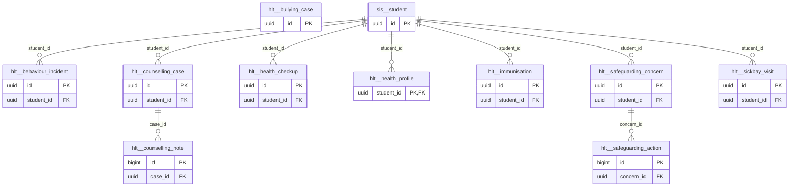

# Schema `hlt`

> HLT: health, sick bay, behaviour, counselling, safeguarding

Generated from the live database by `db/tools/gen_docs.py` — do not edit by hand.

**Tables:** 10

## Entity-relationship diagram

Convention FKs to `core.organisation`, `core.campus`, `sys.stored_file` and `wf.approval_request` are omitted from the diagram (see table details).

## Tables

- [`hlt.behaviour_incident`](#hltbehaviourincident) — Merit, demerit or incident with points and sanction. [HLT-05 merit/demerit, incidents, sanctions]
- [`hlt.bullying_case`](#hltbullyingcase) — Anti-bullying case with investigation and follow-up. [HLT-07]
- [`hlt.counselling_case`](#hltcounsellingcase) — Restricted counselling case. [HLT-04 restricted]
- [`hlt.counselling_note`](#hltcounsellingnote) — Encrypted counselling session note (append-only).
- [`hlt.health_checkup`](#hlthealthcheckup) — Annual health check (height, weight, BMI, vision, dental). [HLT-03]
- [`hlt.health_profile`](#hlthealthprofile) — Student health profile (encrypted details, alert summary, consent). [HLT-01]
- [`hlt.immunisation`](#hltimmunisation) — Immunisation record.
- [`hlt.safeguarding_action`](#hltsafeguardingaction) — Append-only action log on a concern.
- [`hlt.safeguarding_concern`](#hltsafeguardingconcern) — Restricted safeguarding concern with escalation. [HLT-06 restricted, escalation chain]
- [`hlt.sickbay_visit`](#hltsickbayvisit) — Sick-bay visit with outcome and parent notification. [HLT-02]

### `hlt.behaviour_incident`

Merit, demerit or incident with points and sanction. [HLT-05 merit/demerit, incidents, sanctions]

- Row-level security: `p_campus: core.campus_visible(org_id, campus_id)`

| Column | Type | Null | Default | Description |
|---|---|---|---|---|
| `id` | uuid |  | uuidv7() |  |
| `org_id` | uuid |  |  |  |
| `campus_id` | uuid |  |  |  |
| `student_id` | uuid |  |  |  |
| `kind` | text |  |  |  |
| `category_code` | text |  |  |  |
| `points` | smallint |  | 0 | + merit / - demerit (feeds house points) |
| `occurred_at` | timestamp with time zone |  |  |  |
| `description` | text |  |  |  |
| `sanction` | text | yes |  |  |
| `reported_by` | uuid |  |  |  |
| `guardian_notified_at` | timestamp with time zone | yes |  |  |
| `status` | text |  | 'recorded'::text |  |
| `created_at` | timestamp with time zone |  | now() |  |
| `created_by` | uuid | yes | core.current_user_id() |  |
| `updated_at` | timestamp with time zone |  | now() |  |
| `updated_by` | uuid | yes |  |  |
| `row_version` | integer |  | 1 |  |

| Constraint | Kind | Definition |
|---|---|---|
| `behaviour_incident_pkey` | PK | `PRIMARY KEY (id)` |
| `behaviour_incident_campus_id_fkey` | FK | `FOREIGN KEY (campus_id) REFERENCES core.campus(id)` |
| `behaviour_incident_org_id_fkey` | FK | `FOREIGN KEY (org_id) REFERENCES core.organisation(id)` |
| `behaviour_incident_student_id_fkey` | FK | `FOREIGN KEY (student_id) REFERENCES sis.student(id)` |
| `behaviour_incident_kind_check` | CHECK | `CHECK ((kind = ANY (ARRAY['merit'::text, 'demerit'::text, 'incident'::text])))` |
| `behaviour_incident_status_check` | CHECK | `CHECK ((status = ANY (ARRAY['recorded'::text, 'under_review'::text, 'closed'::text])))` |

**Indexes**

- `CREATE INDEX ix_behaviour_incident_campus_id_fk ON hlt.behaviour_incident USING btree (campus_id)`
- `CREATE INDEX ix_behaviour_student ON hlt.behaviour_incident USING btree (student_id, occurred_at DESC)`

**Triggers**

- `trg_audit` — AFTER INSERT UPDATE DELETE → `tg_row_audit()`
- `trg_touch` — BEFORE UPDATE → `tg_touch()`

### `hlt.bullying_case`

Anti-bullying case with investigation and follow-up. [HLT-07]

- Row-level security: `p_campus: core.campus_visible(org_id, campus_id)`

| Column | Type | Null | Default | Description |
|---|---|---|---|---|
| `id` | uuid |  | uuidv7() |  |
| `org_id` | uuid |  |  |  |
| `campus_id` | uuid |  |  |  |
| `reported_at` | timestamp with time zone |  | now() |  |
| `reported_by` | uuid |  |  |  |
| `target_student_ids` | uuid[] |  |  |  |
| `alleged_student_ids` | uuid[] |  | '{}'::uuid[] |  |
| `description` | text |  |  |  |
| `investigation` | jsonb |  | '[]'::jsonb | steps |
| `outcome` | text | yes |  |  |
| `follow_up_on` | date | yes |  |  |
| `status` | text |  | 'open'::text |  |
| `created_at` | timestamp with time zone |  | now() |  |
| `created_by` | uuid | yes | core.current_user_id() |  |
| `updated_at` | timestamp with time zone |  | now() |  |
| `updated_by` | uuid | yes |  |  |
| `row_version` | integer |  | 1 |  |

| Constraint | Kind | Definition |
|---|---|---|
| `bullying_case_pkey` | PK | `PRIMARY KEY (id)` |
| `bullying_case_campus_id_fkey` | FK | `FOREIGN KEY (campus_id) REFERENCES core.campus(id)` |
| `bullying_case_org_id_fkey` | FK | `FOREIGN KEY (org_id) REFERENCES core.organisation(id)` |
| `bullying_case_status_check` | CHECK | `CHECK ((status = ANY (ARRAY['open'::text, 'investigating'::text, 'resolved'::text, 'closed'::text])))` |

**Indexes**

- `CREATE INDEX ix_bullying_case_campus_id_fk ON hlt.bullying_case USING btree (campus_id)`

**Triggers**

- `trg_audit` — AFTER INSERT UPDATE DELETE → `tg_row_audit()`
- `trg_touch` — BEFORE UPDATE → `tg_touch()`

### `hlt.counselling_case`

Restricted counselling case. [HLT-04 restricted]

- Row-level security: `p_campus: core.campus_visible(org_id, campus_id)`

| Column | Type | Null | Default | Description |
|---|---|---|---|---|
| `id` | uuid |  | uuidv7() |  |
| `org_id` | uuid |  |  |  |
| `campus_id` | uuid |  |  |  |
| `student_id` | uuid |  |  |  |
| `counsellor_id` | uuid |  |  |  |
| `referral_source` | text | yes |  |  |
| `risk_level` | text |  | 'low'::text |  |
| `opened_on` | date |  |  |  |
| `closed_on` | date | yes |  |  |
| `status` | text |  | 'open'::text |  |
| `created_at` | timestamp with time zone |  | now() |  |
| `created_by` | uuid | yes | core.current_user_id() |  |
| `updated_at` | timestamp with time zone |  | now() |  |
| `updated_by` | uuid | yes |  |  |
| `row_version` | integer |  | 1 |  |

| Constraint | Kind | Definition |
|---|---|---|
| `counselling_case_pkey` | PK | `PRIMARY KEY (id)` |
| `counselling_case_campus_id_fkey` | FK | `FOREIGN KEY (campus_id) REFERENCES core.campus(id)` |
| `counselling_case_org_id_fkey` | FK | `FOREIGN KEY (org_id) REFERENCES core.organisation(id)` |
| `counselling_case_student_id_fkey` | FK | `FOREIGN KEY (student_id) REFERENCES sis.student(id)` |
| `counselling_case_risk_level_check` | CHECK | `CHECK ((risk_level = ANY (ARRAY['low'::text, 'medium'::text, 'high'::text, 'critical'::text])))` |
| `counselling_case_status_check` | CHECK | `CHECK ((status = ANY (ARRAY['open'::text, 'monitoring'::text, 'closed'::text, 'referred_out'::text])))` |

**Indexes**

- `CREATE INDEX ix_counselling_case_campus_id_fk ON hlt.counselling_case USING btree (campus_id)`
- `CREATE INDEX ix_counselling_case_student_id_fk ON hlt.counselling_case USING btree (student_id)`

**Triggers**

- `trg_audit` — AFTER INSERT UPDATE DELETE → `tg_row_audit()`
- `trg_touch` — BEFORE UPDATE → `tg_touch()`

### `hlt.counselling_note`

Encrypted counselling session note (append-only).

| Column | Type | Null | Default | Description |
|---|---|---|---|---|
| `id` | bigint |  |  |  |
| `case_id` | uuid |  |  |  |
| `author_id` | uuid |  |  |  |
| `session_at` | timestamp with time zone |  |  |  |
| `note_enc` | bytea |  |  |  |
| `created_at` | timestamp with time zone |  | now() |  |

| Constraint | Kind | Definition |
|---|---|---|
| `counselling_note_pkey` | PK | `PRIMARY KEY (id)` |
| `counselling_note_case_id_fkey` | FK | `FOREIGN KEY (case_id) REFERENCES hlt.counselling_case(id)` |

**Indexes**

- `CREATE INDEX ix_counselling_note_case_id_fk ON hlt.counselling_note USING btree (case_id)`

### `hlt.health_checkup`

Annual health check (height, weight, BMI, vision, dental). [HLT-03]

- Row-level security: `p_campus: core.campus_visible(org_id, campus_id)`

| Column | Type | Null | Default | Description |
|---|---|---|---|---|
| `id` | uuid |  | uuidv7() |  |
| `org_id` | uuid |  |  |  |
| `campus_id` | uuid |  |  |  |
| `student_id` | uuid |  |  |  |
| `checked_on` | date |  |  |  |
| `height_cm` | numeric(5,1) | yes |  |  |
| `weight_kg` | numeric(5,1) | yes |  |  |
| `bmi` | numeric(4,1) | yes | *generated* |  |
| `vision_left` | text | yes |  |  |
| `vision_right` | text | yes |  |  |
| `dental_note` | text | yes |  |  |
| `camp_name` | text | yes |  |  |
| `created_at` | timestamp with time zone |  | now() |  |
| `created_by` | uuid | yes | core.current_user_id() |  |
| `updated_at` | timestamp with time zone |  | now() |  |
| `updated_by` | uuid | yes |  |  |
| `row_version` | integer |  | 1 |  |

| Constraint | Kind | Definition |
|---|---|---|
| `health_checkup_pkey` | PK | `PRIMARY KEY (id)` |
| `health_checkup_campus_id_fkey` | FK | `FOREIGN KEY (campus_id) REFERENCES core.campus(id)` |
| `health_checkup_org_id_fkey` | FK | `FOREIGN KEY (org_id) REFERENCES core.organisation(id)` |
| `health_checkup_student_id_fkey` | FK | `FOREIGN KEY (student_id) REFERENCES sis.student(id)` |

**Indexes**

- `CREATE INDEX ix_health_checkup_campus_id_fk ON hlt.health_checkup USING btree (campus_id)`
- `CREATE INDEX ix_health_checkup_student_id_fk ON hlt.health_checkup USING btree (student_id)`

**Triggers**

- `trg_touch` — BEFORE UPDATE → `tg_touch()`

### `hlt.health_profile`

Student health profile (encrypted details, alert summary, consent). [HLT-01]

- Row-level security: `p_campus: core.campus_visible(org_id, campus_id)`

| Column | Type | Null | Default | Description |
|---|---|---|---|---|
| `student_id` | uuid |  |  |  |
| `org_id` | uuid |  |  |  |
| `campus_id` | uuid |  |  |  |
| `allergies_enc` | bytea | yes |  |  |
| `conditions_enc` | bytea | yes |  |  |
| `medications_enc` | bytea | yes |  |  |
| `alert_summary` | text | yes |  | need-to-know line shown to class teacher, e.g. 'Severe nut allergy - EpiPen in sick bay' |
| `has_alert` | boolean |  | false |  |
| `treatment_consent` | boolean |  | false |  |
| `doctor_name` | text | yes |  |  |
| `doctor_phone` | core.phone_e164 | yes |  |  |
| `created_at` | timestamp with time zone |  | now() |  |
| `created_by` | uuid | yes | core.current_user_id() |  |
| `updated_at` | timestamp with time zone |  | now() |  |
| `updated_by` | uuid | yes |  |  |
| `row_version` | integer |  | 1 |  |

| Constraint | Kind | Definition |
|---|---|---|
| `health_profile_pkey` | PK | `PRIMARY KEY (student_id)` |
| `health_profile_campus_id_fkey` | FK | `FOREIGN KEY (campus_id) REFERENCES core.campus(id)` |
| `health_profile_org_id_fkey` | FK | `FOREIGN KEY (org_id) REFERENCES core.organisation(id)` |
| `health_profile_student_id_fkey` | FK | `FOREIGN KEY (student_id) REFERENCES sis.student(id)` |

**Indexes**

- `CREATE INDEX ix_health_profile_campus_id_fk ON hlt.health_profile USING btree (campus_id)`

**Triggers**

- `trg_audit` — AFTER INSERT UPDATE DELETE → `tg_row_audit()`
- `trg_touch` — BEFORE UPDATE → `tg_touch()`

### `hlt.immunisation`

Immunisation record.

| Column | Type | Null | Default | Description |
|---|---|---|---|---|
| `id` | uuid |  | uuidv7() |  |
| `student_id` | uuid |  |  |  |
| `vaccine` | text |  |  |  |
| `dose_no` | smallint | yes |  |  |
| `given_on` | date | yes |  |  |
| `evidence_file_id` | uuid | yes |  |  |

| Constraint | Kind | Definition |
|---|---|---|
| `immunisation_pkey` | PK | `PRIMARY KEY (id)` |
| `immunisation_evidence_file_id_fkey` | FK | `FOREIGN KEY (evidence_file_id) REFERENCES sys.stored_file(id)` |
| `immunisation_student_id_fkey` | FK | `FOREIGN KEY (student_id) REFERENCES sis.student(id)` |

**Indexes**

- `CREATE INDEX ix_immunisation_student_id_fk ON hlt.immunisation USING btree (student_id)`

### `hlt.safeguarding_action`

Append-only action log on a concern.

| Column | Type | Null | Default | Description |
|---|---|---|---|---|
| `id` | bigint |  |  |  |
| `concern_id` | uuid |  |  |  |
| `actor_id` | uuid |  |  |  |
| `action` | text |  |  |  |
| `note_enc` | bytea | yes |  |  |
| `at` | timestamp with time zone |  | now() |  |

| Constraint | Kind | Definition |
|---|---|---|
| `safeguarding_action_pkey` | PK | `PRIMARY KEY (id)` |
| `safeguarding_action_concern_id_fkey` | FK | `FOREIGN KEY (concern_id) REFERENCES hlt.safeguarding_concern(id)` |

**Indexes**

- `CREATE INDEX ix_safeguarding_action_concern_id_fk ON hlt.safeguarding_action USING btree (concern_id)`

### `hlt.safeguarding_concern`

Restricted safeguarding concern with escalation. [HLT-06 restricted, escalation chain]

- Row-level security: `p_campus: core.campus_visible(org_id, campus_id)`

| Column | Type | Null | Default | Description |
|---|---|---|---|---|
| `id` | uuid |  | uuidv7() |  |
| `org_id` | uuid |  |  |  |
| `campus_id` | uuid |  |  |  |
| `student_id` | uuid |  |  |  |
| `raised_by` | uuid |  |  |  |
| `raised_at` | timestamp with time zone |  | now() |  |
| `category` | text |  |  |  |
| `details_enc` | bytea |  |  |  |
| `severity` | text |  |  |  |
| `dsl_user_id` | uuid | yes |  | designated safeguarding lead |
| `status` | text |  | 'raised'::text |  |
| `escalation_level` | smallint |  | 0 |  |
| `created_at` | timestamp with time zone |  | now() |  |
| `created_by` | uuid | yes | core.current_user_id() |  |
| `updated_at` | timestamp with time zone |  | now() |  |
| `updated_by` | uuid | yes |  |  |
| `row_version` | integer |  | 1 |  |

| Constraint | Kind | Definition |
|---|---|---|
| `safeguarding_concern_pkey` | PK | `PRIMARY KEY (id)` |
| `safeguarding_concern_campus_id_fkey` | FK | `FOREIGN KEY (campus_id) REFERENCES core.campus(id)` |
| `safeguarding_concern_org_id_fkey` | FK | `FOREIGN KEY (org_id) REFERENCES core.organisation(id)` |
| `safeguarding_concern_student_id_fkey` | FK | `FOREIGN KEY (student_id) REFERENCES sis.student(id)` |
| `safeguarding_concern_severity_check` | CHECK | `CHECK ((severity = ANY (ARRAY['low'::text, 'medium'::text, 'high'::text, 'immediate'::text])))` |
| `safeguarding_concern_status_check` | CHECK | `CHECK ((status = ANY (ARRAY['raised'::text, 'triaged'::text, 'escalated'::text, 'external_referral'::text, 'closed'::text])))` |

**Indexes**

- `CREATE INDEX ix_safeguarding_concern_campus_id_fk ON hlt.safeguarding_concern USING btree (campus_id)`
- `CREATE INDEX ix_safeguarding_concern_student_id_fk ON hlt.safeguarding_concern USING btree (student_id)`

**Triggers**

- `trg_audit` — AFTER INSERT UPDATE DELETE → `tg_row_audit()`
- `trg_touch` — BEFORE UPDATE → `tg_touch()`

### `hlt.sickbay_visit`

Sick-bay visit with outcome and parent notification. [HLT-02]

- Row-level security: `p_campus: core.campus_visible(org_id, campus_id)`

| Column | Type | Null | Default | Description |
|---|---|---|---|---|
| `id` | uuid |  | uuidv7() |  |
| `org_id` | uuid |  |  |  |
| `campus_id` | uuid |  |  |  |
| `student_id` | uuid |  |  |  |
| `visited_at` | timestamp with time zone |  | now() |  |
| `symptoms` | text |  |  |  |
| `treatment` | text | yes |  |  |
| `temperature_c` | numeric(4,1) | yes |  |  |
| `outcome` | text |  |  |  |
| `guardian_notified_at` | timestamp with time zone | yes |  |  |
| `attended_by` | uuid |  |  |  |
| `created_at` | timestamp with time zone |  | now() |  |
| `created_by` | uuid | yes | core.current_user_id() |  |
| `updated_at` | timestamp with time zone |  | now() |  |
| `updated_by` | uuid | yes |  |  |
| `row_version` | integer |  | 1 |  |

| Constraint | Kind | Definition |
|---|---|---|
| `sickbay_visit_pkey` | PK | `PRIMARY KEY (id)` |
| `sickbay_visit_campus_id_fkey` | FK | `FOREIGN KEY (campus_id) REFERENCES core.campus(id)` |
| `sickbay_visit_org_id_fkey` | FK | `FOREIGN KEY (org_id) REFERENCES core.organisation(id)` |
| `sickbay_visit_student_id_fkey` | FK | `FOREIGN KEY (student_id) REFERENCES sis.student(id)` |
| `sickbay_visit_outcome_check` | CHECK | `CHECK ((outcome = ANY (ARRAY['returned_to_class'::text, 'rested'::text, 'sent_home'::text, 'referred_hospital'::text])))` |

**Indexes**

- `CREATE INDEX ix_sickbay_student ON hlt.sickbay_visit USING btree (student_id, visited_at DESC)`
- `CREATE INDEX ix_sickbay_visit_campus_id_fk ON hlt.sickbay_visit USING btree (campus_id)`

**Triggers**

- `trg_touch` — BEFORE UPDATE → `tg_touch()`

