# Schema `hrm`

> HRM: staff, contracts, payroll, recruitment, appraisal

Generated from the live database by `db/tools/gen_docs.py` — do not edit by hand.

**Tables:** 23

## Entity-relationship diagram

Convention FKs to `core.organisation`, `core.campus`, `sys.stored_file` and `wf.approval_request` are omitted from the diagram (see table details).

```mermaid
erDiagram
  hrm__appraisal {
    uuid id PK
    uuid cycle_id FK
    uuid staff_id FK
    uuid reviewer_id FK
  }
  hrm__appraisal_cycle {
    uuid id PK
  }
  hrm__contract {
    uuid id PK
    uuid staff_id FK
  }
  hrm__contract_component {
    uuid contract_id PK, FK
    uuid component_id PK, FK
  }
  hrm__cpd_course {
    uuid id PK
  }
  hrm__cpd_record {
    uuid id PK
    uuid staff_id FK
    uuid cpd_course_id FK
  }
  hrm__department {
    uuid id PK
  }
  hrm__designation {
    uuid id PK
  }
  hrm__interview {
    uuid id PK
    uuid job_application_id FK
  }
  hrm__job_application {
    uuid id PK
    uuid vacancy_id FK
    uuid hired_staff_id FK
  }
  hrm__lesson_observation {
    uuid id PK
    uuid staff_id FK
    uuid observer_id FK
    uuid teaching_group_id FK
  }
  hrm__lifecycle_task {
    uuid id PK
    uuid staff_id FK
  }
  hrm__payroll_run {
    uuid id PK
  }
  hrm__payslip {
    uuid id PK
    uuid payroll_run_id FK
    uuid staff_id FK
  }
  hrm__payslip_line {
    uuid payslip_id PK, FK
    uuid component_id PK, FK
  }
  hrm__qualification {
    uuid id PK
    uuid staff_id FK
  }
  hrm__salary_component {
    uuid id PK
  }
  hrm__separation {
    uuid id PK
    uuid staff_id FK
  }
  hrm__staff {
    uuid id PK
    uuid user_id FK
    uuid department_id FK
    uuid designation_id FK
    uuid reporting_to_id FK
  }
  hrm__staff_campus {
    uuid staff_id PK, FK
    uuid campus_id PK
  }
  hrm__staff_document {
    uuid id PK
    uuid staff_id FK
  }
  hrm__staff_loan {
    uuid id PK
    uuid staff_id FK
  }
  hrm__vacancy {
    uuid id PK
    uuid department_id FK
    uuid designation_id FK
  }
  aca__teaching_group {
    uuid id PK
  }
  iam__user_account {
    uuid id PK
  }
  aca__teaching_group ||--o{ hrm__lesson_observation : "teaching_group_id"
  hrm__appraisal_cycle ||--o{ hrm__appraisal : "cycle_id"
  hrm__contract ||--o{ hrm__contract_component : "contract_id"
  hrm__cpd_course ||--o{ hrm__cpd_record : "cpd_course_id"
  hrm__department ||--o{ hrm__staff : "department_id"
  hrm__department ||--o{ hrm__vacancy : "department_id"
  hrm__designation ||--o{ hrm__staff : "designation_id"
  hrm__designation ||--o{ hrm__vacancy : "designation_id"
  hrm__job_application ||--o{ hrm__interview : "job_application_id"
  hrm__payroll_run ||--o{ hrm__payslip : "payroll_run_id"
  hrm__payslip ||--o{ hrm__payslip_line : "payslip_id"
  hrm__salary_component ||--o{ hrm__contract_component : "component_id"
  hrm__salary_component ||--o{ hrm__payslip_line : "component_id"
  hrm__staff ||--o{ hrm__appraisal : "reviewer_id"
  hrm__staff ||--o{ hrm__appraisal : "staff_id"
  hrm__staff ||--o{ hrm__contract : "staff_id"
  hrm__staff ||--o{ hrm__cpd_record : "staff_id"
  hrm__staff ||--o{ hrm__job_application : "hired_staff_id"
  hrm__staff ||--o{ hrm__lesson_observation : "observer_id"
  hrm__staff ||--o{ hrm__lesson_observation : "staff_id"
  hrm__staff ||--o{ hrm__lifecycle_task : "staff_id"
  hrm__staff ||--o{ hrm__payslip : "staff_id"
  hrm__staff ||--o{ hrm__qualification : "staff_id"
  hrm__staff ||--o{ hrm__separation : "staff_id"
  hrm__staff ||--o{ hrm__staff : "reporting_to_id"
  hrm__staff ||--o{ hrm__staff_campus : "staff_id"
  hrm__staff ||--o{ hrm__staff_document : "staff_id"
  hrm__staff ||--o{ hrm__staff_loan : "staff_id"
  hrm__vacancy ||--o{ hrm__job_application : "vacancy_id"
  iam__user_account ||--o{ hrm__staff : "user_id"
```

## Tables

- [`hrm.appraisal`](#hrmappraisal) — Appraisal of a staff member in a cycle.
- [`hrm.appraisal_cycle`](#hrmappraisalcycle) — Appraisal cycle and form definition. [HRM-05]
- [`hrm.contract`](#hrmcontract) — Employment contract with basic pay; no overlapping contracts.
- [`hrm.contract_component`](#hrmcontractcomponent) — Salary components of a contract (amount or percent).
- [`hrm.cpd_course`](#hrmcpdcourse) — Training/CPD course catalogue. [HRM-06 (P3)]
- [`hrm.cpd_record`](#hrmcpdrecord) — CPD hours completed by a staff member.
- [`hrm.department`](#hrmdepartment) — Department (academic or administrative).
- [`hrm.designation`](#hrmdesignation) — Job title/grade.
- [`hrm.interview`](#hrminterview) — Interview with panel scores and recommendation.
- [`hrm.job_application`](#hrmjobapplication) — Candidate application through the recruitment pipeline.
- [`hrm.lesson_observation`](#hrmlessonobservation) — Lesson observation record.
- [`hrm.lifecycle_task`](#hrmlifecycletask) — Onboarding/exit checklist task. [HRM-03 onboarding & exit checklists]
- [`hrm.payroll_run`](#hrmpayrollrun) — Monthly payroll per campus with approval and lock. [HRM-04 locked monthly payroll with approval]
- [`hrm.payslip`](#hrmpayslip) — Payslip per staff in a payroll run.
- [`hrm.payslip_line`](#hrmpayslipline) — Component line of a payslip.
- [`hrm.qualification`](#hrmqualification) — Degrees, teaching credentials, certifications and experience.
- [`hrm.salary_component`](#hrmsalarycomponent) — Earning/deduction component with calculation rule.
- [`hrm.separation`](#hrmseparation) — Resignation/termination with clearance and experience certificate. [resignation / termination with clearance]
- [`hrm.staff`](#hrmstaff) — Staff master record (teaching and non-teaching).
- [`hrm.staff_campus`](#hrmstaffcampus) — Additional campuses a staff member works at. [teachers working on several campuses]
- [`hrm.staff_document`](#hrmstaffdocument) — Staff document with expiry alerts. [certificates, contracts with expiry alerts]
- [`hrm.staff_loan`](#hrmstaffloan) — Staff loan/advance recovered through payroll.
- [`hrm.vacancy`](#hrmvacancy) — Job vacancy (published to the website careers page). [HRM-02, synced to website careers page (WEB-04)]

### `hrm.appraisal`

Appraisal of a staff member in a cycle.

- Row-level security: `p_campus: core.campus_visible(org_id, campus_id)`

| Column | Type | Null | Default | Description |
|---|---|---|---|---|
| `id` | uuid |  | uuidv7() |  |
| `org_id` | uuid |  |  |  |
| `campus_id` | uuid |  |  |  |
| `cycle_id` | uuid |  |  |  |
| `staff_id` | uuid |  |  |  |
| `reviewer_id` | uuid | yes |  |  |
| `self_review` | jsonb | yes |  |  |
| `reviewer_review` | jsonb | yes |  |  |
| `student_feedback` | jsonb | yes |  |  |
| `overall_rating` | numeric(3,1) | yes |  |  |
| `goals` | jsonb |  | '[]'::jsonb |  |
| `status` | text |  | 'pending'::text |  |
| `created_at` | timestamp with time zone |  | now() |  |
| `created_by` | uuid | yes | core.current_user_id() |  |
| `updated_at` | timestamp with time zone |  | now() |  |
| `updated_by` | uuid | yes |  |  |
| `row_version` | integer |  | 1 |  |

| Constraint | Kind | Definition |
|---|---|---|
| `appraisal_pkey` | PK | `PRIMARY KEY (id)` |
| `appraisal_cycle_id_staff_id_key` | UNIQUE | `UNIQUE (cycle_id, staff_id)` |
| `appraisal_campus_id_fkey` | FK | `FOREIGN KEY (campus_id) REFERENCES core.campus(id)` |
| `appraisal_cycle_id_fkey` | FK | `FOREIGN KEY (cycle_id) REFERENCES hrm.appraisal_cycle(id)` |
| `appraisal_org_id_fkey` | FK | `FOREIGN KEY (org_id) REFERENCES core.organisation(id)` |
| `appraisal_reviewer_id_fkey` | FK | `FOREIGN KEY (reviewer_id) REFERENCES hrm.staff(id)` |
| `appraisal_staff_id_fkey` | FK | `FOREIGN KEY (staff_id) REFERENCES hrm.staff(id)` |
| `appraisal_status_check` | CHECK | `CHECK ((status = ANY (ARRAY['pending'::text, 'self_done'::text, 'reviewed'::text, 'acknowledged'::text])))` |

**Indexes**

- `CREATE INDEX ix_appraisal_campus_id_fk ON hrm.appraisal USING btree (campus_id)`
- `CREATE INDEX ix_appraisal_reviewer_id_fk ON hrm.appraisal USING btree (reviewer_id)`
- `CREATE INDEX ix_appraisal_staff_id_fk ON hrm.appraisal USING btree (staff_id)`

**Triggers**

- `trg_touch` — BEFORE UPDATE → `tg_touch()`

### `hrm.appraisal_cycle`

Appraisal cycle and form definition. [HRM-05]

- Row-level security: `p_org: core.org_visible(org_id)`

| Column | Type | Null | Default | Description |
|---|---|---|---|---|
| `id` | uuid |  | uuidv7() |  |
| `org_id` | uuid |  |  |  |
| `name` | text |  |  |  |
| `starts_on` | date |  |  |  |
| `ends_on` | date |  |  |  |
| `form` | jsonb |  |  | sections, criteria, weights |
| `status` | text |  | 'draft'::text |  |

| Constraint | Kind | Definition |
|---|---|---|
| `appraisal_cycle_pkey` | PK | `PRIMARY KEY (id)` |
| `appraisal_cycle_org_id_fkey` | FK | `FOREIGN KEY (org_id) REFERENCES core.organisation(id)` |
| `appraisal_cycle_status_check` | CHECK | `CHECK ((status = ANY (ARRAY['draft'::text, 'open'::text, 'closed'::text])))` |

### `hrm.contract`

Employment contract with basic pay; no overlapping contracts.

- Row-level security: `p_org: core.org_visible(org_id)`

| Column | Type | Null | Default | Description |
|---|---|---|---|---|
| `id` | uuid |  | uuidv7() |  |
| `org_id` | uuid |  |  |  |
| `staff_id` | uuid |  |  |  |
| `contract_type` | text |  |  |  |
| `starts_on` | date |  |  |  |
| `ends_on` | date | yes |  |  |
| `probation_ends_on` | date | yes |  |  |
| `basic_paisa` | core.paisa_nn |  |  |  |
| `file_id` | uuid | yes |  |  |
| `created_at` | timestamp with time zone |  | now() |  |
| `created_by` | uuid | yes | core.current_user_id() |  |
| `updated_at` | timestamp with time zone |  | now() |  |
| `updated_by` | uuid | yes |  |  |
| `row_version` | integer |  | 1 |  |

| Constraint | Kind | Definition |
|---|---|---|
| `contract_pkey` | PK | `PRIMARY KEY (id)` |
| `contract_org_id_fkey` | FK | `FOREIGN KEY (org_id) REFERENCES core.organisation(id)` |
| `contract_staff_id_fkey` | FK | `FOREIGN KEY (staff_id) REFERENCES hrm.staff(id)` |
| `contract_staff_id_daterange_excl` | EXCLUDE | `EXCLUDE USING gist (staff_id WITH =, daterange(starts_on, COALESCE(ends_on, 'infinity'::date), '[]'::text) WITH &&)` |
| `contract_contract_type_check` | CHECK | `CHECK ((contract_type = ANY (ARRAY['permanent'::text, 'fixed_term'::text, 'part_time'::text, 'hourly'::text, 'probation'::text])))` |

**Triggers**

- `trg_audit` — AFTER INSERT UPDATE DELETE → `tg_row_audit()`
- `trg_touch` — BEFORE UPDATE → `tg_touch()`

### `hrm.contract_component`

Salary components of a contract (amount or percent).

| Column | Type | Null | Default | Description |
|---|---|---|---|---|
| `contract_id` | uuid |  |  |  |
| `component_id` | uuid |  |  |  |
| `amount_paisa` | core.paisa_nn | yes |  |  |
| `percent` | numeric(6,3) | yes |  |  |

| Constraint | Kind | Definition |
|---|---|---|
| `contract_component_pkey` | PK | `PRIMARY KEY (contract_id, component_id)` |
| `contract_component_component_id_fkey` | FK | `FOREIGN KEY (component_id) REFERENCES hrm.salary_component(id)` |
| `contract_component_contract_id_fkey` | FK | `FOREIGN KEY (contract_id) REFERENCES hrm.contract(id) ON DELETE CASCADE` |
| `contract_component_check` | CHECK | `CHECK (((amount_paisa IS NULL) <> (percent IS NULL)))` |

**Indexes**

- `CREATE INDEX ix_contract_component_component_id_fk ON hrm.contract_component USING btree (component_id)`

**Triggers**

- `trg_audit` — AFTER INSERT UPDATE DELETE → `tg_row_audit()`

### `hrm.cpd_course`

Training/CPD course catalogue. [HRM-06 (P3)]

- Row-level security: `p_org: core.org_visible(org_id)`

| Column | Type | Null | Default | Description |
|---|---|---|---|---|
| `id` | uuid |  | uuidv7() |  |
| `org_id` | uuid |  |  |  |
| `title` | text |  |  |  |
| `provider` | text | yes |  |  |
| `hours` | numeric(5,1) |  |  |  |
| `is_active` | boolean |  | true |  |

| Constraint | Kind | Definition |
|---|---|---|
| `cpd_course_pkey` | PK | `PRIMARY KEY (id)` |
| `cpd_course_org_id_fkey` | FK | `FOREIGN KEY (org_id) REFERENCES core.organisation(id)` |

### `hrm.cpd_record`

CPD hours completed by a staff member.

| Column | Type | Null | Default | Description |
|---|---|---|---|---|
| `id` | uuid |  | uuidv7() |  |
| `staff_id` | uuid |  |  |  |
| `cpd_course_id` | uuid | yes |  |  |
| `title` | text |  |  |  |
| `completed_on` | date |  |  |  |
| `hours` | numeric(5,1) |  |  |  |
| `certificate_file_id` | uuid | yes |  |  |

| Constraint | Kind | Definition |
|---|---|---|
| `cpd_record_pkey` | PK | `PRIMARY KEY (id)` |
| `cpd_record_certificate_file_id_fkey` | FK | `FOREIGN KEY (certificate_file_id) REFERENCES sys.stored_file(id)` |
| `cpd_record_cpd_course_id_fkey` | FK | `FOREIGN KEY (cpd_course_id) REFERENCES hrm.cpd_course(id)` |
| `cpd_record_staff_id_fkey` | FK | `FOREIGN KEY (staff_id) REFERENCES hrm.staff(id)` |
| `cpd_record_hours_check` | CHECK | `CHECK ((hours > (0)::numeric))` |

**Indexes**

- `CREATE INDEX ix_cpd_record_cpd_course_id_fk ON hrm.cpd_record USING btree (cpd_course_id)`
- `CREATE INDEX ix_cpd_record_staff_id_fk ON hrm.cpd_record USING btree (staff_id)`

### `hrm.department`

Department (academic or administrative).

- Row-level security: `p_org: core.org_visible(org_id)`

| Column | Type | Null | Default | Description |
|---|---|---|---|---|
| `id` | uuid |  | uuidv7() |  |
| `org_id` | uuid |  |  |  |
| `code` | text |  |  |  |
| `name_en` | text |  |  |  |
| `head_staff_id` | uuid | yes |  |  |

| Constraint | Kind | Definition |
|---|---|---|
| `department_pkey` | PK | `PRIMARY KEY (id)` |
| `department_org_id_code_key` | UNIQUE | `UNIQUE (org_id, code)` |
| `department_org_id_fkey` | FK | `FOREIGN KEY (org_id) REFERENCES core.organisation(id)` |

### `hrm.designation`

Job title/grade.

- Row-level security: `p_org: core.org_visible(org_id)`

| Column | Type | Null | Default | Description |
|---|---|---|---|---|
| `id` | uuid |  | uuidv7() |  |
| `org_id` | uuid |  |  |  |
| `code` | text |  |  |  |
| `name_en` | text |  |  |  |
| `name_bn` | text | yes |  |  |
| `grade` | text | yes |  |  |

| Constraint | Kind | Definition |
|---|---|---|
| `designation_pkey` | PK | `PRIMARY KEY (id)` |
| `designation_org_id_code_key` | UNIQUE | `UNIQUE (org_id, code)` |
| `designation_org_id_fkey` | FK | `FOREIGN KEY (org_id) REFERENCES core.organisation(id)` |

### `hrm.interview`

Interview with panel scores and recommendation.

| Column | Type | Null | Default | Description |
|---|---|---|---|---|
| `id` | uuid |  | uuidv7() |  |
| `job_application_id` | uuid |  |  |  |
| `scheduled_at` | timestamp with time zone |  |  |  |
| `panel_staff_ids` | uuid[] |  | '{}'::uuid[] |  |
| `scores` | jsonb |  | '{}'::jsonb | {criterion: score} per panelist |
| `recommendation` | text | yes |  |  |
| `notes` | text | yes |  |  |

| Constraint | Kind | Definition |
|---|---|---|
| `interview_pkey` | PK | `PRIMARY KEY (id)` |
| `interview_job_application_id_fkey` | FK | `FOREIGN KEY (job_application_id) REFERENCES hrm.job_application(id) ON DELETE CASCADE` |
| `interview_recommendation_check` | CHECK | `CHECK ((recommendation = ANY (ARRAY['hire'::text, 'hold'::text, 'reject'::text])))` |

**Indexes**

- `CREATE INDEX ix_interview_job_application_id_fk ON hrm.interview USING btree (job_application_id)`

### `hrm.job_application`

Candidate application through the recruitment pipeline.

- Row-level security: `p_campus: core.campus_visible(org_id, campus_id)`

| Column | Type | Null | Default | Description |
|---|---|---|---|---|
| `id` | uuid |  | uuidv7() |  |
| `org_id` | uuid |  |  |  |
| `campus_id` | uuid |  |  |  |
| `vacancy_id` | uuid |  |  |  |
| `full_name` | text |  |  |  |
| `email` | citext |  |  |  |
| `phone` | core.phone_e164 |  |  |  |
| `cv_file_id` | uuid | yes |  |  |
| `answers` | jsonb |  | '{}'::jsonb |  |
| `stage` | text |  | 'applied'::text |  |
| `score` | numeric(5,2) | yes |  |  |
| `offer_document_id` | uuid | yes |  |  |
| `hired_staff_id` | uuid | yes |  |  |
| `created_at` | timestamp with time zone |  | now() |  |
| `created_by` | uuid | yes | core.current_user_id() |  |
| `updated_at` | timestamp with time zone |  | now() |  |
| `updated_by` | uuid | yes |  |  |
| `row_version` | integer |  | 1 |  |

| Constraint | Kind | Definition |
|---|---|---|
| `job_application_pkey` | PK | `PRIMARY KEY (id)` |
| `job_application_campus_id_fkey` | FK | `FOREIGN KEY (campus_id) REFERENCES core.campus(id)` |
| `job_application_cv_file_id_fkey` | FK | `FOREIGN KEY (cv_file_id) REFERENCES sys.stored_file(id)` |
| `job_application_hired_staff_id_fkey` | FK | `FOREIGN KEY (hired_staff_id) REFERENCES hrm.staff(id)` |
| `job_application_org_id_fkey` | FK | `FOREIGN KEY (org_id) REFERENCES core.organisation(id)` |
| `job_application_vacancy_id_fkey` | FK | `FOREIGN KEY (vacancy_id) REFERENCES hrm.vacancy(id)` |
| `job_application_stage_check` | CHECK | `CHECK ((stage = ANY (ARRAY['applied'::text, 'shortlisted'::text, 'interview'::text, 'demo_class'::text, 'offered'::text, 'hired'::text, 'rejected'::text, 'withdrawn'::text])))` |

**Indexes**

- `CREATE INDEX ix_job_application_campus_id_fk ON hrm.job_application USING btree (campus_id)`
- `CREATE INDEX ix_job_application_hired_staff_id_fk ON hrm.job_application USING btree (hired_staff_id)`
- `CREATE INDEX ix_job_application_vacancy ON hrm.job_application USING btree (vacancy_id, stage)`

**Triggers**

- `trg_touch` — BEFORE UPDATE → `tg_touch()`

### `hrm.lesson_observation`

Lesson observation record.

- Row-level security: `p_campus: core.campus_visible(org_id, campus_id)`

| Column | Type | Null | Default | Description |
|---|---|---|---|---|
| `id` | uuid |  | uuidv7() |  |
| `org_id` | uuid |  |  |  |
| `campus_id` | uuid |  |  |  |
| `staff_id` | uuid |  |  |  |
| `observer_id` | uuid |  |  |  |
| `teaching_group_id` | uuid | yes |  |  |
| `observed_on` | date |  |  |  |
| `ratings` | jsonb |  |  |  |
| `strengths` | text | yes |  |  |
| `improvements` | text | yes |  |  |
| `created_at` | timestamp with time zone |  | now() |  |
| `created_by` | uuid | yes | core.current_user_id() |  |
| `updated_at` | timestamp with time zone |  | now() |  |
| `updated_by` | uuid | yes |  |  |
| `row_version` | integer |  | 1 |  |

| Constraint | Kind | Definition |
|---|---|---|
| `lesson_observation_pkey` | PK | `PRIMARY KEY (id)` |
| `lesson_observation_campus_id_fkey` | FK | `FOREIGN KEY (campus_id) REFERENCES core.campus(id)` |
| `lesson_observation_observer_id_fkey` | FK | `FOREIGN KEY (observer_id) REFERENCES hrm.staff(id)` |
| `lesson_observation_org_id_fkey` | FK | `FOREIGN KEY (org_id) REFERENCES core.organisation(id)` |
| `lesson_observation_staff_id_fkey` | FK | `FOREIGN KEY (staff_id) REFERENCES hrm.staff(id)` |
| `lesson_observation_teaching_group_id_fkey` | FK | `FOREIGN KEY (teaching_group_id) REFERENCES aca.teaching_group(id)` |

**Indexes**

- `CREATE INDEX ix_lesson_observation_campus_id_fk ON hrm.lesson_observation USING btree (campus_id)`
- `CREATE INDEX ix_lesson_observation_observer_id_fk ON hrm.lesson_observation USING btree (observer_id)`
- `CREATE INDEX ix_lesson_observation_staff_id_fk ON hrm.lesson_observation USING btree (staff_id)`
- `CREATE INDEX ix_lesson_observation_teaching_group_id_fk ON hrm.lesson_observation USING btree (teaching_group_id)`

**Triggers**

- `trg_touch` — BEFORE UPDATE → `tg_touch()`

### `hrm.lifecycle_task`

Onboarding/exit checklist task. [HRM-03 onboarding & exit checklists]

- Row-level security: `p_org: core.org_visible(org_id)`

| Column | Type | Null | Default | Description |
|---|---|---|---|---|
| `id` | uuid |  | uuidv7() |  |
| `org_id` | uuid |  |  |  |
| `staff_id` | uuid |  |  |  |
| `kind` | text |  |  |  |
| `task_code` | text |  |  | IT_ACCOUNT, ID_CARD, UNIFORM, ORIENTATION, CLEARANCE_LIB, ... |
| `assignee_id` | uuid | yes |  |  |
| `due_on` | date | yes |  |  |
| `done_at` | timestamp with time zone | yes |  |  |
| `done_by` | uuid | yes |  |  |
| `note` | text | yes |  |  |

| Constraint | Kind | Definition |
|---|---|---|
| `lifecycle_task_pkey` | PK | `PRIMARY KEY (id)` |
| `lifecycle_task_staff_id_kind_task_code_key` | UNIQUE | `UNIQUE (staff_id, kind, task_code)` |
| `lifecycle_task_org_id_fkey` | FK | `FOREIGN KEY (org_id) REFERENCES core.organisation(id)` |
| `lifecycle_task_staff_id_fkey` | FK | `FOREIGN KEY (staff_id) REFERENCES hrm.staff(id)` |
| `lifecycle_task_kind_check` | CHECK | `CHECK ((kind = ANY (ARRAY['onboarding'::text, 'exit'::text])))` |

### `hrm.payroll_run`

Monthly payroll per campus with approval and lock. [HRM-04 locked monthly payroll with approval]

- Row-level security: `p_campus: core.campus_visible(org_id, campus_id)`

| Column | Type | Null | Default | Description |
|---|---|---|---|---|
| `id` | uuid |  | uuidv7() |  |
| `org_id` | uuid |  |  |  |
| `campus_id` | uuid |  |  |  |
| `period_month` | date |  |  |  |
| `status` | text |  | 'draft'::text |  |
| `gross_paisa` | core.paisa | yes |  |  |
| `deductions_paisa` | core.paisa | yes |  |  |
| `net_paisa` | core.paisa | yes |  |  |
| `approval_request_id` | uuid | yes |  |  |
| `bank_advice_file_id` | uuid | yes |  |  |
| `locked_at` | timestamp with time zone | yes |  |  |
| `created_at` | timestamp with time zone |  | now() |  |
| `created_by` | uuid | yes | core.current_user_id() |  |
| `updated_at` | timestamp with time zone |  | now() |  |
| `updated_by` | uuid | yes |  |  |
| `row_version` | integer |  | 1 |  |

| Constraint | Kind | Definition |
|---|---|---|
| `payroll_run_pkey` | PK | `PRIMARY KEY (id)` |
| `payroll_run_approval_request_id_fkey` | FK | `FOREIGN KEY (approval_request_id) REFERENCES wf.approval_request(id)` |
| `payroll_run_bank_advice_file_id_fkey` | FK | `FOREIGN KEY (bank_advice_file_id) REFERENCES sys.stored_file(id)` |
| `payroll_run_campus_id_fkey` | FK | `FOREIGN KEY (campus_id) REFERENCES core.campus(id)` |
| `payroll_run_org_id_fkey` | FK | `FOREIGN KEY (org_id) REFERENCES core.organisation(id)` |
| `payroll_run_period_month_check` | CHECK | `CHECK ((EXTRACT(day FROM period_month) = (1)::numeric))` |
| `payroll_run_status_check` | CHECK | `CHECK ((status = ANY (ARRAY['draft'::text, 'computed'::text, 'submitted'::text, 'approved'::text, 'locked'::text, 'paid'::text, 'cancelled'::text])))` |

**Indexes**

- `CREATE UNIQUE INDEX ux_payroll_period ON hrm.payroll_run USING btree (campus_id, period_month) WHERE (status <> 'cancelled'::text)`

**Triggers**

- `trg_audit` — AFTER INSERT UPDATE DELETE → `tg_row_audit()`
- `trg_touch` — BEFORE UPDATE → `tg_touch()`

### `hrm.payslip`

Payslip per staff in a payroll run.

| Column | Type | Null | Default | Description |
|---|---|---|---|---|
| `id` | uuid |  | uuidv7() |  |
| `payroll_run_id` | uuid |  |  |  |
| `staff_id` | uuid |  |  |  |
| `working_days` | numeric(4,1) |  |  |  |
| `paid_days` | numeric(4,1) |  |  |  |
| `lwp_days` | numeric(4,1) |  | 0 |  |
| `cover_periods` | smallint |  | 0 | from aca.substitution |
| `overtime_minutes` | integer |  | 0 |  |
| `gross_paisa` | core.paisa |  |  |  |
| `deductions_paisa` | core.paisa |  |  |  |
| `tax_paisa` | core.paisa |  | 0 |  |
| `net_paisa` | core.paisa |  |  |  |
| `file_id` | uuid | yes |  |  |

| Constraint | Kind | Definition |
|---|---|---|
| `payslip_pkey` | PK | `PRIMARY KEY (id)` |
| `payslip_payroll_run_id_staff_id_key` | UNIQUE | `UNIQUE (payroll_run_id, staff_id)` |
| `payslip_payroll_run_id_fkey` | FK | `FOREIGN KEY (payroll_run_id) REFERENCES hrm.payroll_run(id)` |
| `payslip_staff_id_fkey` | FK | `FOREIGN KEY (staff_id) REFERENCES hrm.staff(id)` |

**Indexes**

- `CREATE INDEX ix_payslip_staff_id_fk ON hrm.payslip USING btree (staff_id)`

**Triggers**

- `trg_audit` — AFTER INSERT UPDATE DELETE → `tg_row_audit()`

### `hrm.payslip_line`

Component line of a payslip.

| Column | Type | Null | Default | Description |
|---|---|---|---|---|
| `payslip_id` | uuid |  |  |  |
| `component_id` | uuid |  |  |  |
| `quantity` | numeric(8,2) | yes |  |  |
| `amount_paisa` | core.paisa |  |  |  |
| `note` | text | yes |  |  |

| Constraint | Kind | Definition |
|---|---|---|
| `payslip_line_pkey` | PK | `PRIMARY KEY (payslip_id, component_id)` |
| `payslip_line_component_id_fkey` | FK | `FOREIGN KEY (component_id) REFERENCES hrm.salary_component(id)` |
| `payslip_line_payslip_id_fkey` | FK | `FOREIGN KEY (payslip_id) REFERENCES hrm.payslip(id) ON DELETE CASCADE` |

**Indexes**

- `CREATE INDEX ix_payslip_line_component_id_fk ON hrm.payslip_line USING btree (component_id)`

### `hrm.qualification`

Degrees, teaching credentials, certifications and experience.

| Column | Type | Null | Default | Description |
|---|---|---|---|---|
| `id` | uuid |  | uuidv7() |  |
| `staff_id` | uuid |  |  |  |
| `kind` | text |  |  |  |
| `title` | text |  |  |  |
| `institution` | text | yes |  |  |
| `from_date` | date | yes |  |  |
| `to_date` | date | yes |  |  |
| `file_id` | uuid | yes |  |  |

| Constraint | Kind | Definition |
|---|---|---|
| `qualification_pkey` | PK | `PRIMARY KEY (id)` |
| `qualification_staff_id_fkey` | FK | `FOREIGN KEY (staff_id) REFERENCES hrm.staff(id)` |
| `qualification_kind_check` | CHECK | `CHECK ((kind = ANY (ARRAY['degree'::text, 'teaching_credential'::text, 'certification'::text, 'experience'::text])))` |

**Indexes**

- `CREATE INDEX ix_qualification_staff_id_fk ON hrm.qualification USING btree (staff_id)`

### `hrm.salary_component`

Earning/deduction component with calculation rule.

- Row-level security: `p_org: core.org_visible(org_id)`

| Column | Type | Null | Default | Description |
|---|---|---|---|---|
| `id` | uuid |  | uuidv7() |  |
| `org_id` | uuid |  |  |  |
| `code` | text |  |  | BASIC, HOUSE, MEDICAL, CONVEYANCE, COVER_PAY, OT, FEST_BONUS, |
| `name_en` | text |  |  |  |
| `kind` | text |  |  |  |
| `calc` | text |  |  |  |
| `formula` | text | yes |  | safe expression evaluated in domain (no eval) |
| `taxable` | boolean |  | true |  |
| `seq` | smallint |  | 0 |  |

| Constraint | Kind | Definition |
|---|---|---|
| `salary_component_pkey` | PK | `PRIMARY KEY (id)` |
| `salary_component_org_id_code_key` | UNIQUE | `UNIQUE (org_id, code)` |
| `salary_component_org_id_fkey` | FK | `FOREIGN KEY (org_id) REFERENCES core.organisation(id)` |
| `salary_component_calc_check` | CHECK | `CHECK ((calc = ANY (ARRAY['fixed'::text, 'percent_of_basic'::text, 'per_unit'::text, 'formula'::text])))` |
| `salary_component_kind_check` | CHECK | `CHECK ((kind = ANY (ARRAY['earning'::text, 'deduction'::text, 'employer_contribution'::text])))` |

### `hrm.separation`

Resignation/termination with clearance and experience certificate. [resignation / termination with clearance]

- Row-level security: `p_campus: core.campus_visible(org_id, campus_id)`

| Column | Type | Null | Default | Description |
|---|---|---|---|---|
| `id` | uuid |  | uuidv7() |  |
| `org_id` | uuid |  |  |  |
| `campus_id` | uuid |  |  |  |
| `staff_id` | uuid |  |  |  |
| `kind` | text |  |  |  |
| `notice_on` | date |  |  |  |
| `last_working_day` | date |  |  |  |
| `reason` | text | yes |  |  |
| `clearance` | jsonb |  | '{}'::jsonb |  |
| `experience_cert_document_id` | uuid | yes |  |  |
| `status` | text |  | 'initiated'::text |  |
| `approval_request_id` | uuid | yes |  |  |
| `created_at` | timestamp with time zone |  | now() |  |
| `created_by` | uuid | yes | core.current_user_id() |  |
| `updated_at` | timestamp with time zone |  | now() |  |
| `updated_by` | uuid | yes |  |  |
| `row_version` | integer |  | 1 |  |

| Constraint | Kind | Definition |
|---|---|---|
| `separation_pkey` | PK | `PRIMARY KEY (id)` |
| `separation_approval_request_id_fkey` | FK | `FOREIGN KEY (approval_request_id) REFERENCES wf.approval_request(id)` |
| `separation_campus_id_fkey` | FK | `FOREIGN KEY (campus_id) REFERENCES core.campus(id)` |
| `separation_org_id_fkey` | FK | `FOREIGN KEY (org_id) REFERENCES core.organisation(id)` |
| `separation_staff_id_fkey` | FK | `FOREIGN KEY (staff_id) REFERENCES hrm.staff(id)` |
| `separation_kind_check` | CHECK | `CHECK ((kind = ANY (ARRAY['resignation'::text, 'termination'::text, 'retirement'::text, 'contract_end'::text])))` |
| `separation_status_check` | CHECK | `CHECK ((status = ANY (ARRAY['initiated'::text, 'clearance'::text, 'settled'::text, 'closed'::text])))` |

**Indexes**

- `CREATE INDEX ix_separation_campus_id_fk ON hrm.separation USING btree (campus_id)`
- `CREATE INDEX ix_separation_staff_id_fk ON hrm.separation USING btree (staff_id)`

**Triggers**

- `trg_touch` — BEFORE UPDATE → `tg_touch()`

### `hrm.staff`

Staff master record (teaching and non-teaching).

- Row-level security: `p_campus: core.campus_visible(org_id, campus_id)`

| Column | Type | Null | Default | Description |
|---|---|---|---|---|
| `id` | uuid |  | uuidv7() |  |
| `org_id` | uuid |  |  |  |
| `campus_id` | uuid |  |  | primary campus |
| `user_id` | uuid | yes |  |  |
| `staff_no` | text |  |  |  |
| `full_name_en` | text |  |  |  |
| `full_name_bn` | text COLLATE bn_bd | yes |  |  |
| `gender` | text |  |  |  |
| `date_of_birth` | date | yes |  |  |
| `nid_enc` | bytea | yes |  |  |
| `nid_bidx` | bytea | yes |  |  |
| `tin_enc` | bytea | yes |  |  |
| `phone` | core.phone_e164 |  |  |  |
| `email` | citext | yes |  |  |
| `staff_type` | text |  |  |  |
| `department_id` | uuid | yes |  |  |
| `designation_id` | uuid | yes |  |  |
| `reporting_to_id` | uuid | yes |  |  |
| `joined_on` | date |  |  |  |
| `confirmed_on` | date | yes |  |  |
| `left_on` | date | yes |  |  |
| `status` | text |  | 'active'::text |  |
| `bank_account_enc` | bytea | yes |  | {bank, branch, routing, account} encrypted JSON |
| `emergency_contact` | jsonb | yes |  |  |
| `photo_file_id` | uuid | yes |  |  |
| `rfid_uid` | text | yes |  |  |
| `biometric_pin` | text | yes |  |  |
| `search_text` | text | yes | *generated* |  |
| `deleted_at` | timestamp with time zone | yes |  |  |
| `created_at` | timestamp with time zone |  | now() |  |
| `created_by` | uuid | yes | core.current_user_id() |  |
| `updated_at` | timestamp with time zone |  | now() |  |
| `updated_by` | uuid | yes |  |  |
| `row_version` | integer |  | 1 |  |

| Constraint | Kind | Definition |
|---|---|---|
| `staff_pkey` | PK | `PRIMARY KEY (id)` |
| `staff_campus_id_fkey` | FK | `FOREIGN KEY (campus_id) REFERENCES core.campus(id)` |
| `staff_department_id_fkey` | FK | `FOREIGN KEY (department_id) REFERENCES hrm.department(id)` |
| `staff_designation_id_fkey` | FK | `FOREIGN KEY (designation_id) REFERENCES hrm.designation(id)` |
| `staff_org_id_fkey` | FK | `FOREIGN KEY (org_id) REFERENCES core.organisation(id)` |
| `staff_photo_file_id_fkey` | FK | `FOREIGN KEY (photo_file_id) REFERENCES sys.stored_file(id)` |
| `staff_reporting_to_id_fkey` | FK | `FOREIGN KEY (reporting_to_id) REFERENCES hrm.staff(id)` |
| `staff_user_id_fkey` | FK | `FOREIGN KEY (user_id) REFERENCES iam.user_account(id)` |
| `staff_gender_check` | CHECK | `CHECK ((gender = ANY (ARRAY['male'::text, 'female'::text])))` |
| `staff_staff_type_check` | CHECK | `CHECK ((staff_type = ANY (ARRAY['teaching'::text, 'non_teaching'::text, 'admin'::text, 'support'::text])))` |
| `staff_status_check` | CHECK | `CHECK ((status = ANY (ARRAY['onboarding'::text, 'probation'::text, 'active'::text, 'on_leave'::text, 'resigned'::text, 'terminated'::text, 'retired'::text])))` |

**Indexes**

- `CREATE INDEX ix_staff_campus_id_fk ON hrm.staff USING btree (campus_id)`
- `CREATE INDEX ix_staff_department_id_fk ON hrm.staff USING btree (department_id)`
- `CREATE INDEX ix_staff_designation_id_fk ON hrm.staff USING btree (designation_id)`
- `CREATE INDEX ix_staff_reporting_to_id_fk ON hrm.staff USING btree (reporting_to_id)`
- `CREATE INDEX ix_staff_trgm ON hrm.staff USING gin (search_text gin_trgm_ops)`
- `CREATE INDEX ix_staff_user_id_fk ON hrm.staff USING btree (user_id)`
- `CREATE UNIQUE INDEX ux_staff_no ON hrm.staff USING btree (org_id, staff_no) WHERE (deleted_at IS NULL)`

**Triggers**

- `trg_audit` — AFTER INSERT UPDATE DELETE → `tg_row_audit()`
- `trg_touch` — BEFORE UPDATE → `tg_touch()`

### `hrm.staff_campus`

Additional campuses a staff member works at. [teachers working on several campuses]

| Column | Type | Null | Default | Description |
|---|---|---|---|---|
| `staff_id` | uuid |  |  |  |
| `campus_id` | uuid |  |  |  |

| Constraint | Kind | Definition |
|---|---|---|
| `staff_campus_pkey` | PK | `PRIMARY KEY (staff_id, campus_id)` |
| `staff_campus_campus_id_fkey` | FK | `FOREIGN KEY (campus_id) REFERENCES core.campus(id)` |
| `staff_campus_staff_id_fkey` | FK | `FOREIGN KEY (staff_id) REFERENCES hrm.staff(id)` |

**Indexes**

- `CREATE INDEX ix_staff_campus_campus_id_fk ON hrm.staff_campus USING btree (campus_id)`

### `hrm.staff_document`

Staff document with expiry alerts. [certificates, contracts with expiry alerts]

| Column | Type | Null | Default | Description |
|---|---|---|---|---|
| `id` | uuid |  | uuidv7() |  |
| `staff_id` | uuid |  |  |  |
| `doc_type` | text |  |  |  |
| `file_id` | uuid |  |  |  |
| `expires_on` | date | yes |  |  |
| `verified` | boolean |  | false |  |

| Constraint | Kind | Definition |
|---|---|---|
| `staff_document_pkey` | PK | `PRIMARY KEY (id)` |
| `staff_document_file_id_fkey` | FK | `FOREIGN KEY (file_id) REFERENCES sys.stored_file(id)` |
| `staff_document_staff_id_fkey` | FK | `FOREIGN KEY (staff_id) REFERENCES hrm.staff(id)` |

**Indexes**

- `CREATE INDEX ix_staff_doc_expiry ON hrm.staff_document USING btree (expires_on) WHERE (expires_on IS NOT NULL)`
- `CREATE INDEX ix_staff_document_staff_id_fk ON hrm.staff_document USING btree (staff_id)`

### `hrm.staff_loan`

Staff loan/advance recovered through payroll.

| Column | Type | Null | Default | Description |
|---|---|---|---|---|
| `id` | uuid |  | uuidv7() |  |
| `staff_id` | uuid |  |  |  |
| `kind` | text |  |  |  |
| `principal_paisa` | core.paisa_nn |  |  |  |
| `installment_paisa` | core.paisa_nn |  |  |  |
| `outstanding_paisa` | core.paisa_nn |  |  |  |
| `starts_month` | date |  |  |  |
| `status` | text |  | 'active'::text |  |
| `approval_request_id` | uuid | yes |  |  |

| Constraint | Kind | Definition |
|---|---|---|
| `staff_loan_pkey` | PK | `PRIMARY KEY (id)` |
| `staff_loan_approval_request_id_fkey` | FK | `FOREIGN KEY (approval_request_id) REFERENCES wf.approval_request(id)` |
| `staff_loan_staff_id_fkey` | FK | `FOREIGN KEY (staff_id) REFERENCES hrm.staff(id)` |
| `staff_loan_kind_check` | CHECK | `CHECK ((kind = ANY (ARRAY['loan'::text, 'advance'::text])))` |
| `staff_loan_status_check` | CHECK | `CHECK ((status = ANY (ARRAY['active'::text, 'closed'::text, 'written_off'::text])))` |

**Indexes**

- `CREATE INDEX ix_staff_loan_staff_id_fk ON hrm.staff_loan USING btree (staff_id)`

**Triggers**

- `trg_audit` — AFTER INSERT UPDATE DELETE → `tg_row_audit()`

### `hrm.vacancy`

Job vacancy (published to the website careers page). [HRM-02, synced to website careers page (WEB-04)]

- Row-level security: `p_campus: core.campus_visible(org_id, campus_id)`

| Column | Type | Null | Default | Description |
|---|---|---|---|---|
| `id` | uuid |  | uuidv7() |  |
| `org_id` | uuid |  |  |  |
| `campus_id` | uuid |  |  |  |
| `title` | text |  |  |  |
| `department_id` | uuid | yes |  |  |
| `designation_id` | uuid | yes |  |  |
| `description` | text |  |  |  |
| `requirements` | text | yes |  |  |
| `openings` | smallint |  | 1 |  |
| `closes_on` | date | yes |  |  |
| `publish_to_web` | boolean |  | true |  |
| `status` | text |  | 'draft'::text |  |
| `created_at` | timestamp with time zone |  | now() |  |
| `created_by` | uuid | yes | core.current_user_id() |  |
| `updated_at` | timestamp with time zone |  | now() |  |
| `updated_by` | uuid | yes |  |  |
| `row_version` | integer |  | 1 |  |

| Constraint | Kind | Definition |
|---|---|---|
| `vacancy_pkey` | PK | `PRIMARY KEY (id)` |
| `vacancy_campus_id_fkey` | FK | `FOREIGN KEY (campus_id) REFERENCES core.campus(id)` |
| `vacancy_department_id_fkey` | FK | `FOREIGN KEY (department_id) REFERENCES hrm.department(id)` |
| `vacancy_designation_id_fkey` | FK | `FOREIGN KEY (designation_id) REFERENCES hrm.designation(id)` |
| `vacancy_org_id_fkey` | FK | `FOREIGN KEY (org_id) REFERENCES core.organisation(id)` |
| `vacancy_status_check` | CHECK | `CHECK ((status = ANY (ARRAY['draft'::text, 'open'::text, 'closed'::text, 'filled'::text, 'cancelled'::text])))` |

**Indexes**

- `CREATE INDEX ix_vacancy_campus_id_fk ON hrm.vacancy USING btree (campus_id)`
- `CREATE INDEX ix_vacancy_department_id_fk ON hrm.vacancy USING btree (department_id)`
- `CREATE INDEX ix_vacancy_designation_id_fk ON hrm.vacancy USING btree (designation_id)`

**Triggers**

- `trg_touch` — BEFORE UPDATE → `tg_touch()`

