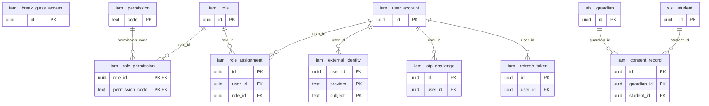

# Schema `iam`

> CORE: identity & access (users, roles, permissions, sessions, consent)

Generated from the live database by `db/tools/gen_docs.py` — do not edit by hand.

**Tables:** 10

## Entity-relationship diagram

Convention FKs to `core.organisation`, `core.campus`, `sys.stored_file` and `wf.approval_request` are omitted from the diagram (see table details).

## Tables

- [`iam.break_glass_access`](#iambreakglassaccess) — Logged access to confidential records (SEN, counselling, safeguarding) with reason and review. [confidential record access log (SEN, safeguarding, counselling)]
- [`iam.consent_record`](#iamconsentrecord) — Guardian consents (data processing, photo/media, medical, trips) with policy version. [CORE-11 data privacy, PRT-07 consents]
- [`iam.external_identity`](#iamexternalidentity) — Linked Google/Microsoft SSO identity of a user. [Google / Microsoft SSO (CORE-10)]
- [`iam.otp_challenge`](#iamotpchallenge) — One-time passwords (hashed) for login, MFA, password reset and verification.
- [`iam.permission`](#iampermission) — Global permission catalogue: module.resource.action. [seeded from packages/contracts/permissions.ts]
- [`iam.refresh_token`](#iamrefreshtoken) — Rotating refresh tokens grouped by login family for reuse detection. [rotating refresh tokens with reuse detection]
- [`iam.role`](#iamrole) — Role (Principal, Class Teacher, Accountant, Parent, ...); system roles are seeded.
- [`iam.role_assignment`](#iamroleassignment) — Role held by a user, scoped to the organisation or one campus, with validity dates.
- [`iam.role_permission`](#iamrolepermission) — Permission granted to a role, with its data scope (org/campus/section/own classes/own children/self).
- [`iam.user_account`](#iamuseraccount) — Login identity for staff, guardians, students and system users.

### `iam.break_glass_access`

Logged access to confidential records (SEN, counselling, safeguarding) with reason and review. [confidential record access log (SEN, safeguarding, counselling)]

- Row-level security: `p_org: core.org_visible(org_id)`

| Column | Type | Null | Default | Description |
|---|---|---|---|---|
| `id` | uuid |  | uuidv7() |  |
| `org_id` | uuid |  |  |  |
| `user_id` | uuid |  |  |  |
| `resource_type` | text |  |  |  |
| `resource_id` | uuid |  |  |  |
| `reason` | text |  |  |  |
| `accessed_at` | timestamp with time zone |  | now() |  |
| `reviewed_by` | uuid | yes |  |  |
| `reviewed_at` | timestamp with time zone | yes |  |  |
| `review_note` | text | yes |  |  |

| Constraint | Kind | Definition |
|---|---|---|
| `break_glass_access_pkey` | PK | `PRIMARY KEY (id)` |
| `break_glass_access_org_id_fkey` | FK | `FOREIGN KEY (org_id) REFERENCES core.organisation(id)` |

### `iam.consent_record`

Guardian consents (data processing, photo/media, medical, trips) with policy version. [CORE-11 data privacy, PRT-07 consents]

- Row-level security: `p_org: core.org_visible(org_id)`

| Column | Type | Null | Default | Description |
|---|---|---|---|---|
| `id` | uuid |  | uuidv7() |  |
| `org_id` | uuid |  |  |  |
| `guardian_id` | uuid |  |  |  |
| `student_id` | uuid | yes |  |  |
| `consent_type` | text |  |  | 'photo_media','data_processing','medical_treatment','trip:<id>' |
| `granted` | boolean |  |  |  |
| `version` | text |  |  | policy version |
| `signed_name` | text | yes |  |  |
| `evidence_file_id` | uuid | yes |  |  |
| `granted_at` | timestamp with time zone |  | now() |  |
| `revoked_at` | timestamp with time zone | yes |  |  |

| Constraint | Kind | Definition |
|---|---|---|
| `consent_record_pkey` | PK | `PRIMARY KEY (id)` |
| `consent_record_evidence_file_id_fkey` | FK | `FOREIGN KEY (evidence_file_id) REFERENCES sys.stored_file(id)` |
| `consent_record_guardian_id_fkey` | FK | `FOREIGN KEY (guardian_id) REFERENCES sis.guardian(id)` |
| `consent_record_org_id_fkey` | FK | `FOREIGN KEY (org_id) REFERENCES core.organisation(id)` |
| `consent_record_student_id_fkey` | FK | `FOREIGN KEY (student_id) REFERENCES sis.student(id)` |

**Indexes**

- `CREATE INDEX ix_consent_record_guardian_id_fk ON iam.consent_record USING btree (guardian_id)`
- `CREATE INDEX ix_consent_student ON iam.consent_record USING btree (student_id, consent_type)`

### `iam.external_identity`

Linked Google/Microsoft SSO identity of a user. [Google / Microsoft SSO (CORE-10)]

| Column | Type | Null | Default | Description |
|---|---|---|---|---|
| `user_id` | uuid |  |  |  |
| `provider` | text |  |  |  |
| `subject` | text |  |  |  |
| `linked_at` | timestamp with time zone |  | now() |  |

| Constraint | Kind | Definition |
|---|---|---|
| `external_identity_pkey` | PK | `PRIMARY KEY (provider, subject)` |
| `external_identity_user_id_fkey` | FK | `FOREIGN KEY (user_id) REFERENCES iam.user_account(id)` |
| `external_identity_provider_check` | CHECK | `CHECK ((provider = ANY (ARRAY['google'::text, 'microsoft'::text])))` |

**Indexes**

- `CREATE INDEX ix_external_identity_user_id_fk ON iam.external_identity USING btree (user_id)`

### `iam.otp_challenge`

One-time passwords (hashed) for login, MFA, password reset and verification.

| Column | Type | Null | Default | Description |
|---|---|---|---|---|
| `id` | uuid |  | uuidv7() |  |
| `phone` | core.phone_e164 | yes |  |  |
| `email` | citext | yes |  |  |
| `user_id` | uuid | yes |  |  |
| `purpose` | text |  |  |  |
| `code_hash` | bytea |  |  |  |
| `attempts` | smallint |  | 0 |  |
| `expires_at` | timestamp with time zone |  |  |  |
| `consumed_at` | timestamp with time zone | yes |  |  |
| `created_at` | timestamp with time zone |  | now() |  |

| Constraint | Kind | Definition |
|---|---|---|
| `otp_challenge_pkey` | PK | `PRIMARY KEY (id)` |
| `otp_challenge_user_id_fkey` | FK | `FOREIGN KEY (user_id) REFERENCES iam.user_account(id)` |
| `otp_challenge_purpose_check` | CHECK | `CHECK ((purpose = ANY (ARRAY['login'::text, 'mfa'::text, 'reset_password'::text, 'verify_phone'::text, 'result_lookup'::text, 'pickup'::text])))` |

**Indexes**

- `CREATE INDEX ix_otp_challenge_user_id_fk ON iam.otp_challenge USING btree (user_id)`

### `iam.permission`

Global permission catalogue: module.resource.action. [seeded from packages/contracts/permissions.ts]

| Column | Type | Null | Default | Description |
|---|---|---|---|---|
| `code` | text |  |  | 'fee.invoice.create' |
| `module` | text |  |  |  |
| `resource` | text |  |  |  |
| `action` | text |  |  |  |
| `is_sensitive` | boolean |  | false | break-glass logging |
| `description` | text | yes |  |  |

| Constraint | Kind | Definition |
|---|---|---|
| `permission_pkey` | PK | `PRIMARY KEY (code)` |
| `permission_action_check` | CHECK | `CHECK ((action = ANY (ARRAY['view'::text, 'create'::text, 'edit'::text, 'approve'::text, 'export'::text, 'delete'::text])))` |

### `iam.refresh_token`

Rotating refresh tokens grouped by login family for reuse detection. [rotating refresh tokens with reuse detection]

| Column | Type | Null | Default | Description |
|---|---|---|---|---|
| `id` | uuid |  | uuidv7() |  |
| `user_id` | uuid |  |  |  |
| `family_id` | uuid |  |  | all rotations of one login |
| `token_hash` | bytea |  |  | sha256(token) |
| `client` | text |  |  |  |
| `issued_at` | timestamp with time zone |  | now() |  |
| `expires_at` | timestamp with time zone |  |  |  |
| `rotated_at` | timestamp with time zone | yes |  |  |
| `revoked_at` | timestamp with time zone | yes |  |  |
| `revoke_reason` | text | yes |  |  |
| `ip` | inet | yes |  |  |
| `user_agent` | text | yes |  |  |

| Constraint | Kind | Definition |
|---|---|---|
| `refresh_token_pkey` | PK | `PRIMARY KEY (id)` |
| `refresh_token_token_hash_key` | UNIQUE | `UNIQUE (token_hash)` |
| `refresh_token_user_id_fkey` | FK | `FOREIGN KEY (user_id) REFERENCES iam.user_account(id)` |
| `refresh_token_client_check` | CHECK | `CHECK ((client = ANY (ARRAY['web'::text, 'parent_app'::text, 'staff_app'::text, 'scanner'::text])))` |

**Indexes**

- `CREATE INDEX ix_refresh_token_family ON iam.refresh_token USING btree (family_id)`
- `CREATE INDEX ix_refresh_token_user_active ON iam.refresh_token USING btree (user_id) WHERE (revoked_at IS NULL)`

### `iam.role`

Role (Principal, Class Teacher, Accountant, Parent, ...); system roles are seeded.

- Row-level security: `p_org: core.org_visible(org_id)`

| Column | Type | Null | Default | Description |
|---|---|---|---|---|
| `id` | uuid |  | uuidv7() |  |
| `org_id` | uuid |  |  |  |
| `code` | text |  |  | PRINCIPAL, CAMPUS_HEAD, HOS, CLASS_TEACHER, SUBJECT_TEACHER, |
| `name_en` | text |  |  |  |
| `name_bn` | text | yes |  |  |
| `is_system` | boolean |  | false | seeded, cannot be deleted |
| `requires_mfa` | boolean |  | false | §5.5 accounts/HR/IT/principal |
| `created_at` | timestamp with time zone |  | now() |  |
| `created_by` | uuid | yes | core.current_user_id() |  |
| `updated_at` | timestamp with time zone |  | now() |  |
| `updated_by` | uuid | yes |  |  |
| `row_version` | integer |  | 1 |  |

| Constraint | Kind | Definition |
|---|---|---|
| `role_pkey` | PK | `PRIMARY KEY (id)` |
| `role_org_id_code_key` | UNIQUE | `UNIQUE (org_id, code)` |
| `role_org_id_fkey` | FK | `FOREIGN KEY (org_id) REFERENCES core.organisation(id)` |

**Triggers**

- `trg_audit` — AFTER INSERT UPDATE DELETE → `tg_row_audit()`
- `trg_touch` — BEFORE UPDATE → `tg_touch()`

### `iam.role_assignment`

Role held by a user, scoped to the organisation or one campus, with validity dates.

- Row-level security: `p_org: core.org_visible(org_id)`

| Column | Type | Null | Default | Description |
|---|---|---|---|---|
| `id` | uuid |  | uuidv7() |  |
| `org_id` | uuid |  |  |  |
| `user_id` | uuid |  |  |  |
| `role_id` | uuid |  |  |  |
| `scope_type` | text |  |  |  |
| `campus_id` | uuid | yes |  |  |
| `valid_from` | date |  | CURRENT_DATE |  |
| `valid_to` | date | yes |  |  |
| `granted_by` | uuid | yes |  |  |
| `created_at` | timestamp with time zone |  | now() |  |
| `created_by` | uuid | yes | core.current_user_id() |  |
| `updated_at` | timestamp with time zone |  | now() |  |
| `updated_by` | uuid | yes |  |  |
| `row_version` | integer |  | 1 |  |

| Constraint | Kind | Definition |
|---|---|---|
| `role_assignment_pkey` | PK | `PRIMARY KEY (id)` |
| `role_assignment_user_id_role_id_campus_id_key` | UNIQUE | `UNIQUE NULLS NOT DISTINCT (user_id, role_id, campus_id)` |
| `role_assignment_campus_id_fkey` | FK | `FOREIGN KEY (campus_id) REFERENCES core.campus(id)` |
| `role_assignment_org_id_fkey` | FK | `FOREIGN KEY (org_id) REFERENCES core.organisation(id)` |
| `role_assignment_role_id_fkey` | FK | `FOREIGN KEY (role_id) REFERENCES iam.role(id)` |
| `role_assignment_user_id_fkey` | FK | `FOREIGN KEY (user_id) REFERENCES iam.user_account(id)` |
| `role_assignment_check` | CHECK | `CHECK ((((scope_type = 'org'::text) AND (campus_id IS NULL)) OR ((scope_type = 'campus'::text) AND (campus_id IS NOT NULL))))` |
| `role_assignment_scope_type_check` | CHECK | `CHECK ((scope_type = ANY (ARRAY['org'::text, 'campus'::text])))` |

**Indexes**

- `CREATE INDEX ix_role_assignment_campus_id_fk ON iam.role_assignment USING btree (campus_id)`
- `CREATE INDEX ix_role_assignment_role_id_fk ON iam.role_assignment USING btree (role_id)`

**Triggers**

- `trg_audit` — AFTER INSERT UPDATE DELETE → `tg_row_audit()`
- `trg_touch` — BEFORE UPDATE → `tg_touch()`

### `iam.role_permission`

Permission granted to a role, with its data scope (org/campus/section/own classes/own children/self).

| Column | Type | Null | Default | Description |
|---|---|---|---|---|
| `role_id` | uuid |  |  |  |
| `permission_code` | text |  |  |  |
| `data_scope` | text |  | 'campus'::text |  |

| Constraint | Kind | Definition |
|---|---|---|
| `role_permission_pkey` | PK | `PRIMARY KEY (role_id, permission_code)` |
| `role_permission_permission_code_fkey` | FK | `FOREIGN KEY (permission_code) REFERENCES iam.permission(code)` |
| `role_permission_role_id_fkey` | FK | `FOREIGN KEY (role_id) REFERENCES iam.role(id) ON DELETE CASCADE` |
| `role_permission_data_scope_check` | CHECK | `CHECK ((data_scope = ANY (ARRAY['org'::text, 'campus'::text, 'section'::text, 'own_classes'::text, 'own_subjects'::text, 'own_children'::text, 'self'::text])))` |

**Indexes**

- `CREATE INDEX ix_role_permission_permission_code_fk ON iam.role_permission USING btree (permission_code)`

**Triggers**

- `trg_audit` — AFTER INSERT UPDATE DELETE → `tg_row_audit()`

### `iam.user_account`

Login identity for staff, guardians, students and system users.

- Row-level security: `p_org: core.org_visible(org_id)`

| Column | Type | Null | Default | Description |
|---|---|---|---|---|
| `id` | uuid |  | uuidv7() |  |
| `org_id` | uuid |  |  |  |
| `user_type` | text |  |  |  |
| `username` | citext | yes |  | staff/student login id |
| `email` | citext | yes |  |  |
| `phone` | core.phone_e164 | yes |  | guardian OTP login |
| `password_hash` | text | yes |  | argon2id; NULL for OTP-only guardians |
| `status` | text |  | 'invited'::text |  |
| `mfa_type` | text | yes |  |  |
| `mfa_secret_enc` | bytea | yes |  |  |
| `must_change_password` | boolean |  | false |  |
| `preferred_locale` | core.locale |  | 'en'::text |  |
| `failed_login_count` | smallint |  | 0 |  |
| `locked_until` | timestamp with time zone | yes |  |  |
| `last_login_at` | timestamp with time zone | yes |  |  |
| `password_changed_at` | timestamp with time zone | yes |  |  |
| `authz_version` | integer |  | 1 | bump => cached permissions invalidated |
| `deleted_at` | timestamp with time zone | yes |  |  |
| `created_at` | timestamp with time zone |  | now() |  |
| `created_by` | uuid | yes | core.current_user_id() |  |
| `updated_at` | timestamp with time zone |  | now() |  |
| `updated_by` | uuid | yes |  |  |
| `row_version` | integer |  | 1 |  |

| Constraint | Kind | Definition |
|---|---|---|
| `user_account_pkey` | PK | `PRIMARY KEY (id)` |
| `user_account_org_id_fkey` | FK | `FOREIGN KEY (org_id) REFERENCES core.organisation(id)` |
| `user_account_mfa_type_check` | CHECK | `CHECK ((mfa_type = ANY (ARRAY['totp'::text, 'sms_otp'::text])))` |
| `user_account_status_check` | CHECK | `CHECK ((status = ANY (ARRAY['invited'::text, 'active'::text, 'locked'::text, 'disabled'::text])))` |
| `user_account_user_type_check` | CHECK | `CHECK ((user_type = ANY (ARRAY['staff'::text, 'guardian'::text, 'student'::text, 'system'::text])))` |

**Indexes**

- `CREATE UNIQUE INDEX ux_user_email ON iam.user_account USING btree (org_id, email) WHERE ((email IS NOT NULL) AND (deleted_at IS NULL))`
- `CREATE UNIQUE INDEX ux_user_phone ON iam.user_account USING btree (org_id, phone) WHERE ((phone IS NOT NULL) AND (deleted_at IS NULL) AND (user_type = 'guardian'::text))`
- `CREATE UNIQUE INDEX ux_user_username ON iam.user_account USING btree (org_id, username) WHERE ((username IS NOT NULL) AND (deleted_at IS NULL))`

**Triggers**

- `trg_audit` — AFTER INSERT UPDATE DELETE → `tg_row_audit()`
- `trg_touch` — BEFORE UPDATE → `tg_touch()`

