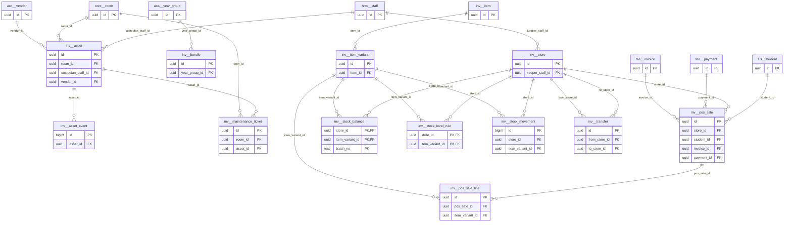

# Schema `inv`

> INV: items, stores, stock ledger, POS, assets, maintenance

Generated from the live database by `db/tools/gen_docs.py` — do not edit by hand.

**Tables:** 13

## Entity-relationship diagram

Convention FKs to `core.organisation`, `core.campus`, `sys.stored_file` and `wf.approval_request` are omitted from the diagram (see table details).

## Tables

- [`inv.asset`](#invasset) — Fixed asset with QR tag, custodian and depreciation. [INV-04 (P3) fixed-asset register]
- [`inv.asset_event`](#invassetevent) — Asset movement/verification/maintenance history. [movements, verification, maintenance history]
- [`inv.bundle`](#invbundle) — Uniform/book set per year group. [uniform / book sets per class]
- [`inv.item`](#invitem) — Inventory item master. [INV-01]
- [`inv.item_variant`](#invitemvariant) — Variant of an item (size/colour) with sale price. [uniform size / colour]
- [`inv.maintenance_ticket`](#invmaintenanceticket) — Facility/IT ticket with SLA and sign-off. [INV-06 (P3) facility / IT tickets with SLA]
- [`inv.pos_sale`](#invpossale) — Uniform/book-shop sale (cash or student account). [INV-03 uniform & book-shop POS]
- [`inv.pos_sale_line`](#invpossaleline) — Line of a POS sale.
- [`inv.stock_balance`](#invstockbalance) — Current quantity on hand; never negative (trigger-maintained). [current quantity; updated only with a ledger insert (same tx)]
- [`inv.stock_level_rule`](#invstocklevelrule) — Min/max reorder levels per store and variant. [min / max reorder levels]
- [`inv.stock_movement`](#invstockmovement) — Append-only stock ledger (receipt, issue, transfer, sale, adjustment). [INV-02 append-only stock ledger]
- [`inv.store`](#invstore) — Store per campus (central, uniform shop, lab).
- [`inv.transfer`](#invtransfer) — Inter-store/campus transfer with approval. [inter-campus transfer with approval]

### `inv.asset`

Fixed asset with QR tag, custodian and depreciation. [INV-04 (P3) fixed-asset register]

- Row-level security: `p_campus: core.campus_visible(org_id, campus_id)`

| Column | Type | Null | Default | Description |
|---|---|---|---|---|
| `id` | uuid |  | uuidv7() |  |
| `org_id` | uuid |  |  |  |
| `campus_id` | uuid |  |  |  |
| `asset_tag` | text |  |  | printed as QR |
| `name` | text |  |  |  |
| `category` | text |  |  |  |
| `room_id` | uuid | yes |  |  |
| `custodian_staff_id` | uuid | yes |  |  |
| `purchase_date` | date | yes |  |  |
| `cost_paisa` | core.paisa_nn | yes |  |  |
| `salvage_paisa` | core.paisa_nn |  | 0 |  |
| `useful_life_months` | smallint | yes |  |  |
| `depreciation_method` | text |  | 'straight_line'::text |  |
| `vendor_id` | uuid | yes |  |  |
| `warranty_until` | date | yes |  |  |
| `status` | text |  | 'in_use'::text |  |
| `disposed_on` | date | yes |  |  |
| `disposal_note` | text | yes |  |  |
| `created_at` | timestamp with time zone |  | now() |  |
| `created_by` | uuid | yes | core.current_user_id() |  |
| `updated_at` | timestamp with time zone |  | now() |  |
| `updated_by` | uuid | yes |  |  |
| `row_version` | integer |  | 1 |  |

| Constraint | Kind | Definition |
|---|---|---|
| `asset_pkey` | PK | `PRIMARY KEY (id)` |
| `asset_org_id_asset_tag_key` | UNIQUE | `UNIQUE (org_id, asset_tag)` |
| `asset_campus_id_fkey` | FK | `FOREIGN KEY (campus_id) REFERENCES core.campus(id)` |
| `asset_custodian_staff_id_fkey` | FK | `FOREIGN KEY (custodian_staff_id) REFERENCES hrm.staff(id)` |
| `asset_org_id_fkey` | FK | `FOREIGN KEY (org_id) REFERENCES core.organisation(id)` |
| `asset_room_id_fkey` | FK | `FOREIGN KEY (room_id) REFERENCES core.room(id)` |
| `asset_vendor_id_fkey` | FK | `FOREIGN KEY (vendor_id) REFERENCES acc.vendor(id)` |
| `asset_depreciation_method_check` | CHECK | `CHECK ((depreciation_method = ANY (ARRAY['straight_line'::text, 'declining'::text, 'none'::text])))` |
| `asset_status_check` | CHECK | `CHECK ((status = ANY (ARRAY['in_use'::text, 'in_store'::text, 'under_repair'::text, 'disposed'::text, 'lost'::text])))` |

**Indexes**

- `CREATE INDEX ix_asset_campus_id_fk ON inv.asset USING btree (campus_id)`
- `CREATE INDEX ix_asset_custodian_staff_id_fk ON inv.asset USING btree (custodian_staff_id)`
- `CREATE INDEX ix_asset_room_id_fk ON inv.asset USING btree (room_id)`
- `CREATE INDEX ix_asset_vendor_id_fk ON inv.asset USING btree (vendor_id)`

**Triggers**

- `trg_audit` — AFTER INSERT UPDATE DELETE → `tg_row_audit()`
- `trg_touch` — BEFORE UPDATE → `tg_touch()`

### `inv.asset_event`

Asset movement/verification/maintenance history. [movements, verification, maintenance history]

| Column | Type | Null | Default | Description |
|---|---|---|---|---|
| `id` | bigint |  |  |  |
| `asset_id` | uuid |  |  |  |
| `kind` | text |  |  |  |
| `details` | jsonb |  | '{}'::jsonb |  |
| `actor_id` | uuid |  |  |  |
| `at` | timestamp with time zone |  | now() |  |

| Constraint | Kind | Definition |
|---|---|---|
| `asset_event_pkey` | PK | `PRIMARY KEY (id)` |
| `asset_event_asset_id_fkey` | FK | `FOREIGN KEY (asset_id) REFERENCES inv.asset(id)` |
| `asset_event_kind_check` | CHECK | `CHECK ((kind = ANY (ARRAY['moved'::text, 'custodian_changed'::text, 'verified'::text, 'maintained'::text, 'disposed'::text])))` |

**Indexes**

- `CREATE INDEX ix_asset_event_asset_id_fk ON inv.asset_event USING btree (asset_id)`

### `inv.bundle`

Uniform/book set per year group. [uniform / book sets per class]

- Row-level security: `p_org: core.org_visible(org_id)`

| Column | Type | Null | Default | Description |
|---|---|---|---|---|
| `id` | uuid |  | uuidv7() |  |
| `org_id` | uuid |  |  |  |
| `name` | text |  |  |  |
| `year_group_id` | uuid | yes |  |  |
| `items` | jsonb |  |  | [{itemId, qty}] — size chosen at sale |

| Constraint | Kind | Definition |
|---|---|---|
| `bundle_pkey` | PK | `PRIMARY KEY (id)` |
| `bundle_org_id_fkey` | FK | `FOREIGN KEY (org_id) REFERENCES core.organisation(id)` |
| `bundle_year_group_id_fkey` | FK | `FOREIGN KEY (year_group_id) REFERENCES aca.year_group(id)` |

**Indexes**

- `CREATE INDEX ix_bundle_year_group_id_fk ON inv.bundle USING btree (year_group_id)`

### `inv.item`

Inventory item master. [INV-01]

- Row-level security: `p_org: core.org_visible(org_id)`

| Column | Type | Null | Default | Description |
|---|---|---|---|---|
| `id` | uuid |  | uuidv7() |  |
| `org_id` | uuid |  |  |  |
| `sku` | text |  |  |  |
| `name_en` | text |  |  |  |
| `name_bn` | text | yes |  |  |
| `category` | text |  |  |  |
| `unit` | text |  | 'pcs'::text |  |
| `is_sellable` | boolean |  | false |  |
| `track_batch` | boolean |  | false | batch/expiry where needed |
| `barcode` | text | yes |  |  |
| `created_at` | timestamp with time zone |  | now() |  |
| `created_by` | uuid | yes | core.current_user_id() |  |
| `updated_at` | timestamp with time zone |  | now() |  |
| `updated_by` | uuid | yes |  |  |
| `row_version` | integer |  | 1 |  |

| Constraint | Kind | Definition |
|---|---|---|
| `item_pkey` | PK | `PRIMARY KEY (id)` |
| `item_org_id_sku_key` | UNIQUE | `UNIQUE (org_id, sku)` |
| `item_org_id_fkey` | FK | `FOREIGN KEY (org_id) REFERENCES core.organisation(id)` |
| `item_category_check` | CHECK | `CHECK ((category = ANY (ARRAY['uniform'::text, 'book'::text, 'stationery'::text, 'lab_consumable'::text, 'lab_equipment'::text, 'ict'::text, 'cleaning'::text, 'furniture'::text, 'sports'::text, 'other'::text])))` |

**Triggers**

- `trg_touch` — BEFORE UPDATE → `tg_touch()`

### `inv.item_variant`

Variant of an item (size/colour) with sale price. [uniform size / colour]

| Column | Type | Null | Default | Description |
|---|---|---|---|---|
| `id` | uuid |  | uuidv7() |  |
| `item_id` | uuid |  |  |  |
| `code` | text |  |  | 'S-28', 'M-32' |
| `attributes` | jsonb |  | '{}'::jsonb | {"size":"28","gender":"girls"} |
| `barcode` | text | yes |  |  |
| `sale_price_paisa` | core.paisa_nn | yes |  |  |

| Constraint | Kind | Definition |
|---|---|---|
| `item_variant_pkey` | PK | `PRIMARY KEY (id)` |
| `item_variant_item_id_code_key` | UNIQUE | `UNIQUE (item_id, code)` |
| `item_variant_item_id_fkey` | FK | `FOREIGN KEY (item_id) REFERENCES inv.item(id) ON DELETE CASCADE` |

### `inv.maintenance_ticket`

Facility/IT ticket with SLA and sign-off. [INV-06 (P3) facility / IT tickets with SLA]

- Row-level security: `p_campus: core.campus_visible(org_id, campus_id)`

| Column | Type | Null | Default | Description |
|---|---|---|---|---|
| `id` | uuid |  | uuidv7() |  |
| `org_id` | uuid |  |  |  |
| `campus_id` | uuid |  |  |  |
| `ticket_no` | text |  |  |  |
| `category` | text |  |  |  |
| `priority` | text |  | 'normal'::text |  |
| `title` | text |  |  |  |
| `description` | text | yes |  |  |
| `room_id` | uuid | yes |  |  |
| `asset_id` | uuid | yes |  |  |
| `photo_file_ids` | uuid[] |  | '{}'::uuid[] |  |
| `raised_by` | uuid |  |  |  |
| `assignee_id` | uuid | yes |  |  |
| `sla_due_at` | timestamp with time zone | yes |  |  |
| `status` | text |  | 'open'::text |  |
| `completed_at` | timestamp with time zone | yes |  |  |
| `signed_off_by` | uuid | yes |  |  |
| `created_at` | timestamp with time zone |  | now() |  |
| `created_by` | uuid | yes | core.current_user_id() |  |
| `updated_at` | timestamp with time zone |  | now() |  |
| `updated_by` | uuid | yes |  |  |
| `row_version` | integer |  | 1 |  |

| Constraint | Kind | Definition |
|---|---|---|
| `maintenance_ticket_pkey` | PK | `PRIMARY KEY (id)` |
| `maintenance_ticket_org_id_ticket_no_key` | UNIQUE | `UNIQUE (org_id, ticket_no)` |
| `maintenance_ticket_asset_id_fkey` | FK | `FOREIGN KEY (asset_id) REFERENCES inv.asset(id)` |
| `maintenance_ticket_campus_id_fkey` | FK | `FOREIGN KEY (campus_id) REFERENCES core.campus(id)` |
| `maintenance_ticket_org_id_fkey` | FK | `FOREIGN KEY (org_id) REFERENCES core.organisation(id)` |
| `maintenance_ticket_room_id_fkey` | FK | `FOREIGN KEY (room_id) REFERENCES core.room(id)` |
| `maintenance_ticket_category_check` | CHECK | `CHECK ((category = ANY (ARRAY['electrical'::text, 'plumbing'::text, 'it'::text, 'furniture'::text, 'cleaning'::text, 'ac'::text, 'other'::text])))` |
| `maintenance_ticket_priority_check` | CHECK | `CHECK ((priority = ANY (ARRAY['low'::text, 'normal'::text, 'high'::text, 'urgent'::text])))` |
| `maintenance_ticket_status_check` | CHECK | `CHECK ((status = ANY (ARRAY['open'::text, 'assigned'::text, 'in_progress'::text, 'done'::text, 'signed_off'::text, 'cancelled'::text])))` |

**Indexes**

- `CREATE INDEX ix_maintenance_ticket_asset_id_fk ON inv.maintenance_ticket USING btree (asset_id)`
- `CREATE INDEX ix_maintenance_ticket_campus_id_fk ON inv.maintenance_ticket USING btree (campus_id)`
- `CREATE INDEX ix_maintenance_ticket_room_id_fk ON inv.maintenance_ticket USING btree (room_id)`

**Triggers**

- `trg_touch` — BEFORE UPDATE → `tg_touch()`

### `inv.pos_sale`

Uniform/book-shop sale (cash or student account). [INV-03 uniform & book-shop POS]

- Row-level security: `p_campus: core.campus_visible(org_id, campus_id)`

| Column | Type | Null | Default | Description |
|---|---|---|---|---|
| `id` | uuid |  | uuidv7() |  |
| `org_id` | uuid |  |  |  |
| `campus_id` | uuid |  |  |  |
| `store_id` | uuid |  |  |  |
| `sale_no` | text |  |  |  |
| `student_id` | uuid | yes |  |  |
| `settlement` | text |  |  |  |
| `total_paisa` | core.paisa_nn |  |  |  |
| `invoice_id` | uuid | yes |  | when charged to student account |
| `payment_id` | uuid | yes |  | when paid immediately |
| `sold_by` | uuid |  |  |  |
| `sold_at` | timestamp with time zone |  | now() |  |
| `status` | text |  | 'completed'::text |  |

| Constraint | Kind | Definition |
|---|---|---|
| `pos_sale_pkey` | PK | `PRIMARY KEY (id)` |
| `pos_sale_org_id_sale_no_key` | UNIQUE | `UNIQUE (org_id, sale_no)` |
| `pos_sale_campus_id_fkey` | FK | `FOREIGN KEY (campus_id) REFERENCES core.campus(id)` |
| `pos_sale_invoice_id_fkey` | FK | `FOREIGN KEY (invoice_id) REFERENCES fee.invoice(id)` |
| `pos_sale_org_id_fkey` | FK | `FOREIGN KEY (org_id) REFERENCES core.organisation(id)` |
| `pos_sale_payment_id_fkey` | FK | `FOREIGN KEY (payment_id) REFERENCES fee.payment(id)` |
| `pos_sale_store_id_fkey` | FK | `FOREIGN KEY (store_id) REFERENCES inv.store(id)` |
| `pos_sale_student_id_fkey` | FK | `FOREIGN KEY (student_id) REFERENCES sis.student(id)` |
| `pos_sale_settlement_check` | CHECK | `CHECK ((settlement = ANY (ARRAY['cash'::text, 'student_account'::text, 'card'::text, 'mfs'::text])))` |
| `pos_sale_status_check` | CHECK | `CHECK ((status = ANY (ARRAY['completed'::text, 'returned'::text, 'partially_returned'::text, 'void'::text])))` |

**Indexes**

- `CREATE INDEX ix_pos_sale_campus_id_fk ON inv.pos_sale USING btree (campus_id)`
- `CREATE INDEX ix_pos_sale_invoice_id_fk ON inv.pos_sale USING btree (invoice_id)`
- `CREATE INDEX ix_pos_sale_payment_id_fk ON inv.pos_sale USING btree (payment_id)`
- `CREATE INDEX ix_pos_sale_store_id_fk ON inv.pos_sale USING btree (store_id)`
- `CREATE INDEX ix_pos_sale_student_id_fk ON inv.pos_sale USING btree (student_id)`

### `inv.pos_sale_line`

Line of a POS sale.

| Column | Type | Null | Default | Description |
|---|---|---|---|---|
| `id` | uuid |  | uuidv7() |  |
| `pos_sale_id` | uuid |  |  |  |
| `item_variant_id` | uuid |  |  |  |
| `qty` | numeric(12,3) |  |  |  |
| `unit_price_paisa` | core.paisa_nn |  |  |  |
| `discount_paisa` | core.paisa_nn |  | 0 |  |
| `returned_qty` | numeric(12,3) |  | 0 |  |

| Constraint | Kind | Definition |
|---|---|---|
| `pos_sale_line_pkey` | PK | `PRIMARY KEY (id)` |
| `pos_sale_line_item_variant_id_fkey` | FK | `FOREIGN KEY (item_variant_id) REFERENCES inv.item_variant(id)` |
| `pos_sale_line_pos_sale_id_fkey` | FK | `FOREIGN KEY (pos_sale_id) REFERENCES inv.pos_sale(id) ON DELETE CASCADE` |
| `pos_sale_line_check` | CHECK | `CHECK ((returned_qty <= qty))` |
| `pos_sale_line_discount_chk` | CHECK | `CHECK (((discount_paisa)::numeric <= (qty * (unit_price_paisa)::numeric)))` |
| `pos_sale_line_qty_check` | CHECK | `CHECK ((qty > (0)::numeric))` |
| `pos_sale_line_returned_qty_check` | CHECK | `CHECK ((returned_qty >= (0)::numeric))` |

**Indexes**

- `CREATE INDEX ix_pos_sale_line_item_variant_id_fk ON inv.pos_sale_line USING btree (item_variant_id)`
- `CREATE INDEX ix_pos_sale_line_pos_sale_id_fk ON inv.pos_sale_line USING btree (pos_sale_id)`

### `inv.stock_balance`

Current quantity on hand; never negative (trigger-maintained). [current quantity; updated only with a ledger insert (same tx)]

| Column | Type | Null | Default | Description |
|---|---|---|---|---|
| `store_id` | uuid |  |  |  |
| `item_variant_id` | uuid |  |  |  |
| `batch_no` | text |  | ''::text |  |
| `expires_on` | date | yes |  |  |
| `qty_on_hand` | numeric(12,3) |  | 0 | I-9 no negative stock |
| `avg_cost_paisa` | core.paisa_nn |  | 0 |  |

| Constraint | Kind | Definition |
|---|---|---|
| `stock_balance_pkey` | PK | `PRIMARY KEY (store_id, item_variant_id, batch_no)` |
| `stock_balance_item_variant_id_fkey` | FK | `FOREIGN KEY (item_variant_id) REFERENCES inv.item_variant(id)` |
| `stock_balance_store_id_fkey` | FK | `FOREIGN KEY (store_id) REFERENCES inv.store(id)` |
| `stock_balance_qty_on_hand_check` | CHECK | `CHECK ((qty_on_hand >= (0)::numeric))` |

**Indexes**

- `CREATE INDEX ix_stock_balance_item_variant_id_fk ON inv.stock_balance USING btree (item_variant_id)`

### `inv.stock_level_rule`

Min/max reorder levels per store and variant. [min / max reorder levels]

| Column | Type | Null | Default | Description |
|---|---|---|---|---|
| `store_id` | uuid |  |  |  |
| `item_variant_id` | uuid |  |  |  |
| `min_qty` | numeric(12,3) |  | 0 |  |
| `max_qty` | numeric(12,3) | yes |  |  |

| Constraint | Kind | Definition |
|---|---|---|
| `stock_level_rule_pkey` | PK | `PRIMARY KEY (store_id, item_variant_id)` |
| `stock_level_rule_item_variant_id_fkey` | FK | `FOREIGN KEY (item_variant_id) REFERENCES inv.item_variant(id)` |
| `stock_level_rule_store_id_fkey` | FK | `FOREIGN KEY (store_id) REFERENCES inv.store(id)` |

**Indexes**

- `CREATE INDEX ix_stock_level_rule_item_variant_id_fk ON inv.stock_level_rule USING btree (item_variant_id)`

### `inv.stock_movement`

Append-only stock ledger (receipt, issue, transfer, sale, adjustment). [INV-02 append-only stock ledger]

- Row-level security: `p_campus: core.campus_visible(org_id, campus_id)`

| Column | Type | Null | Default | Description |
|---|---|---|---|---|
| `id` | bigint |  |  |  |
| `org_id` | uuid |  |  |  |
| `campus_id` | uuid |  |  |  |
| `store_id` | uuid |  |  |  |
| `item_variant_id` | uuid |  |  |  |
| `batch_no` | text |  | ''::text |  |
| `movement_type` | text |  |  |  |
| `qty_delta` | numeric(12,3) |  |  |  |
| `unit_cost_paisa` | core.paisa_nn | yes |  |  |
| `ref_type` | text | yes |  | 'purchase_order','pos_sale','transfer','issue_note' |
| `ref_id` | uuid | yes |  |  |
| `transfer_id` | uuid | yes |  | pairs transfer_out/transfer_in |
| `reason` | text | yes |  |  |
| `moved_by` | uuid |  |  |  |
| `moved_at` | timestamp with time zone |  | now() |  |

| Constraint | Kind | Definition |
|---|---|---|
| `stock_movement_pkey` | PK | `PRIMARY KEY (id)` |
| `stock_movement_campus_id_fkey` | FK | `FOREIGN KEY (campus_id) REFERENCES core.campus(id)` |
| `stock_movement_item_variant_id_fkey` | FK | `FOREIGN KEY (item_variant_id) REFERENCES inv.item_variant(id)` |
| `stock_movement_org_id_fkey` | FK | `FOREIGN KEY (org_id) REFERENCES core.organisation(id)` |
| `stock_movement_store_id_fkey` | FK | `FOREIGN KEY (store_id) REFERENCES inv.store(id)` |
| `stock_movement_movement_type_check` | CHECK | `CHECK ((movement_type = ANY (ARRAY['receipt'::text, 'issue'::text, 'transfer_out'::text, 'transfer_in'::text, 'sale'::text, 'sale_return'::text, 'adjustment'::text, 'write_off'::text, 'opening'::text])))` |
| `stock_movement_qty_delta_check` | CHECK | `CHECK ((qty_delta <> (0)::numeric))` |

**Indexes**

- `CREATE INDEX ix_stock_movement_campus_id_fk ON inv.stock_movement USING btree (campus_id)`
- `CREATE INDEX ix_stock_movement_item ON inv.stock_movement USING btree (store_id, item_variant_id, moved_at DESC)`
- `CREATE INDEX ix_stock_movement_item_variant_id_fk ON inv.stock_movement USING btree (item_variant_id)`

**Triggers**

- `trg_apply_movement` — AFTER INSERT → `tg_apply_movement()`

### `inv.store`

Store per campus (central, uniform shop, lab).

- Row-level security: `p_campus: core.campus_visible(org_id, campus_id)`

| Column | Type | Null | Default | Description |
|---|---|---|---|---|
| `id` | uuid |  | uuidv7() |  |
| `org_id` | uuid |  |  |  |
| `campus_id` | uuid |  |  |  |
| `code` | text |  |  |  |
| `name` | text |  |  |  |
| `kind` | text |  |  |  |
| `keeper_staff_id` | uuid | yes |  |  |

| Constraint | Kind | Definition |
|---|---|---|
| `store_pkey` | PK | `PRIMARY KEY (id)` |
| `store_campus_id_code_key` | UNIQUE | `UNIQUE (campus_id, code)` |
| `store_campus_id_fkey` | FK | `FOREIGN KEY (campus_id) REFERENCES core.campus(id)` |
| `store_keeper_staff_id_fkey` | FK | `FOREIGN KEY (keeper_staff_id) REFERENCES hrm.staff(id)` |
| `store_org_id_fkey` | FK | `FOREIGN KEY (org_id) REFERENCES core.organisation(id)` |
| `store_kind_check` | CHECK | `CHECK ((kind = ANY (ARRAY['central'::text, 'uniform_shop'::text, 'book_shop'::text, 'lab'::text, 'ict'::text, 'sports'::text])))` |

**Indexes**

- `CREATE INDEX ix_store_keeper_staff_id_fk ON inv.store USING btree (keeper_staff_id)`

### `inv.transfer`

Inter-store/campus transfer with approval. [inter-campus transfer with approval]

- Row-level security: `p_campus: core.campus_visible(org_id, campus_id)`

| Column | Type | Null | Default | Description |
|---|---|---|---|---|
| `id` | uuid |  | uuidv7() |  |
| `org_id` | uuid |  |  |  |
| `campus_id` | uuid |  |  | source campus |
| `from_store_id` | uuid |  |  |  |
| `to_store_id` | uuid |  |  |  |
| `status` | text |  | 'requested'::text |  |
| `approval_request_id` | uuid | yes |  |  |
| `lines` | jsonb |  |  | [{variantId, qty, batchNo}] snapshot |
| `created_at` | timestamp with time zone |  | now() |  |
| `created_by` | uuid | yes | core.current_user_id() |  |
| `updated_at` | timestamp with time zone |  | now() |  |
| `updated_by` | uuid | yes |  |  |
| `row_version` | integer |  | 1 |  |

| Constraint | Kind | Definition |
|---|---|---|
| `transfer_pkey` | PK | `PRIMARY KEY (id)` |
| `transfer_approval_request_id_fkey` | FK | `FOREIGN KEY (approval_request_id) REFERENCES wf.approval_request(id)` |
| `transfer_campus_id_fkey` | FK | `FOREIGN KEY (campus_id) REFERENCES core.campus(id)` |
| `transfer_from_store_id_fkey` | FK | `FOREIGN KEY (from_store_id) REFERENCES inv.store(id)` |
| `transfer_org_id_fkey` | FK | `FOREIGN KEY (org_id) REFERENCES core.organisation(id)` |
| `transfer_to_store_id_fkey` | FK | `FOREIGN KEY (to_store_id) REFERENCES inv.store(id)` |
| `transfer_check` | CHECK | `CHECK ((from_store_id <> to_store_id))` |
| `transfer_status_check` | CHECK | `CHECK ((status = ANY (ARRAY['requested'::text, 'approved'::text, 'dispatched'::text, 'received'::text, 'rejected'::text, 'cancelled'::text])))` |

**Indexes**

- `CREATE INDEX ix_transfer_campus_id_fk ON inv.transfer USING btree (campus_id)`
- `CREATE INDEX ix_transfer_from_store_id_fk ON inv.transfer USING btree (from_store_id)`
- `CREATE INDEX ix_transfer_to_store_id_fk ON inv.transfer USING btree (to_store_id)`

**Triggers**

- `trg_audit` — AFTER INSERT UPDATE DELETE → `tg_row_audit()`
- `trg_touch` — BEFORE UPDATE → `tg_touch()`

