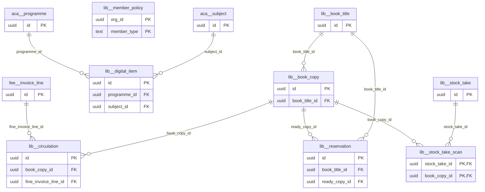

# Schema `lib`

> LIB: catalogue, copies, circulation, reservations

Generated from the live database by `db/tools/gen_docs.py` — do not edit by hand.

**Tables:** 8

## Entity-relationship diagram

Convention FKs to `core.organisation`, `core.campus`, `sys.stored_file` and `wf.approval_request` are omitted from the diagram (see table details).

## Tables

- [`lib.book_copy`](#libbookcopy) — Physical copy with accession number and barcode.
- [`lib.book_title`](#libbooktitle) — Catalogue title (ISBN, authors, category). [LIB-01 catalogue]
- [`lib.circulation`](#libcirculation) — Loan of a copy; one active loan per copy. [LIB-02 issue / return / renewal]
- [`lib.digital_item`](#libdigitalitem) — E-book or past paper with class-based access. [LIB-06 (P3) e-library & past papers]
- [`lib.member_policy`](#libmemberpolicy) — Loan limits and fines per member type. [limits per role]
- [`lib.reservation`](#libreservation) — Title reservation queue. [LIB-04]
- [`lib.stock_take`](#libstocktake) — Library stock verification session. [LIB-05 (P3)]
- [`lib.stock_take_scan`](#libstocktakescan) — Copy scanned during stock-take.

### `lib.book_copy`

Physical copy with accession number and barcode.

- Row-level security: `p_campus: core.campus_visible(org_id, campus_id)`

| Column | Type | Null | Default | Description |
|---|---|---|---|---|
| `id` | uuid |  | uuidv7() |  |
| `org_id` | uuid |  |  |  |
| `campus_id` | uuid |  |  |  |
| `book_title_id` | uuid |  |  |  |
| `accession_no` | text |  |  |  |
| `barcode` | text |  |  |  |
| `rfid_uid` | text | yes |  |  |
| `shelf_location` | text | yes |  |  |
| `acquired_on` | date | yes |  |  |
| `price_paisa` | core.paisa_nn | yes |  |  |
| `status` | text |  | 'available'::text |  |
| `created_at` | timestamp with time zone |  | now() |  |
| `created_by` | uuid | yes | core.current_user_id() |  |
| `updated_at` | timestamp with time zone |  | now() |  |
| `updated_by` | uuid | yes |  |  |
| `row_version` | integer |  | 1 |  |

| Constraint | Kind | Definition |
|---|---|---|
| `book_copy_pkey` | PK | `PRIMARY KEY (id)` |
| `book_copy_org_id_accession_no_key` | UNIQUE | `UNIQUE (org_id, accession_no)` |
| `book_copy_org_id_barcode_key` | UNIQUE | `UNIQUE (org_id, barcode)` |
| `book_copy_book_title_id_fkey` | FK | `FOREIGN KEY (book_title_id) REFERENCES lib.book_title(id)` |
| `book_copy_campus_id_fkey` | FK | `FOREIGN KEY (campus_id) REFERENCES core.campus(id)` |
| `book_copy_org_id_fkey` | FK | `FOREIGN KEY (org_id) REFERENCES core.organisation(id)` |
| `book_copy_status_check` | CHECK | `CHECK ((status = ANY (ARRAY['available'::text, 'on_loan'::text, 'reserved'::text, 'lost'::text, 'damaged'::text, 'withdrawn'::text, 'in_repair'::text])))` |

**Indexes**

- `CREATE INDEX ix_book_copy_campus_id_fk ON lib.book_copy USING btree (campus_id)`
- `CREATE INDEX ix_book_copy_title ON lib.book_copy USING btree (book_title_id, status)`

**Triggers**

- `trg_touch` — BEFORE UPDATE → `tg_touch()`

### `lib.book_title`

Catalogue title (ISBN, authors, category). [LIB-01 catalogue]

- Row-level security: `p_org: core.org_visible(org_id)`

| Column | Type | Null | Default | Description |
|---|---|---|---|---|
| `id` | uuid |  | uuidv7() |  |
| `org_id` | uuid |  |  |  |
| `isbn` | text | yes |  |  |
| `title` | text |  |  |  |
| `subtitle` | text | yes |  |  |
| `authors` | text[] |  | '{}'::text[] |  |
| `publisher` | text | yes |  |  |
| `edition` | text | yes |  |  |
| `published_year` | smallint | yes |  |  |
| `language` | text |  | 'en'::text |  |
| `category_code` | text | yes |  | DDC class or school category |
| `reading_level` | text | yes |  |  |
| `media_type` | text |  | 'book'::text |  |
| `cover_file_id` | uuid | yes |  |  |
| `search_text` | text | yes | *generated* |  |
| `created_at` | timestamp with time zone |  | now() |  |
| `created_by` | uuid | yes | core.current_user_id() |  |
| `updated_at` | timestamp with time zone |  | now() |  |
| `updated_by` | uuid | yes |  |  |
| `row_version` | integer |  | 1 |  |

| Constraint | Kind | Definition |
|---|---|---|
| `book_title_pkey` | PK | `PRIMARY KEY (id)` |
| `book_title_cover_file_id_fkey` | FK | `FOREIGN KEY (cover_file_id) REFERENCES sys.stored_file(id)` |
| `book_title_org_id_fkey` | FK | `FOREIGN KEY (org_id) REFERENCES core.organisation(id)` |
| `book_title_media_type_check` | CHECK | `CHECK ((media_type = ANY (ARRAY['book'::text, 'journal'::text, 'magazine'::text, 'dvd'::text, 'audio'::text, 'kit'::text])))` |

**Indexes**

- `CREATE INDEX ix_book_title_isbn ON lib.book_title USING btree (org_id, isbn) WHERE (isbn IS NOT NULL)`
- `CREATE INDEX ix_book_title_trgm ON lib.book_title USING gin (search_text gin_trgm_ops)`

**Triggers**

- `trg_touch` — BEFORE UPDATE → `tg_touch()`

### `lib.circulation`

Loan of a copy; one active loan per copy. [LIB-02 issue / return / renewal]

- Row-level security: `p_campus: core.campus_visible(org_id, campus_id)`

| Column | Type | Null | Default | Description |
|---|---|---|---|---|
| `id` | uuid |  | uuidv7() |  |
| `org_id` | uuid |  |  |  |
| `campus_id` | uuid |  |  |  |
| `book_copy_id` | uuid |  |  |  |
| `borrower_type` | text |  |  |  |
| `borrower_id` | uuid |  |  |  |
| `issued_at` | timestamp with time zone |  | now() |  |
| `due_on` | date |  |  |  |
| `renew_count` | smallint |  | 0 |  |
| `returned_at` | timestamp with time zone | yes |  |  |
| `return_condition` | text | yes |  |  |
| `fine_paisa` | core.paisa_nn |  | 0 |  |
| `fine_invoice_line_id` | uuid | yes |  | LIB-03 fine posted to fee ledger |
| `issued_by` | uuid |  |  |  |
| `received_by` | uuid | yes |  |  |

| Constraint | Kind | Definition |
|---|---|---|
| `circulation_pkey` | PK | `PRIMARY KEY (id)` |
| `circulation_book_copy_id_fkey` | FK | `FOREIGN KEY (book_copy_id) REFERENCES lib.book_copy(id)` |
| `circulation_campus_id_fkey` | FK | `FOREIGN KEY (campus_id) REFERENCES core.campus(id)` |
| `circulation_fine_invoice_line_id_fkey` | FK | `FOREIGN KEY (fine_invoice_line_id) REFERENCES fee.invoice_line(id)` |
| `circulation_org_id_fkey` | FK | `FOREIGN KEY (org_id) REFERENCES core.organisation(id)` |
| `circulation_borrower_type_check` | CHECK | `CHECK ((borrower_type = ANY (ARRAY['student'::text, 'staff'::text])))` |
| `circulation_return_condition_check` | CHECK | `CHECK ((return_condition = ANY (ARRAY['good'::text, 'damaged'::text, 'lost'::text])))` |

**Indexes**

- `CREATE INDEX ix_circulation_borrower ON lib.circulation USING btree (borrower_type, borrower_id) WHERE (returned_at IS NULL)`
- `CREATE INDEX ix_circulation_campus_id_fk ON lib.circulation USING btree (campus_id)`
- `CREATE INDEX ix_circulation_fine_invoice_line_id_fk ON lib.circulation USING btree (fine_invoice_line_id)`
- `CREATE INDEX ix_circulation_overdue ON lib.circulation USING btree (due_on) WHERE (returned_at IS NULL)`
- `CREATE UNIQUE INDEX ux_circulation_active_copy ON lib.circulation USING btree (book_copy_id) WHERE (returned_at IS NULL)`

### `lib.digital_item`

E-book or past paper with class-based access. [LIB-06 (P3) e-library & past papers]

- Row-level security: `p_org: core.org_visible(org_id)`

| Column | Type | Null | Default | Description |
|---|---|---|---|---|
| `id` | uuid |  | uuidv7() |  |
| `org_id` | uuid |  |  |  |
| `title` | text |  |  |  |
| `kind` | text |  |  |  |
| `file_id` | uuid | yes |  |  |
| `url` | text | yes |  |  |
| `programme_id` | uuid | yes |  |  |
| `year_group_ids` | uuid[] |  | '{}'::uuid[] | access control by class |
| `subject_id` | uuid | yes |  |  |
| `created_at` | timestamp with time zone |  | now() |  |
| `created_by` | uuid | yes | core.current_user_id() |  |
| `updated_at` | timestamp with time zone |  | now() |  |
| `updated_by` | uuid | yes |  |  |
| `row_version` | integer |  | 1 |  |

| Constraint | Kind | Definition |
|---|---|---|
| `digital_item_pkey` | PK | `PRIMARY KEY (id)` |
| `digital_item_file_id_fkey` | FK | `FOREIGN KEY (file_id) REFERENCES sys.stored_file(id)` |
| `digital_item_org_id_fkey` | FK | `FOREIGN KEY (org_id) REFERENCES core.organisation(id)` |
| `digital_item_programme_id_fkey` | FK | `FOREIGN KEY (programme_id) REFERENCES aca.programme(id)` |
| `digital_item_subject_id_fkey` | FK | `FOREIGN KEY (subject_id) REFERENCES aca.subject(id)` |
| `digital_item_check` | CHECK | `CHECK (((file_id IS NOT NULL) OR (url IS NOT NULL)))` |
| `digital_item_kind_check` | CHECK | `CHECK ((kind = ANY (ARRAY['ebook'::text, 'past_paper'::text, 'journal'::text, 'video'::text])))` |

**Indexes**

- `CREATE INDEX ix_digital_item_programme_id_fk ON lib.digital_item USING btree (programme_id)`
- `CREATE INDEX ix_digital_item_subject_id_fk ON lib.digital_item USING btree (subject_id)`

**Triggers**

- `trg_touch` — BEFORE UPDATE → `tg_touch()`

### `lib.member_policy`

Loan limits and fines per member type. [limits per role]

- Row-level security: `p_org: core.org_visible(org_id)`

| Column | Type | Null | Default | Description |
|---|---|---|---|---|
| `org_id` | uuid |  |  |  |
| `member_type` | text |  |  |  |
| `max_loans` | smallint |  |  |  |
| `loan_days` | smallint |  |  |  |
| `max_renewals` | smallint |  | 1 |  |
| `fine_per_day_paisa` | core.paisa_nn |  | 0 |  |

| Constraint | Kind | Definition |
|---|---|---|
| `member_policy_pkey` | PK | `PRIMARY KEY (org_id, member_type)` |
| `member_policy_org_id_fkey` | FK | `FOREIGN KEY (org_id) REFERENCES core.organisation(id)` |
| `member_policy_member_type_check` | CHECK | `CHECK ((member_type = ANY (ARRAY['student_junior'::text, 'student_senior'::text, 'teacher'::text, 'staff'::text])))` |

### `lib.reservation`

Title reservation queue. [LIB-04]

- Row-level security: `p_campus: core.campus_visible(org_id, campus_id)`

| Column | Type | Null | Default | Description |
|---|---|---|---|---|
| `id` | uuid |  | uuidv7() |  |
| `org_id` | uuid |  |  |  |
| `campus_id` | uuid |  |  |  |
| `book_title_id` | uuid |  |  |  |
| `borrower_type` | text |  |  |  |
| `borrower_id` | uuid |  |  |  |
| `reserved_at` | timestamp with time zone |  | now() |  |
| `ready_copy_id` | uuid | yes |  |  |
| `expires_at` | timestamp with time zone | yes |  |  |
| `status` | text |  | 'waiting'::text |  |

| Constraint | Kind | Definition |
|---|---|---|
| `reservation_pkey` | PK | `PRIMARY KEY (id)` |
| `reservation_book_title_id_fkey` | FK | `FOREIGN KEY (book_title_id) REFERENCES lib.book_title(id)` |
| `reservation_campus_id_fkey` | FK | `FOREIGN KEY (campus_id) REFERENCES core.campus(id)` |
| `reservation_org_id_fkey` | FK | `FOREIGN KEY (org_id) REFERENCES core.organisation(id)` |
| `reservation_ready_copy_id_fkey` | FK | `FOREIGN KEY (ready_copy_id) REFERENCES lib.book_copy(id)` |
| `reservation_borrower_type_check` | CHECK | `CHECK ((borrower_type = ANY (ARRAY['student'::text, 'staff'::text])))` |
| `reservation_status_check` | CHECK | `CHECK ((status = ANY (ARRAY['waiting'::text, 'ready'::text, 'fulfilled'::text, 'cancelled'::text, 'expired'::text])))` |

**Indexes**

- `CREATE INDEX ix_reservation_book_title_id_fk ON lib.reservation USING btree (book_title_id)`
- `CREATE INDEX ix_reservation_campus_id_fk ON lib.reservation USING btree (campus_id)`
- `CREATE INDEX ix_reservation_ready_copy_id_fk ON lib.reservation USING btree (ready_copy_id)`

### `lib.stock_take`

Library stock verification session. [LIB-05 (P3)]

- Row-level security: `p_campus: core.campus_visible(org_id, campus_id)`

| Column | Type | Null | Default | Description |
|---|---|---|---|---|
| `id` | uuid |  | uuidv7() |  |
| `org_id` | uuid |  |  |  |
| `campus_id` | uuid |  |  |  |
| `started_on` | date |  |  |  |
| `completed_on` | date | yes |  |  |
| `status` | text |  | 'in_progress'::text |  |

| Constraint | Kind | Definition |
|---|---|---|
| `stock_take_pkey` | PK | `PRIMARY KEY (id)` |
| `stock_take_campus_id_fkey` | FK | `FOREIGN KEY (campus_id) REFERENCES core.campus(id)` |
| `stock_take_org_id_fkey` | FK | `FOREIGN KEY (org_id) REFERENCES core.organisation(id)` |
| `stock_take_status_check` | CHECK | `CHECK ((status = ANY (ARRAY['in_progress'::text, 'completed'::text])))` |

**Indexes**

- `CREATE INDEX ix_stock_take_campus_id_fk ON lib.stock_take USING btree (campus_id)`

### `lib.stock_take_scan`

Copy scanned during stock-take.

| Column | Type | Null | Default | Description |
|---|---|---|---|---|
| `stock_take_id` | uuid |  |  |  |
| `book_copy_id` | uuid |  |  |  |
| `scanned_at` | timestamp with time zone |  | now() |  |
| `condition` | text | yes |  |  |

| Constraint | Kind | Definition |
|---|---|---|
| `stock_take_scan_pkey` | PK | `PRIMARY KEY (stock_take_id, book_copy_id)` |
| `stock_take_scan_book_copy_id_fkey` | FK | `FOREIGN KEY (book_copy_id) REFERENCES lib.book_copy(id)` |
| `stock_take_scan_stock_take_id_fkey` | FK | `FOREIGN KEY (stock_take_id) REFERENCES lib.stock_take(id) ON DELETE CASCADE` |

**Indexes**

- `CREATE INDEX ix_stock_take_scan_book_copy_id_fk ON lib.stock_take_scan USING btree (book_copy_id)`

