# Schema `lrn`

> LRN: homework, diary, resources, gradebook, quizzes

Generated from the live database by `db/tools/gen_docs.py` — do not edit by hand.

**Tables:** 14

## Entity-relationship diagram

Convention FKs to `core.organisation`, `core.campus`, `sys.stored_file` and `wf.approval_request` are omitted from the diagram (see table details).

```mermaid
erDiagram
  lrn__class_diary {
    uuid id PK
    uuid class_section_id FK
  }
  lrn__gradebook_item {
    uuid id PK
    uuid teaching_group_id FK
    uuid term_id FK
    uuid homework_id FK
  }
  lrn__gradebook_score {
    uuid gradebook_item_id PK, FK
    uuid student_id PK, FK
  }
  lrn__homework {
    uuid id PK
    uuid teaching_group_id FK
    uuid subject_id FK
    uuid set_by_staff_id FK
  }
  lrn__homework_submission {
    uuid id PK
    uuid homework_id FK
    uuid student_id FK
  }
  lrn__learner_target {
    uuid id PK
    uuid student_id FK
    uuid academic_year_id FK
    uuid subject_id FK
  }
  lrn__learning_resource {
    uuid id PK
  }
  lrn__lesson_plan {
    uuid id PK
    uuid teaching_group_id FK
    uuid subject_id FK
    uuid year_group_id FK
    uuid author_staff_id FK
    uuid topic_id FK
  }
  lrn__online_session {
    uuid id PK
    uuid teaching_group_id FK
    uuid timetable_slot_id FK
    uuid lesson_plan_id FK
  }
  lrn__online_session_join {
    uuid online_session_id PK, FK
    uuid student_id PK
    timestamp_with_time_zone joined_at PK
  }
  lrn__question {
    uuid id PK
    uuid subject_id FK
    uuid year_group_id FK
    uuid topic_id FK
  }
  lrn__quiz {
    uuid id PK
    uuid teaching_group_id FK
    uuid gradebook_item_id FK
  }
  lrn__quiz_attempt {
    uuid id PK
    uuid quiz_id FK
    uuid student_id FK
  }
  lrn__quiz_question {
    uuid quiz_id PK, FK
    uuid question_id PK, FK
  }
  aca__class_section {
    uuid id PK
  }
  aca__subject {
    uuid id PK
  }
  aca__syllabus_topic {
    uuid id PK
  }
  aca__teaching_group {
    uuid id PK
  }
  aca__timetable_slot {
    uuid id PK
  }
  aca__year_group {
    uuid id PK
  }
  core__academic_year {
    uuid id PK
  }
  core__term {
    uuid id PK
  }
  hrm__staff {
    uuid id PK
  }
  sis__student {
    uuid id PK
  }
  aca__class_section ||--o{ lrn__class_diary : "class_section_id"
  aca__subject ||--o{ lrn__homework : "subject_id"
  aca__subject ||--o{ lrn__learner_target : "subject_id"
  aca__subject ||--o{ lrn__lesson_plan : "subject_id"
  aca__subject ||--o{ lrn__question : "subject_id"
  aca__syllabus_topic ||--o{ lrn__lesson_plan : "topic_id"
  aca__syllabus_topic ||--o{ lrn__question : "topic_id"
  aca__teaching_group ||--o{ lrn__gradebook_item : "teaching_group_id"
  aca__teaching_group ||--o{ lrn__homework : "teaching_group_id"
  aca__teaching_group ||--o{ lrn__lesson_plan : "teaching_group_id"
  aca__teaching_group ||--o{ lrn__online_session : "teaching_group_id"
  aca__teaching_group ||--o{ lrn__quiz : "teaching_group_id"
  aca__timetable_slot ||--o{ lrn__online_session : "timetable_slot_id"
  aca__year_group ||--o{ lrn__lesson_plan : "year_group_id"
  aca__year_group ||--o{ lrn__question : "year_group_id"
  core__academic_year ||--o{ lrn__learner_target : "academic_year_id"
  core__term ||--o{ lrn__gradebook_item : "term_id"
  hrm__staff ||--o{ lrn__homework : "set_by_staff_id"
  hrm__staff ||--o{ lrn__lesson_plan : "author_staff_id"
  lrn__gradebook_item ||--o{ lrn__gradebook_score : "gradebook_item_id"
  lrn__gradebook_item ||--o{ lrn__quiz : "gradebook_item_id"
  lrn__homework ||--o{ lrn__gradebook_item : "homework_id"
  lrn__homework ||--o{ lrn__homework_submission : "homework_id"
  lrn__lesson_plan ||--o{ lrn__online_session : "lesson_plan_id"
  lrn__online_session ||--o{ lrn__online_session_join : "online_session_id"
  lrn__question ||--o{ lrn__quiz_question : "question_id"
  lrn__quiz ||--o{ lrn__quiz_attempt : "quiz_id"
  lrn__quiz ||--o{ lrn__quiz_question : "quiz_id"
  sis__student ||--o{ lrn__gradebook_score : "student_id"
  sis__student ||--o{ lrn__homework_submission : "student_id"
  sis__student ||--o{ lrn__learner_target : "student_id"
  sis__student ||--o{ lrn__quiz_attempt : "student_id"
```

## Tables

- [`lrn.class_diary`](#lrnclassdiary) — Daily class diary shown in the parent app. [LRN-03 daily digest for parent app]
- [`lrn.gradebook_item`](#lrngradebookitem) — Continuous-assessment item (classwork, project, quiz) with weight. [LRN-08 continuous assessment]
- [`lrn.gradebook_score`](#lrngradebookscore) — Student score on a gradebook item.
- [`lrn.homework`](#lrnhomework) — Homework/assignment set for a teaching group. [LRN-02]
- [`lrn.homework_submission`](#lrnhomeworksubmission) — Student submission, grade and feedback for a homework.
- [`lrn.learner_target`](#lrnlearnertarget) — Baseline, target and working-at grade per student and subject. [LRN-09 baseline / target / working-at grades]
- [`lrn.learning_resource`](#lrnlearningresource) — Notes, slides, videos and past papers with visibility control. [LRN-04]
- [`lrn.lesson_plan`](#lrnlessonplan) — Lesson plan aligned to syllabus topics, approved by the head of department. [LRN-01 aligned to Edexcel spec topics, HoD approval]
- [`lrn.online_session`](#lrnonlinesession) — Online class (Meet/Teams/Zoom) linked to the timetable. [LRN-05 Meet / Teams / Zoom]
- [`lrn.online_session_join`](#lrnonlinesessionjoin) — Join log of an online session (feeds attendance). [join log -> period attendance]
- [`lrn.question`](#lrnquestion) — Question bank item (MCQ, short, structured) tagged by subject/topic. [LRN-06 tagged question bank]
- [`lrn.quiz`](#lrnquiz) — Quiz or online test for a teaching group. [LRN-06 quizzes / LRN-07 online tests]
- [`lrn.quiz_attempt`](#lrnquizattempt) — Student attempt with answers and scores.
- [`lrn.quiz_question`](#lrnquizquestion) — Question included in a quiz with marks.

### `lrn.class_diary`

Daily class diary shown in the parent app. [LRN-03 daily digest for parent app]

- Row-level security: `p_campus: core.campus_visible(org_id, campus_id)`

| Column | Type | Null | Default | Description |
|---|---|---|---|---|
| `id` | uuid |  | uuidv7() |  |
| `org_id` | uuid |  |  |  |
| `campus_id` | uuid |  |  |  |
| `class_section_id` | uuid |  |  |  |
| `diary_date` | date |  |  |  |
| `entries` | jsonb |  | '[]'::jsonb | [{"subject":"MATH","topic":"...","note":"..."}] |
| `reminders` | text | yes |  | uniform/kit notes |
| `published_at` | timestamp with time zone | yes |  |  |
| `created_at` | timestamp with time zone |  | now() |  |
| `created_by` | uuid | yes | core.current_user_id() |  |
| `updated_at` | timestamp with time zone |  | now() |  |
| `updated_by` | uuid | yes |  |  |
| `row_version` | integer |  | 1 |  |

| Constraint | Kind | Definition |
|---|---|---|
| `class_diary_pkey` | PK | `PRIMARY KEY (id)` |
| `class_diary_class_section_id_diary_date_key` | UNIQUE | `UNIQUE (class_section_id, diary_date)` |
| `class_diary_campus_id_fkey` | FK | `FOREIGN KEY (campus_id) REFERENCES core.campus(id)` |
| `class_diary_class_section_id_fkey` | FK | `FOREIGN KEY (class_section_id) REFERENCES aca.class_section(id)` |
| `class_diary_org_id_fkey` | FK | `FOREIGN KEY (org_id) REFERENCES core.organisation(id)` |

**Indexes**

- `CREATE INDEX ix_class_diary_campus_id_fk ON lrn.class_diary USING btree (campus_id)`

**Triggers**

- `trg_touch` — BEFORE UPDATE → `tg_touch()`

### `lrn.gradebook_item`

Continuous-assessment item (classwork, project, quiz) with weight. [LRN-08 continuous assessment]

- Row-level security: `p_campus: core.campus_visible(org_id, campus_id)`

| Column | Type | Null | Default | Description |
|---|---|---|---|---|
| `id` | uuid |  | uuidv7() |  |
| `org_id` | uuid |  |  |  |
| `campus_id` | uuid |  |  |  |
| `teaching_group_id` | uuid |  |  |  |
| `term_id` | uuid |  |  |  |
| `category` | text |  |  |  |
| `title` | text |  |  |  |
| `max_score` | numeric(6,2) |  |  |  |
| `weight` | numeric(5,2) |  | 1 |  |
| `assessed_on` | date |  |  |  |
| `homework_id` | uuid | yes |  |  |
| `status` | text |  | 'open'::text |  |
| `created_at` | timestamp with time zone |  | now() |  |
| `created_by` | uuid | yes | core.current_user_id() |  |
| `updated_at` | timestamp with time zone |  | now() |  |
| `updated_by` | uuid | yes |  |  |
| `row_version` | integer |  | 1 |  |

| Constraint | Kind | Definition |
|---|---|---|
| `gradebook_item_pkey` | PK | `PRIMARY KEY (id)` |
| `gradebook_item_campus_id_fkey` | FK | `FOREIGN KEY (campus_id) REFERENCES core.campus(id)` |
| `gradebook_item_homework_id_fkey` | FK | `FOREIGN KEY (homework_id) REFERENCES lrn.homework(id)` |
| `gradebook_item_org_id_fkey` | FK | `FOREIGN KEY (org_id) REFERENCES core.organisation(id)` |
| `gradebook_item_teaching_group_id_fkey` | FK | `FOREIGN KEY (teaching_group_id) REFERENCES aca.teaching_group(id)` |
| `gradebook_item_term_id_fkey` | FK | `FOREIGN KEY (term_id) REFERENCES core.term(id)` |
| `gradebook_item_category_check` | CHECK | `CHECK ((category = ANY (ARRAY['classwork'::text, 'project'::text, 'practical'::text, 'quiz'::text, 'homework'::text, 'presentation'::text])))` |
| `gradebook_item_max_score_check` | CHECK | `CHECK ((max_score > (0)::numeric))` |
| `gradebook_item_status_check` | CHECK | `CHECK ((status = ANY (ARRAY['open'::text, 'moderated'::text, 'locked'::text])))` |

**Indexes**

- `CREATE INDEX ix_gradebook_item_campus_id_fk ON lrn.gradebook_item USING btree (campus_id)`
- `CREATE INDEX ix_gradebook_item_homework_id_fk ON lrn.gradebook_item USING btree (homework_id)`
- `CREATE INDEX ix_gradebook_item_teaching_group_id_fk ON lrn.gradebook_item USING btree (teaching_group_id)`
- `CREATE INDEX ix_gradebook_item_term_id_fk ON lrn.gradebook_item USING btree (term_id)`

**Triggers**

- `trg_audit` — AFTER INSERT UPDATE DELETE → `tg_row_audit()`
- `trg_touch` — BEFORE UPDATE → `tg_touch()`

### `lrn.gradebook_score`

Student score on a gradebook item.

| Column | Type | Null | Default | Description |
|---|---|---|---|---|
| `gradebook_item_id` | uuid |  |  |  |
| `student_id` | uuid |  |  |  |
| `score` | numeric(6,2) | yes |  |  |
| `absence_code` | text | yes |  |  |
| `comment` | text | yes |  |  |
| `entered_by` | uuid |  |  |  |
| `entered_at` | timestamp with time zone |  | now() |  |

| Constraint | Kind | Definition |
|---|---|---|
| `gradebook_score_pkey` | PK | `PRIMARY KEY (gradebook_item_id, student_id)` |
| `gradebook_score_gradebook_item_id_fkey` | FK | `FOREIGN KEY (gradebook_item_id) REFERENCES lrn.gradebook_item(id) ON DELETE CASCADE` |
| `gradebook_score_student_id_fkey` | FK | `FOREIGN KEY (student_id) REFERENCES sis.student(id)` |
| `gradebook_score_absence_code_check` | CHECK | `CHECK ((absence_code = ANY (ARRAY['AB'::text, 'EX'::text])))` |
| `gradebook_score_check` | CHECK | `CHECK (((score IS NULL) <> (absence_code IS NULL)))` |

**Indexes**

- `CREATE INDEX ix_gradebook_score_student_id_fk ON lrn.gradebook_score USING btree (student_id)`

**Triggers**

- `trg_audit` — AFTER INSERT UPDATE DELETE → `tg_row_audit()`

### `lrn.homework`

Homework/assignment set for a teaching group. [LRN-02]

- Row-level security: `p_campus: core.campus_visible(org_id, campus_id)`

| Column | Type | Null | Default | Description |
|---|---|---|---|---|
| `id` | uuid |  | uuidv7() |  |
| `org_id` | uuid |  |  |  |
| `campus_id` | uuid |  |  |  |
| `teaching_group_id` | uuid |  |  |  |
| `subject_id` | uuid |  |  |  |
| `set_by_staff_id` | uuid |  |  |  |
| `title` | text |  |  |  |
| `instructions` | text | yes |  |  |
| `attachment_file_ids` | uuid[] |  | '{}'::uuid[] |  |
| `assigned_on` | date |  |  |  |
| `due_at` | timestamp with time zone |  |  |  |
| `submission_mode` | text |  | 'online'::text |  |
| `max_score` | numeric(6,2) | yes |  |  |
| `late_policy` | text |  | 'allow_flag'::text |  |
| `late_penalty_pct` | core.percent | yes |  |  |
| `status` | text |  | 'published'::text |  |
| `created_at` | timestamp with time zone |  | now() |  |
| `created_by` | uuid | yes | core.current_user_id() |  |
| `updated_at` | timestamp with time zone |  | now() |  |
| `updated_by` | uuid | yes |  |  |
| `row_version` | integer |  | 1 |  |

| Constraint | Kind | Definition |
|---|---|---|
| `homework_pkey` | PK | `PRIMARY KEY (id)` |
| `homework_campus_id_fkey` | FK | `FOREIGN KEY (campus_id) REFERENCES core.campus(id)` |
| `homework_org_id_fkey` | FK | `FOREIGN KEY (org_id) REFERENCES core.organisation(id)` |
| `homework_set_by_staff_id_fkey` | FK | `FOREIGN KEY (set_by_staff_id) REFERENCES hrm.staff(id)` |
| `homework_subject_id_fkey` | FK | `FOREIGN KEY (subject_id) REFERENCES aca.subject(id)` |
| `homework_teaching_group_id_fkey` | FK | `FOREIGN KEY (teaching_group_id) REFERENCES aca.teaching_group(id)` |
| `homework_late_policy_check` | CHECK | `CHECK ((late_policy = ANY (ARRAY['reject'::text, 'allow_flag'::text, 'allow_penalty'::text])))` |
| `homework_status_check` | CHECK | `CHECK ((status = ANY (ARRAY['draft'::text, 'published'::text, 'closed'::text, 'cancelled'::text])))` |
| `homework_submission_mode_check` | CHECK | `CHECK ((submission_mode = ANY (ARRAY['online'::text, 'offline'::text, 'none'::text])))` |

**Indexes**

- `CREATE INDEX ix_homework_campus_id_fk ON lrn.homework USING btree (campus_id)`
- `CREATE INDEX ix_homework_group_due ON lrn.homework USING btree (teaching_group_id, due_at DESC)`
- `CREATE INDEX ix_homework_set_by_staff_id_fk ON lrn.homework USING btree (set_by_staff_id)`
- `CREATE INDEX ix_homework_subject_id_fk ON lrn.homework USING btree (subject_id)`

**Triggers**

- `trg_touch` — BEFORE UPDATE → `tg_touch()`

### `lrn.homework_submission`

Student submission, grade and feedback for a homework.

- Row-level security: `p_campus: core.campus_visible(org_id, campus_id)`

| Column | Type | Null | Default | Description |
|---|---|---|---|---|
| `id` | uuid |  | uuidv7() |  |
| `org_id` | uuid |  |  |  |
| `campus_id` | uuid |  |  |  |
| `homework_id` | uuid |  |  |  |
| `student_id` | uuid |  |  |  |
| `file_ids` | uuid[] |  | '{}'::uuid[] |  |
| `text_answer` | text | yes |  |  |
| `submitted_at` | timestamp with time zone | yes |  |  |
| `is_late` | boolean |  | false |  |
| `status` | text |  | 'pending'::text |  |
| `score` | numeric(6,2) | yes |  |  |
| `feedback` | text | yes |  |  |
| `graded_by` | uuid | yes |  |  |
| `graded_at` | timestamp with time zone | yes |  |  |
| `created_at` | timestamp with time zone |  | now() |  |
| `created_by` | uuid | yes | core.current_user_id() |  |
| `updated_at` | timestamp with time zone |  | now() |  |
| `updated_by` | uuid | yes |  |  |
| `row_version` | integer |  | 1 |  |

| Constraint | Kind | Definition |
|---|---|---|
| `homework_submission_pkey` | PK | `PRIMARY KEY (id)` |
| `homework_submission_homework_id_student_id_key` | UNIQUE | `UNIQUE (homework_id, student_id)` |
| `homework_submission_campus_id_fkey` | FK | `FOREIGN KEY (campus_id) REFERENCES core.campus(id)` |
| `homework_submission_homework_id_fkey` | FK | `FOREIGN KEY (homework_id) REFERENCES lrn.homework(id)` |
| `homework_submission_org_id_fkey` | FK | `FOREIGN KEY (org_id) REFERENCES core.organisation(id)` |
| `homework_submission_student_id_fkey` | FK | `FOREIGN KEY (student_id) REFERENCES sis.student(id)` |
| `homework_submission_status_check` | CHECK | `CHECK ((status = ANY (ARRAY['pending'::text, 'submitted'::text, 'returned'::text, 'graded'::text, 'missing'::text])))` |

**Indexes**

- `CREATE INDEX ix_homework_submission_campus_id_fk ON lrn.homework_submission USING btree (campus_id)`
- `CREATE INDEX ix_homework_submission_student_id_fk ON lrn.homework_submission USING btree (student_id)`

**Triggers**

- `trg_touch` — BEFORE UPDATE → `tg_touch()`

### `lrn.learner_target`

Baseline, target and working-at grade per student and subject. [LRN-09 baseline / target / working-at grades]

- Row-level security: `p_campus: core.campus_visible(org_id, campus_id)`

| Column | Type | Null | Default | Description |
|---|---|---|---|---|
| `id` | uuid |  | uuidv7() |  |
| `org_id` | uuid |  |  |  |
| `campus_id` | uuid |  |  |  |
| `student_id` | uuid |  |  |  |
| `academic_year_id` | uuid |  |  |  |
| `subject_id` | uuid |  |  |  |
| `baseline_grade` | text | yes |  |  |
| `target_grade` | text | yes |  |  |
| `working_at_grade` | text | yes |  |  |
| `intervention_flag` | boolean |  | false |  |
| `note` | text | yes |  |  |
| `created_at` | timestamp with time zone |  | now() |  |
| `created_by` | uuid | yes | core.current_user_id() |  |
| `updated_at` | timestamp with time zone |  | now() |  |
| `updated_by` | uuid | yes |  |  |
| `row_version` | integer |  | 1 |  |

| Constraint | Kind | Definition |
|---|---|---|
| `learner_target_pkey` | PK | `PRIMARY KEY (id)` |
| `learner_target_student_id_academic_year_id_subject_id_key` | UNIQUE | `UNIQUE (student_id, academic_year_id, subject_id)` |
| `learner_target_academic_year_id_fkey` | FK | `FOREIGN KEY (academic_year_id) REFERENCES core.academic_year(id)` |
| `learner_target_campus_id_fkey` | FK | `FOREIGN KEY (campus_id) REFERENCES core.campus(id)` |
| `learner_target_org_id_fkey` | FK | `FOREIGN KEY (org_id) REFERENCES core.organisation(id)` |
| `learner_target_student_id_fkey` | FK | `FOREIGN KEY (student_id) REFERENCES sis.student(id)` |
| `learner_target_subject_id_fkey` | FK | `FOREIGN KEY (subject_id) REFERENCES aca.subject(id)` |

**Indexes**

- `CREATE INDEX ix_learner_target_academic_year_id_fk ON lrn.learner_target USING btree (academic_year_id)`
- `CREATE INDEX ix_learner_target_campus_id_fk ON lrn.learner_target USING btree (campus_id)`
- `CREATE INDEX ix_learner_target_subject_id_fk ON lrn.learner_target USING btree (subject_id)`

**Triggers**

- `trg_touch` — BEFORE UPDATE → `tg_touch()`

### `lrn.learning_resource`

Notes, slides, videos and past papers with visibility control. [LRN-04]

- Row-level security: `p_campus: core.campus_visible(org_id, campus_id)`

| Column | Type | Null | Default | Description |
|---|---|---|---|---|
| `id` | uuid |  | uuidv7() |  |
| `org_id` | uuid |  |  |  |
| `campus_id` | uuid | yes |  | NULL = all campuses |
| `subject_id` | uuid |  |  |  |
| `year_group_id` | uuid | yes |  |  |
| `teaching_group_id` | uuid | yes |  |  |
| `title` | text |  |  |  |
| `kind` | text |  |  |  |
| `file_id` | uuid | yes |  |  |
| `url` | text | yes |  |  |
| `visibility` | text |  | 'students'::text |  |
| `download_count` | integer |  | 0 |  |
| `created_at` | timestamp with time zone |  | now() |  |
| `created_by` | uuid | yes | core.current_user_id() |  |
| `updated_at` | timestamp with time zone |  | now() |  |
| `updated_by` | uuid | yes |  |  |
| `row_version` | integer |  | 1 |  |

| Constraint | Kind | Definition |
|---|---|---|
| `learning_resource_pkey` | PK | `PRIMARY KEY (id)` |
| `learning_resource_campus_id_fkey` | FK | `FOREIGN KEY (campus_id) REFERENCES core.campus(id)` |
| `learning_resource_file_id_fkey` | FK | `FOREIGN KEY (file_id) REFERENCES sys.stored_file(id)` |
| `learning_resource_org_id_fkey` | FK | `FOREIGN KEY (org_id) REFERENCES core.organisation(id)` |
| `learning_resource_check` | CHECK | `CHECK (((file_id IS NOT NULL) OR (url IS NOT NULL)))` |
| `learning_resource_kind_check` | CHECK | `CHECK ((kind = ANY (ARRAY['notes'::text, 'slides'::text, 'video'::text, 'past_paper'::text, 'worksheet'::text, 'link'::text])))` |
| `learning_resource_visibility_check` | CHECK | `CHECK ((visibility = ANY (ARRAY['staff'::text, 'students'::text, 'students_and_parents'::text])))` |

**Indexes**

- `CREATE INDEX ix_learning_resource_campus_id_fk ON lrn.learning_resource USING btree (campus_id)`

**Triggers**

- `trg_touch` — BEFORE UPDATE → `tg_touch()`

### `lrn.lesson_plan`

Lesson plan aligned to syllabus topics, approved by the head of department. [LRN-01 aligned to Edexcel spec topics, HoD approval]

- Row-level security: `p_campus: core.campus_visible(org_id, campus_id)`

| Column | Type | Null | Default | Description |
|---|---|---|---|---|
| `id` | uuid |  | uuidv7() |  |
| `org_id` | uuid |  |  |  |
| `campus_id` | uuid |  |  |  |
| `teaching_group_id` | uuid | yes |  |  |
| `subject_id` | uuid |  |  |  |
| `year_group_id` | uuid |  |  |  |
| `author_staff_id` | uuid |  |  |  |
| `topic_id` | uuid | yes |  |  |
| `title` | text |  |  |  |
| `planned_for` | date | yes |  |  |
| `objectives` | text[] |  | '{}'::text[] |  |
| `body` | jsonb |  | '{}'::jsonb | starter / main / plenary / differentiation / resources |
| `resource_ids` | uuid[] |  | '{}'::uuid[] |  |
| `is_shared` | boolean |  | false | shared plan library |
| `status` | text |  | 'draft'::text |  |
| `reviewed_by` | uuid | yes |  |  |
| `reviewed_at` | timestamp with time zone | yes |  |  |
| `review_comment` | text | yes |  |  |
| `created_at` | timestamp with time zone |  | now() |  |
| `created_by` | uuid | yes | core.current_user_id() |  |
| `updated_at` | timestamp with time zone |  | now() |  |
| `updated_by` | uuid | yes |  |  |
| `row_version` | integer |  | 1 |  |

| Constraint | Kind | Definition |
|---|---|---|
| `lesson_plan_pkey` | PK | `PRIMARY KEY (id)` |
| `lesson_plan_author_staff_id_fkey` | FK | `FOREIGN KEY (author_staff_id) REFERENCES hrm.staff(id)` |
| `lesson_plan_campus_id_fkey` | FK | `FOREIGN KEY (campus_id) REFERENCES core.campus(id)` |
| `lesson_plan_org_id_fkey` | FK | `FOREIGN KEY (org_id) REFERENCES core.organisation(id)` |
| `lesson_plan_subject_id_fkey` | FK | `FOREIGN KEY (subject_id) REFERENCES aca.subject(id)` |
| `lesson_plan_teaching_group_id_fkey` | FK | `FOREIGN KEY (teaching_group_id) REFERENCES aca.teaching_group(id)` |
| `lesson_plan_topic_id_fkey` | FK | `FOREIGN KEY (topic_id) REFERENCES aca.syllabus_topic(id)` |
| `lesson_plan_year_group_id_fkey` | FK | `FOREIGN KEY (year_group_id) REFERENCES aca.year_group(id)` |
| `lesson_plan_status_check` | CHECK | `CHECK ((status = ANY (ARRAY['draft'::text, 'submitted'::text, 'approved'::text, 'returned'::text])))` |

**Indexes**

- `CREATE INDEX ix_lesson_plan_author_staff_id_fk ON lrn.lesson_plan USING btree (author_staff_id)`
- `CREATE INDEX ix_lesson_plan_campus_id_fk ON lrn.lesson_plan USING btree (campus_id)`
- `CREATE INDEX ix_lesson_plan_group ON lrn.lesson_plan USING btree (teaching_group_id, planned_for)`
- `CREATE INDEX ix_lesson_plan_subject_id_fk ON lrn.lesson_plan USING btree (subject_id)`
- `CREATE INDEX ix_lesson_plan_topic_id_fk ON lrn.lesson_plan USING btree (topic_id)`
- `CREATE INDEX ix_lesson_plan_year_group_id_fk ON lrn.lesson_plan USING btree (year_group_id)`

**Triggers**

- `trg_touch` — BEFORE UPDATE → `tg_touch()`

### `lrn.online_session`

Online class (Meet/Teams/Zoom) linked to the timetable. [LRN-05 Meet / Teams / Zoom]

- Row-level security: `p_campus: core.campus_visible(org_id, campus_id)`

| Column | Type | Null | Default | Description |
|---|---|---|---|---|
| `id` | uuid |  | uuidv7() |  |
| `org_id` | uuid |  |  |  |
| `campus_id` | uuid |  |  |  |
| `teaching_group_id` | uuid |  |  |  |
| `timetable_slot_id` | uuid | yes |  |  |
| `provider` | text |  |  |  |
| `external_id` | text | yes |  |  |
| `join_url` | text |  |  |  |
| `starts_at` | timestamp with time zone |  |  |  |
| `ends_at` | timestamp with time zone |  |  |  |
| `recording_url` | text | yes |  |  |
| `lesson_plan_id` | uuid | yes |  |  |
| `created_at` | timestamp with time zone |  | now() |  |
| `created_by` | uuid | yes | core.current_user_id() |  |
| `updated_at` | timestamp with time zone |  | now() |  |
| `updated_by` | uuid | yes |  |  |
| `row_version` | integer |  | 1 |  |

| Constraint | Kind | Definition |
|---|---|---|
| `online_session_pkey` | PK | `PRIMARY KEY (id)` |
| `online_session_campus_id_fkey` | FK | `FOREIGN KEY (campus_id) REFERENCES core.campus(id)` |
| `online_session_lesson_plan_id_fkey` | FK | `FOREIGN KEY (lesson_plan_id) REFERENCES lrn.lesson_plan(id)` |
| `online_session_org_id_fkey` | FK | `FOREIGN KEY (org_id) REFERENCES core.organisation(id)` |
| `online_session_teaching_group_id_fkey` | FK | `FOREIGN KEY (teaching_group_id) REFERENCES aca.teaching_group(id)` |
| `online_session_timetable_slot_id_fkey` | FK | `FOREIGN KEY (timetable_slot_id) REFERENCES aca.timetable_slot(id)` |
| `online_session_check` | CHECK | `CHECK ((ends_at > starts_at))` |
| `online_session_provider_check` | CHECK | `CHECK ((provider = ANY (ARRAY['google_meet'::text, 'ms_teams'::text, 'zoom'::text])))` |

**Indexes**

- `CREATE INDEX ix_online_session_campus_id_fk ON lrn.online_session USING btree (campus_id)`
- `CREATE INDEX ix_online_session_lesson_plan_id_fk ON lrn.online_session USING btree (lesson_plan_id)`
- `CREATE INDEX ix_online_session_teaching_group_id_fk ON lrn.online_session USING btree (teaching_group_id)`
- `CREATE INDEX ix_online_session_timetable_slot_id_fk ON lrn.online_session USING btree (timetable_slot_id)`

**Triggers**

- `trg_touch` — BEFORE UPDATE → `tg_touch()`

### `lrn.online_session_join`

Join log of an online session (feeds attendance). [join log -> period attendance]

| Column | Type | Null | Default | Description |
|---|---|---|---|---|
| `online_session_id` | uuid |  |  |  |
| `student_id` | uuid |  |  |  |
| `joined_at` | timestamp with time zone |  |  |  |
| `left_at` | timestamp with time zone | yes |  |  |

| Constraint | Kind | Definition |
|---|---|---|
| `online_session_join_pkey` | PK | `PRIMARY KEY (online_session_id, student_id, joined_at)` |
| `online_session_join_online_session_id_fkey` | FK | `FOREIGN KEY (online_session_id) REFERENCES lrn.online_session(id) ON DELETE CASCADE` |

### `lrn.question`

Question bank item (MCQ, short, structured) tagged by subject/topic. [LRN-06 tagged question bank]

- Row-level security: `p_org: core.org_visible(org_id)`

| Column | Type | Null | Default | Description |
|---|---|---|---|---|
| `id` | uuid |  | uuidv7() |  |
| `org_id` | uuid |  |  |  |
| `subject_id` | uuid |  |  |  |
| `year_group_id` | uuid | yes |  |  |
| `topic_id` | uuid | yes |  |  |
| `kind` | text |  |  |  |
| `stem` | text |  |  |  |
| `options` | jsonb | yes |  | [{"key":"A","text":"...","correct":true}] |
| `answer` | jsonb | yes |  | model answer / numeric tolerance |
| `marks` | numeric(6,2) |  |  |  |
| `difficulty` | smallint | yes |  |  |
| `tags` | text[] |  | '{}'::text[] |  |
| `is_active` | boolean |  | true |  |
| `created_at` | timestamp with time zone |  | now() |  |
| `created_by` | uuid | yes | core.current_user_id() |  |
| `updated_at` | timestamp with time zone |  | now() |  |
| `updated_by` | uuid | yes |  |  |
| `row_version` | integer |  | 1 |  |

| Constraint | Kind | Definition |
|---|---|---|
| `question_pkey` | PK | `PRIMARY KEY (id)` |
| `question_org_id_fkey` | FK | `FOREIGN KEY (org_id) REFERENCES core.organisation(id)` |
| `question_subject_id_fkey` | FK | `FOREIGN KEY (subject_id) REFERENCES aca.subject(id)` |
| `question_topic_id_fkey` | FK | `FOREIGN KEY (topic_id) REFERENCES aca.syllabus_topic(id)` |
| `question_year_group_id_fkey` | FK | `FOREIGN KEY (year_group_id) REFERENCES aca.year_group(id)` |
| `question_difficulty_check` | CHECK | `CHECK (((difficulty >= 1) AND (difficulty <= 5)))` |
| `question_kind_check` | CHECK | `CHECK ((kind = ANY (ARRAY['mcq_single'::text, 'mcq_multi'::text, 'true_false'::text, 'short'::text, 'structured'::text, 'numeric'::text])))` |
| `question_marks_check` | CHECK | `CHECK ((marks > (0)::numeric))` |

**Indexes**

- `CREATE INDEX ix_question_subject_topic ON lrn.question USING btree (subject_id, topic_id) WHERE is_active`
- `CREATE INDEX ix_question_tags ON lrn.question USING gin (tags)`
- `CREATE INDEX ix_question_topic_id_fk ON lrn.question USING btree (topic_id)`
- `CREATE INDEX ix_question_year_group_id_fk ON lrn.question USING btree (year_group_id)`

**Triggers**

- `trg_touch` — BEFORE UPDATE → `tg_touch()`

### `lrn.quiz`

Quiz or online test for a teaching group. [LRN-06 quizzes / LRN-07 online tests]

- Row-level security: `p_campus: core.campus_visible(org_id, campus_id)`

| Column | Type | Null | Default | Description |
|---|---|---|---|---|
| `id` | uuid |  | uuidv7() |  |
| `org_id` | uuid |  |  |  |
| `campus_id` | uuid |  |  |  |
| `teaching_group_id` | uuid |  |  |  |
| `title` | text |  |  |  |
| `kind` | text |  | 'quiz'::text |  |
| `opens_at` | timestamp with time zone |  |  |  |
| `closes_at` | timestamp with time zone |  |  |  |
| `time_limit` | interval | yes |  |  |
| `shuffle_questions` | boolean |  | true |  |
| `shuffle_options` | boolean |  | true |  |
| `lockdown_required` | boolean |  | false |  |
| `max_attempts` | smallint |  | 1 |  |
| `gradebook_item_id` | uuid | yes |  |  |
| `status` | text |  | 'draft'::text |  |
| `created_at` | timestamp with time zone |  | now() |  |
| `created_by` | uuid | yes | core.current_user_id() |  |
| `updated_at` | timestamp with time zone |  | now() |  |
| `updated_by` | uuid | yes |  |  |
| `row_version` | integer |  | 1 |  |

| Constraint | Kind | Definition |
|---|---|---|
| `quiz_pkey` | PK | `PRIMARY KEY (id)` |
| `quiz_campus_id_fkey` | FK | `FOREIGN KEY (campus_id) REFERENCES core.campus(id)` |
| `quiz_gradebook_item_id_fkey` | FK | `FOREIGN KEY (gradebook_item_id) REFERENCES lrn.gradebook_item(id)` |
| `quiz_org_id_fkey` | FK | `FOREIGN KEY (org_id) REFERENCES core.organisation(id)` |
| `quiz_teaching_group_id_fkey` | FK | `FOREIGN KEY (teaching_group_id) REFERENCES aca.teaching_group(id)` |
| `quiz_check` | CHECK | `CHECK ((closes_at > opens_at))` |
| `quiz_kind_check` | CHECK | `CHECK ((kind = ANY (ARRAY['quiz'::text, 'online_test'::text, 'mock'::text])))` |
| `quiz_status_check` | CHECK | `CHECK ((status = ANY (ARRAY['draft'::text, 'published'::text, 'closed'::text, 'archived'::text])))` |

**Indexes**

- `CREATE INDEX ix_quiz_campus_id_fk ON lrn.quiz USING btree (campus_id)`
- `CREATE INDEX ix_quiz_gradebook_item_id_fk ON lrn.quiz USING btree (gradebook_item_id)`
- `CREATE INDEX ix_quiz_teaching_group_id_fk ON lrn.quiz USING btree (teaching_group_id)`

**Triggers**

- `trg_touch` — BEFORE UPDATE → `tg_touch()`

### `lrn.quiz_attempt`

Student attempt with answers and scores.

- Row-level security: `p_campus: core.campus_visible(org_id, campus_id)`

| Column | Type | Null | Default | Description |
|---|---|---|---|---|
| `id` | uuid |  | uuidv7() |  |
| `org_id` | uuid |  |  |  |
| `campus_id` | uuid |  |  |  |
| `quiz_id` | uuid |  |  |  |
| `student_id` | uuid |  |  |  |
| `attempt_no` | smallint |  | 1 |  |
| `started_at` | timestamp with time zone |  | now() |  |
| `submitted_at` | timestamp with time zone | yes |  |  |
| `auto_submitted` | boolean |  | false |  |
| `answers` | jsonb |  | '{}'::jsonb | {questionId: answer} |
| `auto_score` | numeric(7,2) | yes |  |  |
| `manual_score` | numeric(7,2) | yes |  | teacher moderation of free text |
| `status` | text |  | 'in_progress'::text |  |

| Constraint | Kind | Definition |
|---|---|---|
| `quiz_attempt_pkey` | PK | `PRIMARY KEY (id)` |
| `quiz_attempt_quiz_id_student_id_attempt_no_key` | UNIQUE | `UNIQUE (quiz_id, student_id, attempt_no)` |
| `quiz_attempt_campus_id_fkey` | FK | `FOREIGN KEY (campus_id) REFERENCES core.campus(id)` |
| `quiz_attempt_org_id_fkey` | FK | `FOREIGN KEY (org_id) REFERENCES core.organisation(id)` |
| `quiz_attempt_quiz_id_fkey` | FK | `FOREIGN KEY (quiz_id) REFERENCES lrn.quiz(id)` |
| `quiz_attempt_student_id_fkey` | FK | `FOREIGN KEY (student_id) REFERENCES sis.student(id)` |
| `quiz_attempt_status_check` | CHECK | `CHECK ((status = ANY (ARRAY['in_progress'::text, 'submitted'::text, 'graded'::text])))` |

**Indexes**

- `CREATE INDEX ix_quiz_attempt_campus_id_fk ON lrn.quiz_attempt USING btree (campus_id)`
- `CREATE INDEX ix_quiz_attempt_student_id_fk ON lrn.quiz_attempt USING btree (student_id)`

### `lrn.quiz_question`

Question included in a quiz with marks.

| Column | Type | Null | Default | Description |
|---|---|---|---|---|
| `quiz_id` | uuid |  |  |  |
| `question_id` | uuid |  |  |  |
| `seq` | smallint |  |  |  |
| `marks` | numeric(6,2) |  |  |  |

| Constraint | Kind | Definition |
|---|---|---|
| `quiz_question_pkey` | PK | `PRIMARY KEY (quiz_id, question_id)` |
| `quiz_question_question_id_fkey` | FK | `FOREIGN KEY (question_id) REFERENCES lrn.question(id)` |
| `quiz_question_quiz_id_fkey` | FK | `FOREIGN KEY (quiz_id) REFERENCES lrn.quiz(id) ON DELETE CASCADE` |

**Indexes**

- `CREATE INDEX ix_quiz_question_question_id_fk ON lrn.quiz_question USING btree (question_id)`

