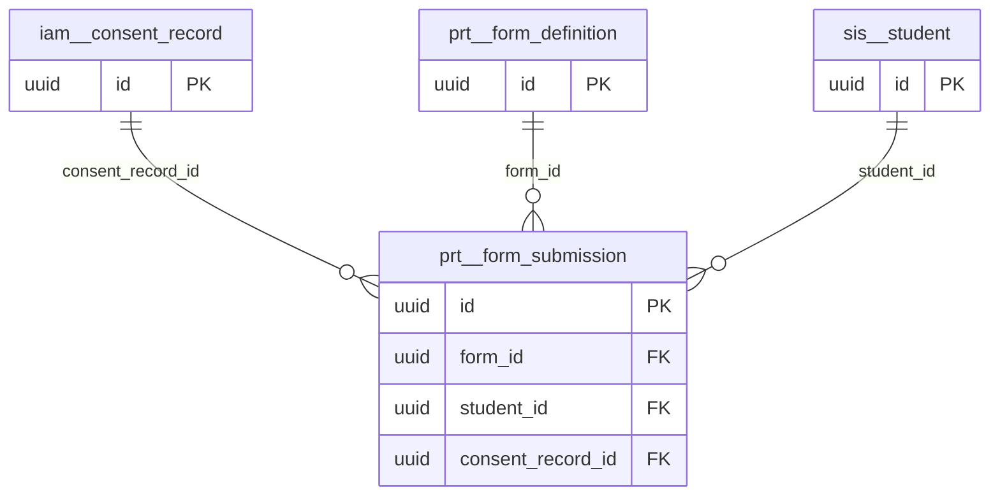

# Schema `prt`

> PRT: online forms and consents for portals

Generated from the live database by `db/tools/gen_docs.py` — do not edit by hand.

**Tables:** 2

## Entity-relationship diagram

Convention FKs to `core.organisation`, `core.campus`, `sys.stored_file` and `wf.approval_request` are omitted from the diagram (see table details).

## Tables

- [`prt.form_definition`](#prtformdefinition) — Online form/consent definition for the portal.
- [`prt.form_submission`](#prtformsubmission) — Submitted form with e-signature.

### `prt.form_definition`

Online form/consent definition for the portal.

- Row-level security: `p_campus: core.campus_visible(org_id, campus_id)`

| Column | Type | Null | Default | Description |
|---|---|---|---|---|
| `id` | uuid |  | uuidv7() |  |
| `org_id` | uuid |  |  |  |
| `campus_id` | uuid | yes |  |  |
| `code` | text |  |  |  |
| `title_en` | text |  |  |  |
| `title_bn` | text | yes |  |  |
| `kind` | text |  |  |  |
| `schema` | jsonb |  |  | JSON schema of fields |
| `requires_signature` | boolean |  | true |  |
| `audience` | jsonb |  | '{}'::jsonb |  |
| `due_at` | timestamp with time zone | yes |  |  |
| `version` | integer |  | 1 |  |
| `status` | text |  | 'draft'::text |  |
| `created_at` | timestamp with time zone |  | now() |  |
| `created_by` | uuid | yes | core.current_user_id() |  |
| `updated_at` | timestamp with time zone |  | now() |  |
| `updated_by` | uuid | yes |  |  |
| `row_version` | integer |  | 1 |  |

| Constraint | Kind | Definition |
|---|---|---|
| `form_definition_pkey` | PK | `PRIMARY KEY (id)` |
| `form_definition_org_id_campus_id_code_version_key` | UNIQUE | `UNIQUE NULLS NOT DISTINCT (org_id, campus_id, code, version)` |
| `form_definition_campus_id_fkey` | FK | `FOREIGN KEY (campus_id) REFERENCES core.campus(id)` |
| `form_definition_org_id_fkey` | FK | `FOREIGN KEY (org_id) REFERENCES core.organisation(id)` |
| `form_definition_kind_check` | CHECK | `CHECK ((kind = ANY (ARRAY['consent'::text, 'medical'::text, 'acknowledgement'::text, 'survey_like'::text])))` |
| `form_definition_status_check` | CHECK | `CHECK ((status = ANY (ARRAY['draft'::text, 'published'::text, 'closed'::text])))` |

**Indexes**

- `CREATE INDEX ix_form_definition_campus_id_fk ON prt.form_definition USING btree (campus_id)`

**Triggers**

- `trg_touch` — BEFORE UPDATE → `tg_touch()`

### `prt.form_submission`

Submitted form with e-signature.

- Row-level security: `p_campus: core.campus_visible(org_id, campus_id)`

| Column | Type | Null | Default | Description |
|---|---|---|---|---|
| `id` | uuid |  | uuidv7() |  |
| `org_id` | uuid |  |  |  |
| `campus_id` | uuid |  |  |  |
| `form_id` | uuid |  |  |  |
| `student_id` | uuid | yes |  |  |
| `submitted_by` | uuid |  |  |  |
| `answers` | jsonb |  |  |  |
| `signature_name` | text | yes |  |  |
| `signature_file_id` | uuid | yes |  |  |
| `submitted_at` | timestamp with time zone |  | now() |  |
| `ip` | inet | yes |  |  |
| `consent_record_id` | uuid | yes |  |  |

| Constraint | Kind | Definition |
|---|---|---|
| `form_submission_pkey` | PK | `PRIMARY KEY (id)` |
| `form_submission_form_id_student_id_submitted_by_key` | UNIQUE | `UNIQUE (form_id, student_id, submitted_by)` |
| `form_submission_campus_id_fkey` | FK | `FOREIGN KEY (campus_id) REFERENCES core.campus(id)` |
| `form_submission_consent_record_id_fkey` | FK | `FOREIGN KEY (consent_record_id) REFERENCES iam.consent_record(id)` |
| `form_submission_form_id_fkey` | FK | `FOREIGN KEY (form_id) REFERENCES prt.form_definition(id)` |
| `form_submission_org_id_fkey` | FK | `FOREIGN KEY (org_id) REFERENCES core.organisation(id)` |
| `form_submission_signature_file_id_fkey` | FK | `FOREIGN KEY (signature_file_id) REFERENCES sys.stored_file(id)` |
| `form_submission_student_id_fkey` | FK | `FOREIGN KEY (student_id) REFERENCES sis.student(id)` |

**Indexes**

- `CREATE INDEX ix_form_submission_campus_id_fk ON prt.form_submission USING btree (campus_id)`
- `CREATE INDEX ix_form_submission_consent_record_id_fk ON prt.form_submission USING btree (consent_record_id)`
- `CREATE INDEX ix_form_submission_student_id_fk ON prt.form_submission USING btree (student_id)`

