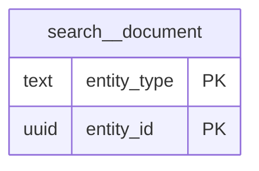

# Schema `search`

> CORE: global search read model fed by domain events

Generated from the live database by `db/tools/gen_docs.py` — do not edit by hand.

**Tables:** 1

## Entity-relationship diagram

Convention FKs to `core.organisation`, `core.campus`, `sys.stored_file` and `wf.approval_request` are omitted from the diagram (see table details).

## Tables

- [`search.document`](#searchdocument) — Global search read model (students, guardians, staff, invoices, receipts) fed by events. [CORE-08 global search read model (fed by events)]

### `search.document`

Global search read model (students, guardians, staff, invoices, receipts) fed by events. [CORE-08 global search read model (fed by events)]

- Row-level security: `p_campus: core.campus_visible(org_id, campus_id)`

| Column | Type | Null | Default | Description |
|---|---|---|---|---|
| `entity_type` | text |  |  | 'student','guardian','staff','invoice','receipt','application' |
| `entity_id` | uuid |  |  |  |
| `org_id` | uuid |  |  |  |
| `campus_id` | uuid | yes |  |  |
| `title` | text |  |  | 'Ayaan Rahman (DHN-2026-0142)' |
| `subtitle` | text | yes |  | 'Year 7 - B · Dhanmondi' |
| `search_text` | text |  |  | lower(name_en) \|\| name_bn \|\| ids \|\| phones \|\| barcode |
| `route` | text |  |  | '/students/{id}' |
| `required_permission` | text |  |  | filtered per user |
| `updated_at` | timestamp with time zone |  | now() |  |

| Constraint | Kind | Definition |
|---|---|---|
| `document_pkey` | PK | `PRIMARY KEY (entity_type, entity_id)` |

**Indexes**

- `CREATE INDEX ix_search_trgm ON search.document USING gin (search_text gin_trgm_ops)`

