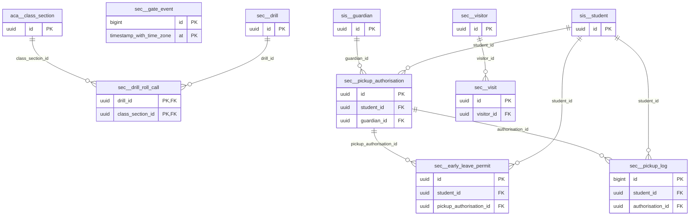

# Schema `sec`

> SEC: visitors, safe pick-up, gate events, drills

Generated from the live database by `db/tools/gen_docs.py` — do not edit by hand.

**Tables:** 8

## Entity-relationship diagram

Convention FKs to `core.organisation`, `core.campus`, `sys.stored_file` and `wf.approval_request` are omitted from the diagram (see table details).

## Tables

- [`sec.drill`](#secdrill) — Emergency drill. [SEC-05 (P3)]
- [`sec.drill_roll_call`](#secdrillrollcall) — Roll call per class during a drill.
- [`sec.early_leave_permit`](#secearlyleavepermit) — Approved early leave for a student.
- [`sec.gate_event`](#secgateevent) — Gate entry/exit scan - monthly partitions. [SEC-03 RFID/QR gate logs (partitioned monthly)]
- [`sec.pickup_authorisation`](#secpickupauthorisation) — Who may collect a student (guardian, standing or ad-hoc with OTP). [SEC-02]
- [`sec.pickup_log`](#secpickuplog) — Append-only release log at the gate.
- [`sec.visit`](#secvisit) — Visit with check-in/out, host and badge. [SEC-01]
- [`sec.visitor`](#secvisitor) — Visitor identity (encrypted ID) and watch-list flag.

### `sec.drill`

Emergency drill. [SEC-05 (P3)]

- Row-level security: `p_campus: core.campus_visible(org_id, campus_id)`

| Column | Type | Null | Default | Description |
|---|---|---|---|---|
| `id` | uuid |  | uuidv7() |  |
| `org_id` | uuid |  |  |  |
| `campus_id` | uuid |  |  |  |
| `kind` | text |  |  |  |
| `scheduled_at` | timestamp with time zone |  |  |  |
| `started_at` | timestamp with time zone | yes |  |  |
| `all_clear_at` | timestamp with time zone | yes |  |  |
| `report` | text | yes |  |  |

| Constraint | Kind | Definition |
|---|---|---|
| `drill_pkey` | PK | `PRIMARY KEY (id)` |
| `drill_campus_id_fkey` | FK | `FOREIGN KEY (campus_id) REFERENCES core.campus(id)` |
| `drill_org_id_fkey` | FK | `FOREIGN KEY (org_id) REFERENCES core.organisation(id)` |
| `drill_kind_check` | CHECK | `CHECK ((kind = ANY (ARRAY['fire'::text, 'earthquake'::text, 'lockdown'::text, 'evacuation'::text])))` |

**Indexes**

- `CREATE INDEX ix_drill_campus_id_fk ON sec.drill USING btree (campus_id)`

### `sec.drill_roll_call`

Roll call per class during a drill.

| Column | Type | Null | Default | Description |
|---|---|---|---|---|
| `drill_id` | uuid |  |  |  |
| `class_section_id` | uuid |  |  |  |
| `expected` | smallint |  |  |  |
| `accounted` | smallint |  |  |  |
| `missing_student_ids` | uuid[] |  | '{}'::uuid[] |  |
| `reported_by` | uuid |  |  |  |
| `reported_at` | timestamp with time zone |  | now() |  |

| Constraint | Kind | Definition |
|---|---|---|
| `drill_roll_call_pkey` | PK | `PRIMARY KEY (drill_id, class_section_id)` |
| `drill_roll_call_class_section_id_fkey` | FK | `FOREIGN KEY (class_section_id) REFERENCES aca.class_section(id)` |
| `drill_roll_call_drill_id_fkey` | FK | `FOREIGN KEY (drill_id) REFERENCES sec.drill(id) ON DELETE CASCADE` |

**Indexes**

- `CREATE INDEX ix_drill_roll_call_class_section_id_fk ON sec.drill_roll_call USING btree (class_section_id)`

### `sec.early_leave_permit`

Approved early leave for a student.

- Row-level security: `p_campus: core.campus_visible(org_id, campus_id)`

| Column | Type | Null | Default | Description |
|---|---|---|---|---|
| `id` | uuid |  | uuidv7() |  |
| `org_id` | uuid |  |  |  |
| `campus_id` | uuid |  |  |  |
| `student_id` | uuid |  |  |  |
| `leave_at` | timestamp with time zone |  |  |  |
| `reason` | text |  |  |  |
| `approved_by` | uuid |  |  |  |
| `pickup_authorisation_id` | uuid | yes |  |  |
| `used_at` | timestamp with time zone | yes |  |  |

| Constraint | Kind | Definition |
|---|---|---|
| `early_leave_permit_pkey` | PK | `PRIMARY KEY (id)` |
| `early_leave_permit_campus_id_fkey` | FK | `FOREIGN KEY (campus_id) REFERENCES core.campus(id)` |
| `early_leave_permit_org_id_fkey` | FK | `FOREIGN KEY (org_id) REFERENCES core.organisation(id)` |
| `early_leave_permit_pickup_authorisation_id_fkey` | FK | `FOREIGN KEY (pickup_authorisation_id) REFERENCES sec.pickup_authorisation(id)` |
| `early_leave_permit_student_id_fkey` | FK | `FOREIGN KEY (student_id) REFERENCES sis.student(id)` |

**Indexes**

- `CREATE INDEX ix_early_leave_permit_campus_id_fk ON sec.early_leave_permit USING btree (campus_id)`
- `CREATE INDEX ix_early_leave_permit_pickup_authorisation_id_fk ON sec.early_leave_permit USING btree (pickup_authorisation_id)`
- `CREATE INDEX ix_early_leave_permit_student_id_fk ON sec.early_leave_permit USING btree (student_id)`

### `sec.gate_event`

Gate entry/exit scan - monthly partitions. [SEC-03 RFID/QR gate logs (partitioned monthly)]

- Partitioned `RANGE (at)` (14 partitions incl. default)
- Row-level security: `p_campus: core.campus_visible(org_id, campus_id)`

| Column | Type | Null | Default | Description |
|---|---|---|---|---|
| `id` | bigint |  |  |  |
| `org_id` | uuid |  |  |  |
| `campus_id` | uuid |  |  |  |
| `person_type` | text |  |  |  |
| `person_id` | uuid | yes |  |  |
| `direction` | text |  |  |  |
| `at` | timestamp with time zone |  |  |  |
| `device_id` | uuid | yes |  |  |
| `kind` | text |  | 'normal'::text |  |
| `permit_ref` | uuid | yes |  |  |
| `cctv_ref` | text | yes |  | SEC-04 NVR channel + timestamp for incident review |

| Constraint | Kind | Definition |
|---|---|---|
| `gate_event_pkey` | PK | `PRIMARY KEY (id, at)` |
| `gate_event_campus_id_fkey` | FK | `FOREIGN KEY (campus_id) REFERENCES core.campus(id)` |
| `gate_event_org_id_fkey` | FK | `FOREIGN KEY (org_id) REFERENCES core.organisation(id)` |
| `gate_event_direction_check` | CHECK | `CHECK ((direction = ANY (ARRAY['in'::text, 'out'::text])))` |
| `gate_event_kind_check` | CHECK | `CHECK ((kind = ANY (ARRAY['normal'::text, 'late_slip'::text, 'early_leave_permit'::text, 'denied'::text])))` |
| `gate_event_person_type_check` | CHECK | `CHECK ((person_type = ANY (ARRAY['student'::text, 'staff'::text, 'visitor'::text])))` |

**Indexes**

- `CREATE INDEX ix_gate_event_campus_id_fk ON ONLY sec.gate_event USING btree (campus_id)`
- `CREATE INDEX ix_gate_event_person ON ONLY sec.gate_event USING btree (person_id, at DESC)`

### `sec.pickup_authorisation`

Who may collect a student (guardian, standing or ad-hoc with OTP). [SEC-02]

- Row-level security: `p_campus: core.campus_visible(org_id, campus_id)`

| Column | Type | Null | Default | Description |
|---|---|---|---|---|
| `id` | uuid |  | uuidv7() |  |
| `org_id` | uuid |  |  |  |
| `campus_id` | uuid |  |  |  |
| `student_id` | uuid |  |  |  |
| `kind` | text |  |  |  |
| `guardian_id` | uuid | yes |  |  |
| `person_name` | text | yes |  |  |
| `person_phone` | core.phone_e164 | yes |  |  |
| `person_photo_file_id` | uuid | yes |  |  |
| `valid_from` | timestamp with time zone |  |  |  |
| `valid_to` | timestamp with time zone | yes |  |  |
| `otp_hash` | bytea | yes |  | adhoc: OTP / QR token |
| `created_by_user` | uuid |  |  |  |
| `revoked_at` | timestamp with time zone | yes |  |  |

| Constraint | Kind | Definition |
|---|---|---|
| `pickup_authorisation_pkey` | PK | `PRIMARY KEY (id)` |
| `pickup_authorisation_campus_id_fkey` | FK | `FOREIGN KEY (campus_id) REFERENCES core.campus(id)` |
| `pickup_authorisation_guardian_id_fkey` | FK | `FOREIGN KEY (guardian_id) REFERENCES sis.guardian(id)` |
| `pickup_authorisation_org_id_fkey` | FK | `FOREIGN KEY (org_id) REFERENCES core.organisation(id)` |
| `pickup_authorisation_person_photo_file_id_fkey` | FK | `FOREIGN KEY (person_photo_file_id) REFERENCES sys.stored_file(id)` |
| `pickup_authorisation_student_id_fkey` | FK | `FOREIGN KEY (student_id) REFERENCES sis.student(id)` |
| `pickup_authorisation_check` | CHECK | `CHECK (((kind <> 'guardian'::text) OR (guardian_id IS NOT NULL)))` |
| `pickup_authorisation_check1` | CHECK | `CHECK (((kind = 'guardian'::text) OR (person_name IS NOT NULL)))` |
| `pickup_authorisation_kind_check` | CHECK | `CHECK ((kind = ANY (ARRAY['guardian'::text, 'standing'::text, 'adhoc'::text])))` |

**Indexes**

- `CREATE INDEX ix_pickup_auth_student ON sec.pickup_authorisation USING btree (student_id) WHERE (revoked_at IS NULL)`
- `CREATE INDEX ix_pickup_authorisation_campus_id_fk ON sec.pickup_authorisation USING btree (campus_id)`
- `CREATE INDEX ix_pickup_authorisation_guardian_id_fk ON sec.pickup_authorisation USING btree (guardian_id)`

**Triggers**

- `trg_audit` — AFTER INSERT UPDATE DELETE → `tg_row_audit()`

### `sec.pickup_log`

Append-only release log at the gate.

- Row-level security: `p_campus: core.campus_visible(org_id, campus_id)`

| Column | Type | Null | Default | Description |
|---|---|---|---|---|
| `id` | bigint |  |  |  |
| `org_id` | uuid |  |  |  |
| `campus_id` | uuid |  |  |  |
| `student_id` | uuid |  |  |  |
| `authorisation_id` | uuid |  |  |  |
| `verified_by` | text |  |  |  |
| `released_by` | uuid |  |  |  |
| `released_at` | timestamp with time zone |  | now() |  |

| Constraint | Kind | Definition |
|---|---|---|
| `pickup_log_pkey` | PK | `PRIMARY KEY (id)` |
| `pickup_log_authorisation_id_fkey` | FK | `FOREIGN KEY (authorisation_id) REFERENCES sec.pickup_authorisation(id)` |
| `pickup_log_campus_id_fkey` | FK | `FOREIGN KEY (campus_id) REFERENCES core.campus(id)` |
| `pickup_log_org_id_fkey` | FK | `FOREIGN KEY (org_id) REFERENCES core.organisation(id)` |
| `pickup_log_student_id_fkey` | FK | `FOREIGN KEY (student_id) REFERENCES sis.student(id)` |
| `pickup_log_verified_by_check` | CHECK | `CHECK ((verified_by = ANY (ARRAY['photo'::text, 'otp'::text, 'qr'::text, 'id_card'::text])))` |

**Indexes**

- `CREATE INDEX ix_pickup_log_authorisation_id_fk ON sec.pickup_log USING btree (authorisation_id)`
- `CREATE INDEX ix_pickup_log_campus_id_fk ON sec.pickup_log USING btree (campus_id)`
- `CREATE INDEX ix_pickup_log_student_id_fk ON sec.pickup_log USING btree (student_id)`

### `sec.visit`

Visit with check-in/out, host and badge. [SEC-01]

- Row-level security: `p_campus: core.campus_visible(org_id, campus_id)`

| Column | Type | Null | Default | Description |
|---|---|---|---|---|
| `id` | uuid |  | uuidv7() |  |
| `org_id` | uuid |  |  |  |
| `campus_id` | uuid |  |  |  |
| `visitor_id` | uuid |  |  |  |
| `purpose` | text |  |  |  |
| `host_user_id` | uuid | yes |  |  |
| `pre_registered` | boolean |  | false |  |
| `expected_at` | timestamp with time zone | yes |  |  |
| `checked_in_at` | timestamp with time zone | yes |  |  |
| `checked_out_at` | timestamp with time zone | yes |  |  |
| `badge_no` | text | yes |  |  |
| `host_notified_at` | timestamp with time zone | yes |  |  |
| `created_at` | timestamp with time zone |  | now() |  |
| `created_by` | uuid | yes | core.current_user_id() |  |
| `updated_at` | timestamp with time zone |  | now() |  |
| `updated_by` | uuid | yes |  |  |
| `row_version` | integer |  | 1 |  |

| Constraint | Kind | Definition |
|---|---|---|
| `visit_pkey` | PK | `PRIMARY KEY (id)` |
| `visit_campus_id_fkey` | FK | `FOREIGN KEY (campus_id) REFERENCES core.campus(id)` |
| `visit_org_id_fkey` | FK | `FOREIGN KEY (org_id) REFERENCES core.organisation(id)` |
| `visit_visitor_id_fkey` | FK | `FOREIGN KEY (visitor_id) REFERENCES sec.visitor(id)` |

**Indexes**

- `CREATE INDEX ix_visit_onsite ON sec.visit USING btree (campus_id) WHERE ((checked_in_at IS NOT NULL) AND (checked_out_at IS NULL))`
- `CREATE INDEX ix_visit_visitor_id_fk ON sec.visit USING btree (visitor_id)`

**Triggers**

- `trg_touch` — BEFORE UPDATE → `tg_touch()`

### `sec.visitor`

Visitor identity (encrypted ID) and watch-list flag.

- Row-level security: `p_org: core.org_visible(org_id)`

| Column | Type | Null | Default | Description |
|---|---|---|---|---|
| `id` | uuid |  | uuidv7() |  |
| `org_id` | uuid |  |  |  |
| `full_name` | text |  |  |  |
| `phone` | core.phone_e164 | yes |  |  |
| `id_type` | text | yes |  |  |
| `id_no_enc` | bytea | yes |  |  |
| `id_no_bidx` | bytea | yes |  |  |
| `photo_file_id` | uuid | yes |  |  |
| `is_watch_listed` | boolean |  | false |  |
| `watch_reason` | text | yes |  |  |
| `created_at` | timestamp with time zone |  | now() |  |
| `created_by` | uuid | yes | core.current_user_id() |  |
| `updated_at` | timestamp with time zone |  | now() |  |
| `updated_by` | uuid | yes |  |  |
| `row_version` | integer |  | 1 |  |

| Constraint | Kind | Definition |
|---|---|---|
| `visitor_pkey` | PK | `PRIMARY KEY (id)` |
| `visitor_org_id_fkey` | FK | `FOREIGN KEY (org_id) REFERENCES core.organisation(id)` |
| `visitor_photo_file_id_fkey` | FK | `FOREIGN KEY (photo_file_id) REFERENCES sys.stored_file(id)` |
| `visitor_id_type_check` | CHECK | `CHECK ((id_type = ANY (ARRAY['nid'::text, 'passport'::text, 'driving_licence'::text, 'other'::text])))` |

**Indexes**

- `CREATE INDEX ix_visitor_bidx ON sec.visitor USING btree (id_no_bidx) WHERE (id_no_bidx IS NOT NULL)`
- `CREATE INDEX ix_visitor_phone ON sec.visitor USING btree (org_id, phone)`

**Triggers**

- `trg_touch` — BEFORE UPDATE → `tg_touch()`

