# Schema `sis`

> SIS: students, guardians, families, enrolment history

Generated from the live database by `db/tools/gen_docs.py` — do not edit by hand.

**Tables:** 13

## Entity-relationship diagram

Convention FKs to `core.organisation`, `core.campus`, `sys.stored_file` and `wf.approval_request` are omitted from the diagram (see table details).

```mermaid
erDiagram
  sis__alumni_profile {
    uuid student_id PK, FK
  }
  sis__enrolment {
    uuid id PK
    uuid academic_year_id FK
    uuid student_id FK
    uuid class_section_id FK
    uuid year_group_id FK
    uuid previous_enrolment_id FK
  }
  sis__family {
    uuid id PK
    uuid billing_guardian_id FK
  }
  sis__guardian {
    uuid id PK
    uuid family_id FK
    uuid user_id FK
    uuid is_staff_id FK
  }
  sis__id_card_issue {
    uuid id PK
    uuid student_id FK
    uuid invoice_line_id FK
  }
  sis__profile_change_request {
    uuid id PK
  }
  sis__sen_record {
    uuid id PK
    uuid student_id FK
  }
  sis__student {
    uuid id PK
    uuid family_id FK
    uuid user_id FK
    uuid house_id FK
  }
  sis__student_address {
    uuid student_id PK, FK
    text kind PK
  }
  sis__student_document {
    uuid id PK
    uuid student_id FK
  }
  sis__student_guardian {
    uuid student_id PK, FK
    uuid guardian_id PK, FK
  }
  sis__student_subject {
    uuid enrolment_id PK, FK
    uuid subject_id PK, FK
  }
  sis__withdrawal {
    uuid id PK
    uuid student_id FK
    uuid tc_document_id FK
  }
  aca__class_section {
    uuid id PK
  }
  aca__subject {
    uuid id PK
  }
  aca__year_group {
    uuid id PK
  }
  cca__house {
    uuid id PK
  }
  core__academic_year {
    uuid id PK
  }
  doc__issued_document {
    uuid id PK
  }
  fee__invoice_line {
    uuid id PK
  }
  hrm__staff {
    uuid id PK
  }
  iam__user_account {
    uuid id PK
  }
  aca__class_section ||--o{ sis__enrolment : "class_section_id"
  aca__subject ||--o{ sis__student_subject : "subject_id"
  aca__year_group ||--o{ sis__enrolment : "year_group_id"
  cca__house ||--o{ sis__student : "house_id"
  core__academic_year ||--o{ sis__enrolment : "academic_year_id"
  doc__issued_document ||--o{ sis__withdrawal : "tc_document_id"
  fee__invoice_line ||--o{ sis__id_card_issue : "invoice_line_id"
  hrm__staff ||--o{ sis__guardian : "is_staff_id"
  iam__user_account ||--o{ sis__guardian : "user_id"
  iam__user_account ||--o{ sis__student : "user_id"
  sis__enrolment ||--o{ sis__enrolment : "previous_enrolment_id"
  sis__enrolment ||--o{ sis__student_subject : "enrolment_id"
  sis__family ||--o{ sis__guardian : "family_id"
  sis__family ||--o{ sis__student : "family_id"
  sis__guardian ||--o{ sis__family : "billing_guardian_id"
  sis__guardian ||--o{ sis__student_guardian : "guardian_id"
  sis__student ||--o{ sis__alumni_profile : "student_id"
  sis__student ||--o{ sis__enrolment : "student_id"
  sis__student ||--o{ sis__id_card_issue : "student_id"
  sis__student ||--o{ sis__sen_record : "student_id"
  sis__student ||--o{ sis__student_address : "student_id"
  sis__student ||--o{ sis__student_document : "student_id"
  sis__student ||--o{ sis__student_guardian : "student_id"
  sis__student ||--o{ sis__withdrawal : "student_id"
```

## Tables

- [`sis.alumni_profile`](#sisalumniprofile) — Graduate destination and alumni contact consent. [SIS-10 (P3)]
- [`sis.enrolment`](#sisenrolment) — Placement of a student in a class section for a period - full history across years and transfers. [one row per student per placement per year (I-12)]
- [`sis.family`](#sisfamily) — Household grouping siblings and guardians across campuses (one login, combined fees). [one login / combined fee view across campuses (I-11)]
- [`sis.guardian`](#sisguardian) — Parent/guardian with contact details and portal account.
- [`sis.id_card_issue`](#sisidcardissue) — Student ID card issue/reissue log with RFID number. [SIS-09]
- [`sis.profile_change_request`](#sisprofilechangerequest) — Guardian-requested profile change awaiting office approval. [PRT-07 guardian-requested updates with approval]
- [`sis.sen_record`](#sissenrecord) — Confidential special-educational-needs record and exam access arrangements. [SIS-08 restricted (break-glass)]
- [`sis.student`](#sisstudent) — Authoritative student record (profile, status, current campus).
- [`sis.student_address`](#sisstudentaddress) — Present and permanent address of a student.
- [`sis.student_document`](#sisstudentdocument) — Document vault entry (birth certificate, reports, vaccination card) with verification. [SIS-03 document vault]
- [`sis.student_guardian`](#sisstudentguardian) — Relationship between student and guardian with contact, payer and pick-up flags.
- [`sis.student_subject`](#sisstudentsubject) — Elective subjects chosen for an enrolment. [chosen electives per enrolment (ACA-02)]
- [`sis.withdrawal`](#siswithdrawal) — Withdrawal workflow with dues clearance and transfer certificate. [SIS-06 with dues clearance]

### `sis.alumni_profile`

Graduate destination and alumni contact consent. [SIS-10 (P3)]

| Column | Type | Null | Default | Description |
|---|---|---|---|---|
| `student_id` | uuid |  |  |  |
| `graduation_year` | smallint |  |  |  |
| `destination` | text | yes |  | university / employer |
| `contact_consent` | boolean |  | false |  |
| `contact_email` | citext | yes |  |  |
| `contact_phone` | core.phone_e164 | yes |  |  |

| Constraint | Kind | Definition |
|---|---|---|
| `alumni_profile_pkey` | PK | `PRIMARY KEY (student_id)` |
| `alumni_profile_student_id_fkey` | FK | `FOREIGN KEY (student_id) REFERENCES sis.student(id)` |

### `sis.enrolment`

Placement of a student in a class section for a period - full history across years and transfers. [one row per student per placement per year (I-12)]

- Row-level security: `p_campus: core.campus_visible(org_id, campus_id)`

| Column | Type | Null | Default | Description |
|---|---|---|---|---|
| `id` | uuid |  | uuidv7() |  |
| `org_id` | uuid |  |  |  |
| `campus_id` | uuid |  |  |  |
| `academic_year_id` | uuid |  |  |  |
| `student_id` | uuid |  |  |  |
| `class_section_id` | uuid |  |  |  |
| `year_group_id` | uuid |  |  | denormalised for reporting |
| `roll_no` | smallint | yes |  |  |
| `status` | text |  | 'active'::text |  |
| `starts_on` | date |  |  |  |
| `ends_on` | date | yes |  |  |
| `end_reason` | text | yes |  |  |
| `previous_enrolment_id` | uuid | yes |  | chain for mid-year transfers |
| `promotion_decision` | text | yes |  |  |
| `created_at` | timestamp with time zone |  | now() |  |
| `created_by` | uuid | yes | core.current_user_id() |  |
| `updated_at` | timestamp with time zone |  | now() |  |
| `updated_by` | uuid | yes |  |  |
| `row_version` | integer |  | 1 |  |

| Constraint | Kind | Definition |
|---|---|---|
| `enrolment_pkey` | PK | `PRIMARY KEY (id)` |
| `enrolment_academic_year_id_fkey` | FK | `FOREIGN KEY (academic_year_id) REFERENCES core.academic_year(id)` |
| `enrolment_campus_id_fkey` | FK | `FOREIGN KEY (campus_id) REFERENCES core.campus(id)` |
| `enrolment_class_section_id_fkey` | FK | `FOREIGN KEY (class_section_id) REFERENCES aca.class_section(id)` |
| `enrolment_org_id_fkey` | FK | `FOREIGN KEY (org_id) REFERENCES core.organisation(id)` |
| `enrolment_previous_enrolment_id_fkey` | FK | `FOREIGN KEY (previous_enrolment_id) REFERENCES sis.enrolment(id)` |
| `enrolment_student_id_fkey` | FK | `FOREIGN KEY (student_id) REFERENCES sis.student(id)` |
| `enrolment_year_group_id_fkey` | FK | `FOREIGN KEY (year_group_id) REFERENCES aca.year_group(id)` |
| `enrolment_student_id_daterange_excl` | EXCLUDE | `EXCLUDE USING gist (student_id WITH =, daterange(starts_on, COALESCE(ends_on, 'infinity'::date), '[]'::text) WITH &&)` |
| `enrolment_check` | CHECK | `CHECK (((ends_on IS NULL) OR (ends_on >= starts_on)))` |
| `enrolment_promotion_decision_check` | CHECK | `CHECK ((promotion_decision = ANY (ARRAY['promote'::text, 'conditional'::text, 'repeat'::text, 'hold'::text, 'graduate'::text])))` |
| `enrolment_status_check` | CHECK | `CHECK ((status = ANY (ARRAY['active'::text, 'transferred_out'::text, 'promoted'::text, 'repeated'::text, 'withdrawn'::text, 'graduated'::text])))` |

**Indexes**

- `CREATE INDEX ix_enrolment_academic_year_id_fk ON sis.enrolment USING btree (academic_year_id)`
- `CREATE INDEX ix_enrolment_campus_id_fk ON sis.enrolment USING btree (campus_id)`
- `CREATE INDEX ix_enrolment_previous_enrolment_id_fk ON sis.enrolment USING btree (previous_enrolment_id)`
- `CREATE INDEX ix_enrolment_section_active ON sis.enrolment USING btree (class_section_id) WHERE (status = 'active'::text)`
- `CREATE INDEX ix_enrolment_student_year ON sis.enrolment USING btree (student_id, academic_year_id)`
- `CREATE INDEX ix_enrolment_year_group_id_fk ON sis.enrolment USING btree (year_group_id)`
- `CREATE UNIQUE INDEX ux_enrolment_roll ON sis.enrolment USING btree (class_section_id, roll_no) WHERE ((status = 'active'::text) AND (roll_no IS NOT NULL))`

**Triggers**

- `trg_audit` — AFTER INSERT UPDATE DELETE → `tg_row_audit()`
- `trg_touch` — BEFORE UPDATE → `tg_touch()`

### `sis.family`

Household grouping siblings and guardians across campuses (one login, combined fees). [one login / combined fee view across campuses (I-11)]

- Row-level security: `p_org: core.org_visible(org_id)`

| Column | Type | Null | Default | Description |
|---|---|---|---|---|
| `id` | uuid |  | uuidv7() |  |
| `org_id` | uuid |  |  |  |
| `family_code` | text |  |  | 'FAM-000123' |
| `billing_guardian_id` | uuid | yes |  | FK added after sis.guardian |
| `notes` | text | yes |  |  |
| `created_at` | timestamp with time zone |  | now() |  |
| `created_by` | uuid | yes | core.current_user_id() |  |
| `updated_at` | timestamp with time zone |  | now() |  |
| `updated_by` | uuid | yes |  |  |
| `row_version` | integer |  | 1 |  |

| Constraint | Kind | Definition |
|---|---|---|
| `family_pkey` | PK | `PRIMARY KEY (id)` |
| `family_org_id_family_code_key` | UNIQUE | `UNIQUE (org_id, family_code)` |
| `family_billing_guardian_id_fkey` | FK | `FOREIGN KEY (billing_guardian_id) REFERENCES sis.guardian(id)` |
| `family_org_id_fkey` | FK | `FOREIGN KEY (org_id) REFERENCES core.organisation(id)` |

**Indexes**

- `CREATE INDEX ix_family_billing_guardian_id_fk ON sis.family USING btree (billing_guardian_id)`

**Triggers**

- `trg_touch` — BEFORE UPDATE → `tg_touch()`

### `sis.guardian`

Parent/guardian with contact details and portal account.

- Row-level security: `p_org: core.org_visible(org_id)`

| Column | Type | Null | Default | Description |
|---|---|---|---|---|
| `id` | uuid |  | uuidv7() |  |
| `org_id` | uuid |  |  |  |
| `family_id` | uuid |  |  |  |
| `user_id` | uuid | yes |  | parent app login (OTP by phone) |
| `full_name_en` | text |  |  |  |
| `full_name_bn` | text COLLATE bn_bd | yes |  |  |
| `phone` | core.phone_e164 |  |  |  |
| `alt_phone` | core.phone_e164 | yes |  |  |
| `whatsapp_phone` | core.phone_e164 | yes |  |  |
| `email` | citext | yes |  |  |
| `nid_enc` | bytea | yes |  |  |
| `nid_bidx` | bytea | yes |  |  |
| `occupation_code` | text | yes |  | core.lookup_value 'occupation' |
| `employer` | text | yes |  |  |
| `income_band` | text | yes |  |  |
| `is_staff_id` | uuid | yes |  | staff-ward concession (FK hrm.staff) |
| `photo_file_id` | uuid | yes |  | authorised pick-up photo |
| `preferred_locale` | core.locale |  | 'bn'::text |  |
| `deleted_at` | timestamp with time zone | yes |  |  |
| `created_at` | timestamp with time zone |  | now() |  |
| `created_by` | uuid | yes | core.current_user_id() |  |
| `updated_at` | timestamp with time zone |  | now() |  |
| `updated_by` | uuid | yes |  |  |
| `row_version` | integer |  | 1 |  |

| Constraint | Kind | Definition |
|---|---|---|
| `guardian_pkey` | PK | `PRIMARY KEY (id)` |
| `guardian_family_id_fkey` | FK | `FOREIGN KEY (family_id) REFERENCES sis.family(id)` |
| `guardian_is_staff_id_fkey` | FK | `FOREIGN KEY (is_staff_id) REFERENCES hrm.staff(id)` |
| `guardian_org_id_fkey` | FK | `FOREIGN KEY (org_id) REFERENCES core.organisation(id)` |
| `guardian_photo_file_id_fkey` | FK | `FOREIGN KEY (photo_file_id) REFERENCES sys.stored_file(id)` |
| `guardian_user_id_fkey` | FK | `FOREIGN KEY (user_id) REFERENCES iam.user_account(id)` |

**Indexes**

- `CREATE INDEX ix_guardian_family ON sis.guardian USING btree (family_id)`
- `CREATE INDEX ix_guardian_is_staff_id_fk ON sis.guardian USING btree (is_staff_id)`
- `CREATE INDEX ix_guardian_phone ON sis.guardian USING btree (org_id, phone)`
- `CREATE INDEX ix_guardian_trgm ON sis.guardian USING gin ((((((lower(full_name_en) \|\| ' '::text) \|\| COALESCE(full_name_bn, ''::text)) \|\| ' '::text) \|\| (phone)::text)) gin_trgm_ops)`
- `CREATE INDEX ix_guardian_user_id_fk ON sis.guardian USING btree (user_id)`

**Triggers**

- `trg_audit` — AFTER INSERT UPDATE DELETE → `tg_row_audit()`
- `trg_touch` — BEFORE UPDATE → `tg_touch()`

### `sis.id_card_issue`

Student ID card issue/reissue log with RFID number. [SIS-09]

- Row-level security: `p_campus: core.campus_visible(org_id, campus_id)`

| Column | Type | Null | Default | Description |
|---|---|---|---|---|
| `id` | uuid |  | uuidv7() |  |
| `org_id` | uuid |  |  |  |
| `campus_id` | uuid |  |  |  |
| `student_id` | uuid |  |  |  |
| `card_no` | text |  |  |  |
| `rfid_uid` | text | yes |  |  |
| `reason` | text |  |  |  |
| `issued_on` | date |  |  |  |
| `invoice_line_id` | uuid | yes |  | reissue fee |

| Constraint | Kind | Definition |
|---|---|---|
| `id_card_issue_pkey` | PK | `PRIMARY KEY (id)` |
| `id_card_issue_org_id_card_no_key` | UNIQUE | `UNIQUE (org_id, card_no)` |
| `id_card_issue_campus_id_fkey` | FK | `FOREIGN KEY (campus_id) REFERENCES core.campus(id)` |
| `id_card_issue_invoice_line_id_fkey` | FK | `FOREIGN KEY (invoice_line_id) REFERENCES fee.invoice_line(id)` |
| `id_card_issue_org_id_fkey` | FK | `FOREIGN KEY (org_id) REFERENCES core.organisation(id)` |
| `id_card_issue_student_id_fkey` | FK | `FOREIGN KEY (student_id) REFERENCES sis.student(id)` |
| `id_card_issue_reason_check` | CHECK | `CHECK ((reason = ANY (ARRAY['new'::text, 'lost'::text, 'damaged'::text, 'renewal'::text])))` |

**Indexes**

- `CREATE INDEX ix_id_card_issue_campus_id_fk ON sis.id_card_issue USING btree (campus_id)`
- `CREATE INDEX ix_id_card_issue_invoice_line_id_fk ON sis.id_card_issue USING btree (invoice_line_id)`
- `CREATE INDEX ix_id_card_issue_student_id_fk ON sis.id_card_issue USING btree (student_id)`

### `sis.profile_change_request`

Guardian-requested profile change awaiting office approval. [PRT-07 guardian-requested updates with approval]

- Row-level security: `p_campus: core.campus_visible(org_id, campus_id)`

| Column | Type | Null | Default | Description |
|---|---|---|---|---|
| `id` | uuid |  | uuidv7() |  |
| `org_id` | uuid |  |  |  |
| `campus_id` | uuid |  |  |  |
| `target_type` | text |  |  |  |
| `target_id` | uuid |  |  |  |
| `requested_by` | uuid |  |  |  |
| `changes` | jsonb |  |  | {"phone": {"from": "...", "to": "..."}} |
| `status` | text |  | 'pending'::text |  |
| `decided_by` | uuid | yes |  |  |
| `decided_at` | timestamp with time zone | yes |  |  |
| `created_at` | timestamp with time zone |  | now() |  |
| `created_by` | uuid | yes | core.current_user_id() |  |
| `updated_at` | timestamp with time zone |  | now() |  |
| `updated_by` | uuid | yes |  |  |
| `row_version` | integer |  | 1 |  |

| Constraint | Kind | Definition |
|---|---|---|
| `profile_change_request_pkey` | PK | `PRIMARY KEY (id)` |
| `profile_change_request_campus_id_fkey` | FK | `FOREIGN KEY (campus_id) REFERENCES core.campus(id)` |
| `profile_change_request_org_id_fkey` | FK | `FOREIGN KEY (org_id) REFERENCES core.organisation(id)` |
| `profile_change_request_status_check` | CHECK | `CHECK ((status = ANY (ARRAY['pending'::text, 'approved'::text, 'rejected'::text])))` |
| `profile_change_request_target_type_check` | CHECK | `CHECK ((target_type = ANY (ARRAY['student'::text, 'guardian'::text, 'address'::text])))` |

**Indexes**

- `CREATE INDEX ix_profile_change_request_campus_id_fk ON sis.profile_change_request USING btree (campus_id)`

**Triggers**

- `trg_audit` — AFTER INSERT UPDATE DELETE → `tg_row_audit()`
- `trg_touch` — BEFORE UPDATE → `tg_touch()`

### `sis.sen_record`

Confidential special-educational-needs record and exam access arrangements. [SIS-08 restricted (break-glass)]

- Row-level security: `p_campus: core.campus_visible(org_id, campus_id)`

| Column | Type | Null | Default | Description |
|---|---|---|---|---|
| `id` | uuid |  | uuidv7() |  |
| `org_id` | uuid |  |  |  |
| `campus_id` | uuid |  |  |  |
| `student_id` | uuid |  |  |  |
| `category` | text |  |  |  |
| `details_enc` | bytea |  |  | IEP, diagnosis (encrypted) |
| `access_arrangements` | text[] |  | '{}'::text[] | 'extra_time_25','reader','separate_room' (shared with EXM) |
| `review_on` | date | yes |  |  |
| `created_at` | timestamp with time zone |  | now() |  |
| `created_by` | uuid | yes | core.current_user_id() |  |
| `updated_at` | timestamp with time zone |  | now() |  |
| `updated_by` | uuid | yes |  |  |
| `row_version` | integer |  | 1 |  |

| Constraint | Kind | Definition |
|---|---|---|
| `sen_record_pkey` | PK | `PRIMARY KEY (id)` |
| `sen_record_campus_id_fkey` | FK | `FOREIGN KEY (campus_id) REFERENCES core.campus(id)` |
| `sen_record_org_id_fkey` | FK | `FOREIGN KEY (org_id) REFERENCES core.organisation(id)` |
| `sen_record_student_id_fkey` | FK | `FOREIGN KEY (student_id) REFERENCES sis.student(id)` |

**Indexes**

- `CREATE INDEX ix_sen_record_campus_id_fk ON sis.sen_record USING btree (campus_id)`
- `CREATE INDEX ix_sen_record_student_id_fk ON sis.sen_record USING btree (student_id)`

**Triggers**

- `trg_audit` — AFTER INSERT UPDATE DELETE → `tg_row_audit()`
- `trg_touch` — BEFORE UPDATE → `tg_touch()`

### `sis.student`

Authoritative student record (profile, status, current campus).

- Row-level security: `p_campus: core.campus_visible(org_id, campus_id)`

| Column | Type | Null | Default | Description |
|---|---|---|---|---|
| `id` | uuid |  | uuidv7() |  |
| `org_id` | uuid |  |  |  |
| `campus_id` | uuid |  |  | current home campus (denormalised from enrolment) |
| `family_id` | uuid |  |  |  |
| `user_id` | uuid | yes |  | student portal account (senior years) |
| `admission_no` | text |  |  | from core.number_sequence |
| `first_name_en` | text |  |  |  |
| `last_name_en` | text | yes |  |  |
| `full_name_en` | text | yes | *generated* |  |
| `full_name_bn` | text COLLATE bn_bd | yes |  |  |
| `preferred_name` | text | yes |  |  |
| `gender` | text |  |  |  |
| `date_of_birth` | date |  |  |  |
| `birth_cert_no_enc` | bytea | yes |  | encrypted |
| `birth_cert_no_bidx` | bytea | yes |  | HMAC blind index (exact search) |
| `passport_no_enc` | bytea | yes |  |  |
| `nationality` | character(2) |  | 'BD'::bpchar |  |
| `religion` | text | yes |  |  |
| `blood_group` | text | yes |  |  |
| `mother_tongue` | text | yes |  |  |
| `photo_file_id` | uuid | yes |  |  |
| `house_id` | uuid | yes |  | FK cca.house |
| `previous_school` | text | yes |  |  |
| `has_special_needs` | boolean |  | false | details in sis.sen_record (restricted) |
| `rfid_uid` | text | yes |  | current ID card chip |
| `status` | text |  | 'active'::text |  |
| `admitted_on` | date |  |  |  |
| `left_on` | date | yes |  |  |
| `search_text` | text | yes | *generated* |  |
| `deleted_at` | timestamp with time zone | yes |  |  |
| `created_at` | timestamp with time zone |  | now() |  |
| `created_by` | uuid | yes | core.current_user_id() |  |
| `updated_at` | timestamp with time zone |  | now() |  |
| `updated_by` | uuid | yes |  |  |
| `row_version` | integer |  | 1 |  |

| Constraint | Kind | Definition |
|---|---|---|
| `student_pkey` | PK | `PRIMARY KEY (id)` |
| `student_campus_id_fkey` | FK | `FOREIGN KEY (campus_id) REFERENCES core.campus(id)` |
| `student_family_id_fkey` | FK | `FOREIGN KEY (family_id) REFERENCES sis.family(id)` |
| `student_house_id_fkey` | FK | `FOREIGN KEY (house_id) REFERENCES cca.house(id)` |
| `student_org_id_fkey` | FK | `FOREIGN KEY (org_id) REFERENCES core.organisation(id)` |
| `student_photo_file_id_fkey` | FK | `FOREIGN KEY (photo_file_id) REFERENCES sys.stored_file(id)` |
| `student_user_id_fkey` | FK | `FOREIGN KEY (user_id) REFERENCES iam.user_account(id)` |
| `student_blood_group_check` | CHECK | `CHECK ((blood_group = ANY (ARRAY['A+'::text, 'A-'::text, 'B+'::text, 'B-'::text, 'AB+'::text, 'AB-'::text, 'O+'::text, 'O-'::text])))` |
| `student_gender_check` | CHECK | `CHECK ((gender = ANY (ARRAY['male'::text, 'female'::text])))` |
| `student_status_check` | CHECK | `CHECK ((status = ANY (ARRAY['active'::text, 'on_hold'::text, 'withdrawn'::text, 'graduated'::text, 'alumni'::text, 'deceased'::text])))` |

**Indexes**

- `CREATE INDEX ix_student_bidx ON sis.student USING btree (birth_cert_no_bidx) WHERE (birth_cert_no_bidx IS NOT NULL)`
- `CREATE INDEX ix_student_campus_status ON sis.student USING btree (campus_id, status) WHERE (deleted_at IS NULL)`
- `CREATE INDEX ix_student_family ON sis.student USING btree (family_id)`
- `CREATE INDEX ix_student_house_id_fk ON sis.student USING btree (house_id)`
- `CREATE INDEX ix_student_trgm ON sis.student USING gin (search_text gin_trgm_ops)`
- `CREATE INDEX ix_student_user_id_fk ON sis.student USING btree (user_id)`
- `CREATE UNIQUE INDEX ux_student_admission_no ON sis.student USING btree (org_id, admission_no) WHERE (deleted_at IS NULL)`
- `CREATE UNIQUE INDEX ux_student_rfid ON sis.student USING btree (org_id, rfid_uid) WHERE ((rfid_uid IS NOT NULL) AND (deleted_at IS NULL))`

**Triggers**

- `trg_audit` — AFTER INSERT UPDATE DELETE → `tg_row_audit()`
- `trg_touch` — BEFORE UPDATE → `tg_touch()`

### `sis.student_address`

Present and permanent address of a student.

| Column | Type | Null | Default | Description |
|---|---|---|---|---|
| `student_id` | uuid |  |  |  |
| `kind` | text |  |  |  |
| `line1` | text |  |  |  |
| `line2` | text | yes |  |  |
| `area` | text | yes |  |  |
| `thana` | text | yes |  |  |
| `district` | text | yes |  |  |
| `postcode` | text | yes |  |  |
| `country` | character(2) |  | 'BD'::bpchar |  |

| Constraint | Kind | Definition |
|---|---|---|
| `student_address_pkey` | PK | `PRIMARY KEY (student_id, kind)` |
| `student_address_student_id_fkey` | FK | `FOREIGN KEY (student_id) REFERENCES sis.student(id) ON DELETE CASCADE` |
| `student_address_kind_check` | CHECK | `CHECK ((kind = ANY (ARRAY['present'::text, 'permanent'::text])))` |

### `sis.student_document`

Document vault entry (birth certificate, reports, vaccination card) with verification. [SIS-03 document vault]

- Row-level security: `p_campus: core.campus_visible(org_id, campus_id)`

| Column | Type | Null | Default | Description |
|---|---|---|---|---|
| `id` | uuid |  | uuidv7() |  |
| `org_id` | uuid |  |  |  |
| `campus_id` | uuid |  |  |  |
| `student_id` | uuid |  |  |  |
| `doc_type` | text |  |  | lookup 'student_doc_type': birth_cert, prev_report, vaccination... |
| `file_id` | uuid |  |  |  |
| `expires_on` | date | yes |  |  |
| `verification_status` | text |  | 'pending'::text |  |
| `verified_by` | uuid | yes |  |  |
| `verified_at` | timestamp with time zone | yes |  |  |
| `deleted_at` | timestamp with time zone | yes |  |  |
| `created_at` | timestamp with time zone |  | now() |  |
| `created_by` | uuid | yes | core.current_user_id() |  |
| `updated_at` | timestamp with time zone |  | now() |  |
| `updated_by` | uuid | yes |  |  |
| `row_version` | integer |  | 1 |  |

| Constraint | Kind | Definition |
|---|---|---|
| `student_document_pkey` | PK | `PRIMARY KEY (id)` |
| `student_document_campus_id_fkey` | FK | `FOREIGN KEY (campus_id) REFERENCES core.campus(id)` |
| `student_document_file_id_fkey` | FK | `FOREIGN KEY (file_id) REFERENCES sys.stored_file(id)` |
| `student_document_org_id_fkey` | FK | `FOREIGN KEY (org_id) REFERENCES core.organisation(id)` |
| `student_document_student_id_fkey` | FK | `FOREIGN KEY (student_id) REFERENCES sis.student(id)` |
| `student_document_verification_status_check` | CHECK | `CHECK ((verification_status = ANY (ARRAY['pending'::text, 'verified'::text, 'rejected'::text])))` |

**Indexes**

- `CREATE INDEX ix_student_document_campus_id_fk ON sis.student_document USING btree (campus_id)`
- `CREATE INDEX ix_student_document_student_id_fk ON sis.student_document USING btree (student_id)`

**Triggers**

- `trg_audit` — AFTER INSERT UPDATE DELETE → `tg_row_audit()`
- `trg_touch` — BEFORE UPDATE → `tg_touch()`

### `sis.student_guardian`

Relationship between student and guardian with contact, payer and pick-up flags.

| Column | Type | Null | Default | Description |
|---|---|---|---|---|
| `student_id` | uuid |  |  |  |
| `guardian_id` | uuid |  |  |  |
| `relationship` | text |  |  |  |
| `is_primary_contact` | boolean |  | false | receives absence SMS |
| `is_fee_payer` | boolean |  | false |  |
| `can_pickup` | boolean |  | false | SEC-02 |
| `has_custody` | boolean |  | true |  |
| `portal_access` | boolean |  | true |  |

| Constraint | Kind | Definition |
|---|---|---|
| `student_guardian_pkey` | PK | `PRIMARY KEY (student_id, guardian_id)` |
| `student_guardian_guardian_id_fkey` | FK | `FOREIGN KEY (guardian_id) REFERENCES sis.guardian(id)` |
| `student_guardian_student_id_fkey` | FK | `FOREIGN KEY (student_id) REFERENCES sis.student(id) ON DELETE CASCADE` |
| `student_guardian_relationship_check` | CHECK | `CHECK ((relationship = ANY (ARRAY['father'::text, 'mother'::text, 'grandfather'::text, 'grandmother'::text, 'uncle'::text, 'aunt'::text, 'sibling'::text, 'legal_guardian'::text, 'other'::text])))` |

**Indexes**

- `CREATE INDEX ix_student_guardian_guardian_id_fk ON sis.student_guardian USING btree (guardian_id)`
- `CREATE UNIQUE INDEX ux_student_primary_contact ON sis.student_guardian USING btree (student_id) WHERE is_primary_contact`

**Triggers**

- `trg_audit` — AFTER INSERT UPDATE DELETE → `tg_row_audit()`

### `sis.student_subject`

Elective subjects chosen for an enrolment. [chosen electives per enrolment (ACA-02)]

| Column | Type | Null | Default | Description |
|---|---|---|---|---|
| `enrolment_id` | uuid |  |  |  |
| `subject_id` | uuid |  |  |  |
| `chosen_on` | date |  | CURRENT_DATE |  |

| Constraint | Kind | Definition |
|---|---|---|
| `student_subject_pkey` | PK | `PRIMARY KEY (enrolment_id, subject_id)` |
| `student_subject_enrolment_id_fkey` | FK | `FOREIGN KEY (enrolment_id) REFERENCES sis.enrolment(id) ON DELETE CASCADE` |
| `student_subject_subject_id_fkey` | FK | `FOREIGN KEY (subject_id) REFERENCES aca.subject(id)` |

**Indexes**

- `CREATE INDEX ix_student_subject_subject_id_fk ON sis.student_subject USING btree (subject_id)`

### `sis.withdrawal`

Withdrawal workflow with dues clearance and transfer certificate. [SIS-06 with dues clearance]

- Row-level security: `p_campus: core.campus_visible(org_id, campus_id)`

| Column | Type | Null | Default | Description |
|---|---|---|---|---|
| `id` | uuid |  | uuidv7() |  |
| `org_id` | uuid |  |  |  |
| `campus_id` | uuid |  |  |  |
| `student_id` | uuid |  |  |  |
| `requested_on` | date |  |  |  |
| `effective_on` | date |  |  |  |
| `reason_code` | text |  |  |  |
| `reason_note` | text | yes |  |  |
| `clearance` | jsonb |  | '{}'::jsonb | {"fee": {"ok": true, "by": ..}, "library": {...}, "transport":..., "store":...} |
| `status` | text |  | 'requested'::text |  |
| `tc_document_id` | uuid | yes |  | doc.issued_document |
| `approval_request_id` | uuid | yes |  |  |
| `created_at` | timestamp with time zone |  | now() |  |
| `created_by` | uuid | yes | core.current_user_id() |  |
| `updated_at` | timestamp with time zone |  | now() |  |
| `updated_by` | uuid | yes |  |  |
| `row_version` | integer |  | 1 |  |

| Constraint | Kind | Definition |
|---|---|---|
| `withdrawal_pkey` | PK | `PRIMARY KEY (id)` |
| `withdrawal_approval_request_id_fkey` | FK | `FOREIGN KEY (approval_request_id) REFERENCES wf.approval_request(id)` |
| `withdrawal_campus_id_fkey` | FK | `FOREIGN KEY (campus_id) REFERENCES core.campus(id)` |
| `withdrawal_org_id_fkey` | FK | `FOREIGN KEY (org_id) REFERENCES core.organisation(id)` |
| `withdrawal_student_id_fkey` | FK | `FOREIGN KEY (student_id) REFERENCES sis.student(id)` |
| `withdrawal_tc_document_id_fkey` | FK | `FOREIGN KEY (tc_document_id) REFERENCES doc.issued_document(id)` |
| `withdrawal_status_check` | CHECK | `CHECK ((status = ANY (ARRAY['requested'::text, 'clearance_pending'::text, 'cleared'::text, 'completed'::text, 'cancelled'::text])))` |

**Indexes**

- `CREATE INDEX ix_withdrawal_campus_id_fk ON sis.withdrawal USING btree (campus_id)`
- `CREATE INDEX ix_withdrawal_student_id_fk ON sis.withdrawal USING btree (student_id)`
- `CREATE INDEX ix_withdrawal_tc_document_id_fk ON sis.withdrawal USING btree (tc_document_id)`

**Triggers**

- `trg_audit` — AFTER INSERT UPDATE DELETE → `tg_row_audit()`
- `trg_touch` — BEFORE UPDATE → `tg_touch()`

