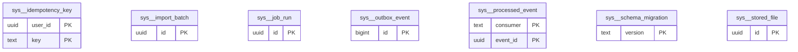

# Schema `sys`

> Platform plumbing: outbox, idempotency, files, imports, jobs

Generated from the live database by `db/tools/gen_docs.py` — do not edit by hand.

**Tables:** 7

## Entity-relationship diagram

Convention FKs to `core.organisation`, `core.campus`, `sys.stored_file` and `wf.approval_request` are omitted from the diagram (see table details).

## Tables

- [`sys.idempotency_key`](#sysidempotencykey) — Stored responses for Idempotency-Key requests (payments, attendance sync, billing runs). [Idempotency-Key header for POSTs (payments, attendance sync)]
- [`sys.import_batch`](#sysimportbatch) — Excel/CSV import with dry-run validation report before commit. [CORE-09 import with validation preview]
- [`sys.job_run`](#sysjobrun) — User-visible background job (exports, PDF batches, billing runs) with progress and result file. [user-visible async jobs (exports, PDF batches, billing runs)]
- [`sys.outbox_event`](#sysoutboxevent) — Transactional outbox: domain events written in the business transaction, relayed to the queue. [transactional outbox]
- [`sys.processed_event`](#sysprocessedevent) — Inbox de-duplication: event already handled by a consumer. [inbox de-duplication for idempotent subscribers]
- [`sys.schema_migration`](#sysschemamigration) — Applied database migrations (version + checksum).
- [`sys.stored_file`](#sysstoredfile) — Metadata of every file in object storage (uploads and generated PDFs) with virus-scan status. [every uploaded/generated file (documents, photos, PDFs)]

### `sys.idempotency_key`

Stored responses for Idempotency-Key requests (payments, attendance sync, billing runs). [Idempotency-Key header for POSTs (payments, attendance sync)]

| Column | Type | Null | Default | Description |
|---|---|---|---|---|
| `user_id` | uuid |  |  |  |
| `key` | text |  |  |  |
| `method_path` | text |  |  |  |
| `request_hash` | bytea |  |  |  |
| `status` | text |  |  |  |
| `response_code` | smallint | yes |  |  |
| `response_body` | jsonb | yes |  |  |
| `created_at` | timestamp with time zone |  | now() |  |
| `expires_at` | timestamp with time zone |  | (now() + '48:00:00'::interval) |  |

| Constraint | Kind | Definition |
|---|---|---|
| `idempotency_key_pkey` | PK | `PRIMARY KEY (user_id, key)` |
| `idempotency_key_status_check` | CHECK | `CHECK ((status = ANY (ARRAY['in_progress'::text, 'completed'::text])))` |

### `sys.import_batch`

Excel/CSV import with dry-run validation report before commit. [CORE-09 import with validation preview]

- Row-level security: `p_campus: core.campus_visible(org_id, campus_id)`

| Column | Type | Null | Default | Description |
|---|---|---|---|---|
| `id` | uuid |  | uuidv7() |  |
| `org_id` | uuid |  |  |  |
| `campus_id` | uuid | yes |  |  |
| `kind` | text |  |  | 'students','guardians','staff','fee_plans','opening_balances','marks' |
| `file_id` | uuid |  |  |  |
| `status` | text |  | 'uploaded'::text |  |
| `row_count` | integer | yes |  |  |
| `error_count` | integer | yes |  |  |
| `report` | jsonb | yes |  | per-row errors/warnings (dry-run report) |
| `committed_at` | timestamp with time zone | yes |  |  |
| `created_at` | timestamp with time zone |  | now() |  |
| `created_by` | uuid | yes | core.current_user_id() |  |
| `updated_at` | timestamp with time zone |  | now() |  |
| `updated_by` | uuid | yes |  |  |
| `row_version` | integer |  | 1 |  |

| Constraint | Kind | Definition |
|---|---|---|
| `import_batch_pkey` | PK | `PRIMARY KEY (id)` |
| `import_batch_campus_id_fkey` | FK | `FOREIGN KEY (campus_id) REFERENCES core.campus(id)` |
| `import_batch_file_id_fkey` | FK | `FOREIGN KEY (file_id) REFERENCES sys.stored_file(id)` |
| `import_batch_org_id_fkey` | FK | `FOREIGN KEY (org_id) REFERENCES core.organisation(id)` |
| `import_batch_status_check` | CHECK | `CHECK ((status = ANY (ARRAY['uploaded'::text, 'validating'::text, 'validated'::text, 'invalid'::text, 'committing'::text, 'committed'::text, 'failed'::text])))` |

**Indexes**

- `CREATE INDEX ix_import_batch_campus_id_fk ON sys.import_batch USING btree (campus_id)`

**Triggers**

- `trg_touch` — BEFORE UPDATE → `tg_touch()`

### `sys.job_run`

User-visible background job (exports, PDF batches, billing runs) with progress and result file. [user-visible async jobs (exports, PDF batches, billing runs)]

- Row-level security: `p_campus: core.campus_visible(org_id, campus_id)`

| Column | Type | Null | Default | Description |
|---|---|---|---|---|
| `id` | uuid |  | uuidv7() |  |
| `org_id` | uuid |  |  |  |
| `campus_id` | uuid | yes |  |  |
| `kind` | text |  |  |  |
| `requested_by` | uuid | yes |  |  |
| `status` | text |  | 'queued'::text |  |
| `progress` | smallint |  | 0 |  |
| `params` | jsonb |  | '{}'::jsonb |  |
| `result_file_id` | uuid | yes |  |  |
| `error` | text | yes |  |  |
| `created_at` | timestamp with time zone |  | now() |  |
| `finished_at` | timestamp with time zone | yes |  |  |

| Constraint | Kind | Definition |
|---|---|---|
| `job_run_pkey` | PK | `PRIMARY KEY (id)` |
| `job_run_campus_id_fkey` | FK | `FOREIGN KEY (campus_id) REFERENCES core.campus(id)` |
| `job_run_org_id_fkey` | FK | `FOREIGN KEY (org_id) REFERENCES core.organisation(id)` |
| `job_run_result_file_id_fkey` | FK | `FOREIGN KEY (result_file_id) REFERENCES sys.stored_file(id)` |
| `job_run_progress_check` | CHECK | `CHECK (((progress >= 0) AND (progress <= 100)))` |
| `job_run_status_check` | CHECK | `CHECK ((status = ANY (ARRAY['queued'::text, 'running'::text, 'succeeded'::text, 'failed'::text, 'cancelled'::text])))` |

**Indexes**

- `CREATE INDEX ix_job_run_campus_id_fk ON sys.job_run USING btree (campus_id)`

### `sys.outbox_event`

Transactional outbox: domain events written in the business transaction, relayed to the queue. [transactional outbox]

| Column | Type | Null | Default | Description |
|---|---|---|---|---|
| `id` | bigint |  |  |  |
| `event_id` | uuid |  | uuidv7() |  |
| `org_id` | uuid |  |  |  |
| `module` | text |  |  |  |
| `event_type` | text |  |  | 'att.student_marked_absent.v1' |
| `aggregate_type` | text |  |  |  |
| `aggregate_id` | text |  |  |  |
| `payload` | jsonb |  |  |  |
| `occurred_at` | timestamp with time zone |  | now() |  |
| `published_at` | timestamp with time zone | yes |  |  |
| `attempts` | smallint |  | 0 |  |
| `last_error` | text | yes |  |  |

| Constraint | Kind | Definition |
|---|---|---|
| `outbox_event_pkey` | PK | `PRIMARY KEY (id)` |
| `outbox_event_event_id_key` | UNIQUE | `UNIQUE (event_id)` |

**Indexes**

- `CREATE INDEX ix_outbox_unpublished ON sys.outbox_event USING btree (id) WHERE (published_at IS NULL)`

### `sys.processed_event`

Inbox de-duplication: event already handled by a consumer. [inbox de-duplication for idempotent subscribers]

| Column | Type | Null | Default | Description |
|---|---|---|---|---|
| `consumer` | text |  |  | 'com.on_student_absent' |
| `event_id` | uuid |  |  |  |
| `processed_at` | timestamp with time zone |  | now() |  |

| Constraint | Kind | Definition |
|---|---|---|
| `processed_event_pkey` | PK | `PRIMARY KEY (consumer, event_id)` |

### `sys.schema_migration`

Applied database migrations (version + checksum).

| Column | Type | Null | Default | Description |
|---|---|---|---|---|
| `version` | text |  |  |  |
| `checksum` | text |  |  |  |
| `applied_at` | timestamp with time zone |  | now() |  |

| Constraint | Kind | Definition |
|---|---|---|
| `schema_migration_pkey` | PK | `PRIMARY KEY (version)` |

### `sys.stored_file`

Metadata of every file in object storage (uploads and generated PDFs) with virus-scan status. [every uploaded/generated file (documents, photos, PDFs)]

- Row-level security: `p_campus: core.campus_visible(org_id, campus_id)`

| Column | Type | Null | Default | Description |
|---|---|---|---|---|
| `id` | uuid |  | uuidv7() |  |
| `org_id` | uuid |  |  |  |
| `campus_id` | uuid | yes |  |  |
| `bucket` | text |  |  |  |
| `object_key` | text |  |  | '{org}/{module}/{yyyy}/{mm}/{uuid}' (no PII in keys) |
| `original_name` | text | yes |  |  |
| `mime_type` | text |  |  |  |
| `size_bytes` | bigint |  |  |  |
| `sha256` | bytea | yes |  |  |
| `purpose` | text |  |  | 'student_photo','student_document','report_card','receipt',... |
| `classification` | text |  | 'internal'::text |  |
| `scan_status` | text |  | 'pending'::text |  |
| `uploaded_by` | uuid | yes |  |  |
| `created_at` | timestamp with time zone |  | now() |  |
| `deleted_at` | timestamp with time zone | yes |  |  |

| Constraint | Kind | Definition |
|---|---|---|
| `stored_file_pkey` | PK | `PRIMARY KEY (id)` |
| `stored_file_bucket_object_key_key` | UNIQUE | `UNIQUE (bucket, object_key)` |
| `stored_file_campus_id_fkey` | FK | `FOREIGN KEY (campus_id) REFERENCES core.campus(id)` |
| `stored_file_org_id_fkey` | FK | `FOREIGN KEY (org_id) REFERENCES core.organisation(id)` |
| `stored_file_classification_check` | CHECK | `CHECK ((classification = ANY (ARRAY['public'::text, 'internal'::text, 'confidential'::text, 'restricted'::text])))` |
| `stored_file_scan_status_check` | CHECK | `CHECK ((scan_status = ANY (ARRAY['pending'::text, 'clean'::text, 'infected'::text, 'failed'::text, 'skipped'::text])))` |
| `stored_file_size_bytes_check` | CHECK | `CHECK ((size_bytes >= 0))` |

**Indexes**

- `CREATE INDEX ix_stored_file_campus_id_fk ON sys.stored_file USING btree (campus_id)`

