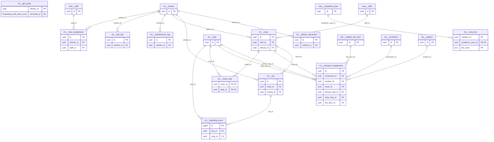

# Schema `trn`

> TRN: vehicles, routes, stops, transport assignment, GPS

Generated from the live database by `db/tools/gen_docs.py` — do not edit by hand.

**Tables:** 13

## Entity-relationship diagram

Convention FKs to `core.organisation`, `core.campus`, `sys.stored_file` and `wf.approval_request` are omitted from the diagram (see table details).

## Tables

- [`trn.boarding_event`](#trnboardingevent) — Boarding/alighting scan with parent notification. [TRN-05 (P3) RFID/QR boarding & alighting]
- [`trn.crew_assignment`](#trncrewassignment) — Driver/helper assigned to a vehicle. [driver / helper]
- [`trn.fuel_log`](#trnfuellog) — Fuel fill-up record. [TRN-06 (P3)]
- [`trn.gps_ping`](#trngpsping) — GPS position of a vehicle - daily partitions. [TRN-04 (P3) high-volume, daily partitions]
- [`trn.maintenance_log`](#trnmaintenancelog) — Vehicle service/repair record.
- [`trn.route`](#trnroute) — Bus route per campus/shift.
- [`trn.route_stop`](#trnroutestop) — Ordered stop on a route with times.
- [`trn.stop`](#trnstop) — Pick-up/drop stop with fee zone.
- [`trn.transport_assignment`](#trntransportassignment) — Student assigned to route and stop; no overlapping assignments. [TRN-02 student -> route/stop]
- [`trn.trip`](#trntrip) — One run of a route on a date. [one run of a route (morning pickup / afternoon drop)]
- [`trn.vehicle`](#trnvehicle) — School vehicle with capacity and devices. [TRN-01]
- [`trn.vehicle_document`](#trnvehicledocument) — Vehicle paper (fitness, insurance, tax token) with expiry. [fitness / insurance / tax-token / route permit expiry alerts]
- [`trn.zone_fee`](#trnzonefee) — Monthly transport fee per zone and year. [route/zone-based fee amounts]

### `trn.boarding_event`

Boarding/alighting scan with parent notification. [TRN-05 (P3) RFID/QR boarding & alighting]

| Column | Type | Null | Default | Description |
|---|---|---|---|---|
| `id` | bigint |  |  |  |
| `trip_id` | uuid |  |  |  |
| `student_id` | uuid |  |  |  |
| `stop_id` | uuid | yes |  |  |
| `event` | text |  |  |  |
| `at` | timestamp with time zone |  |  |  |
| `source` | text |  |  |  |
| `notified_at` | timestamp with time zone | yes |  |  |

| Constraint | Kind | Definition |
|---|---|---|
| `boarding_event_pkey` | PK | `PRIMARY KEY (id)` |
| `boarding_event_stop_id_fkey` | FK | `FOREIGN KEY (stop_id) REFERENCES trn.stop(id)` |
| `boarding_event_trip_id_fkey` | FK | `FOREIGN KEY (trip_id) REFERENCES trn.trip(id)` |
| `boarding_event_event_check` | CHECK | `CHECK ((event = ANY (ARRAY['boarded'::text, 'alighted'::text])))` |
| `boarding_event_source_check` | CHECK | `CHECK ((source = ANY (ARRAY['rfid'::text, 'qr'::text, 'manual'::text])))` |

**Indexes**

- `CREATE INDEX ix_boarding_event_stop_id_fk ON trn.boarding_event USING btree (stop_id)`
- `CREATE INDEX ix_boarding_trip ON trn.boarding_event USING btree (trip_id, student_id)`

### `trn.crew_assignment`

Driver/helper assigned to a vehicle. [driver / helper]

| Column | Type | Null | Default | Description |
|---|---|---|---|---|
| `id` | uuid |  | uuidv7() |  |
| `vehicle_id` | uuid |  |  |  |
| `staff_id` | uuid |  |  |  |
| `role` | text |  |  |  |
| `valid_from` | date |  |  |  |
| `valid_to` | date | yes |  |  |
| `licence_no` | text | yes |  |  |
| `licence_expires_on` | date | yes |  |  |

| Constraint | Kind | Definition |
|---|---|---|
| `crew_assignment_pkey` | PK | `PRIMARY KEY (id)` |
| `crew_assignment_staff_id_fkey` | FK | `FOREIGN KEY (staff_id) REFERENCES hrm.staff(id)` |
| `crew_assignment_vehicle_id_fkey` | FK | `FOREIGN KEY (vehicle_id) REFERENCES trn.vehicle(id)` |
| `crew_assignment_role_check` | CHECK | `CHECK ((role = ANY (ARRAY['driver'::text, 'helper'::text, 'attendant'::text])))` |

**Indexes**

- `CREATE INDEX ix_crew_assignment_staff_id_fk ON trn.crew_assignment USING btree (staff_id)`
- `CREATE INDEX ix_crew_assignment_vehicle_id_fk ON trn.crew_assignment USING btree (vehicle_id)`

### `trn.fuel_log`

Fuel fill-up record. [TRN-06 (P3)]

| Column | Type | Null | Default | Description |
|---|---|---|---|---|
| `id` | uuid |  | uuidv7() |  |
| `vehicle_id` | uuid |  |  |  |
| `filled_on` | date |  |  |  |
| `litres` | numeric(7,2) |  |  |  |
| `cost_paisa` | core.paisa_nn |  |  |  |
| `odometer_km` | integer | yes |  |  |

| Constraint | Kind | Definition |
|---|---|---|
| `fuel_log_pkey` | PK | `PRIMARY KEY (id)` |
| `fuel_log_vehicle_id_fkey` | FK | `FOREIGN KEY (vehicle_id) REFERENCES trn.vehicle(id)` |
| `fuel_log_litres_check` | CHECK | `CHECK ((litres > (0)::numeric))` |

**Indexes**

- `CREATE INDEX ix_fuel_log_vehicle_id_fk ON trn.fuel_log USING btree (vehicle_id)`

### `trn.gps_ping`

GPS position of a vehicle - daily partitions. [TRN-04 (P3) high-volume, daily partitions]

- Partitioned `RANGE (recorded_at)` (16 partitions incl. default)

| Column | Type | Null | Default | Description |
|---|---|---|---|---|
| `vehicle_id` | uuid |  |  |  |
| `recorded_at` | timestamp with time zone |  |  |  |
| `lat` | numeric(9,6) |  |  |  |
| `lng` | numeric(9,6) |  |  |  |
| `speed_kmh` | numeric(5,1) | yes |  |  |
| `heading` | smallint | yes |  |  |

| Constraint | Kind | Definition |
|---|---|---|
| `gps_ping_pkey` | PK | `PRIMARY KEY (vehicle_id, recorded_at)` |

### `trn.maintenance_log`

Vehicle service/repair record.

| Column | Type | Null | Default | Description |
|---|---|---|---|---|
| `id` | uuid |  | uuidv7() |  |
| `vehicle_id` | uuid |  |  |  |
| `kind` | text |  |  |  |
| `description` | text |  |  |  |
| `started_on` | date |  |  |  |
| `completed_on` | date | yes |  |  |
| `cost_paisa` | core.paisa_nn | yes |  |  |
| `odometer_km` | integer | yes |  |  |

| Constraint | Kind | Definition |
|---|---|---|
| `maintenance_log_pkey` | PK | `PRIMARY KEY (id)` |
| `maintenance_log_vehicle_id_fkey` | FK | `FOREIGN KEY (vehicle_id) REFERENCES trn.vehicle(id)` |
| `maintenance_log_kind_check` | CHECK | `CHECK ((kind = ANY (ARRAY['service'::text, 'repair'::text, 'inspection'::text])))` |

**Indexes**

- `CREATE INDEX ix_maintenance_log_vehicle_id_fk ON trn.maintenance_log USING btree (vehicle_id)`

### `trn.route`

Bus route per campus/shift.

- Row-level security: `p_campus: core.campus_visible(org_id, campus_id)`

| Column | Type | Null | Default | Description |
|---|---|---|---|---|
| `id` | uuid |  | uuidv7() |  |
| `org_id` | uuid |  |  |  |
| `campus_id` | uuid |  |  |  |
| `code` | text |  |  |  |
| `name` | text |  |  |  |
| `shift_id` | uuid | yes |  |  |
| `vehicle_id` | uuid | yes |  |  |
| `is_active` | boolean |  | true |  |
| `created_at` | timestamp with time zone |  | now() |  |
| `created_by` | uuid | yes | core.current_user_id() |  |
| `updated_at` | timestamp with time zone |  | now() |  |
| `updated_by` | uuid | yes |  |  |
| `row_version` | integer |  | 1 |  |

| Constraint | Kind | Definition |
|---|---|---|
| `route_pkey` | PK | `PRIMARY KEY (id)` |
| `route_campus_id_code_key` | UNIQUE | `UNIQUE (campus_id, code)` |
| `route_campus_id_fkey` | FK | `FOREIGN KEY (campus_id) REFERENCES core.campus(id)` |
| `route_org_id_fkey` | FK | `FOREIGN KEY (org_id) REFERENCES core.organisation(id)` |
| `route_shift_id_fkey` | FK | `FOREIGN KEY (shift_id) REFERENCES core.shift(id)` |
| `route_vehicle_id_fkey` | FK | `FOREIGN KEY (vehicle_id) REFERENCES trn.vehicle(id)` |

**Indexes**

- `CREATE INDEX ix_route_shift_id_fk ON trn.route USING btree (shift_id)`
- `CREATE INDEX ix_route_vehicle_id_fk ON trn.route USING btree (vehicle_id)`

**Triggers**

- `trg_touch` — BEFORE UPDATE → `tg_touch()`

### `trn.route_stop`

Ordered stop on a route with times.

| Column | Type | Null | Default | Description |
|---|---|---|---|---|
| `route_id` | uuid |  |  |  |
| `stop_id` | uuid |  |  |  |
| `seq` | smallint |  |  |  |
| `pickup_time` | time without time zone | yes |  |  |
| `drop_time` | time without time zone | yes |  |  |

| Constraint | Kind | Definition |
|---|---|---|
| `route_stop_pkey` | PK | `PRIMARY KEY (route_id, stop_id)` |
| `route_stop_route_id_seq_key` | UNIQUE | `UNIQUE (route_id, seq)` |
| `route_stop_route_id_fkey` | FK | `FOREIGN KEY (route_id) REFERENCES trn.route(id) ON DELETE CASCADE` |
| `route_stop_stop_id_fkey` | FK | `FOREIGN KEY (stop_id) REFERENCES trn.stop(id)` |

**Indexes**

- `CREATE INDEX ix_route_stop_stop_id_fk ON trn.route_stop USING btree (stop_id)`

### `trn.stop`

Pick-up/drop stop with fee zone.

- Row-level security: `p_org: core.org_visible(org_id)`

| Column | Type | Null | Default | Description |
|---|---|---|---|---|
| `id` | uuid |  | uuidv7() |  |
| `org_id` | uuid |  |  |  |
| `name` | text |  |  |  |
| `area` | text | yes |  |  |
| `lat` | numeric(9,6) | yes |  |  |
| `lng` | numeric(9,6) | yes |  |  |
| `fee_zone` | text | yes |  | zone-based fee (TRN-03) |

| Constraint | Kind | Definition |
|---|---|---|
| `stop_pkey` | PK | `PRIMARY KEY (id)` |
| `stop_org_id_fkey` | FK | `FOREIGN KEY (org_id) REFERENCES core.organisation(id)` |

### `trn.transport_assignment`

Student assigned to route and stop; no overlapping assignments. [TRN-02 student -> route/stop]

- Row-level security: `p_campus: core.campus_visible(org_id, campus_id)`

| Column | Type | Null | Default | Description |
|---|---|---|---|---|
| `id` | uuid |  | uuidv7() |  |
| `org_id` | uuid |  |  |  |
| `campus_id` | uuid |  |  |  |
| `enrolment_id` | uuid |  |  |  |
| `student_id` | uuid |  |  |  |
| `route_id` | uuid |  |  |  |
| `pickup_stop_id` | uuid |  |  |  |
| `drop_stop_id` | uuid | yes |  |  |
| `direction` | text |  | 'both'::text |  |
| `valid_from` | date |  |  |  |
| `valid_to` | date | yes |  |  |
| `fee_item_id` | uuid | yes |  | TRN-03 fee integration |
| `created_at` | timestamp with time zone |  | now() |  |
| `created_by` | uuid | yes | core.current_user_id() |  |
| `updated_at` | timestamp with time zone |  | now() |  |
| `updated_by` | uuid | yes |  |  |
| `row_version` | integer |  | 1 |  |

| Constraint | Kind | Definition |
|---|---|---|
| `transport_assignment_pkey` | PK | `PRIMARY KEY (id)` |
| `transport_assignment_campus_id_fkey` | FK | `FOREIGN KEY (campus_id) REFERENCES core.campus(id)` |
| `transport_assignment_drop_stop_id_fkey` | FK | `FOREIGN KEY (drop_stop_id) REFERENCES trn.stop(id)` |
| `transport_assignment_enrolment_id_fkey` | FK | `FOREIGN KEY (enrolment_id) REFERENCES sis.enrolment(id)` |
| `transport_assignment_fee_item_id_fkey` | FK | `FOREIGN KEY (fee_item_id) REFERENCES fee.student_fee_item(id)` |
| `transport_assignment_org_id_fkey` | FK | `FOREIGN KEY (org_id) REFERENCES core.organisation(id)` |
| `transport_assignment_pickup_stop_id_fkey` | FK | `FOREIGN KEY (pickup_stop_id) REFERENCES trn.stop(id)` |
| `transport_assignment_route_id_fkey` | FK | `FOREIGN KEY (route_id) REFERENCES trn.route(id)` |
| `transport_assignment_student_id_fkey` | FK | `FOREIGN KEY (student_id) REFERENCES sis.student(id)` |
| `transport_assignment_student_id_daterange_excl` | EXCLUDE | `EXCLUDE USING gist (student_id WITH =, daterange(valid_from, COALESCE(valid_to, 'infinity'::date), '[]'::text) WITH &&)` |
| `transport_assignment_check` | CHECK | `CHECK (((valid_to IS NULL) OR (valid_to >= valid_from)))` |
| `transport_assignment_direction_check` | CHECK | `CHECK ((direction = ANY (ARRAY['both'::text, 'pickup_only'::text, 'drop_only'::text])))` |

**Indexes**

- `CREATE INDEX ix_transport_assignment_campus_id_fk ON trn.transport_assignment USING btree (campus_id)`
- `CREATE INDEX ix_transport_assignment_drop_stop_id_fk ON trn.transport_assignment USING btree (drop_stop_id)`
- `CREATE INDEX ix_transport_assignment_enrolment_id_fk ON trn.transport_assignment USING btree (enrolment_id)`
- `CREATE INDEX ix_transport_assignment_fee_item_id_fk ON trn.transport_assignment USING btree (fee_item_id)`
- `CREATE INDEX ix_transport_assignment_pickup_stop_id_fk ON trn.transport_assignment USING btree (pickup_stop_id)`
- `CREATE INDEX ix_transport_route ON trn.transport_assignment USING btree (route_id) WHERE (valid_to IS NULL)`

**Triggers**

- `trg_touch` — BEFORE UPDATE → `tg_touch()`

### `trn.trip`

One run of a route on a date. [one run of a route (morning pickup / afternoon drop)]

- Row-level security: `p_campus: core.campus_visible(org_id, campus_id)`

| Column | Type | Null | Default | Description |
|---|---|---|---|---|
| `id` | uuid |  | uuidv7() |  |
| `org_id` | uuid |  |  |  |
| `campus_id` | uuid |  |  |  |
| `route_id` | uuid |  |  |  |
| `vehicle_id` | uuid |  |  |  |
| `trip_date` | date |  |  |  |
| `direction` | text |  |  |  |
| `started_at` | timestamp with time zone | yes |  |  |
| `ended_at` | timestamp with time zone | yes |  |  |

| Constraint | Kind | Definition |
|---|---|---|
| `trip_pkey` | PK | `PRIMARY KEY (id)` |
| `trip_route_id_trip_date_direction_key` | UNIQUE | `UNIQUE (route_id, trip_date, direction)` |
| `trip_campus_id_fkey` | FK | `FOREIGN KEY (campus_id) REFERENCES core.campus(id)` |
| `trip_org_id_fkey` | FK | `FOREIGN KEY (org_id) REFERENCES core.organisation(id)` |
| `trip_route_id_fkey` | FK | `FOREIGN KEY (route_id) REFERENCES trn.route(id)` |
| `trip_vehicle_id_fkey` | FK | `FOREIGN KEY (vehicle_id) REFERENCES trn.vehicle(id)` |
| `trip_direction_check` | CHECK | `CHECK ((direction = ANY (ARRAY['pickup'::text, 'drop'::text])))` |

**Indexes**

- `CREATE INDEX ix_trip_campus_id_fk ON trn.trip USING btree (campus_id)`
- `CREATE INDEX ix_trip_vehicle_id_fk ON trn.trip USING btree (vehicle_id)`

### `trn.vehicle`

School vehicle with capacity and devices. [TRN-01]

- Row-level security: `p_campus: core.campus_visible(org_id, campus_id)`

| Column | Type | Null | Default | Description |
|---|---|---|---|---|
| `id` | uuid |  | uuidv7() |  |
| `org_id` | uuid |  |  |  |
| `campus_id` | uuid |  |  |  |
| `reg_no` | text |  |  | 'DHAKA METRO-JA-11-2233' |
| `kind` | text |  |  |  |
| `capacity` | smallint |  |  |  |
| `ownership` | text |  | 'own'::text |  |
| `gps_device_id` | text | yes |  |  |
| `rfid_reader_id` | uuid | yes |  | att.device of kind bus_reader |
| `is_active` | boolean |  | true |  |
| `created_at` | timestamp with time zone |  | now() |  |
| `created_by` | uuid | yes | core.current_user_id() |  |
| `updated_at` | timestamp with time zone |  | now() |  |
| `updated_by` | uuid | yes |  |  |
| `row_version` | integer |  | 1 |  |

| Constraint | Kind | Definition |
|---|---|---|
| `vehicle_pkey` | PK | `PRIMARY KEY (id)` |
| `vehicle_org_id_reg_no_key` | UNIQUE | `UNIQUE (org_id, reg_no)` |
| `vehicle_campus_id_fkey` | FK | `FOREIGN KEY (campus_id) REFERENCES core.campus(id)` |
| `vehicle_org_id_fkey` | FK | `FOREIGN KEY (org_id) REFERENCES core.organisation(id)` |
| `vehicle_capacity_check` | CHECK | `CHECK ((capacity > 0))` |
| `vehicle_kind_check` | CHECK | `CHECK ((kind = ANY (ARRAY['bus'::text, 'minibus'::text, 'microbus'::text, 'van'::text, 'car'::text])))` |
| `vehicle_ownership_check` | CHECK | `CHECK ((ownership = ANY (ARRAY['own'::text, 'leased'::text, 'contracted'::text])))` |

**Indexes**

- `CREATE INDEX ix_vehicle_campus_id_fk ON trn.vehicle USING btree (campus_id)`

**Triggers**

- `trg_touch` — BEFORE UPDATE → `tg_touch()`

### `trn.vehicle_document`

Vehicle paper (fitness, insurance, tax token) with expiry. [fitness / insurance / tax-token / route permit expiry alerts]

| Column | Type | Null | Default | Description |
|---|---|---|---|---|
| `id` | uuid |  | uuidv7() |  |
| `vehicle_id` | uuid |  |  |  |
| `doc_type` | text |  |  |  |
| `doc_no` | text | yes |  |  |
| `expires_on` | date |  |  |  |
| `file_id` | uuid | yes |  |  |

| Constraint | Kind | Definition |
|---|---|---|
| `vehicle_document_pkey` | PK | `PRIMARY KEY (id)` |
| `vehicle_document_file_id_fkey` | FK | `FOREIGN KEY (file_id) REFERENCES sys.stored_file(id)` |
| `vehicle_document_vehicle_id_fkey` | FK | `FOREIGN KEY (vehicle_id) REFERENCES trn.vehicle(id) ON DELETE CASCADE` |
| `vehicle_document_doc_type_check` | CHECK | `CHECK ((doc_type = ANY (ARRAY['fitness'::text, 'insurance'::text, 'tax_token'::text, 'route_permit'::text, 'registration'::text])))` |

**Indexes**

- `CREATE INDEX ix_vehicle_doc_expiry ON trn.vehicle_document USING btree (expires_on)`
- `CREATE INDEX ix_vehicle_document_vehicle_id_fk ON trn.vehicle_document USING btree (vehicle_id)`

### `trn.zone_fee`

Monthly transport fee per zone and year. [route/zone-based fee amounts]

- Row-level security: `p_campus: core.campus_visible(org_id, campus_id)`

| Column | Type | Null | Default | Description |
|---|---|---|---|---|
| `org_id` | uuid |  |  |  |
| `campus_id` | uuid |  |  |  |
| `academic_year_id` | uuid |  |  |  |
| `fee_zone` | text |  |  |  |
| `monthly_paisa` | core.paisa_nn |  |  |  |

| Constraint | Kind | Definition |
|---|---|---|
| `zone_fee_pkey` | PK | `PRIMARY KEY (campus_id, academic_year_id, fee_zone)` |
| `zone_fee_academic_year_id_fkey` | FK | `FOREIGN KEY (academic_year_id) REFERENCES core.academic_year(id)` |
| `zone_fee_campus_id_fkey` | FK | `FOREIGN KEY (campus_id) REFERENCES core.campus(id)` |
| `zone_fee_org_id_fkey` | FK | `FOREIGN KEY (org_id) REFERENCES core.organisation(id)` |

**Indexes**

- `CREATE INDEX ix_zone_fee_academic_year_id_fk ON trn.zone_fee USING btree (academic_year_id)`

