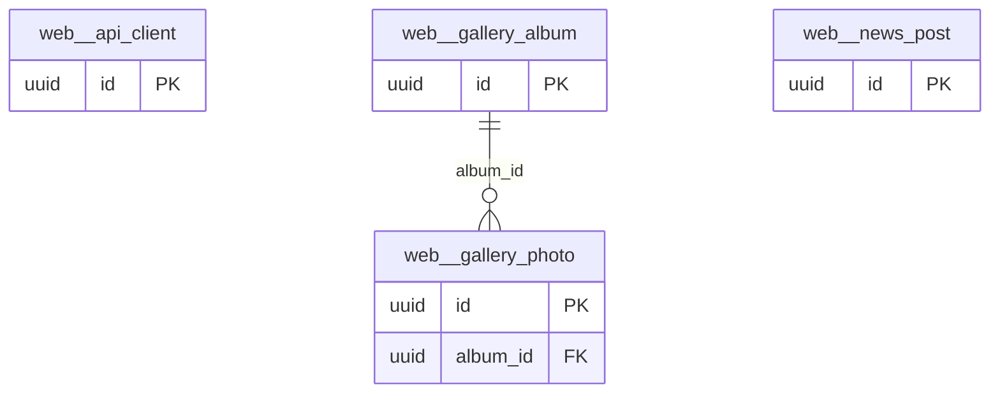

# Schema `web`

> WEB: public website CMS data and API clients

Generated from the live database by `db/tools/gen_docs.py` — do not edit by hand.

**Tables:** 4

## Entity-relationship diagram

Convention FKs to `core.organisation`, `core.campus`, `sys.stored_file` and `wf.approval_request` are omitted from the diagram (see table details).

## Tables

- [`web.api_client`](#webapiclient) — API key for the public website and partners. [public website / partners (API key + CDN)]
- [`web.gallery_album`](#webgalleryalbum) — Photo album for the public website.
- [`web.gallery_photo`](#webgalleryphoto) — Photo with student-consent flags.
- [`web.news_post`](#webnewspost) — News post for the public website.

### `web.api_client`

API key for the public website and partners. [public website / partners (API key + CDN)]

| Column | Type | Null | Default | Description |
|---|---|---|---|---|
| `id` | uuid |  | uuidv7() |  |
| `org_id` | uuid |  |  |  |
| `name` | text |  |  |  |
| `key_prefix` | text |  |  | shown in UI |
| `key_hash` | bytea |  |  | sha256(secret) |
| `scopes` | text[] |  |  | '{public.notices,public.events,admission.enquiry}' |
| `allowed_origins` | text[] |  | '{}'::text[] |  |
| `rate_limit_per_min` | integer |  | 600 |  |
| `revoked_at` | timestamp with time zone | yes |  |  |

| Constraint | Kind | Definition |
|---|---|---|
| `api_client_pkey` | PK | `PRIMARY KEY (id)` |
| `api_client_key_prefix_key` | UNIQUE | `UNIQUE (key_prefix)` |
| `api_client_org_id_fkey` | FK | `FOREIGN KEY (org_id) REFERENCES core.organisation(id)` |

### `web.gallery_album`

Photo album for the public website.

- Row-level security: `p_campus: core.campus_visible(org_id, campus_id)`

| Column | Type | Null | Default | Description |
|---|---|---|---|---|
| `id` | uuid |  | uuidv7() |  |
| `org_id` | uuid |  |  |  |
| `campus_id` | uuid | yes |  |  |
| `title_en` | text |  |  |  |
| `event_date` | date | yes |  |  |
| `published_at` | timestamp with time zone | yes |  |  |
| `created_at` | timestamp with time zone |  | now() |  |
| `created_by` | uuid | yes | core.current_user_id() |  |
| `updated_at` | timestamp with time zone |  | now() |  |
| `updated_by` | uuid | yes |  |  |
| `row_version` | integer |  | 1 |  |

| Constraint | Kind | Definition |
|---|---|---|
| `gallery_album_pkey` | PK | `PRIMARY KEY (id)` |
| `gallery_album_campus_id_fkey` | FK | `FOREIGN KEY (campus_id) REFERENCES core.campus(id)` |
| `gallery_album_org_id_fkey` | FK | `FOREIGN KEY (org_id) REFERENCES core.organisation(id)` |

**Indexes**

- `CREATE INDEX ix_gallery_album_campus_id_fk ON web.gallery_album USING btree (campus_id)`

**Triggers**

- `trg_touch` — BEFORE UPDATE → `tg_touch()`

### `web.gallery_photo`

Photo with student-consent flags.

| Column | Type | Null | Default | Description |
|---|---|---|---|---|
| `id` | uuid |  | uuidv7() |  |
| `album_id` | uuid |  |  |  |
| `file_id` | uuid |  |  |  |
| `caption` | text | yes |  |  |
| `contains_students` | boolean |  | true |  |
| `consent_verified` | boolean |  | false | WEB-05 consent flags |
| `seq` | smallint |  | 0 |  |

| Constraint | Kind | Definition |
|---|---|---|
| `gallery_photo_pkey` | PK | `PRIMARY KEY (id)` |
| `gallery_photo_album_id_fkey` | FK | `FOREIGN KEY (album_id) REFERENCES web.gallery_album(id)` |

**Indexes**

- `CREATE INDEX ix_gallery_photo_album_id_fk ON web.gallery_photo USING btree (album_id)`

### `web.news_post`

News post for the public website.

- Row-level security: `p_campus: core.campus_visible(org_id, campus_id)`

| Column | Type | Null | Default | Description |
|---|---|---|---|---|
| `id` | uuid |  | uuidv7() |  |
| `org_id` | uuid |  |  |  |
| `campus_id` | uuid | yes |  |  |
| `slug` | text |  |  |  |
| `title_en` | text |  |  |  |
| `title_bn` | text | yes |  |  |
| `body_en` | text | yes |  |  |
| `body_bn` | text | yes |  |  |
| `cover_file_id` | uuid | yes |  |  |
| `published_at` | timestamp with time zone | yes |  |  |
| `seo` | jsonb |  | '{}'::jsonb |  |
| `created_at` | timestamp with time zone |  | now() |  |
| `created_by` | uuid | yes | core.current_user_id() |  |
| `updated_at` | timestamp with time zone |  | now() |  |
| `updated_by` | uuid | yes |  |  |
| `row_version` | integer |  | 1 |  |

| Constraint | Kind | Definition |
|---|---|---|
| `news_post_pkey` | PK | `PRIMARY KEY (id)` |
| `news_post_org_id_slug_key` | UNIQUE | `UNIQUE (org_id, slug)` |
| `news_post_campus_id_fkey` | FK | `FOREIGN KEY (campus_id) REFERENCES core.campus(id)` |
| `news_post_cover_file_id_fkey` | FK | `FOREIGN KEY (cover_file_id) REFERENCES sys.stored_file(id)` |
| `news_post_org_id_fkey` | FK | `FOREIGN KEY (org_id) REFERENCES core.organisation(id)` |

**Indexes**

- `CREATE INDEX ix_news_post_campus_id_fk ON web.news_post USING btree (campus_id)`

**Triggers**

- `trg_touch` — BEFORE UPDATE → `tg_touch()`

