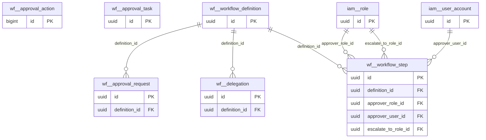

# Schema `wf`

> CORE: configurable multi-step approval workflows

Generated from the live database by `db/tools/gen_docs.py` — do not edit by hand.

**Tables:** 6

## Entity-relationship diagram

Convention FKs to `core.organisation`, `core.campus`, `sys.stored_file` and `wf.approval_request` are omitted from the diagram (see table details).

## Tables

- [`wf.approval_action`](#wfapprovalaction) — Append-only history of approval actions (approve/reject/return/delegate/escalate). [append-only history]
- [`wf.approval_request`](#wfapprovalrequest) — One approval instance for a business object (subject_type/subject_id).
- [`wf.approval_task`](#wfapprovaltask) — Approver inbox item for the current step. [materialised inbox per approver for the current step]
- [`wf.delegation`](#wfdelegation) — Temporary delegation of approvals from one user to another.
- [`wf.workflow_definition`](#wfworkflowdefinition) — Configurable approval workflow (leave, concession, refund, marks re-open, payroll, ...).
- [`wf.workflow_step`](#wfworkflowstep) — Ordered approval step with approver rule, condition and escalation timer.

### `wf.approval_action`

Append-only history of approval actions (approve/reject/return/delegate/escalate). [append-only history]

| Column | Type | Null | Default | Description |
|---|---|---|---|---|
| `id` | bigint |  |  |  |
| `request_id` | uuid |  |  |  |
| `step_no` | smallint |  |  |  |
| `actor_user_id` | uuid |  |  |  |
| `on_behalf_of` | uuid | yes |  | delegation |
| `action` | text |  |  |  |
| `comment` | text | yes |  |  |
| `acted_at` | timestamp with time zone |  | now() |  |

| Constraint | Kind | Definition |
|---|---|---|
| `approval_action_pkey` | PK | `PRIMARY KEY (id)` |
| `approval_action_request_id_fkey` | FK | `FOREIGN KEY (request_id) REFERENCES wf.approval_request(id)` |
| `approval_action_action_check` | CHECK | `CHECK ((action = ANY (ARRAY['submit'::text, 'approve'::text, 'reject'::text, 'return'::text, 'delegate'::text, 'escalate'::text, 'comment'::text, 'cancel'::text])))` |

### `wf.approval_request`

One approval instance for a business object (subject_type/subject_id).

- Row-level security: `p_campus: core.campus_visible(org_id, campus_id)`

| Column | Type | Null | Default | Description |
|---|---|---|---|---|
| `id` | uuid |  | uuidv7() |  |
| `org_id` | uuid |  |  |  |
| `campus_id` | uuid | yes |  |  |
| `definition_id` | uuid |  |  |  |
| `subject_module` | text |  |  | 'fee' |
| `subject_type` | text |  |  | 'student_concession' |
| `subject_id` | uuid |  |  |  |
| `summary` | text |  |  | shown in approver inbox |
| `payload` | jsonb |  | '{}'::jsonb | snapshot used for conditions (amount etc.) |
| `requested_by` | uuid |  |  |  |
| `status` | text |  | 'pending'::text |  |
| `current_step` | smallint |  | 1 |  |
| `due_at` | timestamp with time zone | yes |  | escalation timer |
| `decided_at` | timestamp with time zone | yes |  |  |
| `created_at` | timestamp with time zone |  | now() |  |
| `created_by` | uuid | yes | core.current_user_id() |  |
| `updated_at` | timestamp with time zone |  | now() |  |
| `updated_by` | uuid | yes |  |  |
| `row_version` | integer |  | 1 |  |

| Constraint | Kind | Definition |
|---|---|---|
| `approval_request_pkey` | PK | `PRIMARY KEY (id)` |
| `approval_request_campus_id_fkey` | FK | `FOREIGN KEY (campus_id) REFERENCES core.campus(id)` |
| `approval_request_definition_id_fkey` | FK | `FOREIGN KEY (definition_id) REFERENCES wf.workflow_definition(id)` |
| `approval_request_org_id_fkey` | FK | `FOREIGN KEY (org_id) REFERENCES core.organisation(id)` |
| `approval_request_status_check` | CHECK | `CHECK ((status = ANY (ARRAY['pending'::text, 'approved'::text, 'rejected'::text, 'returned'::text, 'cancelled'::text])))` |

**Indexes**

- `CREATE INDEX ix_approval_pending ON wf.approval_request USING btree (org_id, status, due_at) WHERE (status = 'pending'::text)`
- `CREATE INDEX ix_approval_request_campus_id_fk ON wf.approval_request USING btree (campus_id)`
- `CREATE INDEX ix_approval_request_definition_id_fk ON wf.approval_request USING btree (definition_id)`
- `CREATE INDEX ix_approval_subject ON wf.approval_request USING btree (subject_type, subject_id)`

**Triggers**

- `trg_audit` — AFTER INSERT UPDATE DELETE → `tg_row_audit()`
- `trg_touch` — BEFORE UPDATE → `tg_touch()`

### `wf.approval_task`

Approver inbox item for the current step. [materialised inbox per approver for the current step]

| Column | Type | Null | Default | Description |
|---|---|---|---|---|
| `id` | uuid |  | uuidv7() |  |
| `request_id` | uuid |  |  |  |
| `step_no` | smallint |  |  |  |
| `assignee_user_id` | uuid |  |  |  |
| `status` | text |  | 'open'::text |  |
| `created_at` | timestamp with time zone |  | now() |  |

| Constraint | Kind | Definition |
|---|---|---|
| `approval_task_pkey` | PK | `PRIMARY KEY (id)` |
| `approval_task_request_id_fkey` | FK | `FOREIGN KEY (request_id) REFERENCES wf.approval_request(id) ON DELETE CASCADE` |
| `approval_task_status_check` | CHECK | `CHECK ((status = ANY (ARRAY['open'::text, 'done'::text, 'skipped'::text, 'escalated'::text])))` |

**Indexes**

- `CREATE INDEX ix_approval_task_inbox ON wf.approval_task USING btree (assignee_user_id) WHERE (status = 'open'::text)`

### `wf.delegation`

Temporary delegation of approvals from one user to another.

| Column | Type | Null | Default | Description |
|---|---|---|---|---|
| `id` | uuid |  | uuidv7() |  |
| `from_user_id` | uuid |  |  |  |
| `to_user_id` | uuid |  |  |  |
| `definition_id` | uuid | yes |  | NULL = all workflows |
| `starts_on` | date |  |  |  |
| `ends_on` | date |  |  |  |

| Constraint | Kind | Definition |
|---|---|---|
| `delegation_pkey` | PK | `PRIMARY KEY (id)` |
| `delegation_definition_id_fkey` | FK | `FOREIGN KEY (definition_id) REFERENCES wf.workflow_definition(id)` |
| `delegation_check` | CHECK | `CHECK ((ends_on >= starts_on))` |

**Indexes**

- `CREATE INDEX ix_delegation_definition_id_fk ON wf.delegation USING btree (definition_id)`

### `wf.workflow_definition`

Configurable approval workflow (leave, concession, refund, marks re-open, payroll, ...).

- Row-level security: `p_org: core.org_visible(org_id)`

| Column | Type | Null | Default | Description |
|---|---|---|---|---|
| `id` | uuid |  | uuidv7() |  |
| `org_id` | uuid |  |  |  |
| `code` | text |  |  | 'student_leave','staff_leave','fee_concession','fee_waiver', |
| `name_en` | text |  |  |  |
| `version` | integer |  | 1 |  |
| `is_active` | boolean |  | true |  |
| `created_at` | timestamp with time zone |  | now() |  |
| `created_by` | uuid | yes | core.current_user_id() |  |
| `updated_at` | timestamp with time zone |  | now() |  |
| `updated_by` | uuid | yes |  |  |
| `row_version` | integer |  | 1 |  |

| Constraint | Kind | Definition |
|---|---|---|
| `workflow_definition_pkey` | PK | `PRIMARY KEY (id)` |
| `workflow_definition_org_id_code_version_key` | UNIQUE | `UNIQUE (org_id, code, version)` |
| `workflow_definition_org_id_fkey` | FK | `FOREIGN KEY (org_id) REFERENCES core.organisation(id)` |

**Triggers**

- `trg_touch` — BEFORE UPDATE → `tg_touch()`

### `wf.workflow_step`

Ordered approval step with approver rule, condition and escalation timer.

| Column | Type | Null | Default | Description |
|---|---|---|---|---|
| `id` | uuid |  | uuidv7() |  |
| `definition_id` | uuid |  |  |  |
| `step_no` | smallint |  |  |  |
| `name_en` | text |  |  |  |
| `approver_type` | text |  |  |  |
| `approver_role_id` | uuid | yes |  |  |
| `approver_user_id` | uuid | yes |  |  |
| `condition` | jsonb | yes |  | e.g. {"amount_paisa": {"gt": 500000}} => step applies |
| `min_approvals` | smallint |  | 1 |  |
| `escalate_after` | interval | yes |  | e.g. '48 hours' |
| `escalate_to_role_id` | uuid | yes |  |  |

| Constraint | Kind | Definition |
|---|---|---|
| `workflow_step_pkey` | PK | `PRIMARY KEY (id)` |
| `workflow_step_definition_id_step_no_key` | UNIQUE | `UNIQUE (definition_id, step_no)` |
| `workflow_step_approver_role_id_fkey` | FK | `FOREIGN KEY (approver_role_id) REFERENCES iam.role(id)` |
| `workflow_step_approver_user_id_fkey` | FK | `FOREIGN KEY (approver_user_id) REFERENCES iam.user_account(id)` |
| `workflow_step_definition_id_fkey` | FK | `FOREIGN KEY (definition_id) REFERENCES wf.workflow_definition(id) ON DELETE CASCADE` |
| `workflow_step_escalate_to_role_id_fkey` | FK | `FOREIGN KEY (escalate_to_role_id) REFERENCES iam.role(id)` |
| `workflow_step_approver_type_check` | CHECK | `CHECK ((approver_type = ANY (ARRAY['role'::text, 'user'::text, 'class_teacher'::text, 'head_of_section'::text, 'reporting_manager'::text, 'campus_head'::text])))` |

**Indexes**

- `CREATE INDEX ix_workflow_step_approver_role_id_fk ON wf.workflow_step USING btree (approver_role_id)`
- `CREATE INDEX ix_workflow_step_approver_user_id_fk ON wf.workflow_step USING btree (approver_user_id)`
- `CREATE INDEX ix_workflow_step_escalate_to_role_id_fk ON wf.workflow_step USING btree (escalate_to_role_id)`

